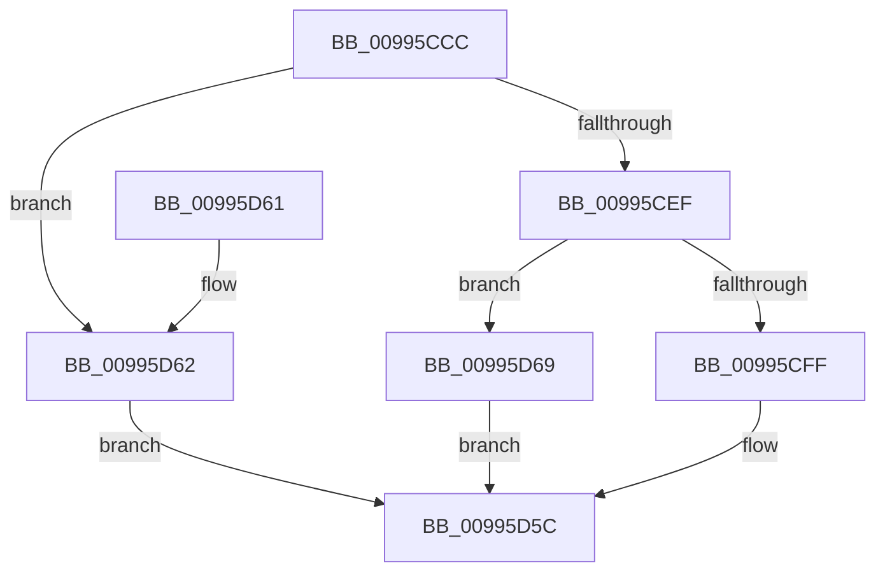

# PnpGetMappedPropertyLocalesDispatch

- RVA: `0x00995CCC`–`0x00995D70` (길이 `164` bytes)
- VA: `0x0000000140995CCC`
- 실행 섹션: `PAGE`
- PDB 이름 있음: `예`; PDB Function 태그: `아니요`
- unwind 정보 RVA: `0x000991B8`
- 디코드: `39`개 명령, `164/164` bytes 표시
- 미해석 바이트: `0` (있으면 어셈블리에 `.byte`로 보존)

> 이 문서는 커널 이미지의 기계어와 PDB 기호를 분석해 생성했습니다. 4번과 5번은 함수 원형과 자료형을 바이너리 사용 방식에서 추정한 C 해석이며 원본 소스 복구 결과는 아닙니다.

## 1. Dependencies

- 직접 호출 지점: **1**; 고유 호출 대상: **1**
- 직접 호출자로 확인된 함수: **1**
- RIP 상대 이미지 참조: **0**

### Outgoing calls
- `0x00995D57` → [guard_dispatch_icall](../../text/6B/guard_dispatch_icall_function_006BAAD0.md) (function, `0x006BAAD0`)

### Direct callers
- [PnpGetObjectPropertyLocalesWorker](PnpGetObjectPropertyLocalesWorker_function_00995B8C.md) at `0x00995C1F`

### Static image references
- 디코드된 RIP-relative 메모리 참조가 없습니다.

## 2. Other-region calls and transfers

- 다른 실행 섹션으로 향하는 call: **1**
  - `0x00995D57` → [guard_dispatch_icall](../../text/6B/guard_dispatch_icall_function_006BAAD0.md) (`PAGE` → `.text`)
- 별도 외부 분기/꼬리 이동을 확인하지 못했습니다.

## 3. Assembly (complete function range)

```asm
00995CCC  48 8B C4                        mov rax, rsp
00995CCF  48 83 EC 78                     sub rsp, 0x78
00995CD3  4C 8B D9                        mov r11, rcx
00995CD6  33 C9                           xor ecx, ecx
00995CD8  89 48 D4                        mov dword ptr [rax - 0x2c], ecx
00995CDB  48 89 48 E4                     mov qword ptr [rax - 0x1c], rcx
00995CDF  48 89 48 EC                     mov qword ptr [rax - 0x14], rcx
00995CE3  89 48 F4                        mov dword ptr [rax - 0xc], ecx
00995CE6  41 8D 40 FF                     lea eax, [r8 - 1]
00995CEA  83 F8 0A                        cmp eax, 0xa
00995CED  77 73                           ja 0x140995d62
00995CEF  49 63 C0                        movsxd rax, r8d
00995CF2  4D 8B 94 C3 28 01 00 00         mov r10, qword ptr [r11 + rax*8 + 0x128]
00995CFA  4D 85 D2                        test r10, r10
00995CFD  74 6A                           je 0x140995d69
00995CFF  48 8B 84 24 A0 00 00 00         mov rax, qword ptr [rsp + 0xa0]
00995D07  8B 8C 24 B0 00 00 00            mov ecx, dword ptr [rsp + 0xb0]
00995D0E  48 89 44 24 38                  mov qword ptr [rsp + 0x38], rax
00995D13  48 8B 84 24 A8 00 00 00         mov rax, qword ptr [rsp + 0xa8]
00995D1B  89 4C 24 48                     mov dword ptr [rsp + 0x48], ecx
00995D1F  48 8B 8C 24 B8 00 00 00         mov rcx, qword ptr [rsp + 0xb8]
00995D27  48 89 44 24 40                  mov qword ptr [rsp + 0x40], rax
00995D2C  48 8D 44 24 30                  lea rax, [rsp + 0x30]
00995D31  48 89 4C 24 50                  mov qword ptr [rsp + 0x50], rcx
00995D36  8B 8C 24 C0 00 00 00            mov ecx, dword ptr [rsp + 0xc0]
00995D3D  48 89 44 24 20                  mov qword ptr [rsp + 0x20], rax
00995D42  49 8B C2                        mov rax, r10
00995D45  4C 89 4C 24 30                  mov qword ptr [rsp + 0x30], r9
00995D4A  41 B9 07 00 00 00               mov r9d, 7
00995D50  89 4C 24 58                     mov dword ptr [rsp + 0x58], ecx
00995D54  49 8B CB                        mov rcx, r11
00995D57  E8 74 4D D2 FF                  call 0x1406baad0
00995D5C  48 83 C4 78                     add rsp, 0x78
00995D60  C3                              ret
00995D61  CC                              int3
00995D62  B8 0D 00 00 C0                  mov eax, 0xc000000d
00995D67  EB F3                           jmp 0x140995d5c
00995D69  B8 02 00 00 C0                  mov eax, 0xc0000002
00995D6E  EB EC                           jmp 0x140995d5c
```

## 4. C-style interpretation (structured pseudocode)

```c
__int64 __fastcall PnpGetMappedPropertyLocalesDispatch(__int64 a1, __int64 a2, __int64 a3, __int64 a4, __int64 a5, __int64 a6, unsigned int a7, __int64 a8, unsigned int a9)
{
    __int64 result;
    __int64 v_rsp;
    unsigned int v_stack_m20;
    unsigned __int64 v_stack_m28;
    unsigned int v_stack_m30;
    unsigned __int64 v_stack_m38;
    unsigned __int64 v_stack_m40;
    unsigned __int64 v_stack_m48;
    unsigned __int64 v_stack_m58;

    v_rsp = (v_rsp) - (120);
    a1 = 0;
    *(unsigned int *)(v_rsp - 44) = 0;
    *(unsigned __int64 *)(v_rsp - 28) = 0;
    *(unsigned __int64 *)(v_rsp - 20) = 0;
    *(unsigned int *)(v_rsp - 12) = 0;
    if (((unsigned int)(a3 - 1)) > 10) goto loc_00995D62;
    if (*(unsigned __int64 *)(a1 + (int)((unsigned int)(a3)) * 8 + 296) == 0) goto loc_00995D69;
    v_stack_m40 = a5;
    v_stack_m30 = (unsigned int)((unsigned int)(a7));
    v_stack_m38 = a6;
    v_stack_m28 = a8;
    v_stack_m58 = v_stack_m48;
    v_stack_m48 = a4;
    v_stack_m20 = (unsigned int)((unsigned int)(a9));
    result = guard_dispatch_icall(0, a2, a3, 7);
loc_00995D5C:
    v_rsp = (v_rsp) + (120);
    return result;
loc_00995D62:
    goto loc_00995D5C;
loc_00995D69:
    goto loc_00995D5C;
}
```

## 5. (Beta) C Style

```c
int64_t PnpGetMappedPropertyLocalesDispatch(void *Arg1, int64_t Arg2, void *Arg3, int64_t Arg4, int64_t Arg5, int64_t Arg6, uint32_t Arg7, int64_t Arg8, uint32_t Arg9)
{
    uint8_t *arg1 = (uint8_t *)Arg1;
    uint8_t *arg3 = (uint8_t *)Arg3;

    int64_t result;
    int64_t local_rsp;
    uint32_t v_stack_m20;
    uint64_t v_stack_m28;
    uint32_t v_stack_m30;
    uint64_t v_stack_m38;
    uint64_t v_stack_m40;
    uint64_t v_stack_m48;
    uint64_t v_stack_m58;

    local_rsp = (local_rsp) - (120);
    Arg1 = 0;
    *(uint32_t *)(local_rsp - 0x2C) = 0;
    *(uint64_t *)(local_rsp - 0x1C) = 0;
    *(uint64_t *)(local_rsp - 0x14) = 0;
    *(uint32_t *)(local_rsp - 0xC) = 0;
    if (((uint32_t)(Arg3 - 1)) > 10) goto loc_00995D62;
    if (*(uint64_t *)(arg1 + (int32_t)((uint32_t)(arg3)) * 8 + 0x128) == 0) goto loc_00995D69;
    v_stack_m40 = Arg5;
    v_stack_m30 = (uint32_t)((uint32_t)(Arg7));
    v_stack_m38 = Arg6;
    v_stack_m28 = Arg8;
    v_stack_m58 = v_stack_m48;
    v_stack_m48 = Arg4;
    v_stack_m20 = (uint32_t)((uint32_t)(Arg9));
    result = guard_dispatch_icall(0, Arg2, Arg3, 7);
loc_00995D5C:
    local_rsp = (local_rsp) + (120);
    return result;
loc_00995D62:
    goto loc_00995D5C;
loc_00995D69:
    goto loc_00995D5C;
}
```

### 관측된 메모리 오프셋

구조체 형식이 확인되지 않은 접근은 인자 기준의 오프셋으로만 기록했습니다.

| 기준 인자 | 오프셋 표현 | 폭 (bit) | 접근 |
|---|---:|---:|---|
| `Arg1` | `+ 0x128 + rax*8` | `64` | `R` |
| `Arg3` | `- 0x1` | `32` | `R` |

## 6. Execution-region graph

[열기: 2D/3D 그래프와 함수 탐색 컨트롤 패널](../../../control-panel.html?section=page&rva=0x00995CCC&view=graph)

- 2D 그래프는 위에서 아래로 흐르고, 3D 그래프는 빈 공간을 드래그해 회전합니다. Shift+드래그는 이동, 휠은 확대·축소, 함수 노드 선택은 대상 보고서 이동입니다.

### Static fallback


