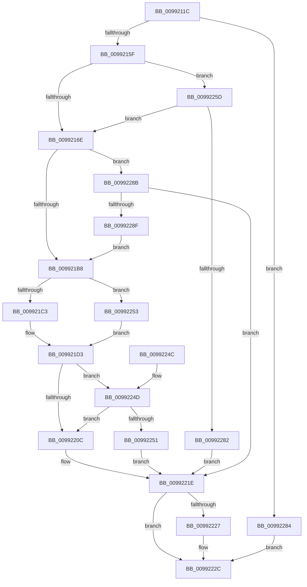

# PnpGetObjectPropertyKeysWorker

- RVA: `0x0099211C`–`0x00992294` (길이 `376` bytes)
- VA: `0x000000014099211C`
- 실행 섹션: `PAGE`
- PDB 이름 있음: `예`; PDB Function 태그: `아니요`
- unwind 정보 RVA: `0x00098DA8`
- 디코드: `111`개 명령, `376/376` bytes 표시
- 미해석 바이트: `0` (있으면 어셈블리에 `.byte`로 보존)

> 이 문서는 커널 이미지의 기계어와 PDB 기호를 분석해 생성했습니다. 4번과 5번은 함수 원형과 자료형을 바이너리 사용 방식에서 추정한 C 해석이며 원본 소스 복구 결과는 아닙니다.

## 1. Dependencies

- 직접 호출 지점: **4**; 고유 호출 대상: **4**
- 직접 호출자로 확인된 함수: **1**
- RIP 상대 이미지 참조: **0**

### Outgoing calls
- `0x009921A3` → [PnpGetMappedPropertyKeysDispatch](PnpGetMappedPropertyKeysDispatch_function_0099229C.md) (function, `0x0099229C`)
- `0x009921FB` → [PnpGetGenericStorePropertyKeys](PnpGetGenericStorePropertyKeys_function_00992378.md) (function, `0x00992378`)
- `0x00992227` → [ZwClose](../../text/6A/ZwClose_function_006AD2B0.md) (function, `0x006AD2B0`)
- `0x00992273` → [PnpOpenObjectRegKey](../8E/PnpOpenObjectRegKey_function_008E15E8.md) (function, `0x008E15E8`)

### Direct callers
- [PnpGetObjectPropertyKeys](PnpGetObjectPropertyKeys_function_009919B4.md) at `0x00991A91`

### Static image references
- 디코드된 RIP-relative 메모리 참조가 없습니다.

## 2. Other-region calls and transfers

- 다른 실행 섹션으로 향하는 call: **1**
  - `0x00992227` → [ZwClose](../../text/6A/ZwClose_function_006AD2B0.md) (`PAGE` → `.text`)
- 별도 외부 분기/꼬리 이동을 확인하지 못했습니다.

## 3. Assembly (complete function range)

```asm
0099211C  48 89 5C 24 08                  mov qword ptr [rsp + 8], rbx
00992121  48 89 74 24 10                  mov qword ptr [rsp + 0x10], rsi
00992126  48 89 7C 24 18                  mov qword ptr [rsp + 0x18], rdi
0099212B  55                              push rbp
0099212C  41 54                           push r12
0099212E  41 55                           push r13
00992130  41 56                           push r14
00992132  41 57                           push r15
00992134  48 8B EC                        mov rbp, rsp
00992137  48 83 EC 60                     sub rsp, 0x60
0099213B  0F B7 45 78                     movzx eax, word ptr [rbp + 0x78]
0099213F  4C 8B E9                        mov r13, rcx
00992142  33 C9                           xor ecx, ecx
00992144  4D 8B F1                        mov r14, r9
00992147  48 89 4D F8                     mov qword ptr [rbp - 8], rcx
0099214B  45 8B F8                        mov r15d, r8d
0099214E  89 4D F0                        mov dword ptr [rbp - 0x10], ecx
00992151  4C 8B E2                        mov r12, rdx
00992154  89 4D F4                        mov dword ptr [rbp - 0xc], ecx
00992157  85 C0                           test eax, eax
00992159  0F 85 25 01 00 00               jne 0x140992284
0099215F  48 8B 75 70                     mov rsi, qword ptr [rbp + 0x70]
00992163  89 0E                           mov dword ptr [rsi], ecx
00992165  4D 85 C9                        test r9, r9
00992168  0F 84 EF 00 00 00               je 0x14099225d
0099216E  8B 7D 68                        mov edi, dword ptr [rbp + 0x68]
00992171  48 8D 45 F0                     lea rax, [rbp - 0x10]
00992175  48 89 44 24 40                  mov qword ptr [rsp + 0x40], rax
0099217A  4D 8B CE                        mov r9, r14
0099217D  48 8B 45 60                     mov rax, qword ptr [rbp + 0x60]
00992181  45 8B C7                        mov r8d, r15d
00992184  89 7C 24 38                     mov dword ptr [rsp + 0x38], edi
00992188  49 8B D4                        mov rdx, r12
0099218B  48 89 44 24 30                  mov qword ptr [rsp + 0x30], rax
00992190  49 8B CD                        mov rcx, r13
00992193  8A 45 58                        mov al, byte ptr [rbp + 0x58]
00992196  88 44 24 28                     mov byte ptr [rsp + 0x28], al
0099219A  48 8B 45 50                     mov rax, qword ptr [rbp + 0x50]
0099219E  48 89 44 24 20                  mov qword ptr [rsp + 0x20], rax
009921A3  E8 F4 00 00 00                  call 0x14099229c
009921A8  8B D8                           mov ebx, eax
009921AA  05 DE FF FF 3F                  add eax, 0x3fffffde
009921AF  83 F8 01                        cmp eax, 1
009921B2  0F 87 D3 00 00 00               ja 0x14099228b
009921B8  8B 55 F0                        mov edx, dword ptr [rbp - 0x10]
009921BB  3B D7                           cmp edx, edi
009921BD  0F 83 90 00 00 00               jae 0x140992253
009921C3  48 8B 45 60                     mov rax, qword ptr [rbp + 0x60]
009921C7  48 8D 0C 92                     lea rcx, [rdx + rdx*4]
009921CB  4C 8D 04 88                     lea r8, [rax + rcx*4]
009921CF  8B C7                           mov eax, edi
009921D1  2B C2                           sub eax, edx
009921D3  48 8B 55 F8                     mov rdx, qword ptr [rbp - 8]
009921D7  48 8D 4D F4                     lea rcx, [rbp - 0xc]
009921DB  44 8A 4D 58                     mov r9b, byte ptr [rbp + 0x58]
009921DF  4D 85 F6                        test r14, r14
009921E2  48 89 4C 24 30                  mov qword ptr [rsp + 0x30], rcx
009921E7  49 8B CD                        mov rcx, r13
009921EA  89 44 24 28                     mov dword ptr [rsp + 0x28], eax
009921EE  49 0F 45 D6                     cmovne rdx, r14
009921F2  4C 89 44 24 20                  mov qword ptr [rsp + 0x20], r8
009921F7  4C 8B 45 50                     mov r8, qword ptr [rbp + 0x50]
009921FB  E8 78 01 00 00                  call 0x140992378
00992200  8B D8                           mov ebx, eax
00992202  05 DE FF FF 3F                  add eax, 0x3fffffde
00992207  83 F8 01                        cmp eax, 1
0099220A  77 41                           ja 0x14099224d
0099220C  8B 55 F4                        mov edx, dword ptr [rbp - 0xc]
0099220F  03 55 F0                        add edx, dword ptr [rbp - 0x10]
00992212  3B FA                           cmp edi, edx
00992214  89 16                           mov dword ptr [rsi], edx
00992216  1B DB                           sbb ebx, ebx
00992218  81 E3 23 00 00 C0               and ebx, 0xc0000023
0099221E  48 8B 4D F8                     mov rcx, qword ptr [rbp - 8]
00992222  48 85 C9                        test rcx, rcx
00992225  74 05                           je 0x14099222c
00992227  E8 84 B0 D1 FF                  call 0x1406ad2b0
0099222C  4C 8D 5C 24 60                  lea r11, [rsp + 0x60]
00992231  8B C3                           mov eax, ebx
00992233  49 8B 5B 30                     mov rbx, qword ptr [r11 + 0x30]
00992237  49 8B 73 38                     mov rsi, qword ptr [r11 + 0x38]
0099223B  49 8B 7B 40                     mov rdi, qword ptr [r11 + 0x40]
0099223F  49 8B E3                        mov rsp, r11
00992242  41 5F                           pop r15
00992244  41 5E                           pop r14
00992246  41 5D                           pop r13
00992248  41 5C                           pop r12
0099224A  5D                              pop rbp
0099224B  C3                              ret
0099224C  CC                              int3
0099224D  85 DB                           test ebx, ebx
0099224F  74 BB                           je 0x14099220c
00992251  EB CB                           jmp 0x14099221e
00992253  45 33 C0                        xor r8d, r8d
00992256  33 C0                           xor eax, eax
00992258  E9 76 FF FF FF                  jmp 0x1409921d3
0099225D  48 8D 45 F8                     lea rax, [rbp - 8]
00992261  41 B9 01 00 00 02               mov r9d, 0x2000001
00992267  48 89 44 24 28                  mov qword ptr [rsp + 0x28], rax
0099226C  88 4C 24 20                     mov byte ptr [rsp + 0x20], cl
00992270  49 8B CD                        mov rcx, r13
00992273  E8 70 F3 F4 FF                  call 0x1408e15e8
00992278  8B D8                           mov ebx, eax
0099227A  85 C0                           test eax, eax
0099227C  0F 89 EC FE FF FF               jns 0x14099216e
00992282  EB 9A                           jmp 0x14099221e
00992284  BB 0D 00 00 C0                  mov ebx, 0xc000000d
00992289  EB A1                           jmp 0x14099222c
0099228B  85 DB                           test ebx, ebx
0099228D  75 8F                           jne 0x14099221e
0099228F  E9 24 FF FF FF                  jmp 0x1409921b8
```

## 4. C-style interpretation (structured pseudocode)

```c
__int64 __fastcall PnpGetObjectPropertyKeysWorker(__int64 a1, __int64 a2, int a3, __int64 a4, __int64 a5, unsigned __int8 a6, __int64 a7, unsigned int a8, __int64 a9, unsigned __int16 a10)
{
    __int64 result;
    __int64 v_rbx;
    __int64 v_rsp;
    unsigned __int64 v_stack_m28;
    unsigned __int64 v_stack_m30;
    unsigned int v_stack_m34;
    unsigned int v_stack_m38;
    unsigned __int8 v_stack_m40;
    unsigned __int64 v_stack_m48;
    unsigned int v_stack_m50;
    unsigned __int64 v_stack_m58;
    unsigned __int8 v_stack_m60;
    unsigned __int64 v_stack_m68;
    unsigned __int64 v_stack_p10;
    unsigned __int64 v_stack_p18;
    unsigned __int64 v_stack_p8;

    v_stack_p8 = v_rbx;
    v_stack_p10 = v_rsi;
    v_stack_p18 = v_rdi;
    v_rsp = (v_rsp) - (96);
    a1 = 0;
    v_stack_m30 = 0;
    v_stack_m38 = 0;
    v_stack_m34 = 0;
    if (a10 != 0) goto loc_00992284;
    *(unsigned int *)(a9) = 0;
    if (a4 == 0) goto loc_0099225D;
loc_0099216E:
    v_stack_m48 = v_stack_m38;
    v_stack_m50 = (unsigned int)((unsigned int)(a8));
    v_stack_m58 = a7;
    v_stack_m60 = a6;
    v_stack_m68 = a5;
    result = PnpGetMappedPropertyKeysDispatch(0, a2, (unsigned int)((unsigned int)((unsigned int)(a3))), a4);
    result = (unsigned int)((result) + (0x3FFFFFDEULL));
    if (((unsigned int)(result)) > 1) goto loc_0099228B;
loc_009921B8:
    if (((unsigned int)((unsigned int)(v_stack_m38))) >= ((unsigned int)((unsigned int)(a8)))) goto loc_00992253;
    result = (unsigned int)(((unsigned int)((unsigned int)((unsigned int)(a8)))) - ((unsigned int)((unsigned int)(v_stack_m38))));
loc_009921D3:
    v_stack_m58 = v_stack_m34;
    v_stack_m60 = (unsigned int)(result);
    a2 = v_stack_m30;
    if (a4 != 0) { a2 = a4; }
    v_stack_m68 = a7 + (unsigned int)(v_stack_m38) + (unsigned int)(v_stack_m38) * 4 * 4;
    result = PnpGetGenericStorePropertyKeys(0, a2, a5, a6);
    result = (unsigned int)((result) + (0x3FFFFFDEULL));
    if (((unsigned int)(result)) > 1) goto loc_0099224D;
loc_0099220C:
    a2 = (unsigned int)(((unsigned int)(v_stack_m34)) + (v_stack_m38));
    *(unsigned int *)(a9) = (unsigned int)(a2);
    v_rbx = (unsigned int)(((unsigned int)((unsigned int)(result))) & (0xC0000023ULL));
loc_0099221E:
    if (v_stack_m30 != 0) {
        result = ZwClose(v_stack_m30, a2, a5, a6);
    }
    return (unsigned int)((unsigned int)(v_rbx));
loc_0099224D:
    if ((unsigned int)(*(unsigned __int64 *)(v_stack_m28 + 48)) == 0) goto loc_0099220C;
    goto loc_0099221E;
loc_00992253:
    a3 = 0;
    result = 0;
    goto loc_009921D3;
loc_0099225D:
    v_stack_m38 = v_stack_m30;
    v_stack_m40 = (unsigned __int8)(v_stack_m30);
    result = PnpOpenObjectRegKey(0, a2, a3, (unsigned int)(0x2000001ULL));
    if (!sign_flag) goto loc_0099216E;
    goto loc_0099221E;
loc_00992284:
    goto loc_0099222C;
loc_0099228B:
    if ((unsigned int)((unsigned int)(0xC000000DULL)) != 0) goto loc_0099221E;
    goto loc_009921B8;
}
```

## 5. (Beta) C Style

```c
int64_t PnpGetObjectPropertyKeysWorker(int64_t Arg1, int64_t Arg2, int32_t Arg3, int64_t Arg4, int64_t Arg5, uint8_t Arg6, void *Arg7, uint32_t Arg8, void *Arg9, uint16_t Arg10)
{
    uint8_t *arg7 = (uint8_t *)Arg7;
    uint8_t *arg9 = (uint8_t *)Arg9;

    int64_t result;
    int64_t local_rbx;
    int64_t local_rsp;
    uint64_t v_stack_m28;
    uint64_t v_stack_m30;
    uint32_t v_stack_m34;
    uint32_t v_stack_m38;
    uint8_t v_stack_m40;
    uint64_t v_stack_m48;
    uint32_t v_stack_m50;
    uint64_t v_stack_m58;
    uint8_t v_stack_m60;
    uint64_t v_stack_m68;
    uint64_t v_stack_p10;
    uint64_t v_stack_p18;
    uint64_t v_stack_p8;

    v_stack_p8 = local_rbx;
    v_stack_p10 = local_rsi;
    v_stack_p18 = local_rdi;
    local_rsp = (local_rsp) - (96);
    Arg1 = 0;
    v_stack_m30 = 0;
    v_stack_m38 = 0;
    v_stack_m34 = 0;
    if (Arg10 != 0) goto loc_00992284;
    *(uint32_t *)(arg9) = 0;
    if (Arg4 == 0) goto loc_0099225D;
loc_0099216E:
    v_stack_m48 = v_stack_m38;
    v_stack_m50 = (uint32_t)((uint32_t)(Arg8));
    v_stack_m58 = Arg7;
    v_stack_m60 = Arg6;
    v_stack_m68 = Arg5;
    result = PnpGetMappedPropertyKeysDispatch(0, Arg2, (uint32_t)((uint32_t)((uint32_t)(Arg3))), Arg4);
    result = (uint32_t)((result) + (0x3FFFFFDEULL));
    if (((uint32_t)(result)) > 1) goto loc_0099228B;
loc_009921B8:
    if (((uint32_t)((uint32_t)(v_stack_m38))) >= ((uint32_t)((uint32_t)(Arg8)))) goto loc_00992253;
    result = (uint32_t)(((uint32_t)((uint32_t)((uint32_t)(Arg8)))) - ((uint32_t)((uint32_t)(v_stack_m38))));
loc_009921D3:
    v_stack_m58 = v_stack_m34;
    v_stack_m60 = (uint32_t)(result);
    Arg2 = v_stack_m30;
    if (Arg4 != 0) { Arg2 = Arg4; }
    v_stack_m68 = Arg7 + (uint32_t)(v_stack_m38) + (uint32_t)(v_stack_m38) * 4 * 4;
    result = PnpGetGenericStorePropertyKeys(0, Arg2, Arg5, Arg6);
    result = (uint32_t)((result) + (0x3FFFFFDEULL));
    if (((uint32_t)(result)) > 1) goto loc_0099224D;
loc_0099220C:
    Arg2 = (uint32_t)(((uint32_t)(v_stack_m34)) + (v_stack_m38));
    *(uint32_t *)(arg9) = (uint32_t)(Arg2);
    local_rbx = (uint32_t)(((uint32_t)((uint32_t)(result))) & (0xC0000023ULL));
loc_0099221E:
    if (v_stack_m30 != 0) {
        result = ZwClose(v_stack_m30, Arg2, Arg5, Arg6);
    }
    return (uint32_t)((uint32_t)(local_rbx));
loc_0099224D:
    if ((uint32_t)(*(uint64_t *)(v_stack_m28 + 0x30)) == 0) goto loc_0099220C;
    goto loc_0099221E;
loc_00992253:
    Arg3 = 0;
    result = 0;
    goto loc_009921D3;
loc_0099225D:
    v_stack_m38 = v_stack_m30;
    v_stack_m40 = (uint8_t)(v_stack_m30);
    result = PnpOpenObjectRegKey(0, Arg2, Arg3, (uint32_t)(0x2000001ULL));
    if (!sign_flag) goto loc_0099216E;
    goto loc_0099221E;
loc_00992284:
    goto loc_0099222C;
loc_0099228B:
    if ((uint32_t)((uint32_t)(0xC000000DULL)) != 0) goto loc_0099221E;
    goto loc_009921B8;
}
```

### 관측된 메모리 오프셋

구조체 형식이 확인되지 않은 접근은 인자 기준의 오프셋으로만 기록했습니다.

| 기준 인자 | 오프셋 표현 | 폭 (bit) | 접근 |
|---|---:|---:|---|
| `Arg7` | `+ 0x0 + rcx*4` | `64` | `R` |
| `Arg9` | `+ 0x0` | `32` | `W` |

## 6. Execution-region graph

[열기: 2D/3D 그래프와 함수 탐색 컨트롤 패널](../../../control-panel.html?section=page&rva=0x0099211C&view=graph)

- 2D 그래프는 위에서 아래로 흐르고, 3D 그래프는 빈 공간을 드래그해 회전합니다. Shift+드래그는 이동, 휠은 확대·축소, 함수 노드 선택은 대상 보고서 이동입니다.

### Static fallback


