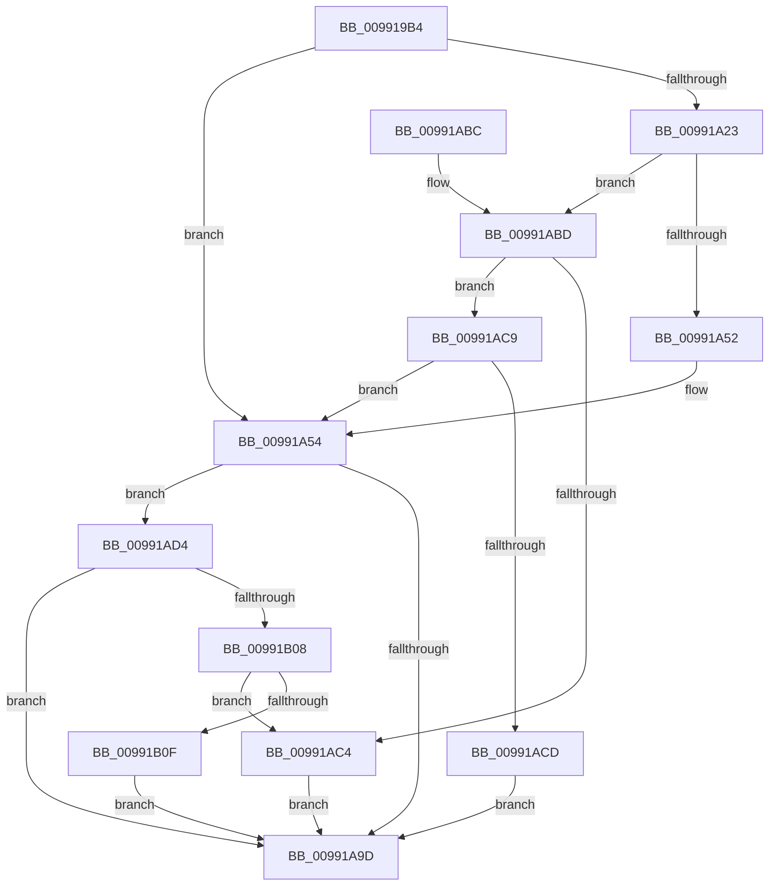

# PnpGetObjectPropertyKeys

- RVA: `0x009919B4`–`0x00991B22` (길이 `366` bytes)
- VA: `0x00000001409919B4`
- 실행 섹션: `PAGE`
- PDB 이름 있음: `예`; PDB Function 태그: `아니요`
- unwind 정보 RVA: `0x00098D64`
- 디코드: `103`개 명령, `366/366` bytes 표시
- 미해석 바이트: `0` (있으면 어셈블리에 `.byte`로 보존)

> 이 문서는 커널 이미지의 기계어와 PDB 기호를 분석해 생성했습니다. 4번과 5번은 함수 원형과 자료형을 바이너리 사용 방식에서 추정한 C 해석이며 원본 소스 복구 결과는 아닙니다.

## 1. Dependencies

- 직접 호출 지점: **4**; 고유 호출 대상: **3**
- 직접 호출자로 확인된 함수: **3**
- RIP 상대 이미지 참조: **0**

### Outgoing calls
- `0x009919E9` → [memset](../../text/6C/memset_function_006C6C40.md) (function, `0x006C6C40`)
- `0x00991A46` → [guard_dispatch_icall](../../text/6B/guard_dispatch_icall_function_006BAAD0.md) (function, `0x006BAAD0`)
- `0x00991A91` → [PnpGetObjectPropertyKeysWorker](PnpGetObjectPropertyKeysWorker_function_0099211C.md) (function, `0x0099211C`)
- `0x00991AFA` → [guard_dispatch_icall](../../text/6B/guard_dispatch_icall_function_006BAAD0.md) (function, `0x006BAAD0`)

### Direct callers
- [PiDevCfgCopyObjectProperties](../96/PiDevCfgCopyObjectProperties_function_009645D8.md) at `0x009647DB`
- [PiDevCfgCopyObjectProperties](../96/PiDevCfgCopyObjectProperties_function_009645D8.md) at `0x0096481E`
- [PiDqPnPGetObjectPropertyKeys](PiDqPnPGetObjectPropertyKeys_function_009917B8.md) at `0x0099185A`
- [PiCMGetObjectPropertyKeys](../A7/PiCMGetObjectPropertyKeys_function_00A7C554.md) at `0x00A7C670`

### Static image references
- 디코드된 RIP-relative 메모리 참조가 없습니다.

## 2. Other-region calls and transfers

- 다른 실행 섹션으로 향하는 call: **3**
  - `0x009919E9` → [memset](../../text/6C/memset_function_006C6C40.md) (`PAGE` → `.text`)
  - `0x00991A46` → [guard_dispatch_icall](../../text/6B/guard_dispatch_icall_function_006BAAD0.md) (`PAGE` → `.text`)
  - `0x00991AFA` → [guard_dispatch_icall](../../text/6B/guard_dispatch_icall_function_006BAAD0.md) (`PAGE` → `.text`)
- 별도 외부 분기/꼬리 이동을 확인하지 못했습니다.

## 3. Assembly (complete function range)

```asm
009919B4  48 8B C4                        mov rax, rsp
009919B7  48 89 58 08                     mov qword ptr [rax + 8], rbx
009919BB  48 89 70 10                     mov qword ptr [rax + 0x10], rsi
009919BF  48 89 78 18                     mov qword ptr [rax + 0x18], rdi
009919C3  55                              push rbp
009919C4  41 56                           push r14
009919C6  41 57                           push r15
009919C8  48 8D 68 D1                     lea rbp, [rax - 0x2f]
009919CC  48 81 EC A0 00 00 00            sub rsp, 0xa0
009919D3  4C 8B FA                        mov r15, rdx
009919D6  45 8B F0                        mov r14d, r8d
009919D9  33 D2                           xor edx, edx
009919DB  48 8B F1                        mov rsi, rcx
009919DE  48 8D 4D C7                     lea rcx, [rbp - 0x39]
009919E2  49 8B D9                        mov rbx, r9
009919E5  44 8D 42 50                     lea r8d, [rdx + 0x50]
009919E9  E8 52 52 D3 FF                  call 0x1406c6c40
009919EE  8A 45 5F                        mov al, byte ptr [rbp + 0x5f]
009919F1  48 8B BE E8 01 00 00            mov rdi, qword ptr [rsi + 0x1e8]
009919F8  48 83 65 DF 00                  and qword ptr [rbp - 0x21], 0
009919FD  83 65 07 00                     and dword ptr [rbp + 7], 0
00991A01  88 45 E7                        mov byte ptr [rbp - 0x19], al
00991A04  48 8B 45 67                     mov rax, qword ptr [rbp + 0x67]
00991A08  48 89 45 EF                     mov qword ptr [rbp - 0x11], rax
00991A0C  8B 45 6F                        mov eax, dword ptr [rbp + 0x6f]
00991A0F  89 45 F7                        mov dword ptr [rbp - 9], eax
00991A12  48 8B 45 77                     mov rax, qword ptr [rbp + 0x77]
00991A16  48 89 45 FF                     mov qword ptr [rbp - 1], rax
00991A1A  48 89 5D D7                     mov qword ptr [rbp - 0x29], rbx
00991A1E  48 85 FF                        test rdi, rdi
00991A21  74 31                           je 0x140991a54
00991A23  48 8D 45 C7                     lea rax, [rbp - 0x39]
00991A27  41 B9 06 00 00 00               mov r9d, 6
00991A2D  48 89 44 24 28                  mov qword ptr [rsp + 0x28], rax
00991A32  45 8B C6                        mov r8d, r14d
00991A35  48 8B C7                        mov rax, rdi
00991A38  C7 44 24 20 01 00 00 00         mov dword ptr [rsp + 0x20], 1
00991A40  49 8B D7                        mov rdx, r15
00991A43  48 8B CE                        mov rcx, rsi
00991A46  E8 85 90 D2 FF                  call 0x1406baad0
00991A4B  3D 02 00 00 C0                  cmp eax, 0xc0000002
00991A50  75 6B                           jne 0x140991abd
00991A52  33 FF                           xor edi, edi
00991A54  8B 45 07                        mov eax, dword ptr [rbp + 7]
00991A57  45 8B C6                        mov r8d, r14d
00991A5A  4C 8B 4D D7                     mov r9, qword ptr [rbp - 0x29]
00991A5E  49 8B D7                        mov rdx, r15
00991A61  89 44 24 48                     mov dword ptr [rsp + 0x48], eax
00991A65  48 8B CE                        mov rcx, rsi
00991A68  48 8B 45 FF                     mov rax, qword ptr [rbp - 1]
00991A6C  48 89 44 24 40                  mov qword ptr [rsp + 0x40], rax
00991A71  8B 45 F7                        mov eax, dword ptr [rbp - 9]
00991A74  89 44 24 38                     mov dword ptr [rsp + 0x38], eax
00991A78  48 8B 45 EF                     mov rax, qword ptr [rbp - 0x11]
00991A7C  48 89 44 24 30                  mov qword ptr [rsp + 0x30], rax
00991A81  8A 45 E7                        mov al, byte ptr [rbp - 0x19]
00991A84  88 44 24 28                     mov byte ptr [rsp + 0x28], al
00991A88  48 8B 45 DF                     mov rax, qword ptr [rbp - 0x21]
00991A8C  48 89 44 24 20                  mov qword ptr [rsp + 0x20], rax
00991A91  E8 86 06 00 00                  call 0x14099211c
00991A96  8B D8                           mov ebx, eax
00991A98  48 85 FF                        test rdi, rdi
00991A9B  75 37                           jne 0x140991ad4
00991A9D  4C 8D 9C 24 A0 00 00 00         lea r11, [rsp + 0xa0]
00991AA5  8B C3                           mov eax, ebx
00991AA7  49 8B 5B 20                     mov rbx, qword ptr [r11 + 0x20]
00991AAB  49 8B 73 28                     mov rsi, qword ptr [r11 + 0x28]
00991AAF  49 8B 7B 30                     mov rdi, qword ptr [r11 + 0x30]
00991AB3  49 8B E3                        mov rsp, r11
00991AB6  41 5F                           pop r15
00991AB8  41 5E                           pop r14
00991ABA  5D                              pop rbp
00991ABB  C3                              ret
00991ABC  CC                              int3
00991ABD  3D 20 01 00 C0                  cmp eax, 0xc0000120
00991AC2  75 05                           jne 0x140991ac9
00991AC4  8B 5D C7                        mov ebx, dword ptr [rbp - 0x39]
00991AC7  EB D4                           jmp 0x140991a9d
00991AC9  85 C0                           test eax, eax
00991ACB  74 87                           je 0x140991a54
00991ACD  BB E5 00 00 C0                  mov ebx, 0xc00000e5
00991AD2  EB C9                           jmp 0x140991a9d
00991AD4  48 8D 45 C7                     lea rax, [rbp - 0x39]
00991AD8  89 5D C7                        mov dword ptr [rbp - 0x39], ebx
00991ADB  48 89 44 24 28                  mov qword ptr [rsp + 0x28], rax
00991AE0  41 B9 06 00 00 00               mov r9d, 6
00991AE6  48 8B C7                        mov rax, rdi
00991AE9  C7 44 24 20 02 00 00 00         mov dword ptr [rsp + 0x20], 2
00991AF1  45 8B C6                        mov r8d, r14d
00991AF4  49 8B D7                        mov rdx, r15
00991AF7  48 8B CE                        mov rcx, rsi
00991AFA  E8 D1 8F D2 FF                  call 0x1406baad0
00991AFF  8B C8                           mov ecx, eax
00991B01  3D 02 00 00 C0                  cmp eax, 0xc0000002
00991B06  74 95                           je 0x140991a9d
00991B08  3D 20 01 00 C0                  cmp eax, 0xc0000120
00991B0D  74 B5                           je 0x140991ac4
00991B0F  8B C3                           mov eax, ebx
00991B11  85 C9                           test ecx, ecx
00991B13  BB E5 00 00 C0                  mov ebx, 0xc00000e5
00991B18  0F 45 C3                        cmovne eax, ebx
00991B1B  8B D8                           mov ebx, eax
00991B1D  E9 7B FF FF FF                  jmp 0x140991a9d
```

## 4. C-style interpretation (structured pseudocode)

```c
__int64 __fastcall PnpGetObjectPropertyKeys(__int64 a1, __int64 a2, int a3, __int64 a4)
{
    __int64 result;
    __int64 v_rdi;
    __int64 v_rsp;
    unsigned __int64 v_stack_m18;
    unsigned int v_stack_m70;
    unsigned __int64 v_stack_m78;
    unsigned int v_stack_m80;
    unsigned __int64 v_stack_m88;
    unsigned __int64 v_stack_m90;
    unsigned int v_stack_m98;

    *(unsigned __int64 *)(v_rsp + 8) = v_rbx;
    *(unsigned __int64 *)(v_rsp + 16) = v_rsi;
    *(unsigned __int64 *)(v_rsp + 24) = v_rdi;
    v_rsp = (v_rsp) - (160);
    a2 = 0;
    result = memset(v_rsp - 47 - 57, a2, a2 + 80, a4);
    *(unsigned __int8 *)(v_rsp - 47 - 25) = (unsigned __int8)(*(unsigned __int8 *)(v_rsp - 47 + 95));
    *(unsigned __int64 *)(v_rsp - 47 - 17) = *(unsigned __int64 *)(v_rsp - 47 + 103);
    *(unsigned int *)(v_rsp - 47 - 9) = (unsigned int)((unsigned int)(*(unsigned int *)(v_rsp - 47 + 111)));
    *(unsigned __int64 *)(v_rsp - 47 - 1) = *(unsigned __int64 *)(v_rsp - 47 + 119);
    *(unsigned __int64 *)(v_rsp - 47 - 41) = a4;
    if (*(unsigned __int64 *)(a1 + 488) == 0) goto loc_00991A54;
    v_stack_m90 = v_rsp - 47 - 57;
    v_stack_m98 = 1;
    result = guard_dispatch_icall(a1, 0, (unsigned int)((unsigned int)((unsigned int)(a3))), 6);
    if (((unsigned int)(result)) != 0xC0000002ULL) goto loc_00991ABD;
    v_rdi = 0;
loc_00991A54:
    v_stack_m70 = (unsigned int)((unsigned int)(*(unsigned int *)(v_rsp - 47 + 7)));
    v_stack_m78 = *(unsigned __int64 *)(v_rsp - 47 - 1);
    v_stack_m80 = (unsigned int)((unsigned int)(*(unsigned int *)(v_rsp - 47 - 9)));
    v_stack_m88 = *(unsigned __int64 *)(v_rsp - 47 - 17);
    v_stack_m90 = (unsigned __int8)(*(unsigned __int8 *)(v_rsp - 47 - 25));
    v_stack_m98 = *(unsigned __int64 *)(v_rsp - 47 - 33);
    result = PnpGetObjectPropertyKeysWorker(a1, 0, (unsigned int)((unsigned int)((unsigned int)(a3))), *(unsigned __int64 *)(v_rsp - 47 - 41));
    if (0 != 0) goto loc_00991AD4;
loc_00991A9D:
    return (unsigned int)((unsigned int)((unsigned int)((unsigned int)(result))));
loc_00991ABD:
    if (((unsigned int)((unsigned int)((unsigned int)((unsigned int)((unsigned int)(result)))))) != 0xC0000120ULL) goto loc_00991AC9;
loc_00991AC4:
    goto loc_00991A9D;
loc_00991AC9:
    if ((unsigned int)((unsigned int)((unsigned int)((unsigned int)((unsigned int)(result))))) == 0) goto loc_00991A54;
    goto loc_00991A9D;
loc_00991AD4:
    *(unsigned int *)(v_rsp - 47 - 57) = (unsigned int)((unsigned int)(0xC00000E5ULL));
    v_stack_m78 = v_rsp - 47 - 57;
    v_stack_m80 = 2;
    result = guard_dispatch_icall(*(unsigned __int64 *)(v_stack_m18 + 40), 0, (unsigned int)((unsigned int)((unsigned int)(a3))), 6);
    if (((unsigned int)(result)) == 0xC0000002ULL) goto loc_00991A9D;
    if (((unsigned int)(result)) == 0xC0000120ULL) goto loc_00991AC4;
    result = (unsigned int)((unsigned int)((unsigned int)(0xC00000E5ULL)));
    if ((unsigned int)((unsigned int)((unsigned int)(result))) != 0) { result = (unsigned int)((unsigned int)(0xC00000E5ULL)); }
    goto loc_00991A9D;
}
```

## 5. (Beta) C Style

```c
int64_t PnpGetObjectPropertyKeys(void *Arg1, int64_t Arg2, int32_t Arg3, int64_t Arg4)
{
    uint8_t *arg1 = (uint8_t *)Arg1;

    int64_t result;
    int64_t local_rdi;
    int64_t local_rsp;
    uint64_t v_stack_m18;
    uint32_t v_stack_m70;
    uint64_t v_stack_m78;
    uint32_t v_stack_m80;
    uint64_t v_stack_m88;
    uint64_t v_stack_m90;
    uint32_t v_stack_m98;

    *(uint64_t *)(local_rsp + 0x8) = local_rbx;
    *(uint64_t *)(local_rsp + 0x10) = local_rsi;
    *(uint64_t *)(local_rsp + 0x18) = local_rdi;
    local_rsp = (local_rsp) - (160);
    Arg2 = 0;
    result = memset(local_rsp - 47 - 57, Arg2, Arg2 + 80, Arg4);
    *(uint8_t *)(local_rsp - 0x2F - 0x19) = (uint8_t)(*(uint8_t *)(local_rsp - 0x2F + 0x5F));
    *(uint64_t *)(local_rsp - 0x2F - 0x11) = *(uint64_t *)(local_rsp - 0x2F + 0x67);
    *(uint32_t *)(local_rsp - 0x2F - 0x9) = (uint32_t)((uint32_t)(*(uint32_t *)(local_rsp - 0x2F + 0x6F)));
    *(uint64_t *)(local_rsp - 0x2F - 0x1) = *(uint64_t *)(local_rsp - 0x2F + 0x77);
    *(uint64_t *)(local_rsp - 0x2F - 0x29) = Arg4;
    if (*(uint64_t *)(arg1 + 0x1E8) == 0) goto loc_00991A54;
    v_stack_m90 = local_rsp - 47 - 57;
    v_stack_m98 = 1;
    result = guard_dispatch_icall(Arg1, 0, (uint32_t)((uint32_t)((uint32_t)(Arg3))), 6);
    if (((uint32_t)(result)) != 0xC0000002ULL) goto loc_00991ABD;
    local_rdi = 0;
loc_00991A54:
    v_stack_m70 = (uint32_t)((uint32_t)(*(uint32_t *)(local_rsp - 0x2F + 0x7)));
    v_stack_m78 = *(uint64_t *)(local_rsp - 0x2F - 0x1);
    v_stack_m80 = (uint32_t)((uint32_t)(*(uint32_t *)(local_rsp - 0x2F - 0x9)));
    v_stack_m88 = *(uint64_t *)(local_rsp - 0x2F - 0x11);
    v_stack_m90 = (uint8_t)(*(uint8_t *)(local_rsp - 0x2F - 0x19));
    v_stack_m98 = *(uint64_t *)(local_rsp - 0x2F - 0x21);
    result = PnpGetObjectPropertyKeysWorker(Arg1, 0, (uint32_t)((uint32_t)((uint32_t)(Arg3))), *(uint64_t *)(local_rsp - 0x2F - 0x29));
    if (0 != 0) goto loc_00991AD4;
loc_00991A9D:
    return (uint32_t)((uint32_t)((uint32_t)((uint32_t)(result))));
loc_00991ABD:
    if (((uint32_t)((uint32_t)((uint32_t)((uint32_t)((uint32_t)(result)))))) != 0xC0000120ULL) goto loc_00991AC9;
loc_00991AC4:
    goto loc_00991A9D;
loc_00991AC9:
    if ((uint32_t)((uint32_t)((uint32_t)((uint32_t)((uint32_t)(result))))) == 0) goto loc_00991A54;
    goto loc_00991A9D;
loc_00991AD4:
    *(uint32_t *)(local_rsp - 0x2F - 0x39) = (uint32_t)((uint32_t)(0xC00000E5ULL));
    v_stack_m78 = local_rsp - 47 - 57;
    v_stack_m80 = 2;
    result = guard_dispatch_icall(*(uint64_t *)(v_stack_m18 + 0x28), 0, (uint32_t)((uint32_t)((uint32_t)(Arg3))), 6);
    if (((uint32_t)(result)) == 0xC0000002ULL) goto loc_00991A9D;
    if (((uint32_t)(result)) == 0xC0000120ULL) goto loc_00991AC4;
    result = (uint32_t)((uint32_t)((uint32_t)(0xC00000E5ULL)));
    if ((uint32_t)((uint32_t)((uint32_t)(result))) != 0) { result = (uint32_t)((uint32_t)(0xC00000E5ULL)); }
    goto loc_00991A9D;
}
```

### 관측된 메모리 오프셋

구조체 형식이 확인되지 않은 접근은 인자 기준의 오프셋으로만 기록했습니다.

| 기준 인자 | 오프셋 표현 | 폭 (bit) | 접근 |
|---|---:|---:|---|
| `Arg1` | `+ 0x1E8` | `64` | `R` |

## 6. Execution-region graph

[열기: 2D/3D 그래프와 함수 탐색 컨트롤 패널](../../../control-panel.html?section=page&rva=0x009919B4&view=graph)

- 2D 그래프는 위에서 아래로 흐르고, 3D 그래프는 빈 공간을 드래그해 회전합니다. Shift+드래그는 이동, 휠은 확대·축소, 함수 노드 선택은 대상 보고서 이동입니다.

### Static fallback


