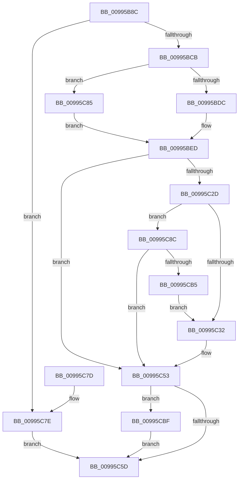

# PnpGetObjectPropertyLocalesWorker

- RVA: `0x00995B8C`–`0x00995CC6` (길이 `314` bytes)
- VA: `0x0000000140995B8C`
- 실행 섹션: `PAGE`
- PDB 이름 있음: `예`; PDB Function 태그: `아니요`
- unwind 정보 RVA: `0x00099198`
- 디코드: `85`개 명령, `314/314` bytes 표시
- 미해석 바이트: `0` (있으면 어셈블리에 `.byte`로 보존)

> 이 문서는 커널 이미지의 기계어와 PDB 기호를 분석해 생성했습니다. 4번과 5번은 함수 원형과 자료형을 바이너리 사용 방식에서 추정한 C 해석이며 원본 소스 복구 결과는 아닙니다.

## 1. Dependencies

- 직접 호출 지점: **4**; 고유 호출 대상: **4**
- 직접 호출자로 확인된 함수: **1**
- RIP 상대 이미지 참조: **0**

### Outgoing calls
- `0x00995C1F` → [PnpGetMappedPropertyLocalesDispatch](PnpGetMappedPropertyLocalesDispatch_function_00995CCC.md) (function, `0x00995CCC`)
- `0x00995C4C` → [PnpGetGenericStorePropertyLocales](PnpGetGenericStorePropertyLocales_function_00994DBC.md) (function, `0x00994DBC`)
- `0x00995CAA` → [PnpOpenObjectRegKey](../8E/PnpOpenObjectRegKey_function_008E15E8.md) (function, `0x008E15E8`)
- `0x00995CBF` → [ZwClose](../../text/6A/ZwClose_function_006AD2B0.md) (function, `0x006AD2B0`)

### Direct callers
- [PnpGetObjectPropertyLocales](PnpGetObjectPropertyLocales_function_00995A1C.md) at `0x00995AF3`

### Static image references
- 디코드된 RIP-relative 메모리 참조가 없습니다.

## 2. Other-region calls and transfers

- 다른 실행 섹션으로 향하는 call: **1**
  - `0x00995CBF` → [ZwClose](../../text/6A/ZwClose_function_006AD2B0.md) (`PAGE` → `.text`)
- 별도 외부 분기/꼬리 이동을 확인하지 못했습니다.

## 3. Assembly (complete function range)

```asm
00995B8C  48 8B C4                        mov rax, rsp
00995B8F  48 89 58 08                     mov qword ptr [rax + 8], rbx
00995B93  48 89 68 10                     mov qword ptr [rax + 0x10], rbp
00995B97  48 89 70 18                     mov qword ptr [rax + 0x18], rsi
00995B9B  57                              push rdi
00995B9C  41 54                           push r12
00995B9E  41 55                           push r13
00995BA0  41 56                           push r14
00995BA2  41 57                           push r15
00995BA4  48 83 EC 60                     sub rsp, 0x60
00995BA8  48 83 60 C8 00                  and qword ptr [rax - 0x38], 0
00995BAD  49 8B F1                        mov rsi, r9
00995BB0  44 8B 8C 24 D0 00 00 00         mov r9d, dword ptr [rsp + 0xd0]
00995BB8  45 8B E0                        mov r12d, r8d
00995BBB  4C 8B EA                        mov r13, rdx
00995BBE  4C 8B F1                        mov r14, rcx
00995BC1  66 45 85 C9                     test r9w, r9w
00995BC5  0F 85 B3 00 00 00               jne 0x140995c7e
00995BCB  48 8B BC 24 B8 00 00 00         mov rdi, qword ptr [rsp + 0xb8]
00995BD3  48 85 FF                        test rdi, rdi
00995BD6  0F 84 A9 00 00 00               je 0x140995c85
00995BDC  8B AC 24 C0 00 00 00            mov ebp, dword ptr [rsp + 0xc0]
00995BE3  8B C5                           mov eax, ebp
00995BE5  F7 D8                           neg eax
00995BE7  48 1B C9                        sbb rcx, rcx
00995BEA  48 23 F9                        and rdi, rcx
00995BED  4C 8B BC 24 C8 00 00 00         mov r15, qword ptr [rsp + 0xc8]
00995BF5  49 8B CE                        mov rcx, r14
00995BF8  48 8B 84 24 B0 00 00 00         mov rax, qword ptr [rsp + 0xb0]
00995C00  44 89 4C 24 40                  mov dword ptr [rsp + 0x40], r9d
00995C05  4C 8B CE                        mov r9, rsi
00995C08  4C 89 7C 24 38                  mov qword ptr [rsp + 0x38], r15
00995C0D  41 83 27 00                     and dword ptr [r15], 0
00995C11  89 6C 24 30                     mov dword ptr [rsp + 0x30], ebp
00995C15  48 89 7C 24 28                  mov qword ptr [rsp + 0x28], rdi
00995C1A  48 89 44 24 20                  mov qword ptr [rsp + 0x20], rax
00995C1F  E8 A8 00 00 00                  call 0x140995ccc
00995C24  8B D8                           mov ebx, eax
00995C26  3D 16 00 00 C0                  cmp eax, 0xc0000016
00995C2B  75 26                           jne 0x140995c53
00995C2D  48 85 F6                        test rsi, rsi
00995C30  74 5A                           je 0x140995c8c
00995C32  4C 8B 84 24 B0 00 00 00         mov r8, qword ptr [rsp + 0xb0]
00995C3A  4C 8B CF                        mov r9, rdi
00995C3D  4C 89 7C 24 28                  mov qword ptr [rsp + 0x28], r15
00995C42  48 8B D6                        mov rdx, rsi
00995C45  49 8B CE                        mov rcx, r14
00995C48  89 6C 24 20                     mov dword ptr [rsp + 0x20], ebp
00995C4C  E8 6B F1 FF FF                  call 0x140994dbc
00995C51  8B D8                           mov ebx, eax
00995C53  48 8B 4C 24 50                  mov rcx, qword ptr [rsp + 0x50]
00995C58  48 85 C9                        test rcx, rcx
00995C5B  75 62                           jne 0x140995cbf
00995C5D  4C 8D 5C 24 60                  lea r11, [rsp + 0x60]
00995C62  8B C3                           mov eax, ebx
00995C64  49 8B 5B 30                     mov rbx, qword ptr [r11 + 0x30]
00995C68  49 8B 6B 38                     mov rbp, qword ptr [r11 + 0x38]
00995C6C  49 8B 73 40                     mov rsi, qword ptr [r11 + 0x40]
00995C70  49 8B E3                        mov rsp, r11
00995C73  41 5F                           pop r15
00995C75  41 5E                           pop r14
00995C77  41 5D                           pop r13
00995C79  41 5C                           pop r12
00995C7B  5F                              pop rdi
00995C7C  C3                              ret
00995C7D  CC                              int3
00995C7E  BB 0D 00 00 C0                  mov ebx, 0xc000000d
00995C83  EB D8                           jmp 0x140995c5d
00995C85  33 ED                           xor ebp, ebp
00995C87  E9 61 FF FF FF                  jmp 0x140995bed
00995C8C  48 8D 44 24 50                  lea rax, [rsp + 0x50]
00995C91  41 B9 01 00 00 02               mov r9d, 0x2000001
00995C97  48 89 44 24 28                  mov qword ptr [rsp + 0x28], rax
00995C9C  45 8B C4                        mov r8d, r12d
00995C9F  49 8B D5                        mov rdx, r13
00995CA2  C6 44 24 20 00                  mov byte ptr [rsp + 0x20], 0
00995CA7  49 8B CE                        mov rcx, r14
00995CAA  E8 39 B9 F4 FF                  call 0x1408e15e8
00995CAF  8B D8                           mov ebx, eax
00995CB1  85 C0                           test eax, eax
00995CB3  78 9E                           js 0x140995c53
00995CB5  48 8B 74 24 50                  mov rsi, qword ptr [rsp + 0x50]
00995CBA  E9 73 FF FF FF                  jmp 0x140995c32
00995CBF  E8 EC 75 D1 FF                  call 0x1406ad2b0
00995CC4  EB 97                           jmp 0x140995c5d
```

## 4. C-style interpretation (structured pseudocode)

```c
__int64 __fastcall PnpGetObjectPropertyLocalesWorker(__int64 a1, __int64 a2, int a3, __int64 a4, __int64 a5, __int64 a6, unsigned int a7, __int64 a8, unsigned int a9)
{
    __int64 result;
    __int64 v_rbp;
    __int64 v_rdi;
    __int64 v_rsp;
    unsigned __int64 v_stack_m10;
    unsigned __int64 v_stack_m28;
    unsigned __int64 v_stack_m38;
    unsigned __int8 v_stack_m40;
    unsigned int v_stack_m48;
    unsigned __int64 v_stack_m50;
    unsigned int v_stack_m58;
    unsigned __int64 v_stack_m60;
    unsigned __int64 v_stack_m68;

    *(unsigned __int64 *)(v_rsp + 8) = v_rbx;
    *(unsigned __int64 *)(v_rsp + 16) = v_rbp;
    *(unsigned __int64 *)(v_rsp + 24) = v_rsi;
    v_rsp = (v_rsp) - (96);
    if ((unsigned __int16)((unsigned int)(a9)) != 0) goto loc_00995C7E;
    if (a6 == 0) goto loc_00995C85;
    result = (unsigned int)(-((unsigned int)((unsigned int)((unsigned int)(a7)))));
    v_rdi = (a6) & (a1);
loc_00995BED:
    v_stack_m48 = (unsigned int)((unsigned int)(a9));
    v_stack_m50 = a8;
    v_stack_m58 = (unsigned int)((unsigned int)(a7));
    v_stack_m60 = v_rdi;
    v_stack_m68 = a5;
    result = PnpGetMappedPropertyLocalesDispatch(a1, a2, a3, a4);
    if (((unsigned int)(result)) != 0xC0000016ULL) goto loc_00995C53;
    if (a4 == 0) goto loc_00995C8C;
loc_00995C32:
    v_stack_m60 = a8;
    v_stack_m68 = (unsigned int)((unsigned int)(a7));
    result = PnpGetGenericStorePropertyLocales(a1, a4, a5, v_rdi);
loc_00995C53:
    if (v_stack_m38 != 0) goto loc_00995CBF;
loc_00995C5D:
    return (unsigned int)((unsigned int)((unsigned int)((unsigned int)(result))));
loc_00995C7E:
    goto loc_00995C5D;
loc_00995C85:
    v_rbp = 0;
    goto loc_00995BED;
loc_00995C8C:
    v_stack_m38 = v_stack_m10;
    v_stack_m40 = 0;
    result = PnpOpenObjectRegKey(a1, a2, (unsigned int)((unsigned int)((unsigned int)(a3))), (unsigned int)(0x2000001ULL));
    if (sign_flag) goto loc_00995C53;
    goto loc_00995C32;
loc_00995CBF:
    result = ZwClose(a1, a2, (unsigned int)((unsigned int)((unsigned int)(a3))), (unsigned int)(0x2000001ULL));
    goto loc_00995C5D;
}
```

## 5. (Beta) C Style

```c
int64_t PnpGetObjectPropertyLocalesWorker(int64_t Arg1, int64_t Arg2, int32_t Arg3, int64_t Arg4, int64_t Arg5, int64_t Arg6, uint32_t Arg7, void *Arg8, uint32_t Arg9)
{
    uint8_t *arg8 = (uint8_t *)Arg8;

    int64_t result;
    int64_t local_rbp;
    int64_t local_rdi;
    int64_t local_rsp;
    uint64_t v_stack_m10;
    uint64_t v_stack_m28;
    uint64_t v_stack_m38;
    uint8_t v_stack_m40;
    uint32_t v_stack_m48;
    uint64_t v_stack_m50;
    uint32_t v_stack_m58;
    uint64_t v_stack_m60;
    uint64_t v_stack_m68;

    *(uint64_t *)(local_rsp + 0x8) = local_rbx;
    *(uint64_t *)(local_rsp + 0x10) = local_rbp;
    *(uint64_t *)(local_rsp + 0x18) = local_rsi;
    local_rsp = (local_rsp) - (96);
    if ((uint16_t)((uint32_t)(Arg9)) != 0) goto loc_00995C7E;
    if (Arg6 == 0) goto loc_00995C85;
    result = (uint32_t)(-((uint32_t)((uint32_t)((uint32_t)(Arg7)))));
    local_rdi = (Arg6) & (Arg1);
loc_00995BED:
    v_stack_m48 = (uint32_t)((uint32_t)(Arg9));
    v_stack_m50 = Arg8;
    v_stack_m58 = (uint32_t)((uint32_t)(Arg7));
    v_stack_m60 = local_rdi;
    v_stack_m68 = Arg5;
    result = PnpGetMappedPropertyLocalesDispatch(Arg1, Arg2, Arg3, Arg4);
    if (((uint32_t)(result)) != 0xC0000016ULL) goto loc_00995C53;
    if (Arg4 == 0) goto loc_00995C8C;
loc_00995C32:
    v_stack_m60 = Arg8;
    v_stack_m68 = (uint32_t)((uint32_t)(Arg7));
    result = PnpGetGenericStorePropertyLocales(Arg1, Arg4, Arg5, local_rdi);
loc_00995C53:
    if (v_stack_m38 != 0) goto loc_00995CBF;
loc_00995C5D:
    return (uint32_t)((uint32_t)((uint32_t)((uint32_t)(result))));
loc_00995C7E:
    goto loc_00995C5D;
loc_00995C85:
    local_rbp = 0;
    goto loc_00995BED;
loc_00995C8C:
    v_stack_m38 = v_stack_m10;
    v_stack_m40 = 0;
    result = PnpOpenObjectRegKey(Arg1, Arg2, (uint32_t)((uint32_t)((uint32_t)(Arg3))), (uint32_t)(0x2000001ULL));
    if (sign_flag) goto loc_00995C53;
    goto loc_00995C32;
loc_00995CBF:
    result = ZwClose(Arg1, Arg2, (uint32_t)((uint32_t)((uint32_t)(Arg3))), (uint32_t)(0x2000001ULL));
    goto loc_00995C5D;
}
```

### 관측된 메모리 오프셋

구조체 형식이 확인되지 않은 접근은 인자 기준의 오프셋으로만 기록했습니다.

| 기준 인자 | 오프셋 표현 | 폭 (bit) | 접근 |
|---|---:|---:|---|
| `Arg8` | `+ 0x0` | `32` | `R/W` |

## 6. Execution-region graph

[열기: 2D/3D 그래프와 함수 탐색 컨트롤 패널](../../../control-panel.html?section=page&rva=0x00995B8C&view=graph)

- 2D 그래프는 위에서 아래로 흐르고, 3D 그래프는 빈 공간을 드래그해 회전합니다. Shift+드래그는 이동, 휠은 확대·축소, 함수 노드 선택은 대상 보고서 이동입니다.

### Static fallback


