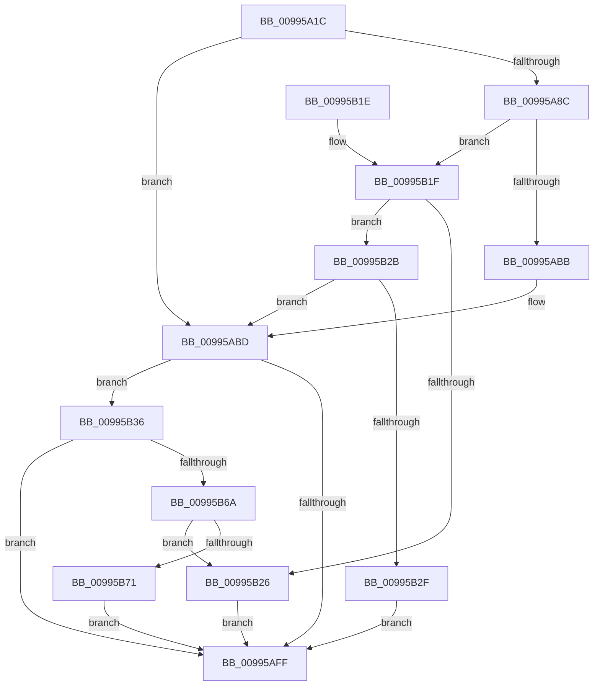

# PnpGetObjectPropertyLocales

- RVA: `0x00995A1C`–`0x00995B84` (길이 `360` bytes)
- VA: `0x0000000140995A1C`
- 실행 섹션: `PAGE`
- PDB 이름 있음: `예`; PDB Function 태그: `아니요`
- unwind 정보 RVA: `0x00098D64`
- 디코드: `100`개 명령, `360/360` bytes 표시
- 미해석 바이트: `0` (있으면 어셈블리에 `.byte`로 보존)

> 이 문서는 커널 이미지의 기계어와 PDB 기호를 분석해 생성했습니다. 4번과 5번은 함수 원형과 자료형을 바이너리 사용 방식에서 추정한 C 해석이며 원본 소스 복구 결과는 아닙니다.

## 1. Dependencies

- 직접 호출 지점: **4**; 고유 호출 대상: **3**
- 직접 호출자로 확인된 함수: **1**
- RIP 상대 이미지 참조: **1**

### Outgoing calls
- `0x00995A55` → [memset](../../text/6C/memset_function_006C6C40.md) (function, `0x006C6C40`)
- `0x00995AAF` → [guard_dispatch_icall](../../text/6B/guard_dispatch_icall_function_006BAAD0.md) (function, `0x006BAAD0`)
- `0x00995AF3` → [PnpGetObjectPropertyLocalesWorker](PnpGetObjectPropertyLocalesWorker_function_00995B8C.md) (function, `0x00995B8C`)
- `0x00995B5C` → [guard_dispatch_icall](../../text/6B/guard_dispatch_icall_function_006BAAD0.md) (function, `0x006BAAD0`)

### Direct callers
- [PiDqPnPGetObjectPropertyLocales](PiDqPnPGetObjectPropertyLocales_function_0099590C.md) at `0x00995999`

### Static image references
- `0x00995A3B` → RVA `0x00E66398` (`.data`; read)

## 2. Other-region calls and transfers

- 다른 실행 섹션으로 향하는 call: **3**
  - `0x00995A55` → [memset](../../text/6C/memset_function_006C6C40.md) (`PAGE` → `.text`)
  - `0x00995AAF` → [guard_dispatch_icall](../../text/6B/guard_dispatch_icall_function_006BAAD0.md) (`PAGE` → `.text`)
  - `0x00995B5C` → [guard_dispatch_icall](../../text/6B/guard_dispatch_icall_function_006BAAD0.md) (`PAGE` → `.text`)
- 별도 외부 분기/꼬리 이동을 확인하지 못했습니다.

## 3. Assembly (complete function range)

```asm
00995A1C  48 8B C4                        mov rax, rsp
00995A1F  48 89 58 08                     mov qword ptr [rax + 8], rbx
00995A23  48 89 70 10                     mov qword ptr [rax + 0x10], rsi
00995A27  48 89 78 18                     mov qword ptr [rax + 0x18], rdi
00995A2B  55                              push rbp
00995A2C  41 56                           push r14
00995A2E  41 57                           push r15
00995A30  48 8D 68 C9                     lea rbp, [rax - 0x37]
00995A34  48 81 EC A0 00 00 00            sub rsp, 0xa0
00995A3B  48 8B 35 56 09 4D 00            mov rsi, qword ptr [rip + 0x4d0956]
00995A42  48 8D 4D CF                     lea rcx, [rbp - 0x31]
00995A46  4C 8B FA                        mov r15, rdx
00995A49  45 8B F0                        mov r14d, r8d
00995A4C  33 D2                           xor edx, edx
00995A4E  49 8B D9                        mov rbx, r9
00995A51  44 8D 42 50                     lea r8d, [rdx + 0x50]
00995A55  E8 E6 11 D3 FF                  call 0x1406c6c40
00995A5A  48 8B BE E8 01 00 00            mov rdi, qword ptr [rsi + 0x1e8]
00995A61  48 8B 45 5F                     mov rax, qword ptr [rbp + 0x5f]
00995A65  83 65 07 00                     and dword ptr [rbp + 7], 0
00995A69  48 89 45 E7                     mov qword ptr [rbp - 0x19], rax
00995A6D  48 8B 45 67                     mov rax, qword ptr [rbp + 0x67]
00995A71  48 89 45 EF                     mov qword ptr [rbp - 0x11], rax
00995A75  8B 45 6F                        mov eax, dword ptr [rbp + 0x6f]
00995A78  89 45 F7                        mov dword ptr [rbp - 9], eax
00995A7B  48 8B 45 77                     mov rax, qword ptr [rbp + 0x77]
00995A7F  48 89 45 FF                     mov qword ptr [rbp - 1], rax
00995A83  48 89 5D DF                     mov qword ptr [rbp - 0x21], rbx
00995A87  48 85 FF                        test rdi, rdi
00995A8A  74 31                           je 0x140995abd
00995A8C  48 8D 45 CF                     lea rax, [rbp - 0x31]
00995A90  41 B9 07 00 00 00               mov r9d, 7
00995A96  48 89 44 24 28                  mov qword ptr [rsp + 0x28], rax
00995A9B  45 8B C6                        mov r8d, r14d
00995A9E  48 8B C7                        mov rax, rdi
00995AA1  C7 44 24 20 01 00 00 00         mov dword ptr [rsp + 0x20], 1
00995AA9  49 8B D7                        mov rdx, r15
00995AAC  48 8B CE                        mov rcx, rsi
00995AAF  E8 1C 50 D2 FF                  call 0x1406baad0
00995AB4  3D 02 00 00 C0                  cmp eax, 0xc0000002
00995AB9  75 64                           jne 0x140995b1f
00995ABB  33 FF                           xor edi, edi
00995ABD  8B 45 07                        mov eax, dword ptr [rbp + 7]
00995AC0  45 8B C6                        mov r8d, r14d
00995AC3  4C 8B 4D DF                     mov r9, qword ptr [rbp - 0x21]
00995AC7  49 8B D7                        mov rdx, r15
00995ACA  89 44 24 40                     mov dword ptr [rsp + 0x40], eax
00995ACE  48 8B CE                        mov rcx, rsi
00995AD1  48 8B 45 FF                     mov rax, qword ptr [rbp - 1]
00995AD5  48 89 44 24 38                  mov qword ptr [rsp + 0x38], rax
00995ADA  8B 45 F7                        mov eax, dword ptr [rbp - 9]
00995ADD  89 44 24 30                     mov dword ptr [rsp + 0x30], eax
00995AE1  48 8B 45 EF                     mov rax, qword ptr [rbp - 0x11]
00995AE5  48 89 44 24 28                  mov qword ptr [rsp + 0x28], rax
00995AEA  48 8B 45 E7                     mov rax, qword ptr [rbp - 0x19]
00995AEE  48 89 44 24 20                  mov qword ptr [rsp + 0x20], rax
00995AF3  E8 94 00 00 00                  call 0x140995b8c
00995AF8  8B D8                           mov ebx, eax
00995AFA  48 85 FF                        test rdi, rdi
00995AFD  75 37                           jne 0x140995b36
00995AFF  4C 8D 9C 24 A0 00 00 00         lea r11, [rsp + 0xa0]
00995B07  8B C3                           mov eax, ebx
00995B09  49 8B 5B 20                     mov rbx, qword ptr [r11 + 0x20]
00995B0D  49 8B 73 28                     mov rsi, qword ptr [r11 + 0x28]
00995B11  49 8B 7B 30                     mov rdi, qword ptr [r11 + 0x30]
00995B15  49 8B E3                        mov rsp, r11
00995B18  41 5F                           pop r15
00995B1A  41 5E                           pop r14
00995B1C  5D                              pop rbp
00995B1D  C3                              ret
00995B1E  CC                              int3
00995B1F  3D 20 01 00 C0                  cmp eax, 0xc0000120
00995B24  75 05                           jne 0x140995b2b
00995B26  8B 5D CF                        mov ebx, dword ptr [rbp - 0x31]
00995B29  EB D4                           jmp 0x140995aff
00995B2B  85 C0                           test eax, eax
00995B2D  74 8E                           je 0x140995abd
00995B2F  BB E5 00 00 C0                  mov ebx, 0xc00000e5
00995B34  EB C9                           jmp 0x140995aff
00995B36  48 8D 45 CF                     lea rax, [rbp - 0x31]
00995B3A  89 5D CF                        mov dword ptr [rbp - 0x31], ebx
00995B3D  48 89 44 24 28                  mov qword ptr [rsp + 0x28], rax
00995B42  41 B9 07 00 00 00               mov r9d, 7
00995B48  48 8B C7                        mov rax, rdi
00995B4B  C7 44 24 20 02 00 00 00         mov dword ptr [rsp + 0x20], 2
00995B53  45 8B C6                        mov r8d, r14d
00995B56  49 8B D7                        mov rdx, r15
00995B59  48 8B CE                        mov rcx, rsi
00995B5C  E8 6F 4F D2 FF                  call 0x1406baad0
00995B61  8B C8                           mov ecx, eax
00995B63  3D 02 00 00 C0                  cmp eax, 0xc0000002
00995B68  74 95                           je 0x140995aff
00995B6A  3D 20 01 00 C0                  cmp eax, 0xc0000120
00995B6F  74 B5                           je 0x140995b26
00995B71  8B C3                           mov eax, ebx
00995B73  85 C9                           test ecx, ecx
00995B75  BB E5 00 00 C0                  mov ebx, 0xc00000e5
00995B7A  0F 45 C3                        cmovne eax, ebx
00995B7D  8B D8                           mov ebx, eax
00995B7F  E9 7B FF FF FF                  jmp 0x140995aff
```

## 4. C-style interpretation (structured pseudocode)

```c
__int64 __fastcall PnpGetObjectPropertyLocales(__int64 a1, __int64 a2, int a3, __int64 a4)
{
    __int64 result;
    __int64 v_rdi;
    __int64 v_rsp;
    unsigned __int64 v_stack_m18;
    unsigned int v_stack_m78;
    unsigned __int64 v_stack_m80;
    unsigned int v_stack_m88;
    unsigned __int64 v_stack_m90;
    unsigned int v_stack_m98;

    *(unsigned __int64 *)(v_rsp + 8) = v_rbx;
    *(unsigned __int64 *)(v_rsp + 16) = v_rsi;
    *(unsigned __int64 *)(v_rsp + 24) = v_rdi;
    v_rsp = (v_rsp) - (160);
    a2 = 0;
    result = memset(v_rsp - 55 - 49, a2, a2 + 80, a4);
    *(unsigned __int64 *)(v_rsp - 55 - 25) = *(unsigned __int64 *)(v_rsp - 55 + 95);
    *(unsigned __int64 *)(v_rsp - 55 - 17) = *(unsigned __int64 *)(v_rsp - 55 + 103);
    *(unsigned int *)(v_rsp - 55 - 9) = (unsigned int)((unsigned int)(*(unsigned int *)(v_rsp - 55 + 111)));
    *(unsigned __int64 *)(v_rsp - 55 - 1) = *(unsigned __int64 *)(v_rsp - 55 + 119);
    *(unsigned __int64 *)(v_rsp - 55 - 33) = a4;
    if (*(unsigned __int64 *)(*(unsigned __int64 *)(v_rip + 5048662) + 488) == 0) goto loc_00995ABD;
    v_stack_m90 = v_rsp - 55 - 49;
    v_stack_m98 = 1;
    result = guard_dispatch_icall(*(unsigned __int64 *)(v_rip + 5048662), 0, (unsigned int)((unsigned int)((unsigned int)(a3))), 7);
    if (((unsigned int)(result)) != 0xC0000002ULL) goto loc_00995B1F;
    v_rdi = 0;
loc_00995ABD:
    v_stack_m78 = (unsigned int)((unsigned int)(*(unsigned int *)(v_rsp - 55 + 7)));
    v_stack_m80 = *(unsigned __int64 *)(v_rsp - 55 - 1);
    v_stack_m88 = (unsigned int)((unsigned int)(*(unsigned int *)(v_rsp - 55 - 9)));
    v_stack_m90 = *(unsigned __int64 *)(v_rsp - 55 - 17);
    v_stack_m98 = *(unsigned __int64 *)(v_rsp - 55 - 25);
    result = PnpGetObjectPropertyLocalesWorker(*(unsigned __int64 *)(v_rip + 5048662), 0, (unsigned int)((unsigned int)((unsigned int)(a3))), *(unsigned __int64 *)(v_rsp - 55 - 33));
    if (0 != 0) goto loc_00995B36;
loc_00995AFF:
    return (unsigned int)((unsigned int)((unsigned int)((unsigned int)(result))));
loc_00995B1F:
    if (((unsigned int)((unsigned int)((unsigned int)((unsigned int)((unsigned int)(result)))))) != 0xC0000120ULL) goto loc_00995B2B;
loc_00995B26:
    goto loc_00995AFF;
loc_00995B2B:
    if ((unsigned int)((unsigned int)((unsigned int)((unsigned int)((unsigned int)(result))))) == 0) goto loc_00995ABD;
    goto loc_00995AFF;
loc_00995B36:
    *(unsigned int *)(v_rsp - 55 - 49) = (unsigned int)((unsigned int)(0xC00000E5ULL));
    v_stack_m78 = v_rsp - 55 - 49;
    v_stack_m80 = 2;
    result = guard_dispatch_icall(*(unsigned __int64 *)(v_stack_m18 + 40), 0, (unsigned int)((unsigned int)((unsigned int)(a3))), 7);
    if (((unsigned int)(result)) == 0xC0000002ULL) goto loc_00995AFF;
    if (((unsigned int)(result)) == 0xC0000120ULL) goto loc_00995B26;
    result = (unsigned int)((unsigned int)((unsigned int)(0xC00000E5ULL)));
    if ((unsigned int)((unsigned int)((unsigned int)(result))) != 0) { result = (unsigned int)((unsigned int)(0xC00000E5ULL)); }
    goto loc_00995AFF;
}
```

## 5. (Beta) C Style

```c
int64_t PnpGetObjectPropertyLocales(int64_t Arg1, int64_t Arg2, int32_t Arg3, int64_t Arg4)
{
    int64_t result;
    int64_t local_rdi;
    int64_t local_rsp;
    uint64_t v_stack_m18;
    uint32_t v_stack_m78;
    uint64_t v_stack_m80;
    uint32_t v_stack_m88;
    uint64_t v_stack_m90;
    uint32_t v_stack_m98;

    *(uint64_t *)(local_rsp + 0x8) = local_rbx;
    *(uint64_t *)(local_rsp + 0x10) = local_rsi;
    *(uint64_t *)(local_rsp + 0x18) = local_rdi;
    local_rsp = (local_rsp) - (160);
    Arg2 = 0;
    result = memset(local_rsp - 55 - 49, Arg2, Arg2 + 80, Arg4);
    *(uint64_t *)(local_rsp - 0x37 - 0x19) = *(uint64_t *)(local_rsp - 0x37 + 0x5F);
    *(uint64_t *)(local_rsp - 0x37 - 0x11) = *(uint64_t *)(local_rsp - 0x37 + 0x67);
    *(uint32_t *)(local_rsp - 0x37 - 0x9) = (uint32_t)((uint32_t)(*(uint32_t *)(local_rsp - 0x37 + 0x6F)));
    *(uint64_t *)(local_rsp - 0x37 - 0x1) = *(uint64_t *)(local_rsp - 0x37 + 0x77);
    *(uint64_t *)(local_rsp - 0x37 - 0x21) = Arg4;
    if (*(uint64_t *)(*(uint64_t *)(v_rip + 0x4D0956) + 0x1E8) == 0) goto loc_00995ABD;
    v_stack_m90 = local_rsp - 55 - 49;
    v_stack_m98 = 1;
    result = guard_dispatch_icall(*(uint64_t *)(v_rip + 0x4D0956), 0, (uint32_t)((uint32_t)((uint32_t)(Arg3))), 7);
    if (((uint32_t)(result)) != 0xC0000002ULL) goto loc_00995B1F;
    local_rdi = 0;
loc_00995ABD:
    v_stack_m78 = (uint32_t)((uint32_t)(*(uint32_t *)(local_rsp - 0x37 + 0x7)));
    v_stack_m80 = *(uint64_t *)(local_rsp - 0x37 - 0x1);
    v_stack_m88 = (uint32_t)((uint32_t)(*(uint32_t *)(local_rsp - 0x37 - 0x9)));
    v_stack_m90 = *(uint64_t *)(local_rsp - 0x37 - 0x11);
    v_stack_m98 = *(uint64_t *)(local_rsp - 0x37 - 0x19);
    result = PnpGetObjectPropertyLocalesWorker(*(uint64_t *)(v_rip + 0x4D0956), 0, (uint32_t)((uint32_t)((uint32_t)(Arg3))), *(uint64_t *)(local_rsp - 0x37 - 0x21));
    if (0 != 0) goto loc_00995B36;
loc_00995AFF:
    return (uint32_t)((uint32_t)((uint32_t)((uint32_t)(result))));
loc_00995B1F:
    if (((uint32_t)((uint32_t)((uint32_t)((uint32_t)((uint32_t)(result)))))) != 0xC0000120ULL) goto loc_00995B2B;
loc_00995B26:
    goto loc_00995AFF;
loc_00995B2B:
    if ((uint32_t)((uint32_t)((uint32_t)((uint32_t)((uint32_t)(result))))) == 0) goto loc_00995ABD;
    goto loc_00995AFF;
loc_00995B36:
    *(uint32_t *)(local_rsp - 0x37 - 0x31) = (uint32_t)((uint32_t)(0xC00000E5ULL));
    v_stack_m78 = local_rsp - 55 - 49;
    v_stack_m80 = 2;
    result = guard_dispatch_icall(*(uint64_t *)(v_stack_m18 + 0x28), 0, (uint32_t)((uint32_t)((uint32_t)(Arg3))), 7);
    if (((uint32_t)(result)) == 0xC0000002ULL) goto loc_00995AFF;
    if (((uint32_t)(result)) == 0xC0000120ULL) goto loc_00995B26;
    result = (uint32_t)((uint32_t)((uint32_t)(0xC00000E5ULL)));
    if ((uint32_t)((uint32_t)((uint32_t)(result))) != 0) { result = (uint32_t)((uint32_t)(0xC00000E5ULL)); }
    goto loc_00995AFF;
}
```

## 6. Execution-region graph

[열기: 2D/3D 그래프와 함수 탐색 컨트롤 패널](../../../control-panel.html?section=page&rva=0x00995A1C&view=graph)

- 2D 그래프는 위에서 아래로 흐르고, 3D 그래프는 빈 공간을 드래그해 회전합니다. Shift+드래그는 이동, 휠은 확대·축소, 함수 노드 선택은 대상 보고서 이동입니다.

### Static fallback


