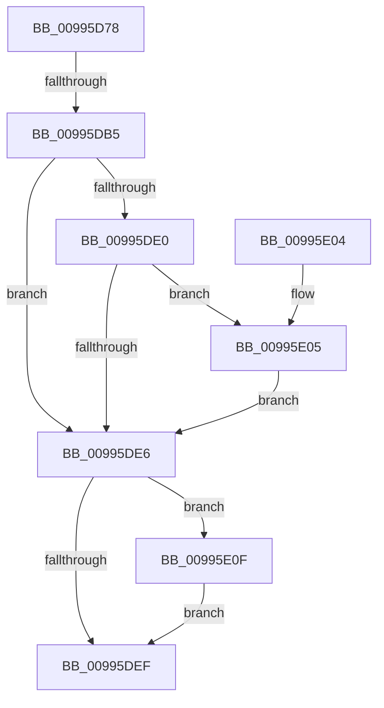

# PnpGetServiceStartType

- RVA: `0x00995D78`–`0x00995E16` (길이 `158` bytes)
- VA: `0x0000000140995D78`
- 실행 섹션: `PAGE`
- PDB 이름 있음: `예`; PDB Function 태그: `예`
- unwind 정보 RVA: `0x000991C4`
- 디코드: `46`개 명령, `158/158` bytes 표시
- 미해석 바이트: `0` (있으면 어셈블리에 `.byte`로 보존)

> 이 문서는 커널 이미지의 기계어와 PDB 기호를 분석해 생성했습니다. 4번과 5번은 함수 원형과 자료형을 바이너리 사용 방식에서 추정한 C 해석이며 원본 소스 복구 결과는 아닙니다.

## 1. Dependencies

- 직접 호출 지점: **2**; 고유 호출 대상: **2**
- 직접 호출자로 확인된 함수: **1**
- RIP 상대 이미지 참조: **2**

### Outgoing calls
- `0x00995DD5` → [PnpCtxRegQueryValue](PnpCtxRegQueryValue_function_009940FC.md) (function, `0x009940FC`)
- `0x00995E0F` → [ZwClose](../../text/6A/ZwClose_function_006AD2B0.md) (function, `0x006AD2B0`)

### Direct callers
- [PipCallDriverAddDeviceQueryRoutine](PipCallDriverAddDeviceQueryRoutine_function_00996604.md) at `0x009967F9`

### Static image references
- `0x00995DA5` → RVA `0x00EFF060` (`.data`; read)
- `0x00995DC6` → RVA `0x00AFDF50` (` ?? ::NNGAKEGL::`string'`; read)

## 2. Other-region calls and transfers

- 다른 실행 섹션으로 향하는 call: **1**
  - `0x00995E0F` → [ZwClose](../../text/6A/ZwClose_function_006AD2B0.md) (`PAGE` → `.text`)
- call이 아닌 외부 분기/꼬리 이동: **1**
  - `0x00995DAF` → [sub_00B2C1C4](../B2/Unknown_function_00B2C1C4.md) (`tail-transfer`)

## 3. Assembly (complete function range)

```asm
00995D78  48 89 5C 24 08                  mov qword ptr [rsp + 8], rbx
00995D7D  48 89 74 24 10                  mov qword ptr [rsp + 0x10], rsi
00995D82  55                              push rbp
00995D83  57                              push rdi
00995D84  41 56                           push r14
00995D86  48 8B EC                        mov rbp, rsp
00995D89  48 83 EC 40                     sub rsp, 0x40
00995D8D  83 65 30 00                     and dword ptr [rbp + 0x30], 0
00995D91  41 BE 04 00 00 00               mov r14d, 4
00995D97  48 83 65 F0 00                  and qword ptr [rbp - 0x10], 0
00995D9C  49 8B F8                        mov rdi, r8
00995D9F  45 89 30                        mov dword ptr [r8], r14d
00995DA2  48 8B F2                        mov rsi, rdx
00995DA5  F6 05 B4 92 56 00 01            test byte ptr [rip + 0x5692b4], 1
00995DAC  48 8B D9                        mov rbx, rcx
00995DAF  0F 85 0F 64 19 00               jne 0x140b2c1c4
00995DB5  48 8D 45 38                     lea rax, [rbp + 0x38]
00995DB9  44 89 75 38                     mov dword ptr [rbp + 0x38], r14d
00995DBD  48 89 44 24 28                  mov qword ptr [rsp + 0x28], rax
00995DC2  4C 8D 4D 30                     lea r9, [rbp + 0x30]
00995DC6  4C 8D 05 83 81 16 00            lea r8, [rip + 0x168183]
00995DCD  48 89 7C 24 20                  mov qword ptr [rsp + 0x20], rdi
00995DD2  48 8B D6                        mov rdx, rsi
00995DD5  E8 22 E3 FF FF                  call 0x1409940fc
00995DDA  8B D8                           mov ebx, eax
00995DDC  85 C0                           test eax, eax
00995DDE  78 06                           js 0x140995de6
00995DE0  44 39 75 30                     cmp dword ptr [rbp + 0x30], r14d
00995DE4  75 1F                           jne 0x140995e05
00995DE6  48 8B 4D F0                     mov rcx, qword ptr [rbp - 0x10]
00995DEA  48 85 C9                        test rcx, rcx
00995DED  75 20                           jne 0x140995e0f
00995DEF  48 8B 74 24 68                  mov rsi, qword ptr [rsp + 0x68]
00995DF4  8B C3                           mov eax, ebx
00995DF6  48 8B 5C 24 60                  mov rbx, qword ptr [rsp + 0x60]
00995DFB  48 83 C4 40                     add rsp, 0x40
00995DFF  41 5E                           pop r14
00995E01  5F                              pop rdi
00995E02  5D                              pop rbp
00995E03  C3                              ret
00995E04  CC                              int3
00995E05  BB 34 00 00 C0                  mov ebx, 0xc0000034
00995E0A  44 89 37                        mov dword ptr [rdi], r14d
00995E0D  EB D7                           jmp 0x140995de6
00995E0F  E8 9C 74 D1 FF                  call 0x1406ad2b0
00995E14  EB D9                           jmp 0x140995def
```

## 4. C-style interpretation (structured pseudocode)

```c
__int64 __fastcall PnpGetServiceStartType(__int64 a1, __int64 a2, __int64 a3)
{
    __int64 result;
    __int64 v_rsp;
    unsigned __int64 v_stack_m28;
    unsigned __int64 v_stack_m30;
    unsigned __int64 v_stack_m38;
    unsigned __int64 v_stack_p10;
    unsigned int v_stack_p18;
    unsigned __int64 v_stack_p20;
    unsigned __int64 v_stack_p8;

    v_stack_p8 = v_rbx;
    v_stack_p10 = v_rsi;
    v_rsp = (v_rsp) - (64);
    *(unsigned int *)(a3) = 4;
    v_stack_p20 = 4;
    v_stack_m30 = v_stack_p20;
    v_stack_m38 = a3;
    result = PnpCtxRegQueryValue(a1, a2, v_rip + 1474947, v_stack_p18);
    if (sign_flag) goto loc_00995DE6;
    if (v_stack_p18 != 4) goto loc_00995E05;
loc_00995DE6:
    if (v_stack_m28 != 0) goto loc_00995E0F;
loc_00995DEF:
    v_rsp = (v_rsp) + (64);
    return (unsigned int)((unsigned int)((unsigned int)((unsigned int)(result))));
loc_00995E05:
    *(unsigned int *)(a3) = 4;
    goto loc_00995DE6;
loc_00995E0F:
    result = ZwClose(v_stack_m28, a2, v_rip + 1474947, v_stack_p18);
    goto loc_00995DEF;
}
```

## 5. (Beta) C Style

```c
int64_t PnpGetServiceStartType(int64_t Arg1, int64_t Arg2, void *Arg3)
{
    uint8_t *arg3 = (uint8_t *)Arg3;

    int64_t result;
    int64_t local_rsp;
    uint64_t v_stack_m28;
    uint64_t v_stack_m30;
    uint64_t v_stack_m38;
    uint64_t v_stack_p10;
    uint32_t v_stack_p18;
    uint64_t v_stack_p20;
    uint64_t v_stack_p8;

    v_stack_p8 = local_rbx;
    v_stack_p10 = local_rsi;
    local_rsp = (local_rsp) - (64);
    *(uint32_t *)(arg3) = 4;
    v_stack_p20 = 4;
    v_stack_m30 = v_stack_p20;
    v_stack_m38 = Arg3;
    result = PnpCtxRegQueryValue(Arg1, Arg2, v_rip + 1474947, v_stack_p18);
    if (sign_flag) goto loc_00995DE6;
    if (v_stack_p18 != 4) goto loc_00995E05;
loc_00995DE6:
    if (v_stack_m28 != 0) goto loc_00995E0F;
loc_00995DEF:
    local_rsp = (local_rsp) + (64);
    return (uint32_t)((uint32_t)((uint32_t)((uint32_t)(result))));
loc_00995E05:
    *(uint32_t *)(arg3) = 4;
    goto loc_00995DE6;
loc_00995E0F:
    result = ZwClose(v_stack_m28, Arg2, v_rip + 1474947, v_stack_p18);
    goto loc_00995DEF;
}
```

### 관측된 메모리 오프셋

구조체 형식이 확인되지 않은 접근은 인자 기준의 오프셋으로만 기록했습니다.

| 기준 인자 | 오프셋 표현 | 폭 (bit) | 접근 |
|---|---:|---:|---|
| `Arg3` | `+ 0x0` | `32` | `W` |

## 6. Execution-region graph

[열기: 2D/3D 그래프와 함수 탐색 컨트롤 패널](../../../control-panel.html?section=page&rva=0x00995D78&view=graph)

- 2D 그래프는 위에서 아래로 흐르고, 3D 그래프는 빈 공간을 드래그해 회전합니다. Shift+드래그는 이동, 휠은 확대·축소, 함수 노드 선택은 대상 보고서 이동입니다.

### Static fallback


