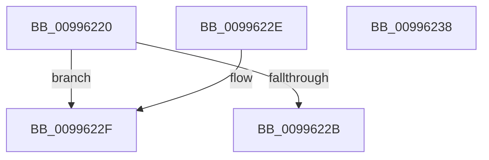

# PnpIsLegacyDriver

- RVA: `0x00996220`–`0x00996239` (길이 `25` bytes)
- VA: `0x0000000140996220`
- 실행 섹션: `PAGE`
- PDB 이름 있음: `예`; PDB Function 태그: `아니요`
- unwind 정보 RVA: `0x000DB714`
- 디코드: `11`개 명령, `25/25` bytes 표시
- 미해석 바이트: `0` (있으면 어셈블리에 `.byte`로 보존)

> 이 문서는 커널 이미지의 기계어와 PDB 기호를 분석해 생성했습니다. 4번과 5번은 함수 원형과 자료형을 바이너리 사용 방식에서 추정한 C 해석이며 원본 소스 복구 결과는 아닙니다.

## 1. Dependencies

- 직접 호출 지점: **0**; 고유 호출 대상: **0**
- 직접 호출자로 확인된 함수: **3**
- RIP 상대 이미지 참조: **0**

### Outgoing calls
- 직접 디코드된 call 명령이 없습니다.

### Direct callers
- [PipCallDriverAddDeviceQueryRoutine](PipCallDriverAddDeviceQueryRoutine_function_00996604.md) at `0x0099672F`
- [IopUnloadDriver](../AB/IopUnloadDriver_function_00ABF868.md) at `0x00ABFB2E`
- [IovpBuildDriverObjectList](../../pagevrfy/B9/IovpBuildDriverObjectList_function_00B92884.md) at `0x00B92891`

### Static image references
- 디코드된 RIP-relative 메모리 참조가 없습니다.

## 2. Other-region calls and transfers

- 다른 실행 섹션으로 향하는 call: **0**
- 별도 외부 분기/꼬리 이동을 확인하지 못했습니다.

## 3. Assembly (complete function range)

```asm
00996220  48 8B 41 30                     mov rax, qword ptr [rcx + 0x30]
00996224  48 83 78 08 00                  cmp qword ptr [rax + 8], 0
00996229  74 04                           je 0x14099622f
0099622B  33 C0                           xor eax, eax
0099622D  C3                              ret
0099622E  CC                              int3
0099622F  8B 41 10                        mov eax, dword ptr [rcx + 0x10]
00996232  D1 E8                           shr eax, 1
00996234  83 E0 01                        and eax, 1
00996237  C3                              ret
00996238  CC                              int3
```

## 4. C-style interpretation (structured pseudocode)

```c
__int64 __fastcall PnpIsLegacyDriver(__int64 a1)
{
    __int64 result;

    if ((*(unsigned __int64 *)(*(unsigned __int64 *)(a1 + 48) + 8)) == 0) goto loc_0099622F;
    result = 0;
    return result;
loc_0099622F:
    result = (unsigned int)(((unsigned int)(*(unsigned int *)(a1 + 16))) >> (1));
    result = (unsigned int)((result) & (1));
    return result;
}
```

## 5. (Beta) C Style

```c
int64_t PnpIsLegacyDriver(void *Arg1)
{
    uint8_t *arg1 = (uint8_t *)Arg1;

    int64_t result;

    if ((*(uint64_t *)(*(uint64_t *)(arg1 + 0x30) + 0x8)) == 0) goto loc_0099622F;
    result = 0;
    return result;
loc_0099622F:
    result = (uint32_t)(((uint32_t)(*(uint32_t *)(arg1 + 0x10))) >> (1));
    result = (uint32_t)((result) & (1));
    return result;
}
```

### 관측된 메모리 오프셋

구조체 형식이 확인되지 않은 접근은 인자 기준의 오프셋으로만 기록했습니다.

| 기준 인자 | 오프셋 표현 | 폭 (bit) | 접근 |
|---|---:|---:|---|
| `Arg1` | `+ 0x10` | `32` | `R` |
| `Arg1` | `+ 0x30` | `64` | `R` |

## 6. Execution-region graph

[열기: 2D/3D 그래프와 함수 탐색 컨트롤 패널](../../../control-panel.html?section=page&rva=0x00996220&view=graph)

- 2D 그래프는 위에서 아래로 흐르고, 3D 그래프는 빈 공간을 드래그해 회전합니다. Shift+드래그는 이동, 휠은 확대·축소, 함수 노드 선택은 대상 보고서 이동입니다.

### Static fallback


