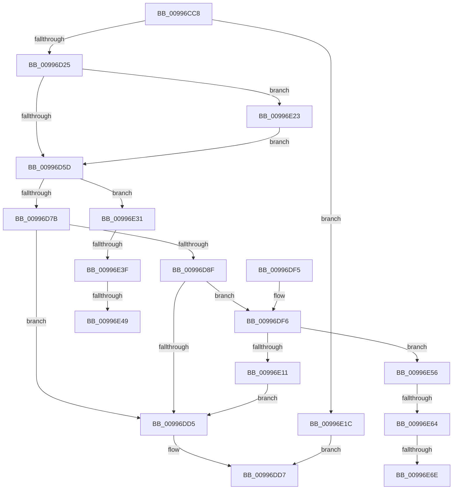

# PnpPrepareDriverLoading

- RVA: `0x00996CC8`–`0x00996E80` (길이 `440` bytes)
- VA: `0x0000000140996CC8`
- 실행 섹션: `PAGE`
- PDB 이름 있음: `예`; PDB Function 태그: `예`
- unwind 정보 RVA: `0x000992C4`
- 디코드: `117`개 명령, `440/440` bytes 표시
- 미해석 바이트: `0` (있으면 어셈블리에 `.byte`로 보존)

> 이 문서는 커널 이미지의 기계어와 PDB 기호를 분석해 생성했습니다. 4번과 5번은 함수 원형과 자료형을 바이너리 사용 방식에서 추정한 C 해석이며 원본 소스 복구 결과는 아닙니다.

## 1. Dependencies

- 직접 호출 지점: **9**; 고유 호출 대상: **8**
- 직접 호출자로 확인된 함수: **2**
- RIP 상대 이미지 참조: **4**

### Outgoing calls
- `0x00996D17` → [RtlImageNtHeader](../../text/44/RtlImageNtHeader_function_00443B60.md) (function, `0x00443B60`)
- `0x00996D47` → [PpCheckInDriverDatabase](PpCheckInDriverDatabase_function_0099A9E4.md) (function, `0x0099A9E4`)
- `0x00996D6E` → [IopGetRegistryValue](IopGetRegistryValue_function_009990EC.md) (function, `0x009990EC`)
- `0x00996D86` → [RtlInitUnicodeStringEx](../../text/46/RtlInitUnicodeStringEx_function_00463960.md) (function, `0x00463960`)
- `0x00996DCC` → [ZwOpenKey](../../text/6A/ZwOpenKey_function_006AD310.md) (function, `0x006AD310`)
- `0x00996DDE` → [_security_check_cookie](../../text/6A/_security_check_cookie_function_006AC640.md) (function, `0x006AC640`)
- `0x00996E08` → [IopGetRegistryValue](IopGetRegistryValue_function_009990EC.md) (function, `0x009990EC`)
- `0x00996E15` → [NtClose](../86/NtClose_function_00868870.md) (function, `0x00868870`)
- `0x00996E27` → [PnpSetBlockedDriverEvent](../73/PnpSetBlockedDriverEvent_function_00738114.md) (function, `0x00738114`)

### Direct callers
- [IopLoadDriver](IopLoadDriver_function_00997B54.md) at `0x00998020`
- [IopInitializeBuiltinDriver](../../init/C7/IopInitializeBuiltinDriver_function_00C7625C.md) at `0x00C765AE`

### Static image references
- `0x00996CDF` → RVA `0x00E0A740` (`.data`; read)
- `0x00996D64` → RVA `0x00AFDAB0` (` ?? ::NNGAKEGL::`string'`; read)
- `0x00996D7B` → RVA `0x00AFD4B0` (` ?? ::NNGAKEGL::`string'`; read)
- `0x00996E01` → RVA `0x00AFDAD0` (` ?? ::NNGAKEGL::`string'`; read)

## 2. Other-region calls and transfers

- 다른 실행 섹션으로 향하는 call: **4**
  - `0x00996D17` → [RtlImageNtHeader](../../text/44/RtlImageNtHeader_function_00443B60.md) (`PAGE` → `.text`)
  - `0x00996D86` → [RtlInitUnicodeStringEx](../../text/46/RtlInitUnicodeStringEx_function_00463960.md) (`PAGE` → `.text`)
  - `0x00996DCC` → [ZwOpenKey](../../text/6A/ZwOpenKey_function_006AD310.md) (`PAGE` → `.text`)
  - `0x00996DDE` → [_security_check_cookie](../../text/6A/_security_check_cookie_function_006AC640.md) (`PAGE` → `.text`)
- call이 아닌 외부 분기/꼬리 이동: **6**
  - `0x00996E39` → [sub_00B2C56E](../B2/Unknown_function_00B2C56E.md) (`tail-transfer`)
  - `0x00996E43` → [sub_00B2C56E](../B2/Unknown_function_00B2C56E.md) (`tail-transfer`)
  - `0x00996E51` → [sub_00B2C56E](../B2/Unknown_function_00B2C56E.md) (`tail-transfer`)
  - `0x00996E5E` → [sub_00B2C56E + 0xD](../B2/Unknown_function_00B2C56E.md) (`tail-transfer`)
  - `0x00996E68` → [sub_00B2C56E + 0xD](../B2/Unknown_function_00B2C56E.md) (`tail-transfer`)
  - `0x00996E7B` → [sub_00B2C56E + 0xD](../B2/Unknown_function_00B2C56E.md) (`tail-transfer`)

## 3. Assembly (complete function range)

```asm
00996CC8  40 55                           push rbp
00996CCA  53                              push rbx
00996CCB  56                              push rsi
00996CCC  57                              push rdi
00996CCD  41 54                           push r12
00996CCF  41 56                           push r14
00996CD1  41 57                           push r15
00996CD3  48 8D 6C 24 E9                  lea rbp, [rsp - 0x17]
00996CD8  48 81 EC A0 00 00 00            sub rsp, 0xa0
00996CDF  48 8B 05 5A 3A 47 00            mov rax, qword ptr [rip + 0x473a5a]
00996CE6  48 33 C4                        xor rax, rsp
00996CE9  48 89 45 07                     mov qword ptr [rbp + 7], rax
00996CED  48 8B 75 77                     mov rsi, qword ptr [rbp + 0x77]
00996CF1  4C 8B E1                        mov r12, rcx
00996CF4  4C 8B 75 7F                     mov r14, qword ptr [rbp + 0x7f]
00996CF8  0F 57 C0                        xorps xmm0, xmm0
00996CFB  48 83 65 A7 00                  and qword ptr [rbp - 0x59], 0
00996D00  49 8B C8                        mov rcx, r8
00996D03  45 8B F9                        mov r15d, r9d
00996D06  49 8B F8                        mov rdi, r8
00996D09  83 26 00                        and dword ptr [rsi], 0
00996D0C  48 8B DA                        mov rbx, rdx
00996D0F  41 C6 06 00                     mov byte ptr [r14], 0
00996D13  0F 11 45 B7                     movups xmmword ptr [rbp - 0x49], xmm0
00996D17  E8 44 CE AA FF                  call 0x140443b60
00996D1C  48 85 C0                        test rax, rax
00996D1F  0F 84 F7 00 00 00               je 0x140996e1c
00996D25  0F 57 C0                        xorps xmm0, xmm0
00996D28  48 8D 4D F7                     lea rcx, [rbp - 9]
00996D2C  48 89 4C 24 28                  mov qword ptr [rsp + 0x28], rcx
00996D31  4C 8B C7                        mov r8, rdi
00996D34  0F 11 45 F7                     movups xmmword ptr [rbp - 9], xmm0
00996D38  44 8B 48 50                     mov r9d, dword ptr [rax + 0x50]
00996D3C  49 8B CC                        mov rcx, r12
00996D3F  48 8B D3                        mov rdx, rbx
00996D42  44 89 7C 24 20                  mov dword ptr [rsp + 0x20], r15d
00996D47  E8 98 3C 00 00                  call 0x14099a9e4
00996D4C  8B F8                           mov edi, eax
00996D4E  8D 88 95 FC FF 3F               lea ecx, [rax + 0x3ffffc95]
00996D54  83 F9 01                        cmp ecx, 1
00996D57  0F 86 C6 00 00 00               jbe 0x140996e23
00996D5D  4C 8D 4D A7                     lea r9, [rbp - 0x59]
00996D61  45 33 C0                        xor r8d, r8d
00996D64  48 8D 15 45 6D 16 00            lea rdx, [rip + 0x166d45]
00996D6B  48 8B CB                        mov rcx, rbx
00996D6E  E8 79 23 00 00                  call 0x1409990ec
00996D73  85 C0                           test eax, eax
00996D75  0F 89 B6 00 00 00               jns 0x140996e31
00996D7B  48 8D 15 2E 67 16 00            lea rdx, [rip + 0x16672e]
00996D82  48 8D 4D B7                     lea rcx, [rbp - 0x49]
00996D86  E8 D5 CB AC FF                  call 0x140463960
00996D8B  85 C0                           test eax, eax
00996D8D  78 46                           js 0x140996dd5
00996D8F  83 65 E3 00                     and dword ptr [rbp - 0x1d], 0
00996D93  48 8D 45 B7                     lea rax, [rbp - 0x49]
00996D97  48 83 65 AF 00                  and qword ptr [rbp - 0x51], 0
00996D9C  4C 8D 45 C7                     lea r8, [rbp - 0x39]
00996DA0  0F 57 C0                        xorps xmm0, xmm0
00996DA3  48 C7 45 C7 30 00 00 00         mov qword ptr [rbp - 0x39], 0x30
00996DAB  83 65 CB 00                     and dword ptr [rbp - 0x35], 0
00996DAF  48 8D 4D AF                     lea rcx, [rbp - 0x51]
00996DB3  BA 3F 00 0F 00                  mov edx, 0xf003f
00996DB8  48 89 45 D7                     mov qword ptr [rbp - 0x29], rax
00996DBC  F3 0F 7F 45 E7                  movdqu xmmword ptr [rbp - 0x19], xmm0
00996DC1  48 89 5D CF                     mov qword ptr [rbp - 0x31], rbx
00996DC5  C7 45 DF 40 02 00 00            mov dword ptr [rbp - 0x21], 0x240
00996DCC  E8 3F 65 D1 FF                  call 0x1406ad310
00996DD1  85 C0                           test eax, eax
00996DD3  79 21                           jns 0x140996df6
00996DD5  8B C7                           mov eax, edi
00996DD7  48 8B 4D 07                     mov rcx, qword ptr [rbp + 7]
00996DDB  48 33 CC                        xor rcx, rsp
00996DDE  E8 5D 58 D1 FF                  call 0x1406ac640
00996DE3  48 81 C4 A0 00 00 00            add rsp, 0xa0
00996DEA  41 5F                           pop r15
00996DEC  41 5E                           pop r14
00996DEE  41 5C                           pop r12
00996DF0  5F                              pop rdi
00996DF1  5E                              pop rsi
00996DF2  5B                              pop rbx
00996DF3  5D                              pop rbp
00996DF4  C3                              ret
00996DF5  CC                              int3
00996DF6  48 8B 4D AF                     mov rcx, qword ptr [rbp - 0x51]
00996DFA  4C 8D 4D A7                     lea r9, [rbp - 0x59]
00996DFE  45 33 C0                        xor r8d, r8d
00996E01  48 8D 15 C8 6C 16 00            lea rdx, [rip + 0x166cc8]
00996E08  E8 DF 22 00 00                  call 0x1409990ec
00996E0D  85 C0                           test eax, eax
00996E0F  79 45                           jns 0x140996e56
00996E11  48 8B 4D AF                     mov rcx, qword ptr [rbp - 0x51]
00996E15  E8 56 1A ED FF                  call 0x140868870
00996E1A  EB B9                           jmp 0x140996dd5
00996E1C  B8 01 00 00 C0                  mov eax, 0xc0000001
00996E21  EB B4                           jmp 0x140996dd7
00996E23  48 8D 4D F7                     lea rcx, [rbp - 9]
00996E27  E8 E8 12 DA FF                  call 0x140738114
00996E2C  E9 2C FF FF FF                  jmp 0x140996d5d
00996E31  48 8B 4D A7                     mov rcx, qword ptr [rbp - 0x59]
00996E35  83 79 04 04                     cmp dword ptr [rcx + 4], 4
00996E39  0F 85 2F 57 19 00               jne 0x140b2c56e
00996E3F  83 79 0C 04                     cmp dword ptr [rcx + 0xc], 4
00996E43  0F 85 25 57 19 00               jne 0x140b2c56e
00996E49  8B 41 08                        mov eax, dword ptr [rcx + 8]
00996E4C  8B 14 08                        mov edx, dword ptr [rax + rcx]
00996E4F  89 16                           mov dword ptr [rsi], edx
00996E51  E9 18 57 19 00                  jmp 0x140b2c56e
00996E56  48 8B 4D A7                     mov rcx, qword ptr [rbp - 0x59]
00996E5A  83 79 04 04                     cmp dword ptr [rcx + 4], 4
00996E5E  0F 85 17 57 19 00               jne 0x140b2c57b
00996E64  83 79 0C 04                     cmp dword ptr [rcx + 0xc], 4
00996E68  0F 85 0D 57 19 00               jne 0x140b2c57b
00996E6E  8B 41 08                        mov eax, dword ptr [rcx + 8]
00996E71  83 3C 08 00                     cmp dword ptr [rax + rcx], 0
00996E75  0F 95 C0                        setne al
00996E78  41 88 06                        mov byte ptr [r14], al
00996E7B  E9 FB 56 19 00                  jmp 0x140b2c57b
```

## 4. C-style interpretation (structured pseudocode)

```c
__int64 __fastcall PnpPrepareDriverLoading(__int64 a1, __int64 a2, __int64 a3, int a4, __int64 a5, __int64 a6)
{
    __int64 result;
    __int64 v_rsp;
    unsigned __int64 v_stack_m48;
    unsigned __int64 v_stack_m4F;
    unsigned __int64 v_stack_m58;
    unsigned __int64 v_stack_m68;
    unsigned int v_stack_m6C;
    unsigned int v_stack_m70;
    unsigned __int64 v_stack_m78;
    unsigned __int64 v_stack_m80;
    unsigned int v_stack_m84;
    unsigned __int64 v_stack_m88;
    unsigned __int64 v_stack_m98;
    unsigned __int64 v_stack_mA0;
    unsigned __int64 v_stack_mA8;
    unsigned __int64 v_stack_mB0;
    unsigned int v_stack_mB8;

    v_rsp = (v_rsp) - (160);
    result = (*(unsigned __int64 *)(v_rip + 4667994)) ^ (v_rsp);
    v_stack_m48 = result;
    *(unsigned __int8 *)(a6) = 0;
    v_stack_m98 = v_xmm0;
    result = RtlImageNtHeader(a3, a2, a3, a4);
    if (result == 0) goto loc_00996E1C;
    v_stack_mB0 = v_stack_m58;
    v_stack_m58 = v_xmm0;
    v_stack_mB8 = (unsigned int)((unsigned int)(a4));
    result = PpCheckInDriverDatabase(a1, a2, a3, (unsigned int)(*(unsigned int *)(result + 80)));
    if (((unsigned int)(result + 1073740949)) <= 1) goto loc_00996E23;
loc_00996D5D:
    a3 = 0;
    result = IopGetRegistryValue(a2, v_rip + 1469765, a3, v_stack_mA8);
    if (!sign_flag) goto loc_00996E31;
    result = RtlInitUnicodeStringEx(v_stack_m98, v_rip + 1468206, a3, v_stack_mA8);
    if (sign_flag) goto loc_00996DD5;
    v_stack_m88 = 48;
    v_stack_m78 = v_stack_m98;
    v_stack_m68 = v_xmm0;
    v_stack_m80 = a2;
    v_stack_m70 = 576;
    result = ZwOpenKey(v_stack_mA0, (unsigned int)(0xF003FULL), v_stack_m88, v_stack_mA8);
    if (!sign_flag) goto loc_00996DF6;
loc_00996DD5:
loc_00996DD7:
    a1 = (v_stack_m48) ^ (v_rsp);
    result = _security_check_cookie(a1, (unsigned int)(0xF003FULL), v_stack_m88, v_stack_mA8);
    v_rsp = (v_rsp) + (160);
    return result;
loc_00996DF6:
    a3 = 0;
    result = IopGetRegistryValue(v_stack_mA0, v_rip + 1469640, a3, v_stack_mA8);
    if (!sign_flag) goto loc_00996E56;
    result = NtClose(v_stack_mA0, v_rip + 1469640, a3, v_stack_mA8);
    goto loc_00996DD5;
loc_00996E1C:
    goto loc_00996DD7;
loc_00996E23:
    result = PnpSetBlockedDriverEvent(v_stack_m58, v_rip + 1469640, a3, v_stack_mA8);
    goto loc_00996D5D;
loc_00996E31:
    *(unsigned int *)(a5) = (unsigned int)((unsigned int)(*(unsigned int *)((unsigned int)(*(unsigned int *)(v_stack_mA8 + 8)) + v_stack_mA8 * 1)));
loc_00996E56:
    result = ((*(unsigned int *)((unsigned int)(*(unsigned int *)(v_stack_mA8 + 8)) + v_stack_mA8 * 1)) != 0) ? 1 : 0;
    *(unsigned __int8 *)(a6) = (unsigned __int8)(result);
}
```

## 5. (Beta) C Style

```c
int64_t PnpPrepareDriverLoading(int64_t Arg1, int64_t Arg2, int64_t Arg3, int32_t Arg4, void *Arg5, void *Arg6)
{
    uint8_t *arg5 = (uint8_t *)Arg5;
    uint8_t *arg6 = (uint8_t *)Arg6;

    int64_t result;
    int64_t local_rsp;
    uint64_t v_stack_m48;
    uint64_t v_stack_m4F;
    uint64_t v_stack_m58;
    uint64_t v_stack_m68;
    uint32_t v_stack_m6C;
    uint32_t v_stack_m70;
    uint64_t v_stack_m78;
    uint64_t v_stack_m80;
    uint32_t v_stack_m84;
    uint64_t v_stack_m88;
    uint64_t v_stack_m98;
    uint64_t v_stack_mA0;
    uint64_t v_stack_mA8;
    uint64_t v_stack_mB0;
    uint32_t v_stack_mB8;

    local_rsp = (local_rsp) - (160);
    result = (*(uint64_t *)(v_rip + 0x473A5A)) ^ (local_rsp);
    v_stack_m48 = result;
    *(uint8_t *)(arg6) = 0;
    v_stack_m98 = v_xmm0;
    result = RtlImageNtHeader(Arg3, Arg2, Arg3, Arg4);
    if (result == 0) goto loc_00996E1C;
    v_stack_mB0 = v_stack_m58;
    v_stack_m58 = v_xmm0;
    v_stack_mB8 = (uint32_t)((uint32_t)(Arg4));
    result = PpCheckInDriverDatabase(Arg1, Arg2, Arg3, (uint32_t)(*(uint32_t *)(result + 0x50)));
    if (((uint32_t)(result + 1073740949)) <= 1) goto loc_00996E23;
loc_00996D5D:
    Arg3 = 0;
    result = IopGetRegistryValue(Arg2, v_rip + 1469765, Arg3, v_stack_mA8);
    if (!sign_flag) goto loc_00996E31;
    result = RtlInitUnicodeStringEx(v_stack_m98, v_rip + 1468206, Arg3, v_stack_mA8);
    if (sign_flag) goto loc_00996DD5;
    v_stack_m88 = 48;
    v_stack_m78 = v_stack_m98;
    v_stack_m68 = v_xmm0;
    v_stack_m80 = Arg2;
    v_stack_m70 = 576;
    result = ZwOpenKey(v_stack_mA0, (uint32_t)(0xF003FULL), v_stack_m88, v_stack_mA8);
    if (!sign_flag) goto loc_00996DF6;
loc_00996DD5:
loc_00996DD7:
    Arg1 = (v_stack_m48) ^ (local_rsp);
    result = _security_check_cookie(Arg1, (uint32_t)(0xF003FULL), v_stack_m88, v_stack_mA8);
    local_rsp = (local_rsp) + (160);
    return result;
loc_00996DF6:
    Arg3 = 0;
    result = IopGetRegistryValue(v_stack_mA0, v_rip + 1469640, Arg3, v_stack_mA8);
    if (!sign_flag) goto loc_00996E56;
    result = NtClose(v_stack_mA0, v_rip + 1469640, Arg3, v_stack_mA8);
    goto loc_00996DD5;
loc_00996E1C:
    goto loc_00996DD7;
loc_00996E23:
    result = PnpSetBlockedDriverEvent(v_stack_m58, v_rip + 1469640, Arg3, v_stack_mA8);
    goto loc_00996D5D;
loc_00996E31:
    *(uint32_t *)(arg5) = (uint32_t)((uint32_t)(*(uint32_t *)((uint32_t)(*(uint32_t *)(v_stack_mA8 + 0x8)) + v_stack_mA8 * 1)));
loc_00996E56:
    result = ((*(uint32_t *)((uint32_t)(*(uint32_t *)(v_stack_mA8 + 0x8)) + v_stack_mA8 * 1)) != 0) ? 1 : 0;
    *(uint8_t *)(arg6) = (uint8_t)(result);
}
```

### 관측된 메모리 오프셋

구조체 형식이 확인되지 않은 접근은 인자 기준의 오프셋으로만 기록했습니다.

| 기준 인자 | 오프셋 표현 | 폭 (bit) | 접근 |
|---|---:|---:|---|
| `Arg5` | `+ 0x0` | `32` | `R/W` |
| `Arg5` | `+ 0x0` | `32` | `W` |
| `Arg6` | `+ 0x0` | `8` | `W` |

## 6. Execution-region graph

[열기: 2D/3D 그래프와 함수 탐색 컨트롤 패널](../../../control-panel.html?section=page&rva=0x00996CC8&view=graph)

- 2D 그래프는 위에서 아래로 흐르고, 3D 그래프는 빈 공간을 드래그해 회전합니다. Shift+드래그는 이동, 휠은 확대·축소, 함수 노드 선택은 대상 보고서 이동입니다.

### Static fallback


