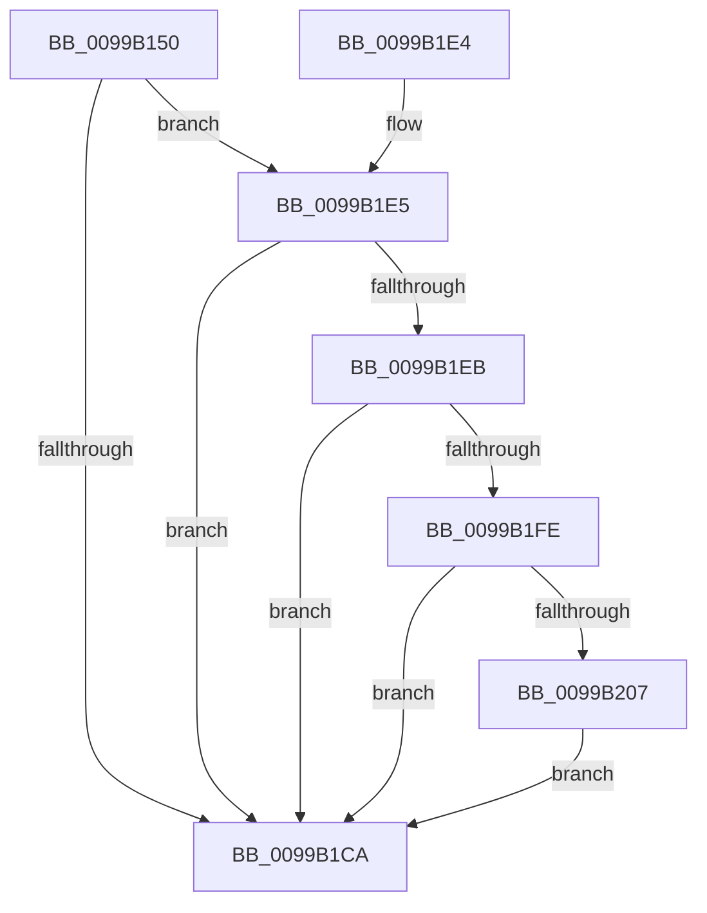

# PnpQueryDeviceText

- RVA: `0x0099B150`–`0x0099B216` (길이 `198` bytes)
- VA: `0x000000014099B150`
- 실행 섹션: `PAGE`
- PDB 이름 있음: `예`; PDB Function 태그: `아니요`
- unwind 정보 RVA: `0x00099688`
- 디코드: `60`개 명령, `198/198` bytes 표시
- 미해석 바이트: `0` (있으면 어셈블리에 `.byte`로 보존)

> 이 문서는 커널 이미지의 기계어와 PDB 기호를 분석해 생성했습니다. 4번과 5번은 함수 원형과 자료형을 바이너리 사용 방식에서 추정한 C 해석이며 원본 소스 복구 결과는 아닙니다.

## 1. Dependencies

- 직접 호출 지점: **4**; 고유 호출 대상: **4**
- 직접 호출자로 확인된 함수: **1**
- RIP 상대 이미지 참조: **1**

### Outgoing calls
- `0x0099B188` → [memset](../../text/6C/memset_function_006C6C40.md) (function, `0x006C6C40`)
- `0x0099B1BA` → [IopSynchronousCall](../8F/IopSynchronousCall_function_008FB018.md) (function, `0x008FB018`)
- `0x0099B1F5` → [PiNormalizeDeviceText](PiNormalizeDeviceText_function_0099A43C.md) (function, `0x0099A43C`)
- `0x0099B20F` → [ExFreePoolWithTag](../../poolcode/B8/ExFreePoolWithTag_function_00B82870.md) (function, `0x00B82870`)

### Direct callers
- [PiProcessNewDeviceNode](../A2/PiProcessNewDeviceNode_function_00A28F20.md) at `0x00A290EC`
- [PiProcessNewDeviceNode](../A2/PiProcessNewDeviceNode_function_00A28F20.md) at `0x00A290FC`

### Static image references
- `0x0099B18D` → RVA `0x00FD9A98` (`PAGEDATA`; read)

## 2. Other-region calls and transfers

- 다른 실행 섹션으로 향하는 call: **2**
  - `0x0099B188` → [memset](../../text/6C/memset_function_006C6C40.md) (`PAGE` → `.text`)
  - `0x0099B20F` → [ExFreePoolWithTag](../../poolcode/B8/ExFreePoolWithTag_function_00B82870.md) (`PAGE` → `POOLCODE`)
- 별도 외부 분기/꼬리 이동을 확인하지 못했습니다.

## 3. Assembly (complete function range)

```asm
0099B150  48 89 5C 24 08                  mov qword ptr [rsp + 8], rbx
0099B155  48 89 74 24 10                  mov qword ptr [rsp + 0x10], rsi
0099B15A  55                              push rbp
0099B15B  57                              push rdi
0099B15C  41 56                           push r14
0099B15E  48 8B EC                        mov rbp, rsp
0099B161  48 81 EC 80 00 00 00            sub rsp, 0x80
0099B168  48 83 65 38 00                  and qword ptr [rbp + 0x38], 0
0099B16D  8B DA                           mov ebx, edx
0099B16F  48 83 65 B0 00                  and qword ptr [rbp - 0x50], 0
0099B174  33 D2                           xor edx, edx
0099B176  49 83 21 00                     and qword ptr [r9], 0
0099B17A  48 8B F9                        mov rdi, rcx
0099B17D  48 8D 4D B8                     lea rcx, [rbp - 0x48]
0099B181  4D 8B F1                        mov r14, r9
0099B184  44 8D 42 48                     lea r8d, [rdx + 0x48]
0099B188  E8 B3 BA D2 FF                  call 0x1406c6c40
0099B18D  8B 05 05 E9 63 00               mov eax, dword ptr [rip + 0x63e905]
0099B193  48 8D 55 B8                     lea rdx, [rbp - 0x48]
0099B197  89 5D C0                        mov dword ptr [rbp - 0x40], ebx
0099B19A  45 33 C9                        xor r9d, r9d
0099B19D  89 45 C8                        mov dword ptr [rbp - 0x38], eax
0099B1A0  BB BB 00 00 C0                  mov ebx, 0xc00000bb
0099B1A5  48 8D 45 38                     lea rax, [rbp + 0x38]
0099B1A9  66 C7 45 B8 1B 0C               mov word ptr [rbp - 0x48], 0xc1b
0099B1AF  44 8B C3                        mov r8d, ebx
0099B1B2  48 89 44 24 20                  mov qword ptr [rsp + 0x20], rax
0099B1B7  48 8B CF                        mov rcx, rdi
0099B1BA  E8 59 FE F5 FF                  call 0x1408fb018
0099B1BF  48 8B 75 38                     mov rsi, qword ptr [rbp + 0x38]
0099B1C3  8B F8                           mov edi, eax
0099B1C5  48 85 F6                        test rsi, rsi
0099B1C8  75 1B                           jne 0x14099b1e5
0099B1CA  4C 8D 9C 24 80 00 00 00         lea r11, [rsp + 0x80]
0099B1D2  8B C3                           mov eax, ebx
0099B1D4  49 8B 5B 20                     mov rbx, qword ptr [r11 + 0x20]
0099B1D8  49 8B 73 28                     mov rsi, qword ptr [r11 + 0x28]
0099B1DC  49 8B E3                        mov rsp, r11
0099B1DF  41 5E                           pop r14
0099B1E1  5F                              pop rdi
0099B1E2  5D                              pop rbp
0099B1E3  C3                              ret
0099B1E4  CC                              int3
0099B1E5  8B D8                           mov ebx, eax
0099B1E7  85 C0                           test eax, eax
0099B1E9  78 DF                           js 0x14099b1ca
0099B1EB  48 8D 55 B0                     lea rdx, [rbp - 0x50]
0099B1EF  49 89 36                        mov qword ptr [r14], rsi
0099B1F2  48 8B CE                        mov rcx, rsi
0099B1F5  E8 42 F2 FF FF                  call 0x14099a43c
0099B1FA  85 C0                           test eax, eax
0099B1FC  78 CC                           js 0x14099b1ca
0099B1FE  48 8B 45 B0                     mov rax, qword ptr [rbp - 0x50]
0099B202  48 85 C0                        test rax, rax
0099B205  74 C3                           je 0x14099b1ca
0099B207  33 D2                           xor edx, edx
0099B209  49 89 06                        mov qword ptr [r14], rax
0099B20C  48 8B CE                        mov rcx, rsi
0099B20F  E8 5C 76 1E 00                  call 0x140b82870
0099B214  EB B4                           jmp 0x14099b1ca
```

## 4. C-style interpretation (structured pseudocode)

```c
__int64 __fastcall PnpQueryDeviceText(__int64 a1, int a2, __int64 a3, __int64 a4)
{
    __int64 result;
    __int64 v_rsp;
    unsigned __int64 v_stack_m18;
    unsigned int v_stack_m50;
    unsigned int v_stack_m58;
    unsigned __int64 v_stack_m60;
    unsigned __int64 v_stack_m68;
    unsigned __int64 v_stack_m78;
    unsigned __int64 v_stack_p10;
    unsigned __int64 v_stack_p20;
    unsigned __int64 v_stack_p8;

    v_stack_p8 = v_rbx;
    v_stack_p10 = v_rsi;
    v_rsp = (v_rsp) - (128);
    a2 = 0;
    result = memset(v_stack_m60, a2, a2 + 72, a4);
    v_stack_m58 = (unsigned int)((unsigned int)(a2));
    a4 = 0;
    v_stack_m50 = (unsigned int)((unsigned int)(*(unsigned int *)(v_rip + 6547717)));
    v_stack_m60 = 0xC1BULL;
    v_stack_m78 = v_stack_p20;
    result = IopSynchronousCall(a1, v_stack_m60, (unsigned int)((unsigned int)((unsigned int)(0xC00000BBULL))), a4);
    if (v_stack_p20 != 0) goto loc_0099B1E5;
loc_0099B1CA:
    return (unsigned int)((unsigned int)((unsigned int)(0xC00000BBULL)));
loc_0099B1E5:
    if (sign_flag) goto loc_0099B1CA;
    *(unsigned __int64 *)(a4) = *(unsigned __int64 *)(v_stack_m18 + 40);
    result = PiNormalizeDeviceText(*(unsigned __int64 *)(v_stack_m18 + 40), v_stack_m68, (unsigned int)((unsigned int)((unsigned int)(0xC00000BBULL))), a4);
    if (sign_flag) goto loc_0099B1CA;
    if (v_stack_m68 == 0) goto loc_0099B1CA;
    a2 = 0;
    *(unsigned __int64 *)(a4) = v_stack_m68;
    result = ExFreePoolWithTag(*(unsigned __int64 *)(v_stack_m18 + 40), a2, (unsigned int)((unsigned int)((unsigned int)(0xC00000BBULL))), a4);
    goto loc_0099B1CA;
}
```

## 5. (Beta) C Style

```c
int64_t PnpQueryDeviceText(int64_t Arg1, int32_t Arg2, int64_t Arg3, void *Arg4)
{
    uint8_t *arg4 = (uint8_t *)Arg4;

    int64_t result;
    int64_t local_rsp;
    uint64_t v_stack_m18;
    uint32_t v_stack_m50;
    uint32_t v_stack_m58;
    uint64_t v_stack_m60;
    uint64_t v_stack_m68;
    uint64_t v_stack_m78;
    uint64_t v_stack_p10;
    uint64_t v_stack_p20;
    uint64_t v_stack_p8;

    v_stack_p8 = local_rbx;
    v_stack_p10 = local_rsi;
    local_rsp = (local_rsp) - (128);
    Arg2 = 0;
    result = memset(v_stack_m60, Arg2, Arg2 + 72, Arg4);
    v_stack_m58 = (uint32_t)((uint32_t)(Arg2));
    Arg4 = 0;
    v_stack_m50 = (uint32_t)((uint32_t)(*(uint32_t *)(v_rip + 0x63E905)));
    v_stack_m60 = 0xC1BULL;
    v_stack_m78 = v_stack_p20;
    result = IopSynchronousCall(Arg1, v_stack_m60, (uint32_t)((uint32_t)((uint32_t)(0xC00000BBULL))), Arg4);
    if (v_stack_p20 != 0) goto loc_0099B1E5;
loc_0099B1CA:
    return (uint32_t)((uint32_t)((uint32_t)(0xC00000BBULL)));
loc_0099B1E5:
    if (sign_flag) goto loc_0099B1CA;
    *(uint64_t *)(arg4) = *(uint64_t *)(v_stack_m18 + 0x28);
    result = PiNormalizeDeviceText(*(uint64_t *)(v_stack_m18 + 0x28), v_stack_m68, (uint32_t)((uint32_t)((uint32_t)(0xC00000BBULL))), Arg4);
    if (sign_flag) goto loc_0099B1CA;
    if (v_stack_m68 == 0) goto loc_0099B1CA;
    Arg2 = 0;
    *(uint64_t *)(arg4) = v_stack_m68;
    result = ExFreePoolWithTag(*(uint64_t *)(v_stack_m18 + 0x28), Arg2, (uint32_t)((uint32_t)((uint32_t)(0xC00000BBULL))), Arg4);
    goto loc_0099B1CA;
}
```

### 관측된 메모리 오프셋

구조체 형식이 확인되지 않은 접근은 인자 기준의 오프셋으로만 기록했습니다.

| 기준 인자 | 오프셋 표현 | 폭 (bit) | 접근 |
|---|---:|---:|---|
| `Arg4` | `+ 0x0` | `64` | `R/W` |
| `Arg4` | `+ 0x0` | `64` | `W` |

## 6. Execution-region graph

[열기: 2D/3D 그래프와 함수 탐색 컨트롤 패널](../../../control-panel.html?section=page&rva=0x0099B150&view=graph)

- 2D 그래프는 위에서 아래로 흐르고, 3D 그래프는 빈 공간을 드래그해 회전합니다. Shift+드래그는 이동, 휠은 확대·축소, 함수 노드 선택은 대상 보고서 이동입니다.

### Static fallback


