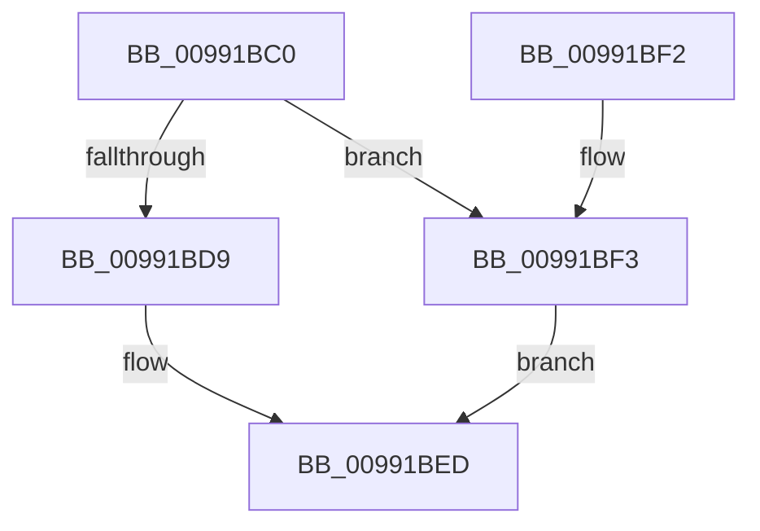

# PnpSetGenericStoreProperty

- RVA: `0x00991BC0`–`0x00991BFF` (길이 `63` bytes)
- VA: `0x0000000140991BC0`
- 실행 섹션: `PAGE`
- PDB 이름 있음: `예`; PDB Function 태그: `아니요`
- unwind 정보 RVA: `0x000816B0`
- 디코드: `16`개 명령, `63/63` bytes 표시
- 미해석 바이트: `0` (있으면 어셈블리에 `.byte`로 보존)

> 이 문서는 커널 이미지의 기계어와 PDB 기호를 분석해 생성했습니다. 4번과 5번은 함수 원형과 자료형을 바이너리 사용 방식에서 추정한 C 해석이며 원본 소스 복구 결과는 아닙니다.

## 1. Dependencies

- 직접 호출 지점: **2**; 고유 호출 대상: **2**
- 직접 호출자로 확인된 함수: **2**
- RIP 상대 이미지 참조: **0**

### Outgoing calls
- `0x00991BE8` → [PnpSetPropertyWorker](PnpSetPropertyWorker_function_00991C08.md) (function, `0x00991C08`)
- `0x00991BF8` → [PnpDeletePropertyWorker](../8F/PnpDeletePropertyWorker_function_008FE754.md) (function, `0x008FE754`)

### Direct callers
- [PnpSetObjectPropertyWorker](../8F/PnpSetObjectPropertyWorker_function_008F7438.md) at `0x008F7536`
- [sub_00B2812A](../B2/Unknown_function_00B2812A.md) at `0x00B2814A`

### Static image references
- 디코드된 RIP-relative 메모리 참조가 없습니다.

## 2. Other-region calls and transfers

- 다른 실행 섹션으로 향하는 call: **0**
- 별도 외부 분기/꼬리 이동을 확인하지 못했습니다.

## 3. Assembly (complete function range)

```asm
00991BC0  48 83 EC 48                     sub rsp, 0x48
00991BC4  44 8B 54 24 70                  mov r10d, dword ptr [rsp + 0x70]
00991BC9  8B 84 24 80 00 00 00            mov eax, dword ptr [rsp + 0x80]
00991BD0  89 44 24 30                     mov dword ptr [rsp + 0x30], eax
00991BD4  45 85 D2                        test r10d, r10d
00991BD7  74 1A                           je 0x140991bf3
00991BD9  48 8B 44 24 78                  mov rax, qword ptr [rsp + 0x78]
00991BDE  48 89 44 24 28                  mov qword ptr [rsp + 0x28], rax
00991BE3  44 89 54 24 20                  mov dword ptr [rsp + 0x20], r10d
00991BE8  E8 1B 00 00 00                  call 0x140991c08
00991BED  48 83 C4 48                     add rsp, 0x48
00991BF1  C3                              ret
00991BF2  CC                              int3
00991BF3  83 64 24 20 00                  and dword ptr [rsp + 0x20], 0
00991BF8  E8 57 CB F6 FF                  call 0x1408fe754
00991BFD  EB EE                           jmp 0x140991bed
```

## 4. C-style interpretation (structured pseudocode)

```c
__int64 __fastcall PnpSetGenericStoreProperty(__int64 a1, __int64 a2, __int64 a3, __int64 a4, unsigned int a5, __int64 a6, unsigned int a7)
{
    __int64 result;
    __int64 v_rsp;
    unsigned int v_stack_m18;
    unsigned __int64 v_stack_m20;
    unsigned int v_stack_m28;
    unsigned int v_stack_p20;

    v_rsp = (v_rsp) - (72);
    v_stack_m18 = (unsigned int)((unsigned int)(a7));
    if ((unsigned int)((unsigned int)(a5)) == 0) goto loc_00991BF3;
    v_stack_m20 = a6;
    v_stack_m28 = (unsigned int)((unsigned int)(a5));
    result = PnpSetPropertyWorker(a1, a2, a3, a4);
loc_00991BED:
    v_rsp = (v_rsp) + (72);
    return result;
loc_00991BF3:
    result = PnpDeletePropertyWorker(a1, a2, a3, a4);
    goto loc_00991BED;
}
```

## 5. (Beta) C Style

```c
int64_t PnpSetGenericStoreProperty(int64_t Arg1, int64_t Arg2, int64_t Arg3, int64_t Arg4, uint32_t Arg5, int64_t Arg6, uint32_t Arg7)
{
    int64_t result;
    int64_t local_rsp;
    uint32_t v_stack_m18;
    uint64_t v_stack_m20;
    uint32_t v_stack_m28;
    uint32_t v_stack_p20;

    local_rsp = (local_rsp) - (72);
    v_stack_m18 = (uint32_t)((uint32_t)(Arg7));
    if ((uint32_t)((uint32_t)(Arg5)) == 0) goto loc_00991BF3;
    v_stack_m20 = Arg6;
    v_stack_m28 = (uint32_t)((uint32_t)(Arg5));
    result = PnpSetPropertyWorker(Arg1, Arg2, Arg3, Arg4);
loc_00991BED:
    local_rsp = (local_rsp) + (72);
    return result;
loc_00991BF3:
    result = PnpDeletePropertyWorker(Arg1, Arg2, Arg3, Arg4);
    goto loc_00991BED;
}
```

## 6. Execution-region graph

[열기: 2D/3D 그래프와 함수 탐색 컨트롤 패널](../../../control-panel.html?section=page&rva=0x00991BC0&view=graph)

- 2D 그래프는 위에서 아래로 흐르고, 3D 그래프는 빈 공간을 드래그해 회전합니다. Shift+드래그는 이동, 휠은 확대·축소, 함수 노드 선택은 대상 보고서 이동입니다.

### Static fallback


