# PnpSetPropertyWorker

- RVA: `0x00991C08`–`0x00992116` (길이 `1,294` bytes)
- VA: `0x0000000140991C08`
- 실행 섹션: `PAGE`
- PDB 이름 있음: `예`; PDB Function 태그: `아니요`
- unwind 정보 RVA: `0x00098D84`
- 디코드: `321`개 명령, `1,294/1,294` bytes 표시
- 미해석 바이트: `0` (있으면 어셈블리에 `.byte`로 보존)

> 이 문서는 커널 이미지의 기계어와 PDB 기호를 분석해 생성했습니다. 4번과 5번은 함수 원형과 자료형을 바이너리 사용 방식에서 추정한 C 해석이며 원본 소스 복구 결과는 아닙니다.

## 1. Dependencies

- 직접 호출 지점: **22**; 고유 호출 대상: **12**
- 직접 호출자로 확인된 함수: **1**
- RIP 상대 이미지 참조: **3**

### Outgoing calls
- `0x00991D0F` → [RtlStringCchPrintfExW](../../text/42/RtlStringCchPrintfExW_function_0042B390.md) (function, `0x0042B390`)
- `0x00991D30` → [swprintf_s](../../text/50/swprintf_s_function_00504B20.md) (function, `0x00504B20`)
- `0x00991D55` → [_PnpOpenPropertiesKey](_PnpOpenPropertiesKey_function_009938A0.md) (function, `0x009938A0`)
- `0x00991DBA` → [RegRtlCreateKeyTransacted](../93/RegRtlCreateKeyTransacted_function_0093207C.md) (function, `0x0093207C`)
- `0x00991E2B` → [RegRtlCreateKeyTransacted](../93/RegRtlCreateKeyTransacted_function_0093207C.md) (function, `0x0093207C`)
- `0x00991E6B` → [PnpCtxRegSetValue](PnpCtxRegSetValue_function_00991B8C.md) (function, `0x00991B8C`)
- `0x00991E82` → [ZwClose](../../text/6A/ZwClose_function_006AD2B0.md) (function, `0x006AD2B0`)
- `0x00991E98` → [ZwClose](../../text/6A/ZwClose_function_006AD2B0.md) (function, `0x006AD2B0`)
- `0x00991EAE` → [ZwClose](../../text/6A/ZwClose_function_006AD2B0.md) (function, `0x006AD2B0`)
- `0x00991EBC` → [_security_check_cookie](../../text/6A/_security_check_cookie_function_006AC640.md) (function, `0x006AC640`)
- `0x00991EFC` → [RegRtlIsPredefinedKey](../93/RegRtlIsPredefinedKey_function_009321CC.md) (function, `0x009321CC`)
- `0x00991F11` → [RtlInitUnicodeStringEx](../../text/46/RtlInitUnicodeStringEx_function_00463960.md) (function, `0x00463960`)
- `0x00991F6B` → [ZwCreateKey](../../text/6A/ZwCreateKey_function_006AD470.md) (function, `0x006AD470`)
- `0x00991F7F` → [ZwClose](../../text/6A/ZwClose_function_006AD2B0.md) (function, `0x006AD2B0`)
- `0x00991FA8` → [RegRtlIsPredefinedKey](../93/RegRtlIsPredefinedKey_function_009321CC.md) (function, `0x009321CC`)
- `0x00991FBD` → [RtlInitUnicodeStringEx](../../text/46/RtlInitUnicodeStringEx_function_00463960.md) (function, `0x00463960`)
- `0x00992018` → [ZwCreateKey](../../text/6A/ZwCreateKey_function_006AD470.md) (function, `0x006AD470`)
- `0x0099202C` → [ZwClose](../../text/6A/ZwClose_function_006AD2B0.md) (function, `0x006AD2B0`)
- `0x00992096` → [RegRtlOpenPredefinedKey](../83/RegRtlOpenPredefinedKey_function_00832A14.md) (function, `0x00832A14`)
- `0x009920B9` → [RegRtlOpenPredefinedKey](../83/RegRtlOpenPredefinedKey_function_00832A14.md) (function, `0x00832A14`)
- `0x009920ED` → [PnpCtxRegDeleteTree](../96/PnpCtxRegDeleteTree_function_00965CC8.md) (function, `0x00965CC8`)
- `0x0099210C` → [PnpCtxRegDeleteTree](../96/PnpCtxRegDeleteTree_function_00965CC8.md) (function, `0x00965CC8`)

### Direct callers
- [PnpSetGenericStoreProperty](PnpSetGenericStoreProperty_function_00991BC0.md) at `0x00991BE8`

### Static image references
- `0x00991C21` → RVA `0x00E0A740` (`.data`; read)
- `0x00991CFB` → RVA `0x00AFDD40` (` ?? ::NNGAKEGL::`string'`; read)
- `0x00991D20` → RVA `0x00B0D950` (` ?? ::NNGAKEGL::`string'`; read)

## 2. Other-region calls and transfers

- 다른 실행 섹션으로 향하는 call: **12**
  - `0x00991D0F` → [RtlStringCchPrintfExW](../../text/42/RtlStringCchPrintfExW_function_0042B390.md) (`PAGE` → `.text`)
  - `0x00991D30` → [swprintf_s](../../text/50/swprintf_s_function_00504B20.md) (`PAGE` → `.text`)
  - `0x00991E82` → [ZwClose](../../text/6A/ZwClose_function_006AD2B0.md) (`PAGE` → `.text`)
  - `0x00991E98` → [ZwClose](../../text/6A/ZwClose_function_006AD2B0.md) (`PAGE` → `.text`)
  - `0x00991EAE` → [ZwClose](../../text/6A/ZwClose_function_006AD2B0.md) (`PAGE` → `.text`)
  - `0x00991EBC` → [_security_check_cookie](../../text/6A/_security_check_cookie_function_006AC640.md) (`PAGE` → `.text`)
  - `0x00991F11` → [RtlInitUnicodeStringEx](../../text/46/RtlInitUnicodeStringEx_function_00463960.md) (`PAGE` → `.text`)
  - `0x00991F6B` → [ZwCreateKey](../../text/6A/ZwCreateKey_function_006AD470.md) (`PAGE` → `.text`)
  - `0x00991F7F` → [ZwClose](../../text/6A/ZwClose_function_006AD2B0.md) (`PAGE` → `.text`)
  - `0x00991FBD` → [RtlInitUnicodeStringEx](../../text/46/RtlInitUnicodeStringEx_function_00463960.md) (`PAGE` → `.text`)
  - `0x00992018` → [ZwCreateKey](../../text/6A/ZwCreateKey_function_006AD470.md) (`PAGE` → `.text`)
  - `0x0099202C` → [ZwClose](../../text/6A/ZwClose_function_006AD2B0.md) (`PAGE` → `.text`)
- 별도 외부 분기/꼬리 이동을 확인하지 못했습니다.

## 3. Assembly (complete function range)

```asm
00991C08  40 55                           push rbp
00991C0A  53                              push rbx
00991C0B  56                              push rsi
00991C0C  57                              push rdi
00991C0D  41 54                           push r12
00991C0F  41 55                           push r13
00991C11  41 56                           push r14
00991C13  41 57                           push r15
00991C15  48 8D 6C 24 88                  lea rbp, [rsp - 0x78]
00991C1A  48 81 EC 88 01 00 00            sub rsp, 0x188
00991C21  48 8B 05 18 8B 47 00            mov rax, qword ptr [rip + 0x478b18]
00991C28  48 33 C4                        xor rax, rsp
00991C2B  48 89 45 60                     mov qword ptr [rbp + 0x60], rax
00991C2F  48 8B 85 E8 00 00 00            mov rax, qword ptr [rbp + 0xe8]
00991C36  4D 8B F9                        mov r15, r9
00991C39  48 89 55 88                     mov qword ptr [rbp - 0x78], rdx
00991C3D  4D 8B E0                        mov r12, r8
00991C40  33 D2                           xor edx, edx
00991C42  48 89 45 E8                     mov qword ptr [rbp - 0x18], rax
00991C46  81 BD F0 00 00 00 FF FF FF 7F   cmp dword ptr [rbp + 0xf0], 0x7fffffff
00991C50  4C 8B F1                        mov r14, rcx
00991C53  89 55 84                        mov dword ptr [rbp - 0x7c], edx
00991C56  89 55 80                        mov dword ptr [rbp - 0x80], edx
00991C59  48 89 55 A0                     mov qword ptr [rbp - 0x60], rdx
00991C5D  48 89 55 90                     mov qword ptr [rbp - 0x70], rdx
00991C61  48 89 55 98                     mov qword ptr [rbp - 0x68], rdx
00991C65  0F 87 00 04 00 00               ja 0x14099206b
00991C6B  4D 85 C0                        test r8, r8
00991C6E  0F 85 C2 03 00 00               jne 0x140992036
00991C74  44 8B AD E0 00 00 00            mov r13d, dword ptr [rbp + 0xe0]
00991C7B  41 83 FD 19                     cmp r13d, 0x19
00991C7F  0F 84 F0 03 00 00               je 0x140992075
00991C85  41 0F B6 41 0F                  movzx eax, byte ptr [r9 + 0xf]
00991C8A  41 0F B6 49 0E                  movzx ecx, byte ptr [r9 + 0xe]
00991C8F  41 0F B6 51 0D                  movzx edx, byte ptr [r9 + 0xd]
00991C94  45 0F B6 41 0C                  movzx r8d, byte ptr [r9 + 0xc]
00991C99  45 0F B6 49 0B                  movzx r9d, byte ptr [r9 + 0xb]
00991C9E  45 0F B6 57 0A                  movzx r10d, byte ptr [r15 + 0xa]
00991CA3  45 0F B6 5F 09                  movzx r11d, byte ptr [r15 + 9]
00991CA8  41 0F B6 5F 08                  movzx ebx, byte ptr [r15 + 8]
00991CAD  41 0F B7 7F 06                  movzx edi, word ptr [r15 + 6]
00991CB2  41 0F B7 77 04                  movzx esi, word ptr [r15 + 4]
00991CB7  89 84 24 80 00 00 00            mov dword ptr [rsp + 0x80], eax
00991CBE  41 8B 07                        mov eax, dword ptr [r15]
00991CC1  89 4C 24 78                     mov dword ptr [rsp + 0x78], ecx
00991CC5  48 8D 4D 10                     lea rcx, [rbp + 0x10]
00991CC9  89 54 24 70                     mov dword ptr [rsp + 0x70], edx
00991CCD  44 89 44 24 68                  mov dword ptr [rsp + 0x68], r8d
00991CD2  45 33 C0                        xor r8d, r8d
00991CD5  44 89 4C 24 60                  mov dword ptr [rsp + 0x60], r9d
00991CDA  45 33 C9                        xor r9d, r9d
00991CDD  44 89 54 24 58                  mov dword ptr [rsp + 0x58], r10d
00991CE2  44 89 5C 24 50                  mov dword ptr [rsp + 0x50], r11d
00991CE7  89 5C 24 48                     mov dword ptr [rsp + 0x48], ebx
00991CEB  89 7C 24 40                     mov dword ptr [rsp + 0x40], edi
00991CEF  41 8D 51 27                     lea edx, [r9 + 0x27]
00991CF3  89 74 24 38                     mov dword ptr [rsp + 0x38], esi
00991CF7  89 44 24 30                     mov dword ptr [rsp + 0x30], eax
00991CFB  48 8D 05 3E C0 16 00            lea rax, [rip + 0x16c03e]
00991D02  48 89 44 24 28                  mov qword ptr [rsp + 0x28], rax
00991D07  C7 44 24 20 00 08 00 00         mov dword ptr [rsp + 0x20], 0x800
00991D0F  E8 7C 96 A9 FF                  call 0x14042b390
00991D14  85 C0                           test eax, eax
00991D16  0F 88 BA 01 00 00               js 0x140991ed6
00991D1C  45 8B 4F 10                     mov r9d, dword ptr [r15 + 0x10]
00991D20  4C 8D 05 29 BC 17 00            lea r8, [rip + 0x17bc29]
00991D27  BA 09 00 00 00                  mov edx, 9
00991D2C  48 8D 4D F0                     lea rcx, [rbp - 0x10]
00991D30  E8 EB 2D B7 FF                  call 0x140504b20
00991D35  48 8B 55 88                     mov rdx, qword ptr [rbp - 0x78]
00991D39  48 8D 45 A0                     lea rax, [rbp - 0x60]
00991D3D  48 89 44 24 30                  mov qword ptr [rsp + 0x30], rax
00991D42  BF 04 00 00 00                  mov edi, 4
00991D47  44 8B CF                        mov r9d, edi
00991D4A  C6 44 24 20 01                  mov byte ptr [rsp + 0x20], 1
00991D4F  45 33 C0                        xor r8d, r8d
00991D52  49 8B CE                        mov rcx, r14
00991D55  E8 46 1B 00 00                  call 0x1409938a0
00991D5A  45 33 FF                        xor r15d, r15d
00991D5D  8B D8                           mov ebx, eax
00991D5F  85 C0                           test eax, eax
00991D61  0F 88 22 03 00 00               js 0x140992089
00991D67  48 8B 75 A0                     mov rsi, qword ptr [rbp - 0x60]
00991D6B  4D 85 F6                        test r14, r14
00991D6E  0F 84 69 01 00 00               je 0x140991edd
00991D74  49 8B 86 E0 00 00 00            mov rax, qword ptr [r14 + 0xe0]
00991D7B  48 85 C0                        test rax, rax
00991D7E  0F 84 59 01 00 00               je 0x140991edd
00991D84  48 8B 48 08                     mov rcx, qword ptr [rax + 8]
00991D88  48 8D 55 10                     lea rdx, [rbp + 0x10]
00991D8C  48 89 4C 24 40                  mov qword ptr [rsp + 0x40], rcx
00991D91  45 33 C0                        xor r8d, r8d
00991D94  44 38 78 10                     cmp byte ptr [rax + 0x10], r15b
00991D98  44 8B CF                        mov r9d, edi
00991D9B  48 8D 45 84                     lea rax, [rbp - 0x7c]
00991D9F  48 8B CE                        mov rcx, rsi
00991DA2  48 89 44 24 38                  mov qword ptr [rsp + 0x38], rax
00991DA7  48 8D 45 90                     lea rax, [rbp - 0x70]
00991DAB  48 89 44 24 30                  mov qword ptr [rsp + 0x30], rax
00991DB0  44 88 7C 24 28                  mov byte ptr [rsp + 0x28], r15b
00991DB5  4C 89 7C 24 20                  mov qword ptr [rsp + 0x20], r15
00991DBA  E8 BD 02 FA FF                  call 0x14093207c
00991DBF  8B F8                           mov edi, eax
00991DC1  81 FF 7C 01 00 C0               cmp edi, 0xc000017c
00991DC7  0F 84 09 01 00 00               je 0x140991ed6
00991DCD  85 FF                           test edi, edi
00991DCF  0F 88 D5 02 00 00               js 0x1409920aa
00991DD5  48 8B 75 90                     mov rsi, qword ptr [rbp - 0x70]
00991DD9  4D 85 F6                        test r14, r14
00991DDC  0F 84 A7 01 00 00               je 0x140991f89
00991DE2  49 8B 86 E0 00 00 00            mov rax, qword ptr [r14 + 0xe0]
00991DE9  48 85 C0                        test rax, rax
00991DEC  0F 84 97 01 00 00               je 0x140991f89
00991DF2  48 8B 48 08                     mov rcx, qword ptr [rax + 8]
00991DF6  48 8D 55 F0                     lea rdx, [rbp - 0x10]
00991DFA  48 89 4C 24 40                  mov qword ptr [rsp + 0x40], rcx
00991DFF  45 33 C0                        xor r8d, r8d
00991E02  44 38 78 10                     cmp byte ptr [rax + 0x10], r15b
00991E06  41 B9 06 00 01 00               mov r9d, 0x10006
00991E0C  48 8D 45 80                     lea rax, [rbp - 0x80]
00991E10  48 8B CE                        mov rcx, rsi
00991E13  48 89 44 24 38                  mov qword ptr [rsp + 0x38], rax
00991E18  48 8D 45 98                     lea rax, [rbp - 0x68]
00991E1C  48 89 44 24 30                  mov qword ptr [rsp + 0x30], rax
00991E21  44 88 7C 24 28                  mov byte ptr [rsp + 0x28], r15b
00991E26  4C 89 7C 24 20                  mov qword ptr [rsp + 0x20], r15
00991E2B  E8 4C 02 FA FF                  call 0x14093207c
00991E30  8B F8                           mov edi, eax
00991E32  BE 7C 01 00 C0                  mov esi, 0xc000017c
00991E37  3B FE                           cmp edi, esi
00991E39  0F 84 97 00 00 00               je 0x140991ed6
00991E3F  85 FF                           test edi, edi
00991E41  0F 88 86 02 00 00               js 0x1409920cd
00991E47  8B 85 F0 00 00 00               mov eax, dword ptr [rbp + 0xf0]
00991E4D  41 81 CD 00 00 FF FF            or r13d, 0xffff0000
00991E54  48 8B 55 98                     mov rdx, qword ptr [rbp - 0x68]
00991E58  45 8B CD                        mov r9d, r13d
00991E5B  89 44 24 28                     mov dword ptr [rsp + 0x28], eax
00991E5F  4D 8B C4                        mov r8, r12
00991E62  48 8B 45 E8                     mov rax, qword ptr [rbp - 0x18]
00991E66  48 89 44 24 20                  mov qword ptr [rsp + 0x20], rax
00991E6B  E8 1C FD FF FF                  call 0x140991b8c
00991E70  3B C6                           cmp eax, esi
00991E72  74 62                           je 0x140991ed6
00991E74  85 C0                           test eax, eax
00991E76  0F 48 D8                        cmovs ebx, eax
00991E79  48 8B 4D 98                     mov rcx, qword ptr [rbp - 0x68]
00991E7D  48 85 C9                        test rcx, rcx
00991E80  74 0D                           je 0x140991e8f
00991E82  E8 29 B4 D1 FF                  call 0x1406ad2b0
00991E87  85 DB                           test ebx, ebx
00991E89  0F 88 49 02 00 00               js 0x1409920d8
00991E8F  48 8B 4D 90                     mov rcx, qword ptr [rbp - 0x70]
00991E93  48 85 C9                        test rcx, rcx
00991E96  74 0D                           je 0x140991ea5
00991E98  E8 13 B4 D1 FF                  call 0x1406ad2b0
00991E9D  85 DB                           test ebx, ebx
00991E9F  0F 88 52 02 00 00               js 0x1409920f7
00991EA5  48 8B 4D A0                     mov rcx, qword ptr [rbp - 0x60]
00991EA9  48 85 C9                        test rcx, rcx
00991EAC  74 05                           je 0x140991eb3
00991EAE  E8 FD B3 D1 FF                  call 0x1406ad2b0
00991EB3  8B C3                           mov eax, ebx
00991EB5  48 8B 4D 60                     mov rcx, qword ptr [rbp + 0x60]
00991EB9  48 33 CC                        xor rcx, rsp
00991EBC  E8 7F A7 D1 FF                  call 0x1406ac640
00991EC1  48 81 C4 88 01 00 00            add rsp, 0x188
00991EC8  41 5F                           pop r15
00991ECA  41 5E                           pop r14
00991ECC  41 5D                           pop r13
00991ECE  41 5C                           pop r12
00991ED0  5F                              pop rdi
00991ED1  5E                              pop rsi
00991ED2  5B                              pop rbx
00991ED3  5D                              pop rbp
00991ED4  C3                              ret
00991ED5  CC                              int3
00991ED6  BB E5 00 00 C0                  mov ebx, 0xc00000e5
00991EDB  EB 9C                           jmp 0x140991e79
00991EDD  33 C0                           xor eax, eax
00991EDF  4C 89 7D 88                     mov qword ptr [rbp - 0x78], r15
00991EE3  0F 57 C0                        xorps xmm0, xmm0
00991EE6  48 89 45 C8                     mov qword ptr [rbp - 0x38], rax
00991EEA  48 8B CE                        mov rcx, rsi
00991EED  89 45 D0                        mov dword ptr [rbp - 0x30], eax
00991EF0  0F 11 45 A8                     movups xmmword ptr [rbp - 0x58], xmm0
00991EF4  0F 11 45 B8                     movups xmmword ptr [rbp - 0x48], xmm0
00991EF8  0F 11 45 D8                     movups xmmword ptr [rbp - 0x28], xmm0
00991EFC  E8 CB 02 FA FF                  call 0x1409321cc
00991F01  84 C0                           test al, al
00991F03  0F 85 89 01 00 00               jne 0x140992092
00991F09  48 8D 55 10                     lea rdx, [rbp + 0x10]
00991F0D  48 8D 4D D8                     lea rcx, [rbp - 0x28]
00991F11  E8 4A 1A AD FF                  call 0x140463960
00991F16  8B F8                           mov edi, eax
00991F18  85 C0                           test eax, eax
00991F1A  78 56                           js 0x140991f72
00991F1C  48 8B 45 88                     mov rax, qword ptr [rbp - 0x78]
00991F20  4C 8D 45 A8                     lea r8, [rbp - 0x58]
00991F24  48 85 C0                        test rax, rax
00991F27  C7 45 A8 30 00 00 00            mov dword ptr [rbp - 0x58], 0x30
00991F2E  0F 57 C0                        xorps xmm0, xmm0
00991F31  C7 45 C0 C0 02 00 00            mov dword ptr [rbp - 0x40], 0x2c0
00991F38  48 0F 45 F0                     cmovne rsi, rax
00991F3C  48 8D 4D 90                     lea rcx, [rbp - 0x70]
00991F40  48 8D 45 D8                     lea rax, [rbp - 0x28]
00991F44  48 89 75 B0                     mov qword ptr [rbp - 0x50], rsi
00991F48  45 33 C9                        xor r9d, r9d
00991F4B  48 89 45 B8                     mov qword ptr [rbp - 0x48], rax
00991F4F  48 8D 45 84                     lea rax, [rbp - 0x7c]
00991F53  48 89 44 24 30                  mov qword ptr [rsp + 0x30], rax
00991F58  44 89 7C 24 28                  mov dword ptr [rsp + 0x28], r15d
00991F5D  41 8D 51 04                     lea edx, [r9 + 4]
00991F61  4C 89 7C 24 20                  mov qword ptr [rsp + 0x20], r15
00991F66  F3 0F 7F 45 C8                  movdqu xmmword ptr [rbp - 0x38], xmm0
00991F6B  E8 00 B5 D1 FF                  call 0x1406ad470
00991F70  8B F8                           mov edi, eax
00991F72  48 8B 4D 88                     mov rcx, qword ptr [rbp - 0x78]
00991F76  48 85 C9                        test rcx, rcx
00991F79  0F 84 42 FE FF FF               je 0x140991dc1
00991F7F  E8 2C B3 D1 FF                  call 0x1406ad2b0
00991F84  E9 38 FE FF FF                  jmp 0x140991dc1
00991F89  33 C0                           xor eax, eax
00991F8B  4C 89 7D 88                     mov qword ptr [rbp - 0x78], r15
00991F8F  0F 57 C0                        xorps xmm0, xmm0
00991F92  48 89 45 C8                     mov qword ptr [rbp - 0x38], rax
00991F96  48 8B CE                        mov rcx, rsi
00991F99  89 45 D0                        mov dword ptr [rbp - 0x30], eax
00991F9C  0F 11 45 A8                     movups xmmword ptr [rbp - 0x58], xmm0
00991FA0  0F 11 45 B8                     movups xmmword ptr [rbp - 0x48], xmm0
00991FA4  0F 11 45 D8                     movups xmmword ptr [rbp - 0x28], xmm0
00991FA8  E8 1F 02 FA FF                  call 0x1409321cc
00991FAD  84 C0                           test al, al
00991FAF  0F 85 00 01 00 00               jne 0x1409920b5
00991FB5  48 8D 55 F0                     lea rdx, [rbp - 0x10]
00991FB9  48 8D 4D D8                     lea rcx, [rbp - 0x28]
00991FBD  E8 9E 19 AD FF                  call 0x140463960
00991FC2  8B F8                           mov edi, eax
00991FC4  85 C0                           test eax, eax
00991FC6  78 57                           js 0x14099201f
00991FC8  48 8B 45 88                     mov rax, qword ptr [rbp - 0x78]
00991FCC  4C 8D 45 A8                     lea r8, [rbp - 0x58]
00991FD0  48 85 C0                        test rax, rax
00991FD3  C7 45 A8 30 00 00 00            mov dword ptr [rbp - 0x58], 0x30
00991FDA  0F 57 C0                        xorps xmm0, xmm0
00991FDD  C7 45 C0 C0 02 00 00            mov dword ptr [rbp - 0x40], 0x2c0
00991FE4  48 0F 45 F0                     cmovne rsi, rax
00991FE8  48 8D 4D 98                     lea rcx, [rbp - 0x68]
00991FEC  48 8D 45 D8                     lea rax, [rbp - 0x28]
00991FF0  48 89 75 B0                     mov qword ptr [rbp - 0x50], rsi
00991FF4  48 89 45 B8                     mov qword ptr [rbp - 0x48], rax
00991FF8  45 33 C9                        xor r9d, r9d
00991FFB  48 8D 45 80                     lea rax, [rbp - 0x80]
00991FFF  BA 06 00 01 00                  mov edx, 0x10006
00992004  48 89 44 24 30                  mov qword ptr [rsp + 0x30], rax
00992009  44 89 7C 24 28                  mov dword ptr [rsp + 0x28], r15d
0099200E  4C 89 7C 24 20                  mov qword ptr [rsp + 0x20], r15
00992013  F3 0F 7F 45 C8                  movdqu xmmword ptr [rbp - 0x38], xmm0
00992018  E8 53 B4 D1 FF                  call 0x1406ad470
0099201D  8B F8                           mov edi, eax
0099201F  48 8B 4D 88                     mov rcx, qword ptr [rbp - 0x78]
00992023  48 85 C9                        test rcx, rcx
00992026  0F 84 06 FE FF FF               je 0x140991e32
0099202C  E8 7F B2 D1 FF                  call 0x1406ad2b0
00992031  E9 FC FD FF FF                  jmp 0x140991e32
00992036  B9 55 00 00 00                  mov ecx, 0x55
0099203B  49 8B C4                        mov rax, r12
0099203E  66 39 10                        cmp word ptr [rax], dx
00992041  74 0A                           je 0x14099204d
00992043  48 83 C0 02                     add rax, 2
00992047  48 83 E9 01                     sub rcx, 1
0099204B  75 F1                           jne 0x14099203e
0099204D  48 8B C1                        mov rax, rcx
00992050  48 F7 D8                        neg rax
00992053  1B DB                           sbb ebx, ebx
00992055  F7 D3                           not ebx
00992057  81 E3 0D 00 00 C0               and ebx, 0xc000000d
0099205D  48 85 C9                        test rcx, rcx
00992060  0F 85 0E FC FF FF               jne 0x140991c74
00992066  E9 48 FE FF FF                  jmp 0x140991eb3
0099206B  BB 0D 00 00 C0                  mov ebx, 0xc000000d
00992070  E9 3E FE FF FF                  jmp 0x140991eb3
00992075  4D 85 E4                        test r12, r12
00992078  0F 84 07 FC FF FF               je 0x140991c85
0099207E  66 41 39 10                     cmp word ptr [r8], dx
00992082  75 E7                           jne 0x14099206b
00992084  E9 FC FB FF FF                  jmp 0x140991c85
00992089  4C 89 7D A0                     mov qword ptr [rbp - 0x60], r15
0099208D  E9 E7 FD FF FF                  jmp 0x140991e79
00992092  48 8D 55 88                     lea rdx, [rbp - 0x78]
00992096  E8 79 09 EA FF                  call 0x140832a14
0099209B  8B F8                           mov edi, eax
0099209D  85 C0                           test eax, eax
0099209F  0F 88 CD FE FF FF               js 0x140991f72
009920A5  E9 5F FE FF FF                  jmp 0x140991f09
009920AA  4C 89 7D 90                     mov qword ptr [rbp - 0x70], r15
009920AE  8B DF                           mov ebx, edi
009920B0  E9 C4 FD FF FF                  jmp 0x140991e79
009920B5  48 8D 55 88                     lea rdx, [rbp - 0x78]
009920B9  E8 56 09 EA FF                  call 0x140832a14
009920BE  8B F8                           mov edi, eax
009920C0  85 C0                           test eax, eax
009920C2  0F 88 57 FF FF FF               js 0x14099201f
009920C8  E9 E8 FE FF FF                  jmp 0x140991fb5
009920CD  4C 89 7D 98                     mov qword ptr [rbp - 0x68], r15
009920D1  8B DF                           mov ebx, edi
009920D3  E9 B7 FD FF FF                  jmp 0x140991e8f
009920D8  83 7D 80 01                     cmp dword ptr [rbp - 0x80], 1
009920DC  0F 85 AD FD FF FF               jne 0x140991e8f
009920E2  48 8B 55 90                     mov rdx, qword ptr [rbp - 0x70]
009920E6  4C 8D 45 F0                     lea r8, [rbp - 0x10]
009920EA  49 8B CE                        mov rcx, r14
009920ED  E8 D6 3B FD FF                  call 0x140965cc8
009920F2  E9 98 FD FF FF                  jmp 0x140991e8f
009920F7  83 7D 84 01                     cmp dword ptr [rbp - 0x7c], 1
009920FB  0F 85 A4 FD FF FF               jne 0x140991ea5
00992101  48 8B 55 A0                     mov rdx, qword ptr [rbp - 0x60]
00992105  4C 8D 45 10                     lea r8, [rbp + 0x10]
00992109  49 8B CE                        mov rcx, r14
0099210C  E8 B7 3B FD FF                  call 0x140965cc8
00992111  E9 8F FD FF FF                  jmp 0x140991ea5
```

## 4. C-style interpretation (structured pseudocode)

```c
__int64 __fastcall PnpSetPropertyWorker(__int64 a1, __int64 a2, __int64 a3, __int64 a4, unsigned int a5, __int64 a6, unsigned int a7)
{
    __int64 result;
    __int64 v_r13;
    __int64 v_r15;
    __int64 v_rbx;
    __int64 v_rdi;
    __int64 v_rsi;
    __int64 v_rsp;
    unsigned __int64 v_stack_m100;
    unsigned __int64 v_stack_m108;
    unsigned __int64 v_stack_m110;
    unsigned __int64 v_stack_m118;
    unsigned __int64 v_stack_m120;
    unsigned __int64 v_stack_m128;
    unsigned __int64 v_stack_m130;
    unsigned int v_stack_m134;
    unsigned int v_stack_m138;
    unsigned int v_stack_m148;
    unsigned int v_stack_m150;
    unsigned int v_stack_m158;
    unsigned int v_stack_m160;
    unsigned int v_stack_m168;
    unsigned int v_stack_m170;
    unsigned int v_stack_m178;
    unsigned int v_stack_m180;
    unsigned int v_stack_m188;
    unsigned int v_stack_m190;
    unsigned int v_stack_m198;
    unsigned __int64 v_stack_m1A0;
    unsigned int v_stack_m1A8;
    unsigned __int64 v_stack_m58;
    unsigned __int64 v_stack_mA8;
    unsigned __int64 v_stack_mB8;
    unsigned __int64 v_stack_mC8;
    unsigned __int64 v_stack_mD0;
    unsigned __int64 v_stack_mE0;
    unsigned int v_stack_mE8;
    unsigned __int64 v_stack_mF0;
    unsigned int v_stack_mF8;
    unsigned __int64 v_stack_p20;
    unsigned int v_stack_p28;
    unsigned __int64 v_stack_p30;

    v_rsp = (v_rsp) - (392);
    result = (*(unsigned __int64 *)(v_rip + 4688664)) ^ (v_rsp);
    v_stack_m58 = result;
    v_stack_m130 = a2;
    a2 = 0;
    v_stack_mD0 = a6;
    v_stack_m134 = 0;
    v_stack_m138 = 0;
    v_stack_m118 = 0;
    v_stack_m128 = 0;
    v_stack_m120 = 0;
    if (a7 > 0x7FFFFFFFULL) goto loc_0099206B;
    if (a3 != 0) goto loc_00992036;
loc_00991C74:
    if (((unsigned int)((unsigned int)(a5))) == 25) goto loc_00992075;
loc_00991C85:
    v_stack_m148 = (unsigned int)(*(unsigned __int8 *)(a4 + 15));
    v_stack_m150 = (unsigned int)(*(unsigned __int8 *)(a4 + 14));
    v_stack_m158 = (unsigned int)(*(unsigned __int8 *)(a4 + 13));
    v_stack_m160 = (unsigned int)(*(unsigned __int8 *)(a4 + 12));
    a3 = 0;
    v_stack_m168 = (unsigned int)(*(unsigned __int8 *)(a4 + 11));
    a4 = 0;
    v_stack_m170 = (unsigned int)(*(unsigned __int8 *)(a4 + 10));
    v_stack_m178 = (unsigned int)(*(unsigned __int8 *)(a4 + 9));
    v_stack_m180 = (unsigned int)(*(unsigned __int8 *)(a4 + 8));
    v_stack_m188 = (unsigned int)(*(unsigned __int16 *)(a4 + 6));
    v_stack_m190 = (unsigned int)(*(unsigned __int16 *)(a4 + 4));
    v_stack_m198 = (unsigned int)((unsigned int)(*(unsigned int *)(a4)));
    v_stack_m1A0 = v_rip + 1491006;
    v_stack_m1A8 = 0x800ULL;
    result = RtlStringCchPrintfExW(v_stack_mA8, a4 + 39, a3, a4);
    if (sign_flag) goto loc_00991ED6;
    result = swprintf_s(v_stack_mC8, 9, v_rip + 1555497, (unsigned int)(*(unsigned int *)(a4 + 16)));
    v_stack_m198 = v_stack_m118;
    v_stack_m1A8 = 1;
    a3 = 0;
    result = _PnpOpenPropertiesKey(a1, v_stack_m130, a3, 4);
    v_r15 = 0;
    if (sign_flag) goto loc_00992089;
    if (a1 == 0) goto loc_00991EDD;
    if (*(unsigned __int64 *)(a1 + 224) == 0) goto loc_00991EDD;
    v_stack_m188 = *(unsigned __int64 *)(*(unsigned __int64 *)(a1 + 224) + 8);
    a3 = 0;
    v_stack_m190 = v_stack_m134;
    v_stack_m198 = v_stack_m128;
    v_stack_m1A0 = 0;
    v_stack_m1A8 = 0;
    result = RegRtlCreateKeyTransacted(v_stack_m118, v_stack_mA8, a3, 4);
loc_00991DC1:
    if (((unsigned int)((unsigned int)((unsigned int)(result)))) == 0xC000017CULL) goto loc_00991ED6;
    if (sign_flag) goto loc_009920AA;
    if (a1 == 0) goto loc_00991F89;
    if (*(unsigned __int64 *)(a1 + 224) == 0) goto loc_00991F89;
    v_stack_m188 = *(unsigned __int64 *)(*(unsigned __int64 *)(a1 + 224) + 8);
    a3 = 0;
    v_stack_m190 = v_stack_m138;
    v_stack_m198 = v_stack_m120;
    v_stack_m1A0 = 0;
    v_stack_m1A8 = 0;
    result = RegRtlCreateKeyTransacted(v_stack_m128, v_stack_mC8, a3, (unsigned int)(0x10006ULL));
loc_00991E32:
    if (((unsigned int)((unsigned int)((unsigned int)(result)))) == ((unsigned int)((unsigned int)(0xC000017CULL)))) goto loc_00991ED6;
    if (sign_flag) goto loc_009920CD;
    v_r13 = (unsigned int)(((unsigned int)(a5)) | (0xFFFF0000ULL));
    v_stack_m1A0 = (unsigned int)((unsigned int)(a7));
    v_stack_m1A8 = v_stack_mD0;
    result = PnpCtxRegSetValue(v_stack_m128, v_stack_m120, 0, (unsigned int)((unsigned int)(v_r13)));
    if (((unsigned int)(result)) == ((unsigned int)((unsigned int)(0xC000017CULL)))) goto loc_00991ED6;
    v_rbx = (unsigned int)((unsigned int)(result));
    if (sign_flag) { v_rbx = (unsigned int)(result); }
loc_00991E79:
    if (v_stack_m120 == 0) goto loc_00991E8F;
    result = ZwClose(v_stack_m120, v_stack_m120, 0, (unsigned int)((unsigned int)(v_r13)));
    if (sign_flag) goto loc_009920D8;
loc_00991E8F:
    if (v_stack_m128 == 0) goto loc_00991EA5;
    result = ZwClose(v_stack_m128, v_stack_m120, 0, (unsigned int)((unsigned int)(v_r13)));
    if (sign_flag) goto loc_009920F7;
loc_00991EA5:
    if (v_stack_m118 != 0) {
        result = ZwClose(v_stack_m118, v_stack_m120, 0, (unsigned int)((unsigned int)(v_r13)));
    }
    a1 = (v_stack_m58) ^ (v_rsp);
    result = _security_check_cookie(a1, v_stack_m120, 0, (unsigned int)((unsigned int)(v_r13)));
    v_rsp = (v_rsp) + (392);
    return result;
loc_00991ED6:
    goto loc_00991E79;
loc_00991EDD:
    result = 0;
    v_stack_m130 = 0;
    v_stack_mF0 = 0;
    v_stack_mE8 = 0;
    v_stack_m110 = v_xmm0;
    v_stack_m100 = v_xmm0;
    v_stack_mE0 = v_xmm0;
    result = RegRtlIsPredefinedKey((unsigned int)(0xC000017CULL), v_stack_m120, 0, (unsigned int)((unsigned int)(v_r13)));
    if ((unsigned __int8)(result) != 0) goto loc_00992092;
loc_00991F09:
    result = RtlInitUnicodeStringEx(v_stack_mE0, v_stack_mA8, 0, (unsigned int)((unsigned int)(v_r13)));
    v_rsi = (unsigned int)(0xC000017CULL);
    v_rdi = (unsigned int)((unsigned int)(result));
    if (!(sign_flag)) {
        result = v_stack_m130;
        a3 = v_stack_m110;
        v_stack_m110 = 48;
        v_stack_mF8 = 704;
        v_rsi = (unsigned int)(0xC000017CULL);
        if (result != 0) { v_rsi = result; }
        a1 = v_stack_m128;
        result = v_stack_mE0;
        v_stack_m108 = v_rsi;
        a4 = 0;
        v_stack_m100 = result;
        result = v_stack_m134;
        v_stack_p30 = result;
        v_stack_p28 = 0;
        a2 = a4 + 4;
        v_stack_p20 = 0;
        v_stack_mF0 = v_xmm0;
        result = ZwCreateKey(a1, a2, a3, a4);
        v_rdi = (unsigned int)(result);
    }
    if (v_stack_m130 == 0) goto loc_00991DC1;
    result = ZwClose(v_stack_m130, a2, a3, a4);
    goto loc_00991DC1;
loc_00991F89:
    result = 0;
    v_stack_m130 = 0;
    v_stack_mF0 = 0;
    v_stack_mE8 = 0;
    v_stack_m110 = v_xmm0;
    v_stack_m100 = v_xmm0;
    v_stack_mE0 = v_xmm0;
    result = RegRtlIsPredefinedKey(v_rsi, a2, a3, a4);
    if ((unsigned __int8)(result) != 0) goto loc_009920B5;
loc_00991FB5:
    result = RtlInitUnicodeStringEx(v_stack_mE0, v_stack_mC8, a3, a4);
    v_rdi = (unsigned int)((unsigned int)(result));
    if (!(sign_flag)) {
        result = v_stack_m130;
        a3 = v_stack_m110;
        v_stack_m110 = 48;
        v_stack_mF8 = 704;
        if (result != 0) { v_rsi = result; }
        a1 = v_stack_m120;
        result = v_stack_mE0;
        v_stack_m108 = v_rsi;
        v_stack_m100 = result;
        a4 = 0;
        result = v_stack_m138;
        a2 = 0x10006ULL;
        v_stack_p30 = result;
        v_stack_p28 = 0;
        v_stack_p20 = 0;
        v_stack_mF0 = v_xmm0;
        result = ZwCreateKey(a1, a2, a3, a4);
        v_rdi = (unsigned int)(result);
    }
    if (v_stack_m130 == 0) goto loc_00991E32;
    result = ZwClose(v_stack_m130, a2, a3, a4);
    goto loc_00991E32;
loc_00992036:
loc_0099203E:
    if ((*(unsigned __int16 *)(a3)) == ((unsigned __int16)(a2))) goto loc_0099204D;
    result = (a3) + (2);
    a1 = (85) - (1);
    if (condition_is_not_equal) goto loc_0099203E;
loc_0099204D:
    result = -(a1);
    v_rbx = (unsigned int)(~((unsigned int)(0xC00000E5ULL)));
    v_rbx = (unsigned int)((v_rbx) & (0xC000000DULL));
    if (a1 != 0) goto loc_00991C74;
    goto loc_00991EB3;
loc_0099206B:
    goto loc_00991EB3;
loc_00992075:
    if (a3 == 0) goto loc_00991C85;
    if ((*(unsigned __int16 *)(a3)) != ((unsigned __int16)(a2))) goto loc_0099206B;
    goto loc_00991C85;
loc_00992089:
    v_stack_m118 = 0;
    goto loc_00991E79;
loc_00992092:
    result = RegRtlOpenPredefinedKey(a1, v_stack_m130, a3, a4);
    if (sign_flag) goto loc_00991F72;
    goto loc_00991F09;
loc_009920AA:
    v_stack_m128 = 0;
    goto loc_00991E79;
loc_009920B5:
    result = RegRtlOpenPredefinedKey(a1, v_stack_m130, a3, a4);
    if (sign_flag) goto loc_0099201F;
    goto loc_00991FB5;
loc_009920CD:
    v_stack_m120 = 0;
    goto loc_00991E8F;
loc_009920D8:
    if (v_stack_m138 != 1) goto loc_00991E8F;
    result = PnpCtxRegDeleteTree(a1, v_stack_m128, v_stack_mC8, a4);
    goto loc_00991E8F;
loc_009920F7:
    if (v_stack_m134 != 1) goto loc_00991EA5;
    result = PnpCtxRegDeleteTree(a1, v_stack_m118, v_stack_mA8, a4);
    goto loc_00991EA5;
}
```

## 5. (Beta) C Style

```c
int64_t PnpSetPropertyWorker(int64_t Arg1, int64_t Arg2, void *Arg3, void *Arg4, uint32_t Arg5, int64_t Arg6, uint32_t Arg7)
{
    uint8_t *arg3 = (uint8_t *)Arg3;
    uint8_t *arg4 = (uint8_t *)Arg4;

    int64_t result;
    int64_t local_r13;
    int64_t local_r15;
    int64_t local_rbx;
    int64_t local_rdi;
    int64_t local_rsi;
    int64_t local_rsp;
    uint64_t v_stack_m100;
    uint64_t v_stack_m108;
    uint64_t v_stack_m110;
    uint64_t v_stack_m118;
    uint64_t v_stack_m120;
    uint64_t v_stack_m128;
    uint64_t v_stack_m130;
    uint32_t v_stack_m134;
    uint32_t v_stack_m138;
    uint32_t v_stack_m148;
    uint32_t v_stack_m150;
    uint32_t v_stack_m158;
    uint32_t v_stack_m160;
    uint32_t v_stack_m168;
    uint32_t v_stack_m170;
    uint32_t v_stack_m178;
    uint32_t v_stack_m180;
    uint32_t v_stack_m188;
    uint32_t v_stack_m190;
    uint32_t v_stack_m198;
    uint64_t v_stack_m1A0;
    uint32_t v_stack_m1A8;
    uint64_t v_stack_m58;
    uint64_t v_stack_mA8;
    uint64_t v_stack_mB8;
    uint64_t v_stack_mC8;
    uint64_t v_stack_mD0;
    uint64_t v_stack_mE0;
    uint32_t v_stack_mE8;
    uint64_t v_stack_mF0;
    uint32_t v_stack_mF8;
    uint64_t v_stack_p20;
    uint32_t v_stack_p28;
    uint64_t v_stack_p30;

    local_rsp = (local_rsp) - (392);
    result = (*(uint64_t *)(v_rip + 0x478B18)) ^ (local_rsp);
    v_stack_m58 = result;
    v_stack_m130 = Arg2;
    Arg2 = 0;
    v_stack_mD0 = Arg6;
    v_stack_m134 = 0;
    v_stack_m138 = 0;
    v_stack_m118 = 0;
    v_stack_m128 = 0;
    v_stack_m120 = 0;
    if (Arg7 > 0x7FFFFFFFULL) goto loc_0099206B;
    if (Arg3 != NULL) goto loc_00992036;
loc_00991C74:
    if (((uint32_t)((uint32_t)(Arg5))) == 25) goto loc_00992075;
loc_00991C85:
    v_stack_m148 = (uint32_t)(*(uint8_t *)(arg4 + 0xF));
    v_stack_m150 = (uint32_t)(*(uint8_t *)(arg4 + 0xE));
    v_stack_m158 = (uint32_t)(*(uint8_t *)(arg4 + 0xD));
    v_stack_m160 = (uint32_t)(*(uint8_t *)(arg4 + 0xC));
    Arg3 = 0;
    v_stack_m168 = (uint32_t)(*(uint8_t *)(arg4 + 0xB));
    Arg4 = 0;
    v_stack_m170 = (uint32_t)(*(uint8_t *)(arg4 + 0xA));
    v_stack_m178 = (uint32_t)(*(uint8_t *)(arg4 + 0x9));
    v_stack_m180 = (uint32_t)(*(uint8_t *)(arg4 + 0x8));
    v_stack_m188 = (uint32_t)(*(uint16_t *)(arg4 + 0x6));
    v_stack_m190 = (uint32_t)(*(uint16_t *)(arg4 + 0x4));
    v_stack_m198 = (uint32_t)((uint32_t)(*(uint32_t *)(arg4)));
    v_stack_m1A0 = v_rip + 1491006;
    v_stack_m1A8 = 0x800ULL;
    result = RtlStringCchPrintfExW(v_stack_mA8, Arg4 + 39, Arg3, Arg4);
    if (sign_flag) goto loc_00991ED6;
    result = swprintf_s(v_stack_mC8, 9, v_rip + 1555497, (uint32_t)(*(uint32_t *)(arg4 + 0x10)));
    v_stack_m198 = v_stack_m118;
    v_stack_m1A8 = 1;
    Arg3 = 0;
    result = _PnpOpenPropertiesKey(Arg1, v_stack_m130, Arg3, 4);
    local_r15 = 0;
    if (sign_flag) goto loc_00992089;
    if (Arg1 == 0) goto loc_00991EDD;
    if (*(uint64_t *)(Arg1 + 0xE0) == 0) goto loc_00991EDD;
    v_stack_m188 = *(uint64_t *)(*(uint64_t *)(Arg1 + 0xE0) + 0x8);
    Arg3 = 0;
    v_stack_m190 = v_stack_m134;
    v_stack_m198 = v_stack_m128;
    v_stack_m1A0 = 0;
    v_stack_m1A8 = 0;
    result = RegRtlCreateKeyTransacted(v_stack_m118, v_stack_mA8, Arg3, 4);
loc_00991DC1:
    if (((uint32_t)((uint32_t)((uint32_t)(result)))) == 0xC000017CULL) goto loc_00991ED6;
    if (sign_flag) goto loc_009920AA;
    if (Arg1 == 0) goto loc_00991F89;
    if (*(uint64_t *)(Arg1 + 0xE0) == 0) goto loc_00991F89;
    v_stack_m188 = *(uint64_t *)(*(uint64_t *)(Arg1 + 0xE0) + 0x8);
    Arg3 = 0;
    v_stack_m190 = v_stack_m138;
    v_stack_m198 = v_stack_m120;
    v_stack_m1A0 = 0;
    v_stack_m1A8 = 0;
    result = RegRtlCreateKeyTransacted(v_stack_m128, v_stack_mC8, Arg3, (uint32_t)(0x10006ULL));
loc_00991E32:
    if (((uint32_t)((uint32_t)((uint32_t)(result)))) == ((uint32_t)((uint32_t)(0xC000017CULL)))) goto loc_00991ED6;
    if (sign_flag) goto loc_009920CD;
    local_r13 = (uint32_t)(((uint32_t)(Arg5)) | (0xFFFF0000ULL));
    v_stack_m1A0 = (uint32_t)((uint32_t)(Arg7));
    v_stack_m1A8 = v_stack_mD0;
    result = PnpCtxRegSetValue(v_stack_m128, v_stack_m120, 0, (uint32_t)((uint32_t)(local_r13)));
    if (((uint32_t)(result)) == ((uint32_t)((uint32_t)(0xC000017CULL)))) goto loc_00991ED6;
    local_rbx = (uint32_t)((uint32_t)(result));
    if (sign_flag) { local_rbx = (uint32_t)(result); }
loc_00991E79:
    if (v_stack_m120 == 0) goto loc_00991E8F;
    result = ZwClose(v_stack_m120, v_stack_m120, 0, (uint32_t)((uint32_t)(local_r13)));
    if (sign_flag) goto loc_009920D8;
loc_00991E8F:
    if (v_stack_m128 == 0) goto loc_00991EA5;
    result = ZwClose(v_stack_m128, v_stack_m120, 0, (uint32_t)((uint32_t)(local_r13)));
    if (sign_flag) goto loc_009920F7;
loc_00991EA5:
    if (v_stack_m118 != 0) {
        result = ZwClose(v_stack_m118, v_stack_m120, 0, (uint32_t)((uint32_t)(local_r13)));
    }
    Arg1 = (v_stack_m58) ^ (local_rsp);
    result = _security_check_cookie(Arg1, v_stack_m120, 0, (uint32_t)((uint32_t)(local_r13)));
    local_rsp = (local_rsp) + (392);
    return result;
loc_00991ED6:
    goto loc_00991E79;
loc_00991EDD:
    result = 0;
    v_stack_m130 = 0;
    v_stack_mF0 = 0;
    v_stack_mE8 = 0;
    v_stack_m110 = v_xmm0;
    v_stack_m100 = v_xmm0;
    v_stack_mE0 = v_xmm0;
    result = RegRtlIsPredefinedKey((uint32_t)(0xC000017CULL), v_stack_m120, 0, (uint32_t)((uint32_t)(local_r13)));
    if ((uint8_t)(result) != 0) goto loc_00992092;
loc_00991F09:
    result = RtlInitUnicodeStringEx(v_stack_mE0, v_stack_mA8, 0, (uint32_t)((uint32_t)(local_r13)));
    local_rsi = (uint32_t)(0xC000017CULL);
    local_rdi = (uint32_t)((uint32_t)(result));
    if (!(sign_flag)) {
        result = v_stack_m130;
        Arg3 = v_stack_m110;
        v_stack_m110 = 48;
        v_stack_mF8 = 704;
        local_rsi = (uint32_t)(0xC000017CULL);
        if (result != 0) { local_rsi = result; }
        Arg1 = v_stack_m128;
        result = v_stack_mE0;
        v_stack_m108 = local_rsi;
        Arg4 = 0;
        v_stack_m100 = result;
        result = v_stack_m134;
        v_stack_p30 = result;
        v_stack_p28 = 0;
        Arg2 = Arg4 + 4;
        v_stack_p20 = 0;
        v_stack_mF0 = v_xmm0;
        result = ZwCreateKey(Arg1, Arg2, Arg3, Arg4);
        local_rdi = (uint32_t)(result);
    }
    if (v_stack_m130 == 0) goto loc_00991DC1;
    result = ZwClose(v_stack_m130, Arg2, Arg3, Arg4);
    goto loc_00991DC1;
loc_00991F89:
    result = 0;
    v_stack_m130 = 0;
    v_stack_mF0 = 0;
    v_stack_mE8 = 0;
    v_stack_m110 = v_xmm0;
    v_stack_m100 = v_xmm0;
    v_stack_mE0 = v_xmm0;
    result = RegRtlIsPredefinedKey(local_rsi, Arg2, Arg3, Arg4);
    if ((uint8_t)(result) != 0) goto loc_009920B5;
loc_00991FB5:
    result = RtlInitUnicodeStringEx(v_stack_mE0, v_stack_mC8, Arg3, Arg4);
    local_rdi = (uint32_t)((uint32_t)(result));
    if (!(sign_flag)) {
        result = v_stack_m130;
        Arg3 = v_stack_m110;
        v_stack_m110 = 48;
        v_stack_mF8 = 704;
        if (result != 0) { local_rsi = result; }
        Arg1 = v_stack_m120;
        result = v_stack_mE0;
        v_stack_m108 = local_rsi;
        v_stack_m100 = result;
        Arg4 = 0;
        result = v_stack_m138;
        Arg2 = 0x10006ULL;
        v_stack_p30 = result;
        v_stack_p28 = 0;
        v_stack_p20 = 0;
        v_stack_mF0 = v_xmm0;
        result = ZwCreateKey(Arg1, Arg2, Arg3, Arg4);
        local_rdi = (uint32_t)(result);
    }
    if (v_stack_m130 == 0) goto loc_00991E32;
    result = ZwClose(v_stack_m130, Arg2, Arg3, Arg4);
    goto loc_00991E32;
loc_00992036:
loc_0099203E:
    if ((*(uint16_t *)(arg3)) == ((uint16_t)(Arg2))) goto loc_0099204D;
    result = (Arg3) + (2);
    Arg1 = (85) - (1);
    if (condition_is_not_equal) goto loc_0099203E;
loc_0099204D:
    result = -(Arg1);
    local_rbx = (uint32_t)(~((uint32_t)(0xC00000E5ULL)));
    local_rbx = (uint32_t)((local_rbx) & (0xC000000DULL));
    if (Arg1 != 0) goto loc_00991C74;
    goto loc_00991EB3;
loc_0099206B:
    goto loc_00991EB3;
loc_00992075:
    if (Arg3 == NULL) goto loc_00991C85;
    if ((*(uint16_t *)(arg3)) != ((uint16_t)(Arg2))) goto loc_0099206B;
    goto loc_00991C85;
loc_00992089:
    v_stack_m118 = 0;
    goto loc_00991E79;
loc_00992092:
    result = RegRtlOpenPredefinedKey(Arg1, v_stack_m130, Arg3, Arg4);
    if (sign_flag) goto loc_00991F72;
    goto loc_00991F09;
loc_009920AA:
    v_stack_m128 = 0;
    goto loc_00991E79;
loc_009920B5:
    result = RegRtlOpenPredefinedKey(Arg1, v_stack_m130, Arg3, Arg4);
    if (sign_flag) goto loc_0099201F;
    goto loc_00991FB5;
loc_009920CD:
    v_stack_m120 = 0;
    goto loc_00991E8F;
loc_009920D8:
    if (v_stack_m138 != 1) goto loc_00991E8F;
    result = PnpCtxRegDeleteTree(Arg1, v_stack_m128, v_stack_mC8, Arg4);
    goto loc_00991E8F;
loc_009920F7:
    if (v_stack_m134 != 1) goto loc_00991EA5;
    result = PnpCtxRegDeleteTree(Arg1, v_stack_m118, v_stack_mA8, Arg4);
    goto loc_00991EA5;
}
```

### 관측된 메모리 오프셋

구조체 형식이 확인되지 않은 접근은 인자 기준의 오프셋으로만 기록했습니다.

| 기준 인자 | 오프셋 표현 | 폭 (bit) | 접근 |
|---|---:|---:|---|
| `Arg3` | `+ 0x0` | `16` | `R` |
| `Arg4` | `+ 0x0` | `32` | `R` |
| `Arg4` | `+ 0x4` | `16` | `R` |
| `Arg4` | `+ 0x6` | `16` | `R` |
| `Arg4` | `+ 0x8` | `8` | `R` |
| `Arg4` | `+ 0x9` | `8` | `R` |
| `Arg4` | `+ 0xA` | `8` | `R` |
| `Arg4` | `+ 0xB` | `8` | `R` |
| `Arg4` | `+ 0xC` | `8` | `R` |
| `Arg4` | `+ 0xD` | `8` | `R` |
| `Arg4` | `+ 0xE` | `8` | `R` |
| `Arg4` | `+ 0xF` | `8` | `R` |
| `Arg4` | `+ 0x10` | `32` | `R` |

## 6. Execution-region graph

[열기: 2D/3D 그래프와 함수 탐색 컨트롤 패널](../../../control-panel.html?section=page&rva=0x00991C08&view=graph)

- 2D 그래프는 위에서 아래로 흐르고, 3D 그래프는 빈 공간을 드래그해 회전합니다. Shift+드래그는 이동, 휠은 확대·축소, 함수 노드 선택은 대상 보고서 이동입니다.

### Static fallback

```mermaid
flowchart TD
  bb_00991C08[BB_00991C08]
  bb_00991C6B[BB_00991C6B]
  bb_00991C74[BB_00991C74]
  bb_00991C85[BB_00991C85]
  bb_00991D1C[BB_00991D1C]
  bb_00991D67[BB_00991D67]
  bb_00991D74[BB_00991D74]
  bb_00991D84[BB_00991D84]
  bb_00991DC1[BB_00991DC1]
  bb_00991DCD[BB_00991DCD]
  bb_00991DD5[BB_00991DD5]
  bb_00991DE2[BB_00991DE2]
  bb_00991DF2[BB_00991DF2]
  bb_00991E32[BB_00991E32]
  bb_00991E3F[BB_00991E3F]
  bb_00991E47[BB_00991E47]
  bb_00991E74[BB_00991E74]
  bb_00991E79[BB_00991E79]
  bb_00991E82[BB_00991E82]
  bb_00991E8F[BB_00991E8F]
  bb_00991E98[BB_00991E98]
  bb_00991EA5[BB_00991EA5]
  bb_00991EAE[BB_00991EAE]
  bb_00991EB3[BB_00991EB3]
  bb_00991ED5[BB_00991ED5]
  bb_00991ED6[BB_00991ED6]
  bb_00991EDD[BB_00991EDD]
  bb_00991F09[BB_00991F09]
  bb_00991F1C[BB_00991F1C]
  bb_00991F72[BB_00991F72]
  bb_00991F7F[BB_00991F7F]
  bb_00991F89[BB_00991F89]
  bb_00991FB5[BB_00991FB5]
  bb_00991FC8[BB_00991FC8]
  bb_0099201F[BB_0099201F]
  bb_0099202C[BB_0099202C]
  bb_00992036[BB_00992036]
  bb_0099203E[BB_0099203E]
  bb_00992043[BB_00992043]
  bb_0099204D[BB_0099204D]
  bb_00992066[BB_00992066]
  bb_0099206B[BB_0099206B]
  bb_00992075[BB_00992075]
  bb_0099207E[BB_0099207E]
  bb_00992084[BB_00992084]
  bb_00992089[BB_00992089]
  bb_00992092[BB_00992092]
  bb_009920A5[BB_009920A5]
  bb_009920AA[BB_009920AA]
  bb_009920B5[BB_009920B5]
  bb_009920C8[BB_009920C8]
  bb_009920CD[BB_009920CD]
  bb_009920D8[BB_009920D8]
  bb_009920E2[BB_009920E2]
  bb_009920F7[BB_009920F7]
  bb_00992101[BB_00992101]
  bb_00991C08 -->|branch| bb_0099206B
  bb_00991C08 -->|fallthrough| bb_00991C6B
  bb_00991C6B -->|branch| bb_00992036
  bb_00991C6B -->|fallthrough| bb_00991C74
  bb_00991C74 -->|branch| bb_00992075
  bb_00991C74 -->|fallthrough| bb_00991C85
  bb_00991C85 -->|branch| bb_00991ED6
  bb_00991C85 -->|fallthrough| bb_00991D1C
  bb_00991D1C -->|branch| bb_00992089
  bb_00991D1C -->|fallthrough| bb_00991D67
  bb_00991D67 -->|branch| bb_00991EDD
  bb_00991D67 -->|fallthrough| bb_00991D74
  bb_00991D74 -->|branch| bb_00991EDD
  bb_00991D74 -->|fallthrough| bb_00991D84
  bb_00991D84 -->|flow| bb_00991DC1
  bb_00991DC1 -->|branch| bb_00991ED6
  bb_00991DC1 -->|fallthrough| bb_00991DCD
  bb_00991DCD -->|branch| bb_009920AA
  bb_00991DCD -->|fallthrough| bb_00991DD5
  bb_00991DD5 -->|branch| bb_00991F89
  bb_00991DD5 -->|fallthrough| bb_00991DE2
  bb_00991DE2 -->|branch| bb_00991F89
  bb_00991DE2 -->|fallthrough| bb_00991DF2
  bb_00991DF2 -->|flow| bb_00991E32
  bb_00991E32 -->|branch| bb_00991ED6
  bb_00991E32 -->|fallthrough| bb_00991E3F
  bb_00991E3F -->|branch| bb_009920CD
  bb_00991E3F -->|fallthrough| bb_00991E47
  bb_00991E47 -->|branch| bb_00991ED6
  bb_00991E47 -->|fallthrough| bb_00991E74
  bb_00991E74 -->|flow| bb_00991E79
  bb_00991E79 -->|branch| bb_00991E8F
  bb_00991E79 -->|fallthrough| bb_00991E82
  bb_00991E82 -->|branch| bb_009920D8
  bb_00991E82 -->|fallthrough| bb_00991E8F
  bb_00991E8F -->|branch| bb_00991EA5
  bb_00991E8F -->|fallthrough| bb_00991E98
  bb_00991E98 -->|branch| bb_009920F7
  bb_00991E98 -->|fallthrough| bb_00991EA5
  bb_00991EA5 -->|branch| bb_00991EB3
  bb_00991EA5 -->|fallthrough| bb_00991EAE
  bb_00991EAE -->|flow| bb_00991EB3
  bb_00991ED5 -->|flow| bb_00991ED6
  bb_00991ED6 -->|branch| bb_00991E79
  bb_00991EDD -->|branch| bb_00992092
  bb_00991EDD -->|fallthrough| bb_00991F09
  bb_00991F09 -->|branch| bb_00991F72
  bb_00991F09 -->|fallthrough| bb_00991F1C
  bb_00991F1C -->|flow| bb_00991F72
  bb_00991F72 -->|branch| bb_00991DC1
  bb_00991F72 -->|fallthrough| bb_00991F7F
  bb_00991F7F -->|branch| bb_00991DC1
  bb_00991F89 -->|branch| bb_009920B5
  bb_00991F89 -->|fallthrough| bb_00991FB5
  bb_00991FB5 -->|branch| bb_0099201F
  bb_00991FB5 -->|fallthrough| bb_00991FC8
  bb_00991FC8 -->|flow| bb_0099201F
  bb_0099201F -->|branch| bb_00991E32
  bb_0099201F -->|fallthrough| bb_0099202C
  bb_0099202C -->|branch| bb_00991E32
  bb_00992036 -->|flow| bb_0099203E
  bb_0099203E -->|branch| bb_0099204D
  bb_0099203E -->|fallthrough| bb_00992043
  bb_00992043 -->|branch| bb_0099203E
  bb_00992043 -->|fallthrough| bb_0099204D
  bb_0099204D -->|branch| bb_00991C74
  bb_0099204D -->|fallthrough| bb_00992066
  bb_00992066 -->|branch| bb_00991EB3
  bb_0099206B -->|branch| bb_00991EB3
  bb_00992075 -->|branch| bb_00991C85
  bb_00992075 -->|fallthrough| bb_0099207E
  bb_0099207E -->|branch| bb_0099206B
  bb_0099207E -->|fallthrough| bb_00992084
  bb_00992084 -->|branch| bb_00991C85
  bb_00992089 -->|branch| bb_00991E79
  bb_00992092 -->|branch| bb_00991F72
  bb_00992092 -->|fallthrough| bb_009920A5
  bb_009920A5 -->|branch| bb_00991F09
  bb_009920AA -->|branch| bb_00991E79
  bb_009920B5 -->|branch| bb_0099201F
  bb_009920B5 -->|fallthrough| bb_009920C8
  bb_009920C8 -->|branch| bb_00991FB5
  bb_009920CD -->|branch| bb_00991E8F
  bb_009920D8 -->|branch| bb_00991E8F
  bb_009920D8 -->|fallthrough| bb_009920E2
  bb_009920E2 -->|branch| bb_00991E8F
  bb_009920F7 -->|branch| bb_00991EA5
  bb_009920F7 -->|fallthrough| bb_00992101
  bb_00992101 -->|branch| bb_00991EA5
```


