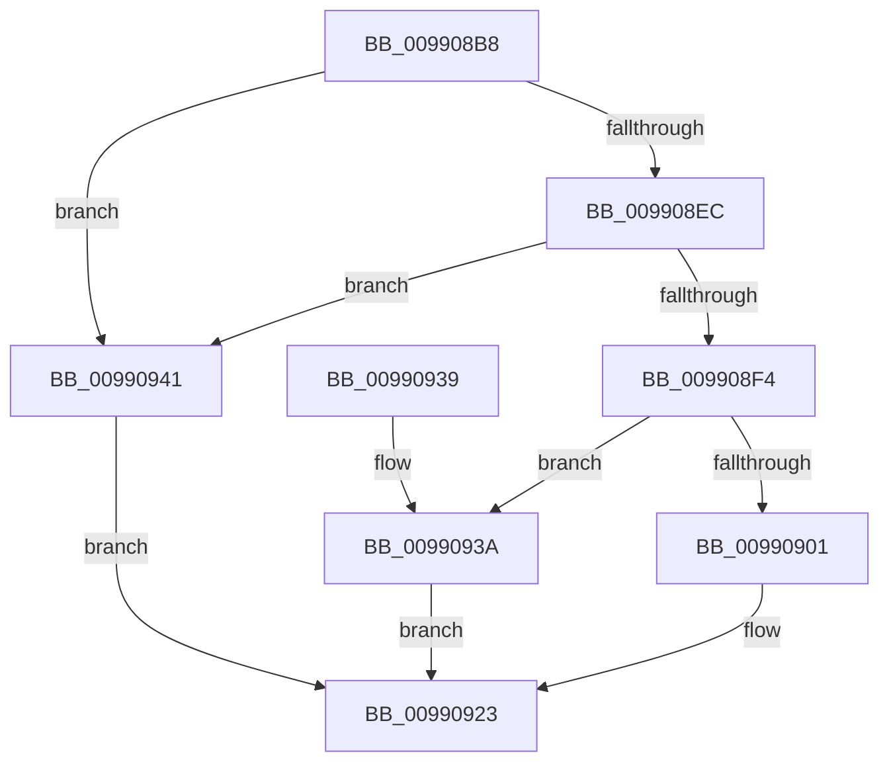

# PnpValidateObjectNameDispatch

- RVA: `0x009908B8`–`0x00990948` (길이 `144` bytes)
- VA: `0x00000001409908B8`
- 실행 섹션: `PAGE`
- PDB 이름 있음: `예`; PDB Function 태그: `아니요`
- unwind 정보 RVA: `0x00098C24`
- 디코드: `42`개 명령, `144/144` bytes 표시
- 미해석 바이트: `0` (있으면 어셈블리에 `.byte`로 보존)

> 이 문서는 커널 이미지의 기계어와 PDB 기호를 분석해 생성했습니다. 4번과 5번은 함수 원형과 자료형을 바이너리 사용 방식에서 추정한 C 해석이며 원본 소스 복구 결과는 아닙니다.

## 1. Dependencies

- 직접 호출 지점: **2**; 고유 호출 대상: **2**
- 직접 호출자로 확인된 함수: **1**
- RIP 상대 이미지 참조: **0**

### Outgoing calls
- `0x009908E2` → [memset](../../text/6C/memset_function_006C6C40.md) (function, `0x006C6C40`)
- `0x0099091E` → [guard_dispatch_icall](../../text/6B/guard_dispatch_icall_function_006BAAD0.md) (function, `0x006BAAD0`)

### Direct callers
- [PnpValidateObjectName](PnpValidateObjectName_function_00990798.md) at `0x0099081C`

### Static image references
- 디코드된 RIP-relative 메모리 참조가 없습니다.

## 2. Other-region calls and transfers

- 다른 실행 섹션으로 향하는 call: **2**
  - `0x009908E2` → [memset](../../text/6C/memset_function_006C6C40.md) (`PAGE` → `.text`)
  - `0x0099091E` → [guard_dispatch_icall](../../text/6B/guard_dispatch_icall_function_006BAAD0.md) (`PAGE` → `.text`)
- 별도 외부 분기/꼬리 이동을 확인하지 못했습니다.

## 3. Assembly (complete function range)

```asm
009908B8  48 8B C4                        mov rax, rsp
009908BB  48 89 58 08                     mov qword ptr [rax + 8], rbx
009908BF  48 89 68 10                     mov qword ptr [rax + 0x10], rbp
009908C3  48 89 70 18                     mov qword ptr [rax + 0x18], rsi
009908C7  57                              push rdi
009908C8  48 83 EC 70                     sub rsp, 0x70
009908CC  48 8B EA                        mov rbp, rdx
009908CF  49 63 D8                        movsxd rbx, r8d
009908D2  33 D2                           xor edx, edx
009908D4  48 8B F9                        mov rdi, rcx
009908D7  48 8D 48 B8                     lea rcx, [rax - 0x48]
009908DB  41 8B F1                        mov esi, r9d
009908DE  44 8D 42 40                     lea r8d, [rdx + 0x40]
009908E2  E8 59 63 D3 FF                  call 0x1406c6c40
009908E7  66 85 F6                        test si, si
009908EA  75 55                           jne 0x140990941
009908EC  8D 43 FF                        lea eax, [rbx - 1]
009908EF  83 F8 0A                        cmp eax, 0xa
009908F2  77 4D                           ja 0x140990941
009908F4  48 8B 84 DF 28 01 00 00         mov rax, qword ptr [rdi + rbx*8 + 0x128]
009908FC  48 85 C0                        test rax, rax
009908FF  74 39                           je 0x14099093a
00990901  48 8D 4C 24 30                  lea rcx, [rsp + 0x30]
00990906  89 74 24 30                     mov dword ptr [rsp + 0x30], esi
0099090A  48 89 4C 24 20                  mov qword ptr [rsp + 0x20], rcx
0099090F  41 B9 01 00 00 00               mov r9d, 1
00990915  48 8B CF                        mov rcx, rdi
00990918  44 8B C3                        mov r8d, ebx
0099091B  48 8B D5                        mov rdx, rbp
0099091E  E8 AD A1 D2 FF                  call 0x1406baad0
00990923  4C 8D 5C 24 70                  lea r11, [rsp + 0x70]
00990928  49 8B 5B 10                     mov rbx, qword ptr [r11 + 0x10]
0099092C  49 8B 6B 18                     mov rbp, qword ptr [r11 + 0x18]
00990930  49 8B 73 20                     mov rsi, qword ptr [r11 + 0x20]
00990934  49 8B E3                        mov rsp, r11
00990937  5F                              pop rdi
00990938  C3                              ret
00990939  CC                              int3
0099093A  B8 02 00 00 C0                  mov eax, 0xc0000002
0099093F  EB E2                           jmp 0x140990923
00990941  B8 0D 00 00 C0                  mov eax, 0xc000000d
00990946  EB DB                           jmp 0x140990923
```

## 4. C-style interpretation (structured pseudocode)

```c
__int64 __fastcall PnpValidateObjectNameDispatch(__int64 a1, __int64 a2, int a3, int a4)
{
    __int64 result;
    __int64 v_rsp;
    unsigned __int64 v_stack_m48;
    unsigned __int64 v_stack_m58;
    unsigned __int64 v_stack_m8;

    *(unsigned __int64 *)(v_rsp + 8) = v_rbx;
    *(unsigned __int64 *)(v_rsp + 16) = v_rbp;
    *(unsigned __int64 *)(v_rsp + 24) = v_rsi;
    v_rsp = (v_rsp) - (112);
    a2 = 0;
    result = memset(v_rsp - 72, a2, a2 + 64, a4);
    if ((unsigned __int16)((unsigned int)(a4)) != 0) goto loc_00990941;
    if (((unsigned int)((int)(a3) - 1)) > 10) goto loc_00990941;
    if (*(unsigned __int64 *)(a1 + (int)(a3) * 8 + 296) == 0) goto loc_0099093A;
    v_stack_m48 = (unsigned int)((unsigned int)(a4));
    v_stack_m58 = v_stack_m48;
    result = guard_dispatch_icall(a1, 0, (unsigned int)((unsigned int)((int)(a3))), 1);
loc_00990923:
    return result;
loc_0099093A:
    goto loc_00990923;
loc_00990941:
    goto loc_00990923;
}
```

## 5. (Beta) C Style

```c
int64_t PnpValidateObjectNameDispatch(void *Arg1, int64_t Arg2, void *Arg3, int32_t Arg4)
{
    uint8_t *arg1 = (uint8_t *)Arg1;
    uint8_t *arg3 = (uint8_t *)Arg3;

    int64_t result;
    int64_t local_rsp;
    uint64_t v_stack_m48;
    uint64_t v_stack_m58;
    uint64_t v_stack_m8;

    *(uint64_t *)(local_rsp + 0x8) = local_rbx;
    *(uint64_t *)(local_rsp + 0x10) = local_rbp;
    *(uint64_t *)(local_rsp + 0x18) = local_rsi;
    local_rsp = (local_rsp) - (112);
    Arg2 = 0;
    result = memset(local_rsp - 72, Arg2, Arg2 + 64, Arg4);
    if ((uint16_t)((uint32_t)(Arg4)) != 0) goto loc_00990941;
    if (((uint32_t)((int32_t)(Arg3) - 1)) > 10) goto loc_00990941;
    if (*(uint64_t *)(arg1 + (int32_t)(arg3) * 8 + 0x128) == 0) goto loc_0099093A;
    v_stack_m48 = (uint32_t)((uint32_t)(Arg4));
    v_stack_m58 = v_stack_m48;
    result = guard_dispatch_icall(Arg1, 0, (uint32_t)((uint32_t)((int32_t)(Arg3))), 1);
loc_00990923:
    return result;
loc_0099093A:
    goto loc_00990923;
loc_00990941:
    goto loc_00990923;
}
```

### 관측된 메모리 오프셋

구조체 형식이 확인되지 않은 접근은 인자 기준의 오프셋으로만 기록했습니다.

| 기준 인자 | 오프셋 표현 | 폭 (bit) | 접근 |
|---|---:|---:|---|
| `Arg1` | `+ 0x128 + rbx*8` | `64` | `R` |
| `Arg3` | `- 0x1` | `32` | `R` |

## 6. Execution-region graph

[열기: 2D/3D 그래프와 함수 탐색 컨트롤 패널](../../../control-panel.html?section=page&rva=0x009908B8&view=graph)

- 2D 그래프는 위에서 아래로 흐르고, 3D 그래프는 빈 공간을 드래그해 회전합니다. Shift+드래그는 이동, 휠은 확대·축소, 함수 노드 선택은 대상 보고서 이동입니다.

### Static fallback


