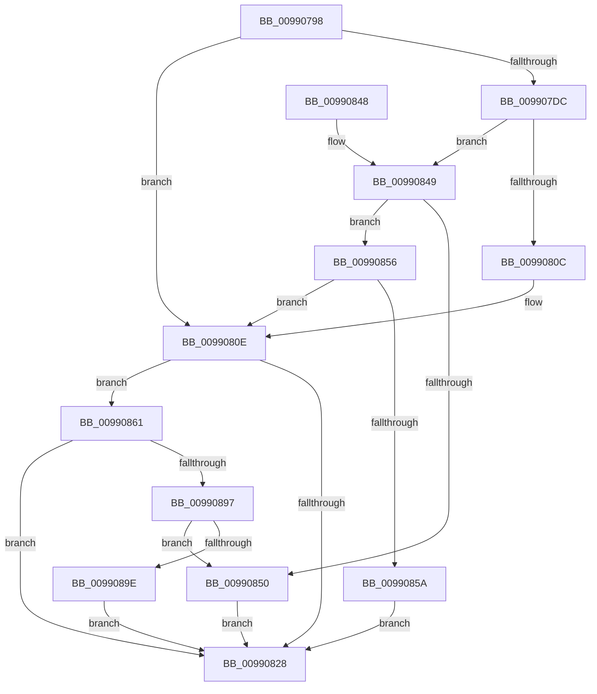

# PnpValidateObjectName

- RVA: `0x00990798`–`0x009908B1` (길이 `281` bytes)
- VA: `0x0000000140990798`
- 실행 섹션: `PAGE`
- PDB 이름 있음: `예`; PDB Function 태그: `아니요`
- unwind 정보 RVA: `0x00098C04`
- 디코드: `76`개 명령, `281/281` bytes 표시
- 미해석 바이트: `0` (있으면 어셈블리에 `.byte`로 보존)

> 이 문서는 커널 이미지의 기계어와 PDB 기호를 분석해 생성했습니다. 4번과 5번은 함수 원형과 자료형을 바이너리 사용 방식에서 추정한 C 해석이며 원본 소스 복구 결과는 아닙니다.

## 1. Dependencies

- 직접 호출 지점: **4**; 고유 호출 대상: **3**
- 직접 호출자로 확인된 함수: **2**
- RIP 상대 이미지 참조: **1**

### Outgoing calls
- `0x009907CB` → [memset](../../text/6C/memset_function_006C6C40.md) (function, `0x006C6C40`)
- `0x00990800` → [guard_dispatch_icall](../../text/6B/guard_dispatch_icall_function_006BAAD0.md) (function, `0x006BAAD0`)
- `0x0099081C` → [PnpValidateObjectNameDispatch](PnpValidateObjectNameDispatch_function_009908B8.md) (function, `0x009908B8`)
- `0x00990889` → [guard_dispatch_icall](../../text/6B/guard_dispatch_icall_function_006BAAD0.md) (function, `0x006BAAD0`)

### Direct callers
- [PiDmObjectCreate](../94/PiDmObjectCreate_function_0094F5CC.md) at `0x0094F6F0`
- [PiDqOpenUserObjectRegKey](PiDqOpenUserObjectRegKey_function_00990444.md) at `0x009904DA`

### Static image references
- `0x009907B4` → RVA `0x00E66398` (`.data`; read)

## 2. Other-region calls and transfers

- 다른 실행 섹션으로 향하는 call: **3**
  - `0x009907CB` → [memset](../../text/6C/memset_function_006C6C40.md) (`PAGE` → `.text`)
  - `0x00990800` → [guard_dispatch_icall](../../text/6B/guard_dispatch_icall_function_006BAAD0.md) (`PAGE` → `.text`)
  - `0x00990889` → [guard_dispatch_icall](../../text/6B/guard_dispatch_icall_function_006BAAD0.md) (`PAGE` → `.text`)
- 별도 외부 분기/꼬리 이동을 확인하지 못했습니다.

## 3. Assembly (complete function range)

```asm
00990798  48 8B C4                        mov rax, rsp
0099079B  48 89 58 08                     mov qword ptr [rax + 8], rbx
0099079F  48 89 68 10                     mov qword ptr [rax + 0x10], rbp
009907A3  48 89 70 18                     mov qword ptr [rax + 0x18], rsi
009907A7  48 89 78 20                     mov qword ptr [rax + 0x20], rdi
009907AB  41 56                           push r14
009907AD  48 81 EC 90 00 00 00            sub rsp, 0x90
009907B4  48 8B 35 DD 5B 4D 00            mov rsi, qword ptr [rip + 0x4d5bdd]
009907BB  48 8D 48 A8                     lea rcx, [rax - 0x58]
009907BF  4C 8B F2                        mov r14, rdx
009907C2  41 8B E8                        mov ebp, r8d
009907C5  33 D2                           xor edx, edx
009907C7  44 8D 42 50                     lea r8d, [rdx + 0x50]
009907CB  E8 70 64 D3 FF                  call 0x1406c6c40
009907D0  48 8B BE E8 01 00 00            mov rdi, qword ptr [rsi + 0x1e8]
009907D7  48 85 FF                        test rdi, rdi
009907DA  74 32                           je 0x14099080e
009907DC  48 8D 44 24 40                  lea rax, [rsp + 0x40]
009907E1  41 B9 01 00 00 00               mov r9d, 1
009907E7  48 89 44 24 28                  mov qword ptr [rsp + 0x28], rax
009907EC  44 8B C5                        mov r8d, ebp
009907EF  48 8B C7                        mov rax, rdi
009907F2  C7 44 24 20 01 00 00 00         mov dword ptr [rsp + 0x20], 1
009907FA  49 8B D6                        mov rdx, r14
009907FD  48 8B CE                        mov rcx, rsi
00990800  E8 CB A2 D2 FF                  call 0x1406baad0
00990805  3D 02 00 00 C0                  cmp eax, 0xc0000002
0099080A  75 3D                           jne 0x140990849
0099080C  33 FF                           xor edi, edi
0099080E  44 8B 4C 24 50                  mov r9d, dword ptr [rsp + 0x50]
00990813  44 8B C5                        mov r8d, ebp
00990816  49 8B D6                        mov rdx, r14
00990819  48 8B CE                        mov rcx, rsi
0099081C  E8 97 00 00 00                  call 0x1409908b8
00990821  8B D8                           mov ebx, eax
00990823  48 85 FF                        test rdi, rdi
00990826  75 39                           jne 0x140990861
00990828  4C 8D 9C 24 90 00 00 00         lea r11, [rsp + 0x90]
00990830  8B C3                           mov eax, ebx
00990832  49 8B 5B 10                     mov rbx, qword ptr [r11 + 0x10]
00990836  49 8B 6B 18                     mov rbp, qword ptr [r11 + 0x18]
0099083A  49 8B 73 20                     mov rsi, qword ptr [r11 + 0x20]
0099083E  49 8B 7B 28                     mov rdi, qword ptr [r11 + 0x28]
00990842  49 8B E3                        mov rsp, r11
00990845  41 5E                           pop r14
00990847  C3                              ret
00990848  CC                              int3
00990849  3D 20 01 00 C0                  cmp eax, 0xc0000120
0099084E  75 06                           jne 0x140990856
00990850  8B 5C 24 40                     mov ebx, dword ptr [rsp + 0x40]
00990854  EB D2                           jmp 0x140990828
00990856  85 C0                           test eax, eax
00990858  74 B4                           je 0x14099080e
0099085A  BB E5 00 00 C0                  mov ebx, 0xc00000e5
0099085F  EB C7                           jmp 0x140990828
00990861  48 8D 44 24 40                  lea rax, [rsp + 0x40]
00990866  89 5C 24 40                     mov dword ptr [rsp + 0x40], ebx
0099086A  48 89 44 24 28                  mov qword ptr [rsp + 0x28], rax
0099086F  41 B9 01 00 00 00               mov r9d, 1
00990875  48 8B C7                        mov rax, rdi
00990878  C7 44 24 20 02 00 00 00         mov dword ptr [rsp + 0x20], 2
00990880  44 8B C5                        mov r8d, ebp
00990883  49 8B D6                        mov rdx, r14
00990886  48 8B CE                        mov rcx, rsi
00990889  E8 42 A2 D2 FF                  call 0x1406baad0
0099088E  8B C8                           mov ecx, eax
00990890  3D 02 00 00 C0                  cmp eax, 0xc0000002
00990895  74 91                           je 0x140990828
00990897  3D 20 01 00 C0                  cmp eax, 0xc0000120
0099089C  74 B2                           je 0x140990850
0099089E  8B C3                           mov eax, ebx
009908A0  85 C9                           test ecx, ecx
009908A2  BB E5 00 00 C0                  mov ebx, 0xc00000e5
009908A7  0F 45 C3                        cmovne eax, ebx
009908AA  8B D8                           mov ebx, eax
009908AC  E9 77 FF FF FF                  jmp 0x140990828
```

## 4. C-style interpretation (structured pseudocode)

```c
__int64 __fastcall PnpValidateObjectName(__int64 a1, __int64 a2, int a3)
{
    __int64 result;
    __int64 v_rdi;
    __int64 v_rsp;
    unsigned int v_stack_m48;
    unsigned int v_stack_m50;
    unsigned __int64 v_stack_m58;
    unsigned __int64 v_stack_m68;
    unsigned __int64 v_stack_m70;
    unsigned int v_stack_m78;
    unsigned __int64 v_stack_m8;

    *(unsigned __int64 *)(v_rsp + 8) = v_rbx;
    *(unsigned __int64 *)(v_rsp + 16) = v_rbp;
    *(unsigned __int64 *)(v_rsp + 24) = v_rsi;
    *(unsigned __int64 *)(v_rsp + 32) = v_rdi;
    v_rsp = (v_rsp) - (144);
    a2 = 0;
    result = memset(v_rsp - 88, a2, a2 + 80, a4);
    if (*(unsigned __int64 *)(*(unsigned __int64 *)(v_rip + 5069789) + 488) == 0) goto loc_0099080E;
    v_stack_m70 = v_stack_m58;
    v_stack_m78 = 1;
    result = guard_dispatch_icall(*(unsigned __int64 *)(v_rip + 5069789), 0, (unsigned int)((unsigned int)((unsigned int)(a3))), 1);
    if (((unsigned int)(result)) != 0xC0000002ULL) goto loc_00990849;
    v_rdi = 0;
loc_0099080E:
    result = PnpValidateObjectNameDispatch(*(unsigned __int64 *)(v_rip + 5069789), 0, (unsigned int)((unsigned int)((unsigned int)(a3))), (unsigned int)(v_stack_m48));
    if (0 != 0) goto loc_00990861;
loc_00990828:
    return (unsigned int)((unsigned int)((unsigned int)((unsigned int)(result))));
loc_00990849:
    if (((unsigned int)((unsigned int)((unsigned int)((unsigned int)((unsigned int)(result)))))) != 0xC0000120ULL) goto loc_00990856;
loc_00990850:
    goto loc_00990828;
loc_00990856:
    if ((unsigned int)((unsigned int)((unsigned int)((unsigned int)((unsigned int)(result))))) == 0) goto loc_0099080E;
    goto loc_00990828;
loc_00990861:
    v_stack_m50 = (unsigned int)((unsigned int)(0xC00000E5ULL));
    v_stack_m68 = v_stack_m50;
    v_stack_m70 = 2;
    result = guard_dispatch_icall(*(unsigned __int64 *)(v_stack_m8 + 32), 0, (unsigned int)((unsigned int)(*(unsigned __int64 *)(v_stack_m8 + 24))), 1);
    if (((unsigned int)(result)) == 0xC0000002ULL) goto loc_00990828;
    if (((unsigned int)(result)) == 0xC0000120ULL) goto loc_00990850;
    result = (unsigned int)((unsigned int)((unsigned int)(0xC00000E5ULL)));
    if ((unsigned int)((unsigned int)((unsigned int)(result))) != 0) { result = (unsigned int)((unsigned int)(0xC00000E5ULL)); }
    goto loc_00990828;
}
```

## 5. (Beta) C Style

```c
int64_t PnpValidateObjectName(int64_t Arg1, int64_t Arg2, int32_t Arg3)
{
    int64_t result;
    int64_t local_rdi;
    int64_t local_rsp;
    uint32_t v_stack_m48;
    uint32_t v_stack_m50;
    uint64_t v_stack_m58;
    uint64_t v_stack_m68;
    uint64_t v_stack_m70;
    uint32_t v_stack_m78;
    uint64_t v_stack_m8;

    *(uint64_t *)(local_rsp + 0x8) = local_rbx;
    *(uint64_t *)(local_rsp + 0x10) = local_rbp;
    *(uint64_t *)(local_rsp + 0x18) = local_rsi;
    *(uint64_t *)(local_rsp + 0x20) = local_rdi;
    local_rsp = (local_rsp) - (144);
    Arg2 = 0;
    result = memset(local_rsp - 88, Arg2, Arg2 + 80, a4);
    if (*(uint64_t *)(*(uint64_t *)(v_rip + 0x4D5BDD) + 0x1E8) == 0) goto loc_0099080E;
    v_stack_m70 = v_stack_m58;
    v_stack_m78 = 1;
    result = guard_dispatch_icall(*(uint64_t *)(v_rip + 0x4D5BDD), 0, (uint32_t)((uint32_t)((uint32_t)(Arg3))), 1);
    if (((uint32_t)(result)) != 0xC0000002ULL) goto loc_00990849;
    local_rdi = 0;
loc_0099080E:
    result = PnpValidateObjectNameDispatch(*(uint64_t *)(v_rip + 0x4D5BDD), 0, (uint32_t)((uint32_t)((uint32_t)(Arg3))), (uint32_t)(v_stack_m48));
    if (0 != 0) goto loc_00990861;
loc_00990828:
    return (uint32_t)((uint32_t)((uint32_t)((uint32_t)(result))));
loc_00990849:
    if (((uint32_t)((uint32_t)((uint32_t)((uint32_t)((uint32_t)(result)))))) != 0xC0000120ULL) goto loc_00990856;
loc_00990850:
    goto loc_00990828;
loc_00990856:
    if ((uint32_t)((uint32_t)((uint32_t)((uint32_t)((uint32_t)(result))))) == 0) goto loc_0099080E;
    goto loc_00990828;
loc_00990861:
    v_stack_m50 = (uint32_t)((uint32_t)(0xC00000E5ULL));
    v_stack_m68 = v_stack_m50;
    v_stack_m70 = 2;
    result = guard_dispatch_icall(*(uint64_t *)(v_stack_m8 + 0x20), 0, (uint32_t)((uint32_t)(*(uint64_t *)(v_stack_m8 + 0x18))), 1);
    if (((uint32_t)(result)) == 0xC0000002ULL) goto loc_00990828;
    if (((uint32_t)(result)) == 0xC0000120ULL) goto loc_00990850;
    result = (uint32_t)((uint32_t)((uint32_t)(0xC00000E5ULL)));
    if ((uint32_t)((uint32_t)((uint32_t)(result))) != 0) { result = (uint32_t)((uint32_t)(0xC00000E5ULL)); }
    goto loc_00990828;
}
```

## 6. Execution-region graph

[열기: 2D/3D 그래프와 함수 탐색 컨트롤 패널](../../../control-panel.html?section=page&rva=0x00990798&view=graph)

- 2D 그래프는 위에서 아래로 흐르고, 3D 그래프는 빈 공간을 드래그해 회전합니다. Shift+드래그는 이동, 휠은 확대·축소, 함수 노드 선택은 대상 보고서 이동입니다.

### Static fallback


