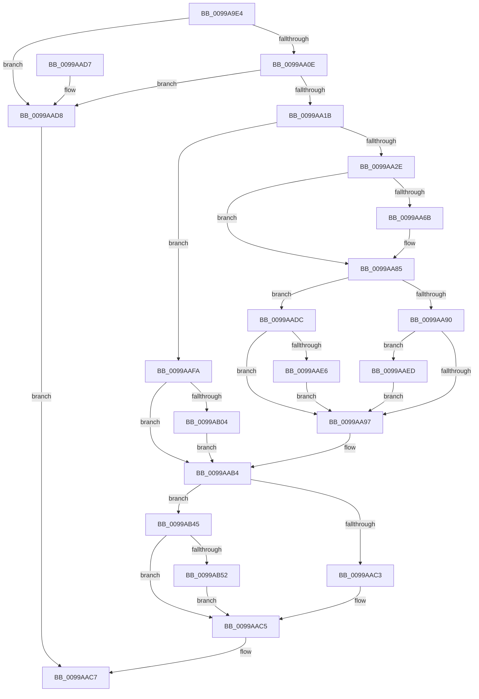

# PpCheckInDriverDatabase

- RVA: `0x0099A9E4`–`0x0099AB72` (길이 `398` bytes)
- VA: `0x000000014099A9E4`
- 실행 섹션: `PAGE`
- PDB 이름 있음: `예`; PDB Function 태그: `아니요`
- unwind 정보 RVA: `0x000995DC`
- 디코드: `93`개 명령, `398/398` bytes 표시
- 미해석 바이트: `0` (있으면 어셈블리에 `.byte`로 보존)

> 이 문서는 커널 이미지의 기계어와 PDB 기호를 분석해 생성했습니다. 4번과 5번은 함수 원형과 자료형을 바이너리 사용 방식에서 추정한 C 해석이며 원본 소스 복구 결과는 아닙니다.

## 1. Dependencies

- 직접 호출 지점: **10**; 고유 호출 대상: **10**
- 직접 호출자로 확인된 함수: **1**
- RIP 상대 이미지 참조: **9**

### Outgoing calls
- `0x0099AA1F` → [IopBuildFullDriverPath](IopBuildFullDriverPath_function_009998E4.md) (function, `0x009998E4`)
- `0x0099AA48` → [ExAcquireResourceExclusiveLite](../../text/21/ExAcquireResourceExclusiveLite_function_00214E20.md) (function, `0x00214E20`)
- `0x0099AA5D` → [PiLookupInDDBCache](PiLookupInDDBCache_function_0099AB78.md) (function, `0x0099AB78`)
- `0x0099AA7E` → [PiLookupInDDB](PiLookupInDDB_function_0099ACBC.md) (function, `0x0099ACBC`)
- `0x0099AA9E` → [ExReleaseResourceLite](../../text/25/ExReleaseResourceLite_function_0025FA10.md) (function, `0x0025FA10`)
- `0x0099AAA3` → [KeLeaveCriticalRegion](../../text/25/KeLeaveCriticalRegion_function_0025D8B0.md) (function, `0x0025D8B0`)
- `0x0099AAAF` → [ExFreePoolWithTag](../../poolcode/B8/ExFreePoolWithTag_function_00B82870.md) (function, `0x00B82870`)
- `0x0099AB21` → [RtlInitUnicodeString](../../text/42/RtlInitUnicodeString_function_0042A780.md) (function, `0x0042A780`)
- `0x0099AB3B` → [PnpLogEvent](../72/PnpLogEvent_function_0072C8FC.md) (function, `0x0072C8FC`)
- `0x0099AB68` → [McTemplateK0j_EtwWriteTransfer](../../text/57/McTemplateK0j_EtwWriteTransfer_function_0057B2AC.md) (function, `0x0057B2AC`)

### Direct callers
- [PnpPrepareDriverLoading](PnpPrepareDriverLoading_function_00996CC8.md) at `0x00996D47`

### Static image references
- `0x0099A9F4` → RVA `0x00FC4148` (`.data`; read)
- `0x0099AA0E` → RVA `0x00FD803E` (`PAGEDATA`; read)
- `0x0099AA37` → RVA `0x00F8C280` (`.data`; read)
- `0x0099AAFA` → RVA `0x00FD9A8C` (`PAGEDATA`; read)
- `0x0099AB07` → RVA `0x00AFE120` (` ?? ::NNGAKEGL::`string'`; read)
- `0x0099AB11` → RVA `0x00FD9A8C` (`PAGEDATA`; write)
- `0x0099AB45` → RVA `0x00EF012A` (`.data`; read)
- `0x0099AB5A` → RVA `0x000271B0` (`.rdata`; read)
- `0x0099AB61` → RVA `0x00E06DA0` (`.data`; read)

## 2. Other-region calls and transfers

- 다른 실행 섹션으로 향하는 call: **6**
  - `0x0099AA48` → [ExAcquireResourceExclusiveLite](../../text/21/ExAcquireResourceExclusiveLite_function_00214E20.md) (`PAGE` → `.text`)
  - `0x0099AA9E` → [ExReleaseResourceLite](../../text/25/ExReleaseResourceLite_function_0025FA10.md) (`PAGE` → `.text`)
  - `0x0099AAA3` → [KeLeaveCriticalRegion](../../text/25/KeLeaveCriticalRegion_function_0025D8B0.md) (`PAGE` → `.text`)
  - `0x0099AAAF` → [ExFreePoolWithTag](../../poolcode/B8/ExFreePoolWithTag_function_00B82870.md) (`PAGE` → `POOLCODE`)
  - `0x0099AB21` → [RtlInitUnicodeString](../../text/42/RtlInitUnicodeString_function_0042A780.md) (`PAGE` → `.text`)
  - `0x0099AB68` → [McTemplateK0j_EtwWriteTransfer](../../text/57/McTemplateK0j_EtwWriteTransfer_function_0057B2AC.md) (`PAGE` → `.text`)
- 별도 외부 분기/꼬리 이동을 확인하지 못했습니다.

## 3. Assembly (complete function range)

```asm
0099A9E4  48 8B C4                        mov rax, rsp
0099A9E7  48 89 58 08                     mov qword ptr [rax + 8], rbx
0099A9EB  48 89 68 10                     mov qword ptr [rax + 0x10], rbp
0099A9EF  56                              push rsi
0099A9F0  48 83 EC 50                     sub rsp, 0x50
0099A9F4  80 3D 4D 97 62 00 00            cmp byte ptr [rip + 0x62974d], 0
0099A9FB  0F 57 C0                        xorps xmm0, xmm0
0099A9FE  0F 11 40 E0                     movups xmmword ptr [rax - 0x20], xmm0
0099AA02  41 8B E9                        mov ebp, r9d
0099AA05  49 8B F0                        mov rsi, r8
0099AA08  0F 85 CA 00 00 00               jne 0x14099aad8
0099AA0E  80 3D 29 D6 63 00 00            cmp byte ptr [rip + 0x63d629], 0
0099AA15  0F 84 BD 00 00 00               je 0x14099aad8
0099AA1B  4C 8D 40 E0                     lea r8, [rax - 0x20]
0099AA1F  E8 C0 EE FF FF                  call 0x1409998e4
0099AA24  8B D8                           mov ebx, eax
0099AA26  85 C0                           test eax, eax
0099AA28  0F 88 CC 00 00 00               js 0x14099aafa
0099AA2E  65 48 8B 04 25 88 01 00 00      mov rax, qword ptr gs:[0x188]
0099AA37  48 8D 0D 42 18 5F 00            lea rcx, [rip + 0x5f1842]
0099AA3E  B2 01                           mov dl, 1
0099AA40  66 FF 88 E4 01 00 00            dec word ptr [rax + 0x1e4]
0099AA47  90                              nop
0099AA48  E8 D3 A3 87 FF                  call 0x140214e20
0099AA4D  4C 8B 8C 24 88 00 00 00         mov r9, qword ptr [rsp + 0x88]
0099AA55  48 8D 4C 24 38                  lea rcx, [rsp + 0x38]
0099AA5A  48 8B D6                        mov rdx, rsi
0099AA5D  E8 16 01 00 00                  call 0x14099ab78
0099AA62  8B D8                           mov ebx, eax
0099AA64  3D 01 00 00 C0                  cmp eax, 0xc0000001
0099AA69  75 1A                           jne 0x14099aa85
0099AA6B  4C 8B 8C 24 88 00 00 00         mov r9, qword ptr [rsp + 0x88]
0099AA73  48 8D 4C 24 38                  lea rcx, [rsp + 0x38]
0099AA78  44 8B C5                        mov r8d, ebp
0099AA7B  48 8B D6                        mov rdx, rsi
0099AA7E  E8 39 02 00 00                  call 0x14099acbc
0099AA83  8B D8                           mov ebx, eax
0099AA85  B9 6C 03 00 C0                  mov ecx, 0xc000036c
0099AA8A  8B C3                           mov eax, ebx
0099AA8C  3B D9                           cmp ebx, ecx
0099AA8E  74 4C                           je 0x14099aadc
0099AA90  3D 6B 03 00 C0                  cmp eax, 0xc000036b
0099AA95  74 56                           je 0x14099aaed
0099AA97  48 8D 0D E2 17 5F 00            lea rcx, [rip + 0x5f17e2]
0099AA9E  E8 6D 4F 8C FF                  call 0x14025fa10
0099AAA3  E8 08 2E 8C FF                  call 0x14025d8b0
0099AAA8  48 8B 4C 24 40                  mov rcx, qword ptr [rsp + 0x40]
0099AAAD  33 D2                           xor edx, edx
0099AAAF  E8 BC 7D 1E 00                  call 0x140b82870
0099AAB4  8D 83 95 FC FF 3F               lea eax, [rbx + 0x3ffffc95]
0099AABA  83 F8 01                        cmp eax, 1
0099AABD  0F 86 82 00 00 00               jbe 0x14099ab45
0099AAC3  33 DB                           xor ebx, ebx
0099AAC5  8B C3                           mov eax, ebx
0099AAC7  48 8B 5C 24 60                  mov rbx, qword ptr [rsp + 0x60]
0099AACC  48 8B 6C 24 68                  mov rbp, qword ptr [rsp + 0x68]
0099AAD1  48 83 C4 50                     add rsp, 0x50
0099AAD5  5E                              pop rsi
0099AAD6  C3                              ret
0099AAD7  CC                              int3
0099AAD8  33 C0                           xor eax, eax
0099AADA  EB EB                           jmp 0x14099aac7
0099AADC  83 BC 24 80 00 00 00 00         cmp dword ptr [rsp + 0x80], 0
0099AAE4  75 B1                           jne 0x14099aa97
0099AAE6  BB 6B 03 00 C0                  mov ebx, 0xc000036b
0099AAEB  EB AA                           jmp 0x14099aa97
0099AAED  83 BC 24 80 00 00 00 00         cmp dword ptr [rsp + 0x80], 0
0099AAF5  0F 45 D9                        cmovne ebx, ecx
0099AAF8  EB 9D                           jmp 0x14099aa97
0099AAFA  8B 05 8C EF 63 00               mov eax, dword ptr [rip + 0x63ef8c]
0099AB00  A8 08                           test al, 8
0099AB02  75 B0                           jne 0x14099aab4
0099AB04  83 C8 08                        or eax, 8
0099AB07  48 8D 15 12 36 16 00            lea rdx, [rip + 0x163612]
0099AB0E  0F 57 C0                        xorps xmm0, xmm0
0099AB11  89 05 75 EF 63 00               mov dword ptr [rip + 0x63ef75], eax
0099AB17  48 8D 4C 24 38                  lea rcx, [rsp + 0x38]
0099AB1C  0F 11 44 24 38                  movups xmmword ptr [rsp + 0x38], xmm0
0099AB21  E8 5A FC A8 FF                  call 0x14042a780
0099AB26  83 64 24 20 00                  and dword ptr [rsp + 0x20], 0
0099AB2B  48 8D 4C 24 38                  lea rcx, [rsp + 0x38]
0099AB30  45 33 C9                        xor r9d, r9d
0099AB33  33 D2                           xor edx, edx
0099AB35  41 B8 6D 03 00 C0               mov r8d, 0xc000036d
0099AB3B  E8 BC 1D D9 FF                  call 0x14072c8fc
0099AB40  E9 6F FF FF FF                  jmp 0x14099aab4
0099AB45  F6 05 DE 55 55 00 04            test byte ptr [rip + 0x5555de], 4
0099AB4C  0F 84 73 FF FF FF               je 0x14099aac5
0099AB52  4C 8B 8C 24 88 00 00 00         mov r9, qword ptr [rsp + 0x88]
0099AB5A  48 8D 15 4F C6 68 FF            lea rdx, [rip - 0x9739b1]
0099AB61  48 8D 0D 38 C2 46 00            lea rcx, [rip + 0x46c238]
0099AB68  E8 3F 07 BE FF                  call 0x14057b2ac
0099AB6D  E9 53 FF FF FF                  jmp 0x14099aac5
```

## 4. C-style interpretation (structured pseudocode)

```c
__int64 __fastcall PpCheckInDriverDatabase(__int64 a1, __int64 a2, __int64 a3, int a4, unsigned int a5, __int64 a6)
{
    __int64 result;
    __int64 v_rbx;
    __int64 v_rsp;
    unsigned __int64 v_stack_m18;
    unsigned __int64 v_stack_m20;
    unsigned __int64 v_stack_p10;
    unsigned int v_stack_p20;
    unsigned __int64 v_stack_p38;
    unsigned __int64 v_stack_p8;

    *(unsigned __int64 *)(v_rsp + 8) = v_rbx;
    *(unsigned __int64 *)(v_rsp + 16) = v_rbp;
    v_rsp = (v_rsp) - (80);
    *(unsigned __int64 *)(v_rsp - 32) = v_xmm0;
    if ((*(unsigned __int8 *)(v_rip + 6461261)) != 0) goto loc_0099AAD8;
    if ((*(unsigned __int8 *)(v_rip + 6542889)) == 0) goto loc_0099AAD8;
    result = IopBuildFullDriverPath(a1, a2, v_rsp - 32, a4);
    if (sign_flag) goto loc_0099AAFA;
    result = ExAcquireResourceExclusiveLite(v_rip + 6232130, 1, v_rsp - 32, a4);
    result = PiLookupInDDBCache(v_stack_m20, a3, v_rsp - 32, a6);
    v_rbx = (unsigned int)((unsigned int)(result));
    if (((unsigned int)(result)) == 0xC0000001ULL) {
        a4 = a6;
        a1 = v_stack_m20;
        a3 = (unsigned int)((unsigned int)(a4));
        a2 = a3;
        result = PiLookupInDDB(a1, a2, a3, a4);
        v_rbx = (unsigned int)(result);
    }
    if (((unsigned int)(v_rbx)) == ((unsigned int)((unsigned int)(0xC000036CULL)))) goto loc_0099AADC;
    if (((unsigned int)((unsigned int)((unsigned int)(v_rbx)))) == 0xC000036BULL) goto loc_0099AAED;
loc_0099AA97:
    result = ExReleaseResourceLite(v_rip + 6232034, a2, a3, a4);
    result = KeLeaveCriticalRegion(v_rip + 6232034, a2, a3, a4);
    a2 = 0;
    result = ExFreePoolWithTag(v_stack_m18, a2, a3, a4);
loc_0099AAB4:
    if (((unsigned int)(v_rbx + 1073740949)) <= 1) goto loc_0099AB45;
    v_rbx = 0;
loc_0099AAC5:
loc_0099AAC7:
    v_rsp = (v_rsp) + (80);
    return 0;
loc_0099AAD8:
    result = 0;
    goto loc_0099AAC7;
loc_0099AADC:
    if (a5 != 0) goto loc_0099AA97;
    goto loc_0099AA97;
loc_0099AAED:
    v_rbx = (unsigned int)(0xC000036BULL);
    if (a5 != 0) { v_rbx = (unsigned int)(v_stack_m18); }
    goto loc_0099AA97;
loc_0099AAFA:
    if ((((unsigned __int8)((unsigned int)(*(unsigned int *)(v_rip + 6549388)))) & (8)) != 0) goto loc_0099AAB4;
    result = (unsigned int)(((unsigned int)(*(unsigned int *)(v_rip + 6549388))) | (8));
    *(unsigned int *)(v_rip + 6549365) = (unsigned int)(result);
    v_stack_p38 = v_xmm0;
    result = RtlInitUnicodeString(v_stack_p38, v_rip + 1455634, a3, a4);
    a4 = 0;
    a2 = 0;
    result = PnpLogEvent(v_stack_p38, a2, (unsigned int)(0xC000036DULL), a4);
    goto loc_0099AAB4;
loc_0099AB45:
    if (((*(unsigned __int8 *)(v_rip + 5592542)) & (4)) == 0) goto loc_0099AAC5;
    result = McTemplateK0j_EtwWriteTransfer(v_rip + 4637240, v_rip - 9910705, (unsigned int)(0xC000036DULL), a6);
    goto loc_0099AAC5;
}
```

## 5. (Beta) C Style

```c
int64_t PpCheckInDriverDatabase(int64_t Arg1, int64_t Arg2, int64_t Arg3, int32_t Arg4, uint32_t Arg5, int64_t Arg6)
{
    int64_t result;
    int64_t local_rbx;
    int64_t local_rsp;
    uint64_t v_stack_m18;
    uint64_t v_stack_m20;
    uint64_t v_stack_p10;
    uint32_t v_stack_p20;
    uint64_t v_stack_p38;
    uint64_t v_stack_p8;

    *(uint64_t *)(local_rsp + 0x8) = local_rbx;
    *(uint64_t *)(local_rsp + 0x10) = local_rbp;
    local_rsp = (local_rsp) - (80);
    *(uint64_t *)(local_rsp - 0x20) = v_xmm0;
    if ((*(uint8_t *)(v_rip + 0x62974D)) != 0) goto loc_0099AAD8;
    if ((*(uint8_t *)(v_rip + 0x63D629)) == 0) goto loc_0099AAD8;
    result = IopBuildFullDriverPath(Arg1, Arg2, local_rsp - 32, Arg4);
    if (sign_flag) goto loc_0099AAFA;
    result = ExAcquireResourceExclusiveLite(v_rip + 6232130, 1, local_rsp - 32, Arg4);
    result = PiLookupInDDBCache(v_stack_m20, Arg3, local_rsp - 32, Arg6);
    local_rbx = (uint32_t)((uint32_t)(result));
    if (((uint32_t)(result)) == 0xC0000001ULL) {
        Arg4 = Arg6;
        Arg1 = v_stack_m20;
        Arg3 = (uint32_t)((uint32_t)(Arg4));
        Arg2 = Arg3;
        result = PiLookupInDDB(Arg1, Arg2, Arg3, Arg4);
        local_rbx = (uint32_t)(result);
    }
    if (((uint32_t)(local_rbx)) == ((uint32_t)((uint32_t)(0xC000036CULL)))) goto loc_0099AADC;
    if (((uint32_t)((uint32_t)((uint32_t)(local_rbx)))) == 0xC000036BULL) goto loc_0099AAED;
loc_0099AA97:
    result = ExReleaseResourceLite(v_rip + 6232034, Arg2, Arg3, Arg4);
    result = KeLeaveCriticalRegion(v_rip + 6232034, Arg2, Arg3, Arg4);
    Arg2 = 0;
    result = ExFreePoolWithTag(v_stack_m18, Arg2, Arg3, Arg4);
loc_0099AAB4:
    if (((uint32_t)(local_rbx + 1073740949)) <= 1) goto loc_0099AB45;
    local_rbx = 0;
loc_0099AAC5:
loc_0099AAC7:
    local_rsp = (local_rsp) + (80);
    return 0;
loc_0099AAD8:
    result = 0;
    goto loc_0099AAC7;
loc_0099AADC:
    if (Arg5 != 0) goto loc_0099AA97;
    goto loc_0099AA97;
loc_0099AAED:
    local_rbx = (uint32_t)(0xC000036BULL);
    if (Arg5 != 0) { local_rbx = (uint32_t)(v_stack_m18); }
    goto loc_0099AA97;
loc_0099AAFA:
    if ((((uint8_t)((uint32_t)(*(uint32_t *)(v_rip + 0x63EF8C)))) & (8)) != 0) goto loc_0099AAB4;
    result = (uint32_t)(((uint32_t)(*(uint32_t *)(v_rip + 0x63EF8C))) | (8));
    *(uint32_t *)(v_rip + 0x63EF75) = (uint32_t)(result);
    v_stack_p38 = v_xmm0;
    result = RtlInitUnicodeString(v_stack_p38, v_rip + 1455634, Arg3, Arg4);
    Arg4 = 0;
    Arg2 = 0;
    result = PnpLogEvent(v_stack_p38, Arg2, (uint32_t)(0xC000036DULL), Arg4);
    goto loc_0099AAB4;
loc_0099AB45:
    if (((*(uint8_t *)(v_rip + 0x5555DE)) & (4)) == 0) goto loc_0099AAC5;
    result = McTemplateK0j_EtwWriteTransfer(v_rip + 4637240, v_rip - 9910705, (uint32_t)(0xC000036DULL), Arg6);
    goto loc_0099AAC5;
}
```

## 6. Execution-region graph

[열기: 2D/3D 그래프와 함수 탐색 컨트롤 패널](../../../control-panel.html?section=page&rva=0x0099A9E4&view=graph)

- 2D 그래프는 위에서 아래로 흐르고, 3D 그래프는 빈 공간을 드래그해 회전합니다. Shift+드래그는 이동, 휠은 확대·축소, 함수 노드 선택은 대상 보고서 이동입니다.

### Static fallback


