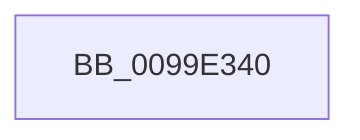

# PsChargeSharedPoolQuota

- RVA: `0x0099E340`–`0x0099E35D` (길이 `29` bytes)
- VA: `0x000000014099E340`
- 실행 섹션: `PAGE`
- PDB 이름 있음: `예`; PDB Function 태그: `아니요`
- unwind 정보 RVA: `0x0009A3E4`
- 디코드: `7`개 명령, `29/29` bytes 표시
- 미해석 바이트: `0` (있으면 어셈블리에 `.byte`로 보존)

> 이 문서는 커널 이미지의 기계어와 PDB 기호를 분석해 생성했습니다. 4번과 5번은 함수 원형과 자료형을 바이너리 사용 방식에서 추정한 C 해석이며 원본 소스 복구 결과는 아닙니다.

## 1. Dependencies

- 직접 호출 지점: **0**; 고유 호출 대상: **0**
- 직접 호출자로 확인된 함수: **3**
- RIP 상대 이미지 참조: **1**

### Outgoing calls
- 직접 디코드된 call 명령이 없습니다.

### Direct callers
- [PspAllocateRateControl](PspAllocateRateControl_function_0099E208.md) at `0x0099E25B`
- [RtlpAllocateAtom](RtlpAllocateAtom_function_0099E2B4.md) at `0x0099E2FC`
- [NtSetInformationJobObject](../9F/NtSetInformationJobObject_function_009F84C0.md) at `0x009F8F51`
- [NtSetInformationJobObject](../9F/NtSetInformationJobObject_function_009F84C0.md) at `0x009F9791`
- [NtSetInformationJobObject](../9F/NtSetInformationJobObject_function_009F84C0.md) at `0x009FA5D0`

### Static image references
- `0x0099E34A` → RVA `0x00FC6AB0` (`ALMOSTRO`; read)

## 2. Other-region calls and transfers

- 다른 실행 섹션으로 향하는 call: **0**
- call이 아닌 외부 분기/꼬리 이동: **1**
  - `0x0099E357` → [sub_0099E3DF + 0x1](Unknown_function_0099E3DF.md) (`tail-transfer`)

## 3. Assembly (complete function range)

```asm
0099E340  48 89 74 24 10                  mov qword ptr [rsp + 0x10], rsi
0099E345  57                              push rdi
0099E346  48 83 EC 20                     sub rsp, 0x20
0099E34A  48 3B 0D 5F 87 62 00            cmp rcx, qword ptr [rip + 0x62875f]
0099E351  49 8B F0                        mov rsi, r8
0099E354  48 8B FA                        mov rdi, rdx
0099E357  0F 84 83 00 00 00               je 0x14099e3e0
```

## 4. C-style interpretation (structured pseudocode)

```c
void __fastcall PsChargeSharedPoolQuota(__int64 a1, __int64 a2, __int64 a3)
{
    __int64 v_rsp;
    unsigned __int64 v_stack_p10;

    v_stack_p10 = v_rsi;
    v_rsp = (v_rsp) - (32);
}
```

## 5. (Beta) C Style

```c
void PsChargeSharedPoolQuota(int64_t Arg1, int64_t Arg2, int64_t Arg3)
{
    int64_t local_rsp;
    uint64_t v_stack_p10;

    v_stack_p10 = local_rsi;
    local_rsp = (local_rsp) - (32);
}
```

## 6. Execution-region graph

[열기: 2D/3D 그래프와 함수 탐색 컨트롤 패널](../../../control-panel.html?section=page&rva=0x0099E340&view=graph)

- 2D 그래프는 위에서 아래로 흐르고, 3D 그래프는 빈 공간을 드래그해 회전합니다. Shift+드래그는 이동, 휠은 확대·축소, 함수 노드 선택은 대상 보고서 이동입니다.

### Static fallback


