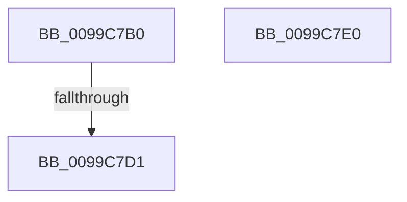

# PsReferenceImpersonationTokenEx

- RVA: `0x0099C7B0`–`0x0099C7E1` (길이 `49` bytes)
- VA: `0x000000014099C7B0`
- 실행 섹션: `PAGE`
- PDB 이름 있음: `예`; PDB Function 태그: `아니요`
- unwind 정보 RVA: `0x00099948`
- 디코드: `20`개 명령, `49/49` bytes 표시
- 미해석 바이트: `0` (있으면 어셈블리에 `.byte`로 보존)

> 이 문서는 커널 이미지의 기계어와 PDB 기호를 분석해 생성했습니다. 4번과 5번은 함수 원형과 자료형을 바이너리 사용 방식에서 추정한 C 해석이며 원본 소스 복구 결과는 아닙니다.

## 1. Dependencies

- 직접 호출 지점: **0**; 고유 호출 대상: **0**
- 직접 호출자로 확인된 함수: **1**
- RIP 상대 이미지 참조: **0**

### Outgoing calls
- 직접 디코드된 call 명령이 없습니다.

### Direct callers
- [SepReferenceTokenByHandle](../../text/3E/SepReferenceTokenByHandle_function_003EDAD0.md) at `0x003EDC2F`

### Static image references
- 디코드된 RIP-relative 메모리 참조가 없습니다.

## 2. Other-region calls and transfers

- 다른 실행 섹션으로 향하는 call: **0**
- call이 아닌 외부 분기/꼬리 이동: **1**
  - `0x0099C7CF` → [sub_0099C7E1](Unknown_function_0099C7E1.md) (`tail-transfer`)

## 3. Assembly (complete function range)

```asm
0099C7B0  48 89 5C 24 18                  mov qword ptr [rsp + 0x18], rbx
0099C7B5  55                              push rbp
0099C7B6  56                              push rsi
0099C7B7  57                              push rdi
0099C7B8  48 83 EC 20                     sub rsp, 0x20
0099C7BC  8B 81 A0 05 00 00               mov eax, dword ptr [rcx + 0x5a0]
0099C7C2  49 8B F1                        mov rsi, r9
0099C7C5  41 8B E8                        mov ebp, r8d
0099C7C8  8B FA                           mov edi, edx
0099C7CA  48 8B D9                        mov rbx, rcx
0099C7CD  A8 08                           test al, 8
0099C7CF  75 10                           jne 0x14099c7e1
0099C7D1  33 C0                           xor eax, eax
0099C7D3  48 8B 5C 24 50                  mov rbx, qword ptr [rsp + 0x50]
0099C7D8  48 83 C4 20                     add rsp, 0x20
0099C7DC  5F                              pop rdi
0099C7DD  5E                              pop rsi
0099C7DE  5D                              pop rbp
0099C7DF  C3                              ret
0099C7E0  CC                              int3
```

## 4. C-style interpretation (structured pseudocode)

```c
__int64 __fastcall PsReferenceImpersonationTokenEx(__int64 a1, int a2, int a3, __int64 a4)
{
    __int64 result;
    __int64 v_rsp;
    unsigned __int64 v_stack_p18;

    v_stack_p18 = v_rbx;
    v_rsp = (v_rsp) - (32);
    result = 0;
    v_rsp = (v_rsp) + (32);
    return result;
}
```

## 5. (Beta) C Style

```c
int64_t PsReferenceImpersonationTokenEx(void *Arg1, int32_t Arg2, int32_t Arg3, int64_t Arg4)
{
    uint8_t *arg1 = (uint8_t *)Arg1;

    int64_t result;
    int64_t local_rsp;
    uint64_t v_stack_p18;

    v_stack_p18 = local_rbx;
    local_rsp = (local_rsp) - (32);
    result = 0;
    local_rsp = (local_rsp) + (32);
    return result;
}
```

### 관측된 메모리 오프셋

구조체 형식이 확인되지 않은 접근은 인자 기준의 오프셋으로만 기록했습니다.

| 기준 인자 | 오프셋 표현 | 폭 (bit) | 접근 |
|---|---:|---:|---|
| `Arg1` | `+ 0x5A0` | `32` | `R` |

## 6. Execution-region graph

[열기: 2D/3D 그래프와 함수 탐색 컨트롤 패널](../../../control-panel.html?section=page&rva=0x0099C7B0&view=graph)

- 2D 그래프는 위에서 아래로 흐르고, 3D 그래프는 빈 공간을 드래그해 회전합니다. Shift+드래그는 이동, 휠은 확대·축소, 함수 노드 선택은 대상 보고서 이동입니다.

### Static fallback


