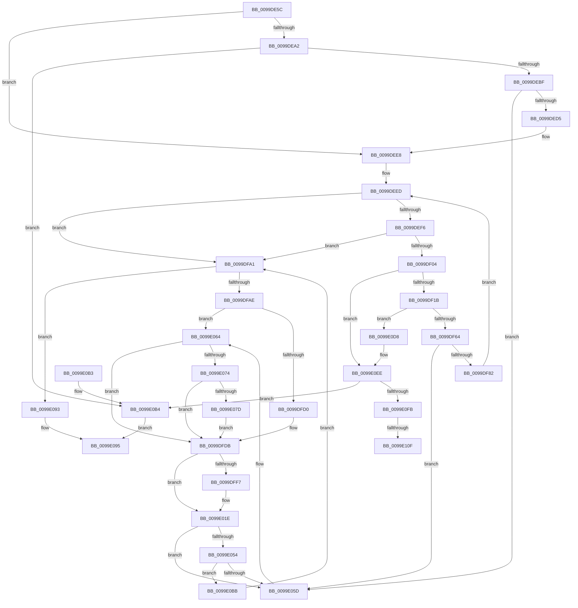

# PspAddSchedulingGroupToJobChain

- RVA: `0x0099DE5C`–`0x0099E12B` (길이 `719` bytes)
- VA: `0x000000014099DE5C`
- 실행 섹션: `PAGE`
- PDB 이름 있음: `예`; PDB Function 태그: `예`
- unwind 정보 RVA: `0x0009A390`
- 디코드: `161`개 명령, `719/719` bytes 표시
- 미해석 바이트: `0` (있으면 어셈블리에 `.byte`로 보존)

> 이 문서는 커널 이미지의 기계어와 PDB 기호를 분석해 생성했습니다. 4번과 5번은 함수 원형과 자료형을 바이너리 사용 방식에서 추정한 C 해석이며 원본 소스 복구 결과는 아닙니다.

## 1. Dependencies

- 직접 호출 지점: **10**; 고유 호출 대상: **7**
- 직접 호출자로 확인된 함수: **2**
- RIP 상대 이미지 참조: **3**

### Outgoing calls
- `0x0099DEAE` → [ExAllocatePool2](../../poolcode/B8/ExAllocatePool2_function_00B820F0.md) (function, `0x00B820F0`)
- `0x0099DF06` → [PspAllocateRateControl](PspAllocateRateControl_function_0099E208.md) (function, `0x0099E208`)
- `0x0099DF53` → [ExAllocatePool2](../../poolcode/B8/ExAllocatePool2_function_00B820F0.md) (function, `0x00B820F0`)
- `0x0099DFEC` → [KeInsertSchedulingGroup](../../text/46/KeInsertSchedulingGroup_function_0046D324.md) (function, `0x0046D324`)
- `0x0099E019` → [PspEnumJobsAndProcessesInJobHierarchy](../91/PspEnumJobsAndProcessesInJobHierarchy_function_0091A1EC.md) (function, `0x0091A1EC`)
- `0x0099E046` → [PspEnumJobsAndProcessesInJobHierarchy](../91/PspEnumJobsAndProcessesInJobHierarchy_function_0091A1EC.md) (function, `0x0091A1EC`)
- `0x0099E089` → [ObfReferenceObjectWithTag](../../text/21/ObfReferenceObjectWithTag_function_00210710.md) (function, `0x00210710`)
- `0x0099E0CA` → [ExFreePoolWithTag](../../poolcode/B8/ExFreePoolWithTag_function_00B82870.md) (function, `0x00B82870`)
- `0x0099E0E1` → [PspFreeRateControl](PspFreeRateControl_function_0099E1BC.md) (function, `0x0099E1BC`)
- `0x0099E111` → [PspFreeRateControl](PspFreeRateControl_function_0099E1BC.md) (function, `0x0099E1BC`)

### Direct callers
- [PspEstablishJobHierarchy](../87/PspEstablishJobHierarchy_function_0087E17C.md) at `0x0087E59A`
- [NtSetInformationJobObject](../9F/NtSetInformationJobObject_function_009F84C0.md) at `0x009F9F9C`

### Static image references
- `0x0099DFFF` → RVA `0x00A66C80` (`PspSetCpuRateControlJobPostCallback`; read)
- `0x0099E00C` → RVA `0x00A8FCA0` (`PspSetCpuRateControlJobPreCallback`; read)
- `0x0099E064` → RVA `0x00FC6ABE` (`ALMOSTRO`; read)

## 2. Other-region calls and transfers

- 다른 실행 섹션으로 향하는 call: **5**
  - `0x0099DEAE` → [ExAllocatePool2](../../poolcode/B8/ExAllocatePool2_function_00B820F0.md) (`PAGE` → `POOLCODE`)
  - `0x0099DF53` → [ExAllocatePool2](../../poolcode/B8/ExAllocatePool2_function_00B820F0.md) (`PAGE` → `POOLCODE`)
  - `0x0099DFEC` → [KeInsertSchedulingGroup](../../text/46/KeInsertSchedulingGroup_function_0046D324.md) (`PAGE` → `.text`)
  - `0x0099E089` → [ObfReferenceObjectWithTag](../../text/21/ObfReferenceObjectWithTag_function_00210710.md) (`PAGE` → `.text`)
  - `0x0099E0CA` → [ExFreePoolWithTag](../../poolcode/B8/ExFreePoolWithTag_function_00B82870.md) (`PAGE` → `POOLCODE`)
- call이 아닌 외부 분기/꼬리 이동: **2**
  - `0x0099E109` → [sub_00B2D0A8](../B2/Unknown_function_00B2D0A8.md) (`tail-transfer`)
  - `0x0099E126` → [sub_00B2D0A8](../B2/Unknown_function_00B2D0A8.md) (`tail-transfer`)

## 3. Assembly (complete function range)

```asm
0099DE5C  48 8B C4                        mov rax, rsp
0099DE5F  48 89 58 08                     mov qword ptr [rax + 8], rbx
0099DE63  48 89 70 10                     mov qword ptr [rax + 0x10], rsi
0099DE67  48 89 78 18                     mov qword ptr [rax + 0x18], rdi
0099DE6B  4C 89 60 20                     mov qword ptr [rax + 0x20], r12
0099DE6F  55                              push rbp
0099DE70  41 56                           push r14
0099DE72  41 57                           push r15
0099DE74  48 8B EC                        mov rbp, rsp
0099DE77  48 83 EC 40                     sub rsp, 0x40
0099DE7B  48 8D 45 F0                     lea rax, [rbp - 0x10]
0099DE7F  48 8B F2                        mov rsi, rdx
0099DE82  48 89 45 F8                     mov qword ptr [rbp - 8], rax
0099DE86  48 8D 5D F0                     lea rbx, [rbp - 0x10]
0099DE8A  48 89 5D F0                     mov qword ptr [rbp - 0x10], rbx
0099DE8E  48 8B F9                        mov rdi, rcx
0099DE91  41 BE 18 00 00 00               mov r14d, 0x18
0099DE97  41 BF 00 01 00 00               mov r15d, 0x100
0099DE9D  48 85 D2                        test rdx, rdx
0099DEA0  74 46                           je 0x14099dee8
0099DEA2  41 B8 50 73 4A 62               mov r8d, 0x624a7350
0099DEA8  41 8B D6                        mov edx, r14d
0099DEAB  41 8B CF                        mov ecx, r15d
0099DEAE  E8 3D 42 1E 00                  call 0x140b820f0
0099DEB3  48 8B D8                        mov rbx, rax
0099DEB6  48 85 C0                        test rax, rax
0099DEB9  0F 84 F5 01 00 00               je 0x14099e0b4
0099DEBF  48 89 70 10                     mov qword ptr [rax + 0x10], rsi
0099DEC3  48 8D 4D F0                     lea rcx, [rbp - 0x10]
0099DEC7  48 8B 45 F0                     mov rax, qword ptr [rbp - 0x10]
0099DECB  48 39 48 08                     cmp qword ptr [rax + 8], rcx
0099DECF  0F 85 88 01 00 00               jne 0x14099e05d
0099DED5  48 89 03                        mov qword ptr [rbx], rax
0099DED8  48 8D 4D F0                     lea rcx, [rbp - 0x10]
0099DEDC  48 89 4B 08                     mov qword ptr [rbx + 8], rcx
0099DEE0  48 89 58 08                     mov qword ptr [rax + 8], rbx
0099DEE4  48 89 5D F0                     mov qword ptr [rbp - 0x10], rbx
0099DEE8  BE 02 00 00 00                  mov esi, 2
0099DEED  48 85 FF                        test rdi, rdi
0099DEF0  0F 84 AB 00 00 00               je 0x14099dfa1
0099DEF6  8B 87 10 06 00 00               mov eax, dword ptr [rdi + 0x610]
0099DEFC  A8 20                           test al, 0x20
0099DEFE  0F 85 9D 00 00 00               jne 0x14099dfa1
0099DF04  8B CE                           mov ecx, esi
0099DF06  E8 FD 02 00 00                  call 0x14099e208
0099DF0B  48 89 87 D8 04 00 00            mov qword ptr [rdi + 0x4d8], rax
0099DF12  48 85 C0                        test rax, rax
0099DF15  0F 84 D3 01 00 00               je 0x14099e0ee
0099DF1B  83 88 84 00 00 00 03            or dword ptr [rax + 0x84], 3
0099DF22  41 B8 50 73 4A 62               mov r8d, 0x624a7350
0099DF28  C7 80 80 00 00 00 10 27 10 27   mov dword ptr [rax + 0x80], 0x27102710
0099DF32  49 8B D6                        mov rdx, r14
0099DF35  48 8B 8F D8 04 00 00            mov rcx, qword ptr [rdi + 0x4d8]
0099DF3C  8B 80 80 00 00 00               mov eax, dword ptr [rax + 0x80]
0099DF42  89 41 2C                        mov dword ptr [rcx + 0x2c], eax
0099DF45  49 8B CF                        mov rcx, r15
0099DF48  48 8B 87 D8 04 00 00            mov rax, qword ptr [rdi + 0x4d8]
0099DF4F  83 48 28 40                     or dword ptr [rax + 0x28], 0x40
0099DF53  E8 98 41 1E 00                  call 0x140b820f0
0099DF58  48 8B D8                        mov rbx, rax
0099DF5B  48 85 C0                        test rax, rax
0099DF5E  0F 84 74 01 00 00               je 0x14099e0d8
0099DF64  F0 83 8F 10 06 00 00 20         lock or dword ptr [rdi + 0x610], 0x20
0099DF6C  48 89 78 10                     mov qword ptr [rax + 0x10], rdi
0099DF70  48 8D 4D F0                     lea rcx, [rbp - 0x10]
0099DF74  48 8B 45 F0                     mov rax, qword ptr [rbp - 0x10]
0099DF78  48 39 48 08                     cmp qword ptr [rax + 8], rcx
0099DF7C  0F 85 DB 00 00 00               jne 0x14099e05d
0099DF82  48 89 03                        mov qword ptr [rbx], rax
0099DF85  48 8D 4D F0                     lea rcx, [rbp - 0x10]
0099DF89  48 89 4B 08                     mov qword ptr [rbx + 8], rcx
0099DF8D  48 89 58 08                     mov qword ptr [rax + 8], rbx
0099DF91  48 89 5D F0                     mov qword ptr [rbp - 0x10], rbx
0099DF95  48 8B BF 18 05 00 00            mov rdi, qword ptr [rdi + 0x518]
0099DF9C  E9 4C FF FF FF                  jmp 0x14099deed
0099DFA1  48 8D 45 F0                     lea rax, [rbp - 0x10]
0099DFA5  48 3B D8                        cmp rbx, rax
0099DFA8  0F 84 E5 00 00 00               je 0x14099e093
0099DFAE  48 8B 7B 10                     mov rdi, qword ptr [rbx + 0x10]
0099DFB2  4C 8B B7 18 05 00 00            mov r14, qword ptr [rdi + 0x518]
0099DFB9  48 8D B7 E0 04 00 00            lea rsi, [rdi + 0x4e0]
0099DFC0  4C 8B BF D8 04 00 00            mov r15, qword ptr [rdi + 0x4d8]
0099DFC7  4D 85 F6                        test r14, r14
0099DFCA  0F 84 94 00 00 00               je 0x14099e064
0099DFD0  4D 8B B6 D8 04 00 00            mov r14, qword ptr [r14 + 0x4d8]
0099DFD7  49 83 EE 80                     sub r14, -0x80
0099DFDB  49 8B 97 80 00 00 00            mov rdx, qword ptr [r15 + 0x80]
0099DFE2  49 8D 8F 80 00 00 00            lea rcx, [r15 + 0x80]
0099DFE9  4D 8B C6                        mov r8, r14
0099DFEC  E8 33 F3 AC FF                  call 0x14046d324
0099DFF1  48 83 3E 00                     cmp qword ptr [rsi], 0
0099DFF5  74 27                           je 0x14099e01e
0099DFF7  C7 44 24 28 08 00 00 00         mov dword ptr [rsp + 0x28], 8
0099DFFF  4C 8D 05 7A 8C 0C 00            lea r8, [rip + 0xc8c7a]
0099E006  48 83 64 24 20 00               and qword ptr [rsp + 0x20], 0
0099E00C  48 8D 15 8D 1C 0F 00            lea rdx, [rip + 0xf1c8d]
0099E013  45 33 C9                        xor r9d, r9d
0099E016  48 8B CF                        mov rcx, rdi
0099E019  E8 CE C1 F7 FF                  call 0x14091a1ec
0099E01E  48 8B 87 D8 04 00 00            mov rax, qword ptr [rdi + 0x4d8]
0099E025  4C 8D 05 54 8C 0C 00            lea r8, [rip + 0xc8c54]
0099E02C  C7 44 24 28 08 00 00 00         mov dword ptr [rsp + 0x28], 8
0099E034  48 8D 15 65 1C 0F 00            lea rdx, [rip + 0xf1c65]
0099E03B  45 33 C9                        xor r9d, r9d
0099E03E  48 89 44 24 20                  mov qword ptr [rsp + 0x20], rax
0099E043  48 8B CF                        mov rcx, rdi
0099E046  E8 A1 C1 F7 FF                  call 0x14091a1ec
0099E04B  48 8B 0B                        mov rcx, qword ptr [rbx]
0099E04E  48 39 59 08                     cmp qword ptr [rcx + 8], rbx
0099E052  75 09                           jne 0x14099e05d
0099E054  48 8B 43 08                     mov rax, qword ptr [rbx + 8]
0099E058  48 39 18                        cmp qword ptr [rax], rbx
0099E05B  74 5E                           je 0x14099e0bb
0099E05D  B9 03 00 00 00                  mov ecx, 3
0099E062  CD 29                           int 0x29
0099E064  80 3D 53 8A 62 00 00            cmp byte ptr [rip + 0x628a53], 0
0099E06B  4C 8B 36                        mov r14, qword ptr [rsi]
0099E06E  0F 84 67 FF FF FF               je 0x14099dfdb
0099E074  4D 85 F6                        test r14, r14
0099E077  0F 84 5E FF FF FF               je 0x14099dfdb
0099E07D  48 8B 8F 40 05 00 00            mov rcx, qword ptr [rdi + 0x540]
0099E084  BA 50 73 4A 62                  mov edx, 0x624a7350
0099E089  E8 82 26 87 FF                  call 0x140210710
0099E08E  E9 48 FF FF FF                  jmp 0x14099dfdb
0099E093  33 C0                           xor eax, eax
0099E095  48 8B 5C 24 60                  mov rbx, qword ptr [rsp + 0x60]
0099E09A  48 8B 74 24 68                  mov rsi, qword ptr [rsp + 0x68]
0099E09F  48 8B 7C 24 70                  mov rdi, qword ptr [rsp + 0x70]
0099E0A4  4C 8B 64 24 78                  mov r12, qword ptr [rsp + 0x78]
0099E0A9  48 83 C4 40                     add rsp, 0x40
0099E0AD  41 5F                           pop r15
0099E0AF  41 5E                           pop r14
0099E0B1  5D                              pop rbp
0099E0B2  C3                              ret
0099E0B3  CC                              int3
0099E0B4  B8 9A 00 00 C0                  mov eax, 0xc000009a
0099E0B9  EB DA                           jmp 0x14099e095
0099E0BB  48 89 08                        mov qword ptr [rax], rcx
0099E0BE  BA 50 73 4A 62                  mov edx, 0x624a7350
0099E0C3  48 89 41 08                     mov qword ptr [rcx + 8], rax
0099E0C7  48 8B CB                        mov rcx, rbx
0099E0CA  E8 A1 47 1E 00                  call 0x140b82870
0099E0CF  48 8B 5D F0                     mov rbx, qword ptr [rbp - 0x10]
0099E0D3  E9 C9 FE FF FF                  jmp 0x14099dfa1
0099E0D8  48 8B 8F D8 04 00 00            mov rcx, qword ptr [rdi + 0x4d8]
0099E0DF  8B D6                           mov edx, esi
0099E0E1  E8 D6 00 00 00                  call 0x14099e1bc
0099E0E6  48 83 A7 D8 04 00 00 00         and qword ptr [rdi + 0x4d8], 0
0099E0EE  48 8B 5D F0                     mov rbx, qword ptr [rbp - 0x10]
0099E0F2  48 8D 45 F0                     lea rax, [rbp - 0x10]
0099E0F6  48 3B D8                        cmp rbx, rax
0099E0F9  74 B9                           je 0x14099e0b4
0099E0FB  48 8B 7B 10                     mov rdi, qword ptr [rbx + 0x10]
0099E0FF  48 8B 8F D8 04 00 00            mov rcx, qword ptr [rdi + 0x4d8]
0099E106  48 85 C9                        test rcx, rcx
0099E109  0F 84 99 EF 18 00               je 0x140b2d0a8
0099E10F  8B D6                           mov edx, esi
0099E111  E8 A6 00 00 00                  call 0x14099e1bc
0099E116  48 83 A7 D8 04 00 00 00         and qword ptr [rdi + 0x4d8], 0
0099E11E  F0 83 A7 10 06 00 00 DF         lock and dword ptr [rdi + 0x610], 0xffffffdf
0099E126  E9 7D EF 18 00                  jmp 0x140b2d0a8
```

## 4. C-style interpretation (structured pseudocode)

```c
__int64 __fastcall PspAddSchedulingGroupToJobChain(__int64 a1, __int64 a2, __int64 a3, int a4)
{
    __int64 result;
    __int64 v_r14;
    __int64 v_rsp;
    unsigned __int64 v_stack_m20;
    unsigned __int64 v_stack_m28;
    unsigned int v_stack_m30;
    unsigned __int64 v_stack_m38;
    unsigned __int64 v_stack_p10;
    unsigned __int64 v_stack_p18;
    unsigned __int64 v_stack_p20;
    unsigned __int64 v_stack_p8;

    *(unsigned __int64 *)(v_rsp + 8) = v_rbx;
    *(unsigned __int64 *)(v_rsp + 16) = v_rsi;
    *(unsigned __int64 *)(v_rsp + 24) = v_rdi;
    *(unsigned __int64 *)(v_rsp + 32) = v_r12;
    v_rsp = (v_rsp) - (64);
    v_stack_m20 = v_stack_m28;
    v_stack_m28 = v_stack_m28;
    if (a2 == 0) goto loc_0099DEE8;
    result = ExAllocatePool2(256, 24, (unsigned int)(0x624A7350ULL), a4);
    if (result == 0) goto loc_0099E0B4;
    *(unsigned __int64 *)(result + 16) = a2;
    if ((*(unsigned __int64 *)(v_stack_m28 + 8)) != v_stack_m28) goto loc_0099E05D;
    *(unsigned __int64 *)(result) = v_stack_m28;
    *(unsigned __int64 *)(result + 8) = v_stack_m28;
    *(unsigned __int64 *)(v_stack_m28 + 8) = result;
    v_stack_m28 = result;
loc_0099DEE8:
loc_0099DEED:
    if (a1 == 0) goto loc_0099DFA1;
    if ((((unsigned __int8)((unsigned int)(*(unsigned int *)(a1 + 1552)))) & (32)) != 0) goto loc_0099DFA1;
    result = PspAllocateRateControl(2, 24, (unsigned int)(0x624A7350ULL), a4);
    *(unsigned __int64 *)(a1 + 1240) = result;
    if (result == 0) goto loc_0099E0EE;
    *(unsigned int *)(result + 128) = 0x27102710ULL;
    *(unsigned int *)(*(unsigned __int64 *)(a1 + 1240) + 44) = (unsigned int)((unsigned int)(*(unsigned int *)(result + 128)));
    result = ExAllocatePool2(256, 24, (unsigned int)(0x624A7350ULL), a4);
    if (result == 0) goto loc_0099E0D8;
    *(unsigned __int64 *)(result + 16) = a1;
    if ((*(unsigned __int64 *)(v_stack_m28 + 8)) != v_stack_m28) goto loc_0099E05D;
    *(unsigned __int64 *)(result) = v_stack_m28;
    *(unsigned __int64 *)(result + 8) = v_stack_m28;
    *(unsigned __int64 *)(v_stack_m28 + 8) = result;
    v_stack_m28 = result;
    goto loc_0099DEED;
loc_0099DFA1:
    if (result == v_stack_m28) goto loc_0099E093;
    if (*(unsigned __int64 *)(*(unsigned __int64 *)(result + 16) + 1304) == 0) goto loc_0099E064;
    v_r14 = (*(unsigned __int64 *)(*(unsigned __int64 *)(*(unsigned __int64 *)(result + 16) + 1304) + 1240)) - (-128);
loc_0099DFDB:
    result = KeInsertSchedulingGroup(*(unsigned __int64 *)(*(unsigned __int64 *)(result + 16) + 1240) + 128, *(unsigned __int64 *)(*(unsigned __int64 *)(*(unsigned __int64 *)(result + 16) + 1240) + 128), v_r14, a4);
    if ((*(unsigned __int64 *)(*(unsigned __int64 *)(result + 16) + 1248)) != 0) {
        v_stack_m30 = 8;
        a3 = v_rip + 822394;
        a2 = v_rip + 990349;
        a4 = 0;
        a1 = *(unsigned __int64 *)(result + 16);
        result = PspEnumJobsAndProcessesInJobHierarchy(a1, a2, a3, a4);
    }
    v_stack_m30 = 8;
    a4 = 0;
    v_stack_m38 = *(unsigned __int64 *)(*(unsigned __int64 *)(result + 16) + 1240);
    result = PspEnumJobsAndProcessesInJobHierarchy(*(unsigned __int64 *)(result + 16), v_rip + 990309, v_rip + 822356, a4);
    if ((*(unsigned __int64 *)(*(unsigned __int64 *)(result) + 8)) != result) goto loc_0099E05D;
    if ((*(unsigned __int64 *)(*(unsigned __int64 *)(result + 8))) == result) goto loc_0099E0BB;
loc_0099E05D:
loc_0099E064:
    if ((*(unsigned __int8 *)(v_rip + 6457939)) == 0) goto loc_0099DFDB;
    if (*(unsigned __int64 *)(*(unsigned __int64 *)(result + 16) + 1248) == 0) goto loc_0099DFDB;
    result = ObfReferenceObjectWithTag(*(unsigned __int64 *)(*(unsigned __int64 *)(result + 16) + 1344), (unsigned int)(0x624A7350ULL), v_rip + 822356, a4);
    goto loc_0099DFDB;
loc_0099E093:
    result = 0;
loc_0099E095:
    v_rsp = (v_rsp) + (64);
    return result;
loc_0099E0B4:
    goto loc_0099E095;
loc_0099E0BB:
    *(unsigned __int64 *)((unsigned int)(0xC000009AULL)) = *(unsigned __int64 *)(*(unsigned __int64 *)(result + 16) + 1344);
    *(unsigned __int64 *)(*(unsigned __int64 *)(*(unsigned __int64 *)(result + 16) + 1344) + 8) = (unsigned int)(0xC000009AULL);
    result = ExFreePoolWithTag(v_stack_p8, (unsigned int)(0x624A7350ULL), v_rip + 822356, a4);
    goto loc_0099DFA1;
loc_0099E0D8:
    result = PspFreeRateControl(*(unsigned __int64 *)(v_stack_p18 + 1240), (unsigned int)((unsigned int)(v_stack_p10)), v_rip + 822356, a4);
loc_0099E0EE:
    if (v_stack_m28 == v_stack_m28) goto loc_0099E0B4;
    result = PspFreeRateControl(*(unsigned __int64 *)(*(unsigned __int64 *)(v_stack_m28 + 16) + 1240), (unsigned int)((unsigned int)(v_stack_p10)), v_rip + 822356, a4);
}
```

## 5. (Beta) C Style

```c
int64_t PspAddSchedulingGroupToJobChain(int64_t Arg1, int64_t Arg2, int64_t Arg3, int32_t Arg4)
{
    int64_t result;
    int64_t local_r14;
    int64_t local_rsp;
    uint64_t v_stack_m20;
    uint64_t v_stack_m28;
    uint32_t v_stack_m30;
    uint64_t v_stack_m38;
    uint64_t v_stack_p10;
    uint64_t v_stack_p18;
    uint64_t v_stack_p20;
    uint64_t v_stack_p8;

    *(uint64_t *)(local_rsp + 0x8) = local_rbx;
    *(uint64_t *)(local_rsp + 0x10) = local_rsi;
    *(uint64_t *)(local_rsp + 0x18) = local_rdi;
    *(uint64_t *)(local_rsp + 0x20) = local_r12;
    local_rsp = (local_rsp) - (64);
    v_stack_m20 = v_stack_m28;
    v_stack_m28 = v_stack_m28;
    if (Arg2 == 0) goto loc_0099DEE8;
    result = ExAllocatePool2(256, 24, (uint32_t)(0x624A7350ULL), Arg4);
    if (result == 0) goto loc_0099E0B4;
    *(uint64_t *)(result + 0x10) = Arg2;
    if ((*(uint64_t *)(v_stack_m28 + 0x8)) != v_stack_m28) goto loc_0099E05D;
    *(uint64_t *)(result) = v_stack_m28;
    *(uint64_t *)(result + 0x8) = v_stack_m28;
    *(uint64_t *)(v_stack_m28 + 0x8) = result;
    v_stack_m28 = result;
loc_0099DEE8:
loc_0099DEED:
    if (Arg1 == 0) goto loc_0099DFA1;
    if ((((uint8_t)((uint32_t)(*(uint32_t *)(Arg1 + 0x610)))) & (32)) != 0) goto loc_0099DFA1;
    result = PspAllocateRateControl(2, 24, (uint32_t)(0x624A7350ULL), Arg4);
    *(uint64_t *)(Arg1 + 0x4D8) = result;
    if (result == 0) goto loc_0099E0EE;
    *(uint32_t *)(result + 0x80) = 0x27102710ULL;
    *(uint32_t *)(*(uint64_t *)(Arg1 + 0x4D8) + 0x2C) = (uint32_t)((uint32_t)(*(uint32_t *)(result + 0x80)));
    result = ExAllocatePool2(256, 24, (uint32_t)(0x624A7350ULL), Arg4);
    if (result == 0) goto loc_0099E0D8;
    *(uint64_t *)(result + 0x10) = Arg1;
    if ((*(uint64_t *)(v_stack_m28 + 0x8)) != v_stack_m28) goto loc_0099E05D;
    *(uint64_t *)(result) = v_stack_m28;
    *(uint64_t *)(result + 0x8) = v_stack_m28;
    *(uint64_t *)(v_stack_m28 + 0x8) = result;
    v_stack_m28 = result;
    goto loc_0099DEED;
loc_0099DFA1:
    if (result == v_stack_m28) goto loc_0099E093;
    if (*(uint64_t *)(*(uint64_t *)(result + 0x10) + 0x518) == 0) goto loc_0099E064;
    local_r14 = (*(uint64_t *)(*(uint64_t *)(*(uint64_t *)(result + 0x10) + 0x518) + 0x4D8)) - (-128);
loc_0099DFDB:
    result = KeInsertSchedulingGroup(*(uint64_t *)(*(uint64_t *)(result + 0x10) + 0x4D8) + 128, *(uint64_t *)(*(uint64_t *)(*(uint64_t *)(result + 0x10) + 0x4D8) + 0x80), local_r14, Arg4);
    if ((*(uint64_t *)(*(uint64_t *)(result + 0x10) + 0x4E0)) != 0) {
        v_stack_m30 = 8;
        Arg3 = v_rip + 822394;
        Arg2 = v_rip + 990349;
        Arg4 = 0;
        Arg1 = *(uint64_t *)(result + 0x10);
        result = PspEnumJobsAndProcessesInJobHierarchy(Arg1, Arg2, Arg3, Arg4);
    }
    v_stack_m30 = 8;
    Arg4 = 0;
    v_stack_m38 = *(uint64_t *)(*(uint64_t *)(result + 0x10) + 0x4D8);
    result = PspEnumJobsAndProcessesInJobHierarchy(*(uint64_t *)(result + 0x10), v_rip + 990309, v_rip + 822356, Arg4);
    if ((*(uint64_t *)(*(uint64_t *)(result) + 0x8)) != result) goto loc_0099E05D;
    if ((*(uint64_t *)(*(uint64_t *)(result + 0x8))) == result) goto loc_0099E0BB;
loc_0099E05D:
loc_0099E064:
    if ((*(uint8_t *)(v_rip + 0x628A53)) == 0) goto loc_0099DFDB;
    if (*(uint64_t *)(*(uint64_t *)(result + 0x10) + 0x4E0) == 0) goto loc_0099DFDB;
    result = ObfReferenceObjectWithTag(*(uint64_t *)(*(uint64_t *)(result + 0x10) + 0x540), (uint32_t)(0x624A7350ULL), v_rip + 822356, Arg4);
    goto loc_0099DFDB;
loc_0099E093:
    result = 0;
loc_0099E095:
    local_rsp = (local_rsp) + (64);
    return result;
loc_0099E0B4:
    goto loc_0099E095;
loc_0099E0BB:
    *(uint64_t *)((uint32_t)(0xC000009AULL)) = *(uint64_t *)(*(uint64_t *)(result + 0x10) + 0x540);
    *(uint64_t *)(*(uint64_t *)(*(uint64_t *)(result + 0x10) + 0x540) + 0x8) = (uint32_t)(0xC000009AULL);
    result = ExFreePoolWithTag(v_stack_p8, (uint32_t)(0x624A7350ULL), v_rip + 822356, Arg4);
    goto loc_0099DFA1;
loc_0099E0D8:
    result = PspFreeRateControl(*(uint64_t *)(v_stack_p18 + 0x4D8), (uint32_t)((uint32_t)(v_stack_p10)), v_rip + 822356, Arg4);
loc_0099E0EE:
    if (v_stack_m28 == v_stack_m28) goto loc_0099E0B4;
    result = PspFreeRateControl(*(uint64_t *)(*(uint64_t *)(v_stack_m28 + 0x10) + 0x4D8), (uint32_t)((uint32_t)(v_stack_p10)), v_rip + 822356, Arg4);
}
```

## 6. Execution-region graph

[열기: 2D/3D 그래프와 함수 탐색 컨트롤 패널](../../../control-panel.html?section=page&rva=0x0099DE5C&view=graph)

- 2D 그래프는 위에서 아래로 흐르고, 3D 그래프는 빈 공간을 드래그해 회전합니다. Shift+드래그는 이동, 휠은 확대·축소, 함수 노드 선택은 대상 보고서 이동입니다.

### Static fallback


