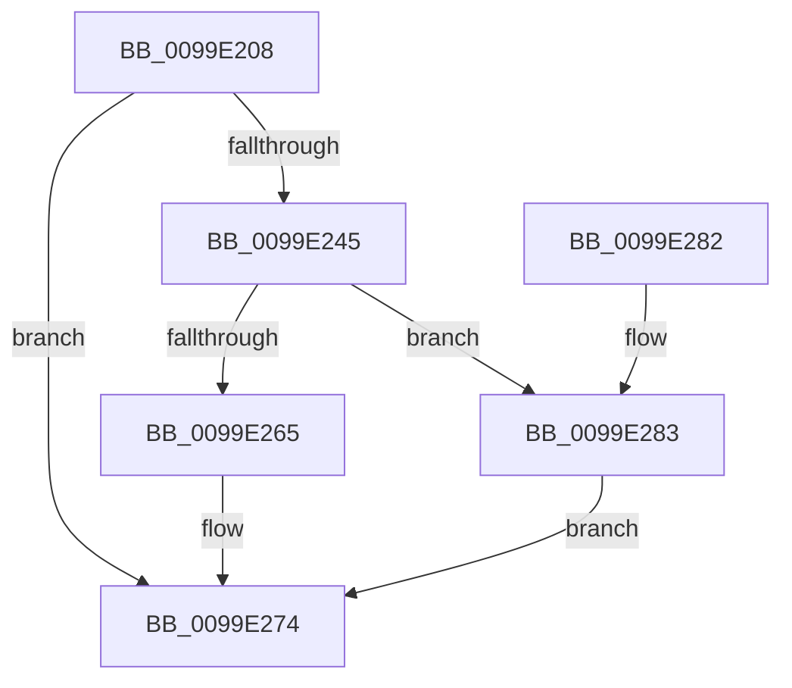

# PspAllocateRateControl

- RVA: `0x0099E208`–`0x0099E288` (길이 `128` bytes)
- VA: `0x000000014099E208`
- 실행 섹션: `PAGE`
- PDB 이름 있음: `예`; PDB Function 태그: `아니요`
- unwind 정보 RVA: `0x0009A3C0`
- 디코드: `35`개 명령, `128/128` bytes 표시
- 미해석 바이트: `0` (있으면 어셈블리에 `.byte`로 보존)

> 이 문서는 커널 이미지의 기계어와 PDB 기호를 분석해 생성했습니다. 4번과 5번은 함수 원형과 자료형을 바이너리 사용 방식에서 추정한 C 해석이며 원본 소스 복구 결과는 아닙니다.

## 1. Dependencies

- 직접 호출 지점: **4**; 고유 호출 대상: **4**
- 직접 호출자로 확인된 함수: **3**
- RIP 상대 이미지 참조: **0**

### Outgoing calls
- `0x0099E212` → [PspGetRateControlSize](PspGetRateControlSize_function_0099E290.md) (function, `0x0099E290`)
- `0x0099E238` → [ExAllocatePool2](../../poolcode/B8/ExAllocatePool2_function_00B820F0.md) (function, `0x00B820F0`)
- `0x0099E25B` → [PsChargeSharedPoolQuota](PsChargeSharedPoolQuota_function_0099E340.md) (function, `0x0099E340`)
- `0x0099E26D` → [ExFreePoolWithTag](../../poolcode/B8/ExFreePoolWithTag_function_00B82870.md) (function, `0x00B82870`)

### Direct callers
- [PspSetJobRateControl](../78/PspSetJobRateControl_function_0078572C.md) at `0x00785798`
- [PspAddSchedulingGroupToJobChain](PspAddSchedulingGroupToJobChain_function_0099DE5C.md) at `0x0099DF06`
- [NtSetInformationJobObject](../9F/NtSetInformationJobObject_function_009F84C0.md) at `0x009F9EA0`

### Static image references
- 디코드된 RIP-relative 메모리 참조가 없습니다.

## 2. Other-region calls and transfers

- 다른 실행 섹션으로 향하는 call: **2**
  - `0x0099E238` → [ExAllocatePool2](../../poolcode/B8/ExAllocatePool2_function_00B820F0.md) (`PAGE` → `POOLCODE`)
  - `0x0099E26D` → [ExFreePoolWithTag](../../poolcode/B8/ExFreePoolWithTag_function_00B82870.md) (`PAGE` → `POOLCODE`)
- 별도 외부 분기/꼬리 이동을 확인하지 못했습니다.

## 3. Assembly (complete function range)

```asm
0099E208  48 89 5C 24 08                  mov qword ptr [rsp + 8], rbx
0099E20D  57                              push rdi
0099E20E  48 83 EC 20                     sub rsp, 0x20
0099E212  E8 79 00 00 00                  call 0x14099e290
0099E217  48 8B F8                        mov rdi, rax
0099E21A  83 F9 02                        cmp ecx, 2
0099E21D  B8 00 01 00 00                  mov eax, 0x100
0099E222  41 B9 40 00 00 00               mov r9d, 0x40
0099E228  44 0F 45 C8                     cmovne r9d, eax
0099E22C  41 B8 50 73 4A 62               mov r8d, 0x624a7350
0099E232  41 8B C9                        mov ecx, r9d
0099E235  48 8B D7                        mov rdx, rdi
0099E238  E8 B3 3E 1E 00                  call 0x140b820f0
0099E23D  48 8B D8                        mov rbx, rax
0099E240  48 85 C0                        test rax, rax
0099E243  74 2F                           je 0x14099e274
0099E245  65 48 8B 0C 25 88 01 00 00      mov rcx, qword ptr gs:[0x188]
0099E24E  45 33 C0                        xor r8d, r8d
0099E251  48 8B D7                        mov rdx, rdi
0099E254  48 8B 89 B8 00 00 00            mov rcx, qword ptr [rcx + 0xb8]
0099E25B  E8 E0 00 00 00                  call 0x14099e340
0099E260  48 85 C0                        test rax, rax
0099E263  75 1E                           jne 0x14099e283
0099E265  BA 50 73 4A 62                  mov edx, 0x624a7350
0099E26A  48 8B CB                        mov rcx, rbx
0099E26D  E8 FE 45 1E 00                  call 0x140b82870
0099E272  33 DB                           xor ebx, ebx
0099E274  48 8B C3                        mov rax, rbx
0099E277  48 8B 5C 24 30                  mov rbx, qword ptr [rsp + 0x30]
0099E27C  48 83 C4 20                     add rsp, 0x20
0099E280  5F                              pop rdi
0099E281  C3                              ret
0099E282  CC                              int3
0099E283  48 89 03                        mov qword ptr [rbx], rax
0099E286  EB EC                           jmp 0x14099e274
```

## 4. C-style interpretation (structured pseudocode)

```c
__int64 __fastcall PspAllocateRateControl(int a1)
{
    __int64 result;
    __int64 v_rbx;
    __int64 v_rsp;
    unsigned __int64 v_stack_p8;

    v_stack_p8 = v_rbx;
    v_rsp = (v_rsp) - (32);
    result = PspGetRateControlSize(a1, a2, a3, a4);
    a4 = 64;
    if (a1 != 2) { a4 = 256; }
    result = ExAllocatePool2((unsigned int)((unsigned int)(a4)), result, (unsigned int)(0x624A7350ULL), a4);
    if (result == 0) goto loc_0099E274;
    a3 = 0;
    result = PsChargeSharedPoolQuota(*(unsigned __int64 *)(*(unsigned __int64 *)(gs_base + (0 + 392)) + 184), result, a3, a4);
    if (result != 0) goto loc_0099E283;
    result = ExFreePoolWithTag(result, (unsigned int)(0x624A7350ULL), a3, a4);
    v_rbx = 0;
loc_0099E274:
    v_rsp = (v_rsp) + (32);
    return 0;
loc_0099E283:
    *(unsigned __int64 *)(v_stack_p8) = 0;
    goto loc_0099E274;
}
```

## 5. (Beta) C Style

```c
int64_t PspAllocateRateControl(int32_t Arg1)
{
    int64_t result;
    int64_t local_rbx;
    int64_t local_rsp;
    uint64_t v_stack_p8;

    v_stack_p8 = local_rbx;
    local_rsp = (local_rsp) - (32);
    result = PspGetRateControlSize(Arg1, a2, a3, a4);
    a4 = 64;
    if (Arg1 != 2) { a4 = 256; }
    result = ExAllocatePool2((uint32_t)((uint32_t)(a4)), result, (uint32_t)(0x624A7350ULL), a4);
    if (result == 0) goto loc_0099E274;
    a3 = 0;
    result = PsChargeSharedPoolQuota(*(uint64_t *)(*(uint64_t *)(gs_base + (0 + 0x188)) + 0xB8), result, a3, a4);
    if (result != 0) goto loc_0099E283;
    result = ExFreePoolWithTag(result, (uint32_t)(0x624A7350ULL), a3, a4);
    local_rbx = 0;
loc_0099E274:
    local_rsp = (local_rsp) + (32);
    return 0;
loc_0099E283:
    *(uint64_t *)(v_stack_p8) = 0;
    goto loc_0099E274;
}
```

## 6. Execution-region graph

[열기: 2D/3D 그래프와 함수 탐색 컨트롤 패널](../../../control-panel.html?section=page&rva=0x0099E208&view=graph)

- 2D 그래프는 위에서 아래로 흐르고, 3D 그래프는 빈 공간을 드래그해 회전합니다. Shift+드래그는 이동, 휠은 확대·축소, 함수 노드 선택은 대상 보고서 이동입니다.

### Static fallback


