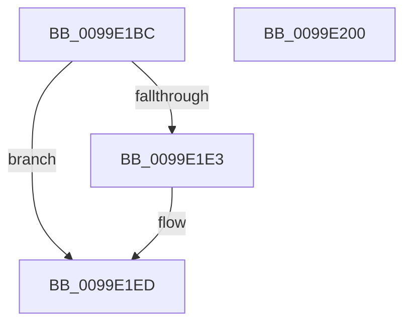

# PspFreeRateControl

- RVA: `0x0099E1BC`–`0x0099E201` (길이 `69` bytes)
- VA: `0x000000014099E1BC`
- 실행 섹션: `PAGE`
- PDB 이름 있음: `예`; PDB Function 태그: `아니요`
- unwind 정보 RVA: `0x0005CF00`
- 디코드: `21`개 명령, `69/69` bytes 표시
- 미해석 바이트: `0` (있으면 어셈블리에 `.byte`로 보존)

> 이 문서는 커널 이미지의 기계어와 PDB 기호를 분석해 생성했습니다. 4번과 5번은 함수 원형과 자료형을 바이너리 사용 방식에서 추정한 C 해석이며 원본 소스 복구 결과는 아닙니다.

## 1. Dependencies

- 직접 호출 지점: **4**; 고유 호출 대상: **3**
- 직접 호출자로 확인된 함수: **5**
- RIP 상대 이미지 참조: **0**

### Outgoing calls
- `0x0099E1C7` → [PspGetRateControlSize](PspGetRateControlSize_function_0099E290.md) (function, `0x0099E290`)
- `0x0099E1D5` → [PsReturnSharedPoolQuota](../8B/PsReturnSharedPoolQuota_function_008BCC30.md) (function, `0x008BCC30`)
- `0x0099E1E8` → [ExFreePoolWithTag](../../poolcode/B8/ExFreePoolWithTag_function_00B82870.md) (function, `0x00B82870`)
- `0x0099E1F5` → [ExFreePoolWithTag](../../poolcode/B8/ExFreePoolWithTag_function_00B82870.md) (function, `0x00B82870`)

### Direct callers
- [PspRemoveRateControl](../78/PspRemoveRateControl_function_00785318.md) at `0x00785392`
- [PspSetJobRateControl](../78/PspSetJobRateControl_function_0078572C.md) at `0x00785817`
- [PspAddSchedulingGroupToJobChain](PspAddSchedulingGroupToJobChain_function_0099DE5C.md) at `0x0099E0E1`
- [PspAddSchedulingGroupToJobChain](PspAddSchedulingGroupToJobChain_function_0099DE5C.md) at `0x0099E111`
- [PspRemoveCpuRateControl](PspRemoveCpuRateControl_function_0099E134.md) at `0x0099E16C`
- [NtSetInformationJobObject](../9F/NtSetInformationJobObject_function_009F84C0.md) at `0x009F9FCD`

### Static image references
- 디코드된 RIP-relative 메모리 참조가 없습니다.

## 2. Other-region calls and transfers

- 다른 실행 섹션으로 향하는 call: **2**
  - `0x0099E1E8` → [ExFreePoolWithTag](../../poolcode/B8/ExFreePoolWithTag_function_00B82870.md) (`PAGE` → `POOLCODE`)
  - `0x0099E1F5` → [ExFreePoolWithTag](../../poolcode/B8/ExFreePoolWithTag_function_00B82870.md) (`PAGE` → `POOLCODE`)
- 별도 외부 분기/꼬리 이동을 확인하지 못했습니다.

## 3. Assembly (complete function range)

```asm
0099E1BC  40 53                           push rbx
0099E1BE  48 83 EC 20                     sub rsp, 0x20
0099E1C2  48 8B D9                        mov rbx, rcx
0099E1C5  8B CA                           mov ecx, edx
0099E1C7  E8 C4 00 00 00                  call 0x14099e290
0099E1CC  48 8B 0B                        mov rcx, qword ptr [rbx]
0099E1CF  48 8B D0                        mov rdx, rax
0099E1D2  45 33 C0                        xor r8d, r8d
0099E1D5  E8 56 EA F1 FF                  call 0x1408bcc30
0099E1DA  48 8B 4B 18                     mov rcx, qword ptr [rbx + 0x18]
0099E1DE  48 85 C9                        test rcx, rcx
0099E1E1  74 0A                           je 0x14099e1ed
0099E1E3  BA 50 73 4A 62                  mov edx, 0x624a7350
0099E1E8  E8 83 46 1E 00                  call 0x140b82870
0099E1ED  BA 50 73 4A 62                  mov edx, 0x624a7350
0099E1F2  48 8B CB                        mov rcx, rbx
0099E1F5  E8 76 46 1E 00                  call 0x140b82870
0099E1FA  48 83 C4 20                     add rsp, 0x20
0099E1FE  5B                              pop rbx
0099E1FF  C3                              ret
0099E200  CC                              int3
```

## 4. C-style interpretation (structured pseudocode)

```c
__int64 __fastcall PspFreeRateControl(__int64 a1, int a2, int a3)
{
    __int64 result;
    __int64 v_rsp;

    v_rsp = (v_rsp) - (32);
    result = PspGetRateControlSize((unsigned int)(a2), a2, a3, a4);
    a3 = 0;
    result = PsReturnSharedPoolQuota(*(unsigned __int64 *)(a1), result, a3, a4);
    if (*(unsigned __int64 *)(a1 + 24) != 0) {
        a2 = 0x624A7350ULL;
        result = ExFreePoolWithTag(*(unsigned __int64 *)(a1 + 24), a2, a3, a4);
    }
    result = ExFreePoolWithTag(a1, (unsigned int)(0x624A7350ULL), a3, a4);
    v_rsp = (v_rsp) + (32);
    return result;
}
```

## 5. (Beta) C Style

```c
int64_t PspFreeRateControl(void *Arg1, int32_t Arg2, int32_t Arg3)
{
    uint8_t *arg1 = (uint8_t *)Arg1;

    int64_t result;
    int64_t local_rsp;

    local_rsp = (local_rsp) - (32);
    result = PspGetRateControlSize((uint32_t)(Arg2), Arg2, Arg3, a4);
    Arg3 = 0;
    result = PsReturnSharedPoolQuota(*(uint64_t *)(arg1), result, Arg3, a4);
    if (*(uint64_t *)(arg1 + 0x18) != 0) {
        Arg2 = 0x624A7350ULL;
        result = ExFreePoolWithTag(*(uint64_t *)(arg1 + 0x18), Arg2, Arg3, a4);
    }
    result = ExFreePoolWithTag(Arg1, (uint32_t)(0x624A7350ULL), Arg3, a4);
    local_rsp = (local_rsp) + (32);
    return result;
}
```

### 관측된 메모리 오프셋

구조체 형식이 확인되지 않은 접근은 인자 기준의 오프셋으로만 기록했습니다.

| 기준 인자 | 오프셋 표현 | 폭 (bit) | 접근 |
|---|---:|---:|---|
| `Arg1` | `+ 0x0` | `64` | `R` |
| `Arg1` | `+ 0x18` | `64` | `R` |

## 6. Execution-region graph

[열기: 2D/3D 그래프와 함수 탐색 컨트롤 패널](../../../control-panel.html?section=page&rva=0x0099E1BC&view=graph)

- 2D 그래프는 위에서 아래로 흐르고, 3D 그래프는 빈 공간을 드래그해 회전합니다. Shift+드래그는 이동, 휠은 확대·축소, 함수 노드 선택은 대상 보고서 이동입니다.

### Static fallback


