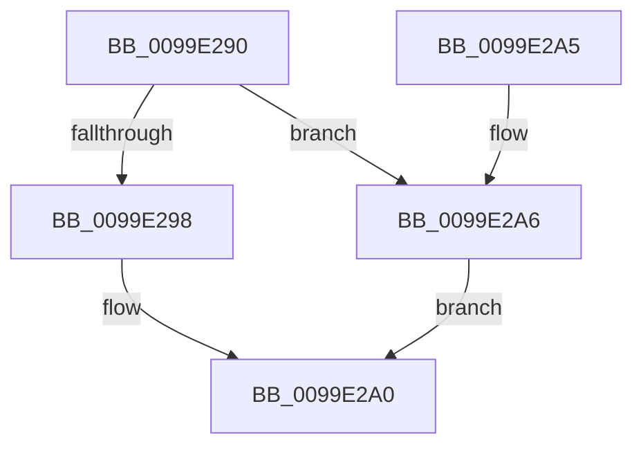

# PspGetRateControlSize

- RVA: `0x0099E290`–`0x0099E2AD` (길이 `29` bytes)
- VA: `0x000000014099E290`
- 실행 섹션: `PAGE`
- PDB 이름 있음: `예`; PDB Function 태그: `아니요`
- unwind 정보 RVA: `0x0005CEE8`
- 디코드: `10`개 명령, `29/29` bytes 표시
- 미해석 바이트: `0` (있으면 어셈블리에 `.byte`로 보존)

> 이 문서는 커널 이미지의 기계어와 PDB 기호를 분석해 생성했습니다. 4번과 5번은 함수 원형과 자료형을 바이너리 사용 방식에서 추정한 C 해석이며 원본 소스 복구 결과는 아닙니다.

## 1. Dependencies

- 직접 호출 지점: **1**; 고유 호출 대상: **1**
- 직접 호출자로 확인된 함수: **2**
- RIP 상대 이미지 참조: **0**

### Outgoing calls
- `0x0099E298` → [KeGetSchedulingGroupSize](../../text/4B/KeGetSchedulingGroupSize_function_004B7934.md) (function, `0x004B7934`)

### Direct callers
- [PspFreeRateControl](PspFreeRateControl_function_0099E1BC.md) at `0x0099E1C7`
- [PspAllocateRateControl](PspAllocateRateControl_function_0099E208.md) at `0x0099E212`

### Static image references
- 디코드된 RIP-relative 메모리 참조가 없습니다.

## 2. Other-region calls and transfers

- 다른 실행 섹션으로 향하는 call: **1**
  - `0x0099E298` → [KeGetSchedulingGroupSize](../../text/4B/KeGetSchedulingGroupSize_function_004B7934.md) (`PAGE` → `.text`)
- 별도 외부 분기/꼬리 이동을 확인하지 못했습니다.

## 3. Assembly (complete function range)

```asm
0099E290  48 83 EC 28                     sub rsp, 0x28
0099E294  85 C9                           test ecx, ecx
0099E296  74 0E                           je 0x14099e2a6
0099E298  E8 97 96 B1 FF                  call 0x1404b7934
0099E29D  83 E8 80                        sub eax, -0x80
0099E2A0  48 83 C4 28                     add rsp, 0x28
0099E2A4  C3                              ret
0099E2A5  CC                              int3
0099E2A6  B8 48 00 00 00                  mov eax, 0x48
0099E2AB  EB F3                           jmp 0x14099e2a0
```

## 4. C-style interpretation (structured pseudocode)

```c
__int64 __fastcall PspGetRateControlSize(int a1)
{
    __int64 result;
    __int64 v_rsp;

    v_rsp = (v_rsp) - (40);
    if (a1 == 0) goto loc_0099E2A6;
    result = KeGetSchedulingGroupSize(a1, a2, a3, a4);
    result = (unsigned int)((result) - (-128));
loc_0099E2A0:
    v_rsp = (v_rsp) + (40);
    return result;
loc_0099E2A6:
    goto loc_0099E2A0;
}
```

## 5. (Beta) C Style

```c
int64_t PspGetRateControlSize(int32_t Arg1)
{
    int64_t result;
    int64_t local_rsp;

    local_rsp = (local_rsp) - (40);
    if (Arg1 == 0) goto loc_0099E2A6;
    result = KeGetSchedulingGroupSize(Arg1, a2, a3, a4);
    result = (uint32_t)((result) - (-128));
loc_0099E2A0:
    local_rsp = (local_rsp) + (40);
    return result;
loc_0099E2A6:
    goto loc_0099E2A0;
}
```

## 6. Execution-region graph

[열기: 2D/3D 그래프와 함수 탐색 컨트롤 패널](../../../control-panel.html?section=page&rva=0x0099E290&view=graph)

- 2D 그래프는 위에서 아래로 흐르고, 3D 그래프는 빈 공간을 드래그해 회전합니다. Shift+드래그는 이동, 휠은 확대·축소, 함수 노드 선택은 대상 보고서 이동입니다.

### Static fallback


