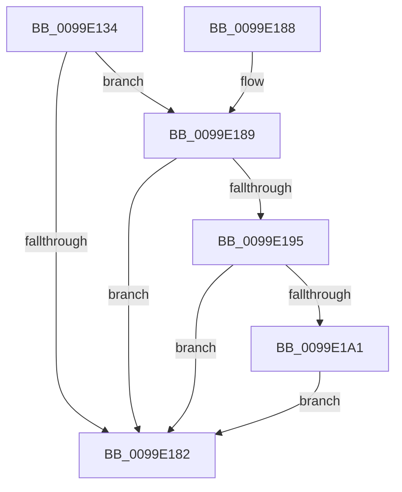

# PspRemoveCpuRateControl

- RVA: `0x0099E134`–`0x0099E1B5` (길이 `129` bytes)
- VA: `0x000000014099E134`
- 실행 섹션: `PAGE`
- PDB 이름 있음: `예`; PDB Function 태그: `아니요`
- unwind 정보 RVA: `0x0006575C`
- 디코드: `29`개 명령, `129/129` bytes 표시
- 미해석 바이트: `0` (있으면 어셈블리에 `.byte`로 보존)

> 이 문서는 커널 이미지의 기계어와 PDB 기호를 분석해 생성했습니다. 4번과 5번은 함수 원형과 자료형을 바이너리 사용 방식에서 추정한 C 해석이며 원본 소스 복구 결과는 아닙니다.

## 1. Dependencies

- 직접 호출 지점: **3**; 고유 호출 대상: **3**
- 직접 호출자로 확인된 함수: **1**
- RIP 상대 이미지 참조: **1**

### Outgoing calls
- `0x0099E15B` → [KeRemoveSchedulingGroup](../../text/4A/KeRemoveSchedulingGroup_function_004AD328.md) (function, `0x004AD328`)
- `0x0099E16C` → [PspFreeRateControl](PspFreeRateControl_function_0099E1BC.md) (function, `0x0099E1BC`)
- `0x0099E1A6` → [ObfDereferenceObjectWithTag](../../text/2F/ObfDereferenceObjectWithTag_function_002F78E0.md) (function, `0x002F78E0`)

### Direct callers
- [PspJobDelete](../../text/4B/PspJobDelete_function_004BF8F0.md) at `0x004BF99A`

### Static image references
- `0x0099E179` → RVA `0x00FC6ABE` (`ALMOSTRO`; read)

## 2. Other-region calls and transfers

- 다른 실행 섹션으로 향하는 call: **2**
  - `0x0099E15B` → [KeRemoveSchedulingGroup](../../text/4A/KeRemoveSchedulingGroup_function_004AD328.md) (`PAGE` → `.text`)
  - `0x0099E1A6` → [ObfDereferenceObjectWithTag](../../text/2F/ObfDereferenceObjectWithTag_function_002F78E0.md) (`PAGE` → `.text`)
- 별도 외부 분기/꼬리 이동을 확인하지 못했습니다.

## 3. Assembly (complete function range)

```asm
0099E134  40 53                           push rbx
0099E136  48 83 EC 20                     sub rsp, 0x20
0099E13A  48 8B 81 D8 04 00 00            mov rax, qword ptr [rcx + 0x4d8]
0099E141  48 8B D9                        mov rbx, rcx
0099E144  83 60 2C 00                     and dword ptr [rax + 0x2c], 0
0099E148  F0 83 A1 10 06 00 00 DF         lock and dword ptr [rcx + 0x610], 0xffffffdf
0099E150  48 8B 89 D8 04 00 00            mov rcx, qword ptr [rcx + 0x4d8]
0099E157  48 83 E9 80                     sub rcx, -0x80
0099E15B  E8 C8 F1 B0 FF                  call 0x1404ad328
0099E160  48 8B 8B D8 04 00 00            mov rcx, qword ptr [rbx + 0x4d8]
0099E167  BA 02 00 00 00                  mov edx, 2
0099E16C  E8 4B 00 00 00                  call 0x14099e1bc
0099E171  48 83 A3 D8 04 00 00 00         and qword ptr [rbx + 0x4d8], 0
0099E179  80 3D 3E 89 62 00 00            cmp byte ptr [rip + 0x62893e], 0
0099E180  75 07                           jne 0x14099e189
0099E182  48 83 C4 20                     add rsp, 0x20
0099E186  5B                              pop rbx
0099E187  C3                              ret
0099E188  CC                              int3
0099E189  48 8B 83 20 05 00 00            mov rax, qword ptr [rbx + 0x520]
0099E190  48 3B C3                        cmp rax, rbx
0099E193  75 ED                           jne 0x14099e182
0099E195  48 8B 8B 40 05 00 00            mov rcx, qword ptr [rbx + 0x540]
0099E19C  48 85 C9                        test rcx, rcx
0099E19F  74 E1                           je 0x14099e182
0099E1A1  BA 50 73 4A 62                  mov edx, 0x624a7350
0099E1A6  E8 35 97 95 FF                  call 0x1402f78e0
0099E1AB  48 83 A3 40 05 00 00 00         and qword ptr [rbx + 0x540], 0
0099E1B3  EB CD                           jmp 0x14099e182
```

## 4. C-style interpretation (structured pseudocode)

```c
__int64 __fastcall PspRemoveCpuRateControl(__int64 a1)
{
    __int64 result;
    __int64 v_rsp;

    v_rsp = (v_rsp) - (32);
    a1 = (*(unsigned __int64 *)(a1 + 1240)) - (-128);
    result = KeRemoveSchedulingGroup(a1, a2, a3, a4);
    result = PspFreeRateControl(*(unsigned __int64 *)(a1 + 1240), 2, a3, a4);
    if ((*(unsigned __int8 *)(v_rip + 6457662)) != 0) goto loc_0099E189;
loc_0099E182:
    v_rsp = (v_rsp) + (32);
    return result;
loc_0099E189:
    if ((*(unsigned __int64 *)(a1 + 1312)) != a1) goto loc_0099E182;
    if (*(unsigned __int64 *)(a1 + 1344) == 0) goto loc_0099E182;
    result = ObfDereferenceObjectWithTag(*(unsigned __int64 *)(a1 + 1344), (unsigned int)(0x624A7350ULL), a3, a4);
    goto loc_0099E182;
}
```

## 5. (Beta) C Style

```c
int64_t PspRemoveCpuRateControl(void *Arg1)
{
    uint8_t *arg1 = (uint8_t *)Arg1;

    int64_t result;
    int64_t local_rsp;

    local_rsp = (local_rsp) - (32);
    Arg1 = (*(uint64_t *)(arg1 + 0x4D8)) - (-128);
    result = KeRemoveSchedulingGroup(Arg1, a2, a3, a4);
    result = PspFreeRateControl(*(uint64_t *)(arg1 + 0x4D8), 2, a3, a4);
    if ((*(uint8_t *)(v_rip + 0x62893E)) != 0) goto loc_0099E189;
loc_0099E182:
    local_rsp = (local_rsp) + (32);
    return result;
loc_0099E189:
    if ((*(uint64_t *)(arg1 + 0x520)) != Arg1) goto loc_0099E182;
    if (*(uint64_t *)(arg1 + 0x540) == 0) goto loc_0099E182;
    result = ObfDereferenceObjectWithTag(*(uint64_t *)(arg1 + 0x540), (uint32_t)(0x624A7350ULL), a3, a4);
    goto loc_0099E182;
}
```

### 관측된 메모리 오프셋

구조체 형식이 확인되지 않은 접근은 인자 기준의 오프셋으로만 기록했습니다.

| 기준 인자 | 오프셋 표현 | 폭 (bit) | 접근 |
|---|---:|---:|---|
| `Arg1` | `+ 0x4D8` | `64` | `R` |
| `Arg1` | `+ 0x4D8` | `64` | `R/W` |
| `Arg1` | `+ 0x520` | `64` | `R` |
| `Arg1` | `+ 0x540` | `64` | `R` |
| `Arg1` | `+ 0x540` | `64` | `R/W` |
| `Arg1` | `+ 0x610` | `32` | `R/W` |

## 6. Execution-region graph

[열기: 2D/3D 그래프와 함수 탐색 컨트롤 패널](../../../control-panel.html?section=page&rva=0x0099E134&view=graph)

- 2D 그래프는 위에서 아래로 흐르고, 3D 그래프는 빈 공간을 드래그해 회전합니다. Shift+드래그는 이동, 휠은 확대·축소, 함수 노드 선택은 대상 보고서 이동입니다.

### Static fallback


