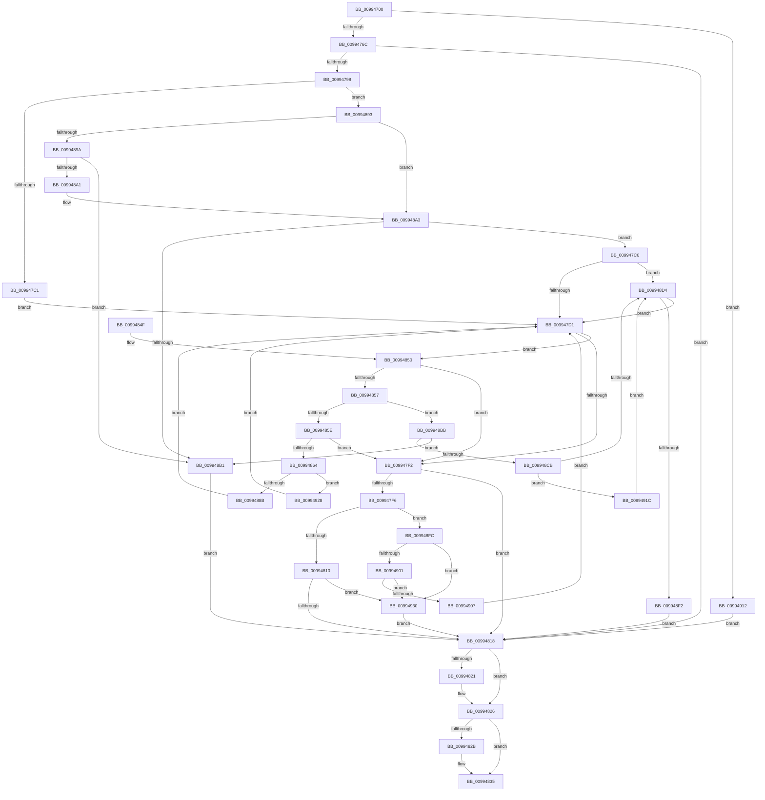

# RegRtlDeleteTreeInternal

- RVA: `0x00994700`–`0x00994937` (길이 `567` bytes)
- VA: `0x0000000140994700`
- 실행 섹션: `PAGE`
- PDB 이름 있음: `예`; PDB Function 태그: `아니요`
- unwind 정보 RVA: `0x00099054`
- 디코드: `167`개 명령, `567/567` bytes 표시
- 미해석 바이트: `0` (있으면 어셈블리에 `.byte`로 보존)

> 이 문서는 커널 이미지의 기계어와 PDB 기호를 분석해 생성했습니다. 4번과 5번은 함수 원형과 자료형을 바이너리 사용 방식에서 추정한 C 해석이며 원본 소스 복구 결과는 아닙니다.

## 1. Dependencies

- 직접 호출 지점: **10**; 고유 호출 대상: **9**
- 직접 호출자로 확인된 함수: **3**
- RIP 상대 이미지 참조: **0**

### Outgoing calls
- `0x0099474B` → [RtlpGetStackLimits](../../text/2F/RtlpGetStackLimits_function_002F5F50.md) (function, `0x002F5F50`)
- `0x00994789` → [_RegRtlOpenKeyTransacted](../8E/_RegRtlOpenKeyTransacted_function_008EF810.md) (function, `0x008EF810`)
- `0x009947AF` → [RegRtlQueryInfoKey](RegRtlQueryInfoKey_function_0099463C.md) (function, `0x0099463C`)
- `0x009947E6` → [RegRtlEnumKey](RegRtlEnumKey_function_00992C00.md) (function, `0x00992C00`)
- `0x00994800` → [RegRtlDeleteKeyTransacted](../96/RegRtlDeleteKeyTransacted_function_00966108.md) (function, `0x00966108`)
- `0x00994821` → [ZwClose](../../text/6A/ZwClose_function_006AD2B0.md) (function, `0x006AD2B0`)
- `0x00994830` → [ExFreePoolWithTag](../../poolcode/B8/ExFreePoolWithTag_function_00B82870.md) (function, `0x00B82870`)
- `0x0099487C` → [RegRtlDeleteTreeInternal](RegRtlDeleteTreeInternal_function_00994700.md) (function, `0x00994700`)
- `0x009948E1` → [ExAllocatePool2](../../poolcode/B8/ExAllocatePool2_function_00B820F0.md) (function, `0x00B820F0`)
- `0x00994921` → [ExFreePoolWithTag](../../poolcode/B8/ExFreePoolWithTag_function_00B82870.md) (function, `0x00B82870`)

### Direct callers
- [PnpCtxRegDeleteTree](../96/PnpCtxRegDeleteTree_function_00965CC8.md) at `0x00965CF3`
- [_RegRtlDeletePathInternal](../96/_RegRtlDeletePathInternal_function_00965F04.md) at `0x00965FE8`
- [RegRtlDeleteTreeInternal](RegRtlDeleteTreeInternal_function_00994700.md) at `0x0099487C`

### Static image references
- 디코드된 RIP-relative 메모리 참조가 없습니다.

## 2. Other-region calls and transfers

- 다른 실행 섹션으로 향하는 call: **5**
  - `0x0099474B` → [RtlpGetStackLimits](../../text/2F/RtlpGetStackLimits_function_002F5F50.md) (`PAGE` → `.text`)
  - `0x00994821` → [ZwClose](../../text/6A/ZwClose_function_006AD2B0.md) (`PAGE` → `.text`)
  - `0x00994830` → [ExFreePoolWithTag](../../poolcode/B8/ExFreePoolWithTag_function_00B82870.md) (`PAGE` → `POOLCODE`)
  - `0x009948E1` → [ExAllocatePool2](../../poolcode/B8/ExAllocatePool2_function_00B820F0.md) (`PAGE` → `POOLCODE`)
  - `0x00994921` → [ExFreePoolWithTag](../../poolcode/B8/ExFreePoolWithTag_function_00B82870.md) (`PAGE` → `POOLCODE`)
- 별도 외부 분기/꼬리 이동을 확인하지 못했습니다.

## 3. Assembly (complete function range)

```asm
00994700  48 89 5C 24 10                  mov qword ptr [rsp + 0x10], rbx
00994705  44 88 4C 24 20                  mov byte ptr [rsp + 0x20], r9b
0099470A  48 89 4C 24 08                  mov qword ptr [rsp + 8], rcx
0099470F  55                              push rbp
00994710  56                              push rsi
00994711  57                              push rdi
00994712  41 54                           push r12
00994714  41 55                           push r13
00994716  41 56                           push r14
00994718  41 57                           push r15
0099471A  48 8B EC                        mov rbp, rsp
0099471D  48 83 EC 50                     sub rsp, 0x50
00994721  45 33 F6                        xor r14d, r14d
00994724  4C 8B EA                        mov r13, rdx
00994727  48 8B D9                        mov rbx, rcx
0099472A  4C 89 75 E8                     mov qword ptr [rbp - 0x18], r14
0099472E  48 8D 55 F8                     lea rdx, [rbp - 8]
00994732  44 89 75 E0                     mov dword ptr [rbp - 0x20], r14d
00994736  48 8D 4D F0                     lea rcx, [rbp - 0x10]
0099473A  4C 89 75 F8                     mov qword ptr [rbp - 8], r14
0099473E  41 8B F6                        mov esi, r14d
00994741  4C 89 75 F0                     mov qword ptr [rbp - 0x10], r14
00994745  45 8B FE                        mov r15d, r14d
00994748  4D 8B E0                        mov r12, r8
0099474B  E8 00 18 96 FF                  call 0x1402f5f50
00994750  F6 D8                           neg al
00994752  48 8D 45 F8                     lea rax, [rbp - 8]
00994756  48 1B C9                        sbb rcx, rcx
00994759  48 23 4D F0                     and rcx, qword ptr [rbp - 0x10]
0099475D  48 2B C1                        sub rax, rcx
00994760  48 3D 00 04 00 00               cmp rax, 0x400
00994766  0F 82 A6 01 00 00               jb 0x140994912
0099476C  48 8D 45 E8                     lea rax, [rbp - 0x18]
00994770  4C 89 64 24 28                  mov qword ptr [rsp + 0x28], r12
00994775  41 B9 1F 00 03 00               mov r9d, 0x3001f
0099477B  48 89 44 24 20                  mov qword ptr [rsp + 0x20], rax
00994780  45 33 C0                        xor r8d, r8d
00994783  49 8B D5                        mov rdx, r13
00994786  48 8B CB                        mov rcx, rbx
00994789  E8 82 B0 F5 FF                  call 0x1408ef810
0099478E  8B D8                           mov ebx, eax
00994790  85 C0                           test eax, eax
00994792  0F 88 80 00 00 00               js 0x140994818
00994798  48 8B 4D E8                     mov rcx, qword ptr [rbp - 0x18]
0099479C  4C 8D 45 E0                     lea r8, [rbp - 0x20]
009947A0  4C 89 74 24 28                  mov qword ptr [rsp + 0x28], r14
009947A5  45 33 C9                        xor r9d, r9d
009947A8  33 D2                           xor edx, edx
009947AA  4C 89 74 24 20                  mov qword ptr [rsp + 0x20], r14
009947AF  E8 88 FE FF FF                  call 0x14099463c
009947B4  BA FF FF FF FF                  mov edx, 0xffffffff
009947B9  85 C0                           test eax, eax
009947BB  0F 84 D2 00 00 00               je 0x140994893
009947C1  41 8B FE                        mov edi, r14d
009947C4  EB 0B                           jmp 0x1409947d1
009947C6  41 8B DE                        mov ebx, r14d
009947C9  85 FF                           test edi, edi
009947CB  0F 85 03 01 00 00               jne 0x1409948d4
009947D1  48 8B 4D E8                     mov rcx, qword ptr [rbp - 0x18]
009947D5  4C 8D 4D E0                     lea r9, [rbp - 0x20]
009947D9  8B C7                           mov eax, edi
009947DB  4C 8B C6                        mov r8, rsi
009947DE  D1 E8                           shr eax, 1
009947E0  41 8B D6                        mov edx, r14d
009947E3  89 45 E0                        mov dword ptr [rbp - 0x20], eax
009947E6  E8 15 E4 FF FF                  call 0x140992c00
009947EB  3D 1A 00 00 80                  cmp eax, 0x8000001a
009947F0  75 5E                           jne 0x140994850
009947F2  85 DB                           test ebx, ebx
009947F4  78 22                           js 0x140994818
009947F6  48 8B 4D 40                     mov rcx, qword ptr [rbp + 0x40]
009947FA  4D 8B C4                        mov r8, r12
009947FD  49 8B D5                        mov rdx, r13
00994800  E8 03 19 FD FF                  call 0x140966108
00994805  3D 21 01 00 C0                  cmp eax, 0xc0000121
0099480A  0F 84 EC 00 00 00               je 0x1409948fc
00994810  85 C0                           test eax, eax
00994812  0F 88 18 01 00 00               js 0x140994930
00994818  48 8B 4D E8                     mov rcx, qword ptr [rbp - 0x18]
0099481C  48 85 C9                        test rcx, rcx
0099481F  74 05                           je 0x140994826
00994821  E8 8A 8A D1 FF                  call 0x1406ad2b0
00994826  48 85 F6                        test rsi, rsi
00994829  74 0A                           je 0x140994835
0099482B  33 D2                           xor edx, edx
0099482D  48 8B CE                        mov rcx, rsi
00994830  E8 3B E0 1E 00                  call 0x140b82870
00994835  8B C3                           mov eax, ebx
00994837  48 8B 9C 24 98 00 00 00         mov rbx, qword ptr [rsp + 0x98]
0099483F  48 83 C4 50                     add rsp, 0x50
00994843  41 5F                           pop r15
00994845  41 5E                           pop r14
00994847  41 5D                           pop r13
00994849  41 5C                           pop r12
0099484B  5F                              pop rdi
0099484C  5E                              pop rsi
0099484D  5D                              pop rbp
0099484E  C3                              ret
0099484F  CC                              int3
00994850  3D 7C 01 00 C0                  cmp eax, 0xc000017c
00994855  74 9B                           je 0x1409947f2
00994857  3D 23 00 00 C0                  cmp eax, 0xc0000023
0099485C  74 5D                           je 0x1409948bb
0099485E  33 C9                           xor ecx, ecx
00994860  85 C0                           test eax, eax
00994862  75 8E                           jne 0x1409947f2
00994864  44 8A 4D 58                     mov r9b, byte ptr [rbp + 0x58]
00994868  4D 8B C4                        mov r8, r12
0099486B  8B C7                           mov eax, edi
0099486D  48 8B D6                        mov rdx, rsi
00994870  48 D1 E8                        shr rax, 1
00994873  66 89 4C 46 FE                  mov word ptr [rsi + rax*2 - 2], cx
00994878  48 8B 4D E8                     mov rcx, qword ptr [rbp - 0x18]
0099487C  E8 7F FE FF FF                  call 0x140994700
00994881  33 C9                           xor ecx, ecx
00994883  85 C0                           test eax, eax
00994885  0F 85 9D 00 00 00               jne 0x140994928
0099488B  44 8B F1                        mov r14d, ecx
0099488E  E9 3E FF FF FF                  jmp 0x1409947d1
00994893  8B 45 E0                        mov eax, dword ptr [rbp - 0x20]
00994896  85 C0                           test eax, eax
00994898  74 09                           je 0x1409948a3
0099489A  8D 48 01                        lea ecx, [rax + 1]
0099489D  3B C8                           cmp ecx, eax
0099489F  72 10                           jb 0x1409948b1
009948A1  8B C1                           mov eax, ecx
009948A3  8B F8                           mov edi, eax
009948A5  48 03 FF                        add rdi, rdi
009948A8  48 3B FA                        cmp rdi, rdx
009948AB  0F 86 15 FF FF FF               jbe 0x1409947c6
009948B1  BB 95 00 00 C0                  mov ebx, 0xc0000095
009948B6  E9 5D FF FF FF                  jmp 0x140994818
009948BB  8B 7D E0                        mov edi, dword ptr [rbp - 0x20]
009948BE  B8 FF FF FF FF                  mov eax, 0xffffffff
009948C3  48 03 FF                        add rdi, rdi
009948C6  48 3B F8                        cmp rdi, rax
009948C9  77 E6                           ja 0x1409948b1
009948CB  33 C0                           xor eax, eax
009948CD  8B D8                           mov ebx, eax
009948CF  48 85 F6                        test rsi, rsi
009948D2  75 48                           jne 0x14099491c
009948D4  41 B8 52 45 47 4C               mov r8d, 0x4c474552
009948DA  8B D7                           mov edx, edi
009948DC  B9 00 01 00 00                  mov ecx, 0x100
009948E1  E8 0A D8 1E 00                  call 0x140b820f0
009948E6  48 8B F0                        mov rsi, rax
009948E9  48 85 C0                        test rax, rax
009948EC  0F 85 DF FE FF FF               jne 0x1409947d1
009948F2  BB 17 00 00 C0                  mov ebx, 0xc0000017
009948F7  E9 1C FF FF FF                  jmp 0x140994818
009948FC  45 85 F6                        test r14d, r14d
009948FF  75 2F                           jne 0x140994930
00994901  41 83 FF 0A                     cmp r15d, 0xa
00994905  73 29                           jae 0x140994930
00994907  41 FF C7                        inc r15d
0099490A  45 33 F6                        xor r14d, r14d
0099490D  E9 BF FE FF FF                  jmp 0x1409947d1
00994912  BB 9A 00 00 C0                  mov ebx, 0xc000009a
00994917  E9 FC FE FF FF                  jmp 0x140994818
0099491C  33 D2                           xor edx, edx
0099491E  48 8B CE                        mov rcx, rsi
00994921  E8 4A DF 1E 00                  call 0x140b82870
00994926  EB AC                           jmp 0x1409948d4
00994928  41 FF C6                        inc r14d
0099492B  E9 A1 FE FF FF                  jmp 0x1409947d1
00994930  8B D8                           mov ebx, eax
00994932  E9 E1 FE FF FF                  jmp 0x140994818
```

## 4. C-style interpretation (structured pseudocode)

```c
__int64 __fastcall RegRtlDeleteTreeInternal(__int64 a1, __int64 a2, __int64 a3, unsigned __int8 a4)
{
    __int64 result;
    __int64 v_r14;
    __int64 v_r15;
    __int64 v_rdi;
    __int64 v_rsp;
    unsigned __int64 v_stack_m40;
    unsigned __int64 v_stack_m48;
    unsigned __int64 v_stack_m50;
    unsigned int v_stack_m58;
    unsigned __int64 v_stack_m60;
    unsigned __int64 v_stack_m68;
    unsigned __int64 v_stack_p10;
    unsigned __int8 v_stack_p20;
    unsigned __int64 v_stack_p8;

    v_stack_p10 = v_rbx;
    v_stack_p20 = a4;
    v_stack_p8 = a1;
    v_rsp = (v_rsp) - (80);
    v_r14 = 0;
    v_stack_m50 = 0;
    v_stack_m58 = 0;
    v_stack_m40 = 0;
    v_stack_m48 = 0;
    result = RtlpGetStackLimits(v_stack_m48, v_stack_m40, a3, a4);
    result = (unsigned __int8)(-(result));
    a1 = (v_stack_m48) & (v_stack_m48);
    result = (v_stack_m40) - (a1);
    if (result < 0x400ULL) goto loc_00994912;
    v_stack_m60 = a3;
    v_stack_m68 = v_stack_m50;
    a3 = 0;
    result = _RegRtlOpenKeyTransacted(a1, a2, a3, (unsigned int)(0x3001FULL));
    if (sign_flag) goto loc_00994818;
    v_stack_m60 = 0;
    a4 = 0;
    a2 = 0;
    v_stack_m68 = 0;
    result = RegRtlQueryInfoKey(v_stack_m50, a2, v_stack_m58, a4);
    if ((unsigned int)(result) == 0) goto loc_00994893;
    goto loc_009947D1;
loc_009947C6:
    if (0 != 0) goto loc_009948D4;
loc_009947D1:
    result = (unsigned int)((0) >> (1));
    v_stack_m58 = (unsigned int)(result);
    result = RegRtlEnumKey(v_stack_m50, 0, 0, v_stack_m58);
    if (((unsigned int)(result)) != 0x8000001AULL) goto loc_00994850;
loc_009947F2:
    if (sign_flag) goto loc_00994818;
    result = RegRtlDeleteKeyTransacted(v_stack_p8, 0, 0, v_stack_m58);
    if (((unsigned int)(result)) == 0xC0000121ULL) goto loc_009948FC;
    if (sign_flag) goto loc_00994930;
loc_00994818:
    if (v_stack_m50 != 0) {
        result = ZwClose(v_stack_m50, 0, 0, v_stack_m58);
    }
    if (0 != 0) {
        a2 = 0;
        a1 = 0;
        result = ExFreePoolWithTag(a1, a2, 0, v_stack_m58);
    }
    v_rsp = (v_rsp) + (80);
    return 0;
loc_00994850:
    if (0 == 0xC000017CULL) goto loc_009947F2;
    if (0 == 0xC0000023ULL) goto loc_009948BB;
    a1 = 0;
    if (0 != 0) goto loc_009947F2;
    result = (0) >> (1);
    *(unsigned __int16 *)(0 + result * 2 - 2) = 0;
    result = RegRtlDeleteTreeInternal(v_stack_m50, 0, 0, v_stack_p20);
    a1 = 0;
    if ((unsigned int)(result) != 0) goto loc_00994928;
    goto loc_009947D1;
loc_00994893:
    if ((unsigned int)((unsigned int)(v_stack_m58)) == 0) goto loc_009948A3;
    if (((unsigned int)((unsigned int)(v_stack_m58) + 1)) < ((unsigned int)((unsigned int)(v_stack_m58)))) goto loc_009948B1;
loc_009948A3:
    v_rdi = ((unsigned int)((unsigned int)((unsigned int)((unsigned int)((unsigned int)(v_stack_m58) + 1))))) + ((unsigned int)((unsigned int)((unsigned int)((unsigned int)((unsigned int)(v_stack_m58) + 1)))));
    if (v_rdi <= 0) goto loc_009947C6;
loc_009948B1:
    goto loc_00994818;
loc_009948BB:
    v_rdi = ((unsigned int)(v_stack_m58)) + ((unsigned int)(v_stack_m58));
    if (v_rdi > ((unsigned int)(0xFFFFFFFFULL))) goto loc_009948B1;
    result = 0;
    if (0 != 0) goto loc_0099491C;
loc_009948D4:
    result = ExAllocatePool2(256, (unsigned int)((unsigned int)(v_rdi)), (unsigned int)(0x4C474552ULL), v_stack_p20);
    if (result != 0) goto loc_009947D1;
    goto loc_00994818;
loc_009948FC:
    if (0 != 0) goto loc_00994930;
    if (0 >= 10) goto loc_00994930;
    v_r15 = (unsigned int)((0) + 1);
    v_r14 = 0;
    goto loc_009947D1;
loc_00994912:
    goto loc_00994818;
loc_0099491C:
    a2 = 0;
    result = ExFreePoolWithTag(result, a2, (unsigned int)(0x4C474552ULL), v_stack_p20);
    goto loc_009948D4;
loc_00994928:
    v_r14 = (unsigned int)((v_r14) + 1);
    goto loc_009947D1;
loc_00994930:
    goto loc_00994818;
}
```

## 5. (Beta) C Style

```c
int64_t RegRtlDeleteTreeInternal(int64_t Arg1, int64_t Arg2, int64_t Arg3, uint8_t Arg4)
{
    int64_t result;
    int64_t local_r14;
    int64_t local_r15;
    int64_t local_rdi;
    int64_t local_rsp;
    uint64_t v_stack_m40;
    uint64_t v_stack_m48;
    uint64_t v_stack_m50;
    uint32_t v_stack_m58;
    uint64_t v_stack_m60;
    uint64_t v_stack_m68;
    uint64_t v_stack_p10;
    uint8_t v_stack_p20;
    uint64_t v_stack_p8;

    v_stack_p10 = local_rbx;
    v_stack_p20 = Arg4;
    v_stack_p8 = Arg1;
    local_rsp = (local_rsp) - (80);
    local_r14 = 0;
    v_stack_m50 = 0;
    v_stack_m58 = 0;
    v_stack_m40 = 0;
    v_stack_m48 = 0;
    result = RtlpGetStackLimits(v_stack_m48, v_stack_m40, Arg3, Arg4);
    result = (uint8_t)(-(result));
    Arg1 = (v_stack_m48) & (v_stack_m48);
    result = (v_stack_m40) - (Arg1);
    if (result < 0x400ULL) goto loc_00994912;
    v_stack_m60 = Arg3;
    v_stack_m68 = v_stack_m50;
    Arg3 = 0;
    result = _RegRtlOpenKeyTransacted(Arg1, Arg2, Arg3, (uint32_t)(0x3001FULL));
    if (sign_flag) goto loc_00994818;
    v_stack_m60 = 0;
    Arg4 = 0;
    Arg2 = 0;
    v_stack_m68 = 0;
    result = RegRtlQueryInfoKey(v_stack_m50, Arg2, v_stack_m58, Arg4);
    if ((uint32_t)(result) == 0) goto loc_00994893;
    goto loc_009947D1;
loc_009947C6:
    if (0 != 0) goto loc_009948D4;
loc_009947D1:
    result = (uint32_t)((0) >> (1));
    v_stack_m58 = (uint32_t)(result);
    result = RegRtlEnumKey(v_stack_m50, 0, 0, v_stack_m58);
    if (((uint32_t)(result)) != 0x8000001AULL) goto loc_00994850;
loc_009947F2:
    if (sign_flag) goto loc_00994818;
    result = RegRtlDeleteKeyTransacted(v_stack_p8, 0, 0, v_stack_m58);
    if (((uint32_t)(result)) == 0xC0000121ULL) goto loc_009948FC;
    if (sign_flag) goto loc_00994930;
loc_00994818:
    if (v_stack_m50 != 0) {
        result = ZwClose(v_stack_m50, 0, 0, v_stack_m58);
    }
    if (0 != 0) {
        Arg2 = 0;
        Arg1 = 0;
        result = ExFreePoolWithTag(Arg1, Arg2, 0, v_stack_m58);
    }
    local_rsp = (local_rsp) + (80);
    return 0;
loc_00994850:
    if (0 == 0xC000017CULL) goto loc_009947F2;
    if (0 == 0xC0000023ULL) goto loc_009948BB;
    Arg1 = 0;
    if (0 != 0) goto loc_009947F2;
    result = (0) >> (1);
    *(uint16_t *)(0 + result * 2 - 0x2) = 0;
    result = RegRtlDeleteTreeInternal(v_stack_m50, 0, 0, v_stack_p20);
    Arg1 = 0;
    if ((uint32_t)(result) != 0) goto loc_00994928;
    goto loc_009947D1;
loc_00994893:
    if ((uint32_t)((uint32_t)(v_stack_m58)) == 0) goto loc_009948A3;
    if (((uint32_t)((uint32_t)(v_stack_m58) + 1)) < ((uint32_t)((uint32_t)(v_stack_m58)))) goto loc_009948B1;
loc_009948A3:
    local_rdi = ((uint32_t)((uint32_t)((uint32_t)((uint32_t)((uint32_t)(v_stack_m58) + 1))))) + ((uint32_t)((uint32_t)((uint32_t)((uint32_t)((uint32_t)(v_stack_m58) + 1)))));
    if (local_rdi <= 0) goto loc_009947C6;
loc_009948B1:
    goto loc_00994818;
loc_009948BB:
    local_rdi = ((uint32_t)(v_stack_m58)) + ((uint32_t)(v_stack_m58));
    if (local_rdi > ((uint32_t)(0xFFFFFFFFULL))) goto loc_009948B1;
    result = 0;
    if (0 != 0) goto loc_0099491C;
loc_009948D4:
    result = ExAllocatePool2(256, (uint32_t)((uint32_t)(local_rdi)), (uint32_t)(0x4C474552ULL), v_stack_p20);
    if (result != 0) goto loc_009947D1;
    goto loc_00994818;
loc_009948FC:
    if (0 != 0) goto loc_00994930;
    if (0 >= 10) goto loc_00994930;
    local_r15 = (uint32_t)((0) + 1);
    local_r14 = 0;
    goto loc_009947D1;
loc_00994912:
    goto loc_00994818;
loc_0099491C:
    Arg2 = 0;
    result = ExFreePoolWithTag(result, Arg2, (uint32_t)(0x4C474552ULL), v_stack_p20);
    goto loc_009948D4;
loc_00994928:
    local_r14 = (uint32_t)((local_r14) + 1);
    goto loc_009947D1;
loc_00994930:
    goto loc_00994818;
}
```

## 6. Execution-region graph

[열기: 2D/3D 그래프와 함수 탐색 컨트롤 패널](../../../control-panel.html?section=page&rva=0x00994700&view=graph)

- 2D 그래프는 위에서 아래로 흐르고, 3D 그래프는 빈 공간을 드래그해 회전합니다. Shift+드래그는 이동, 휠은 확대·축소, 함수 노드 선택은 대상 보고서 이동입니다.

### Static fallback


