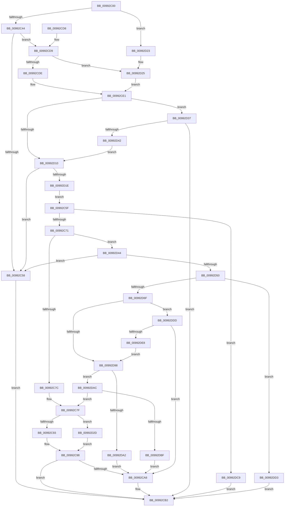

# RegRtlEnumKey

- RVA: `0x00992C00`–`0x00992DEA` (길이 `490` bytes)
- VA: `0x0000000140992C00`
- 실행 섹션: `PAGE`
- PDB 이름 있음: `예`; PDB Function 태그: `아니요`
- unwind 정보 RVA: `0x00098E7C`
- 디코드: `140`개 명령, `490/490` bytes 표시
- 미해석 바이트: `0` (있으면 어셈블리에 `.byte`로 보존)

> 이 문서는 커널 이미지의 기계어와 PDB 기호를 분석해 생성했습니다. 4번과 5번은 함수 원형과 자료형을 바이너리 사용 방식에서 추정한 C 해석이며 원본 소스 복구 결과는 아닙니다.

## 1. Dependencies

- 직접 호출 지점: **7**; 고유 호출 대상: **5**
- 직접 호출자로 확인된 함수: **8**
- RIP 상대 이미지 참조: **1**

### Outgoing calls
- `0x00992C93` → [memcpy](../../text/6C/memcpy_function_006C6840.md) (function, `0x006C6840`)
- `0x00992CAD` → [ExFreePoolWithTag](../../poolcode/B8/ExFreePoolWithTag_function_00B82870.md) (function, `0x00B82870`)
- `0x00992CBF` → [_security_check_cookie](../../text/6A/_security_check_cookie_function_006AC640.md) (function, `0x006AC640`)
- `0x00992D05` → [ZwEnumerateKey](../../text/6A/ZwEnumerateKey_function_006AD710.md) (function, `0x006AD710`)
- `0x00992D2D` → [memcpy](../../text/6C/memcpy_function_006C6840.md) (function, `0x006C6840`)
- `0x00992D5F` → [ExAllocatePool2](../../poolcode/B8/ExAllocatePool2_function_00B820F0.md) (function, `0x00B820F0`)
- `0x00992D8D` → [ZwEnumerateKey](../../text/6A/ZwEnumerateKey_function_006AD710.md) (function, `0x006AD710`)

### Direct callers
- [RegRtlCopyTreeInternal](../83/RegRtlCopyTreeInternal_function_008324C0.md) at `0x00832774`
- [_CmGetDeviceContainerIdFromBase](../8F/_CmGetDeviceContainerIdFromBase_function_008FD2B4.md) at `0x008FD3AA`
- [PnpGetGenericStorePropertyKeys](PnpGetGenericStorePropertyKeys_function_00992378.md) at `0x0099249B`
- [PnpGetGenericStorePropertyKeys](PnpGetGenericStorePropertyKeys_function_00992378.md) at `0x00992547`
- [PiCMEnumerateSubKeys](PiCMEnumerateSubKeys_function_009926E8.md) at `0x009927E0`
- [PnpCtxRegEnumKey](PnpCtxRegEnumKey_function_009929C0.md) at `0x009929D8`
- [_RegRtlEnumKeyWithCallback](_RegRtlEnumKeyWithCallback_function_009929EC.md) at `0x00992B31`
- [RegRtlDeleteTreeInternal](RegRtlDeleteTreeInternal_function_00994700.md) at `0x009947E6`
- [PiDqDeleteUserObjectFromLoadedHives](../AB/PiDqDeleteUserObjectFromLoadedHives_function_00AB957C.md) at `0x00AB9690`

### Static image references
- `0x00992C14` → RVA `0x00E0A740` (`.data`; read)

## 2. Other-region calls and transfers

- 다른 실행 섹션으로 향하는 call: **7**
  - `0x00992C93` → [memcpy](../../text/6C/memcpy_function_006C6840.md) (`PAGE` → `.text`)
  - `0x00992CAD` → [ExFreePoolWithTag](../../poolcode/B8/ExFreePoolWithTag_function_00B82870.md) (`PAGE` → `POOLCODE`)
  - `0x00992CBF` → [_security_check_cookie](../../text/6A/_security_check_cookie_function_006AC640.md) (`PAGE` → `.text`)
  - `0x00992D05` → [ZwEnumerateKey](../../text/6A/ZwEnumerateKey_function_006AD710.md) (`PAGE` → `.text`)
  - `0x00992D2D` → [memcpy](../../text/6C/memcpy_function_006C6840.md) (`PAGE` → `.text`)
  - `0x00992D5F` → [ExAllocatePool2](../../poolcode/B8/ExAllocatePool2_function_00B820F0.md) (`PAGE` → `POOLCODE`)
  - `0x00992D8D` → [ZwEnumerateKey](../../text/6A/ZwEnumerateKey_function_006AD710.md) (`PAGE` → `.text`)
- 별도 외부 분기/꼬리 이동을 확인하지 못했습니다.

## 3. Assembly (complete function range)

```asm
00992C00  40 53                           push rbx
00992C02  55                              push rbp
00992C03  56                              push rsi
00992C04  57                              push rdi
00992C05  41 54                           push r12
00992C07  41 55                           push r13
00992C09  41 56                           push r14
00992C0B  41 57                           push r15
00992C0D  48 81 EC A8 00 00 00            sub rsp, 0xa8
00992C14  48 8B 05 25 7B 47 00            mov rax, qword ptr [rip + 0x477b25]
00992C1B  48 33 C4                        xor rax, rsp
00992C1E  48 89 84 24 98 00 00 00         mov qword ptr [rsp + 0x98], rax
00992C26  4C 8B E9                        mov r13, rcx
00992C29  89 54 24 34                     mov dword ptr [rsp + 0x34], edx
00992C2D  33 C9                           xor ecx, ecx
00992C2F  4D 8B E1                        mov r12, r9
00992C32  89 4C 24 30                     mov dword ptr [rsp + 0x30], ecx
00992C36  4D 8B F0                        mov r14, r8
00992C39  8B F1                           mov esi, ecx
00992C3B  4D 85 C0                        test r8, r8
00992C3E  0F 84 DF 00 00 00               je 0x140992d23
00992C44  41 8B 39                        mov edi, dword ptr [r9]
00992C47  B9 FF FF FF FF                  mov ecx, 0xffffffff
00992C4C  48 03 FF                        add rdi, rdi
00992C4F  48 3B F9                        cmp rdi, rcx
00992C52  0F 86 81 00 00 00               jbe 0x140992cd9
00992C58  BB 95 00 00 C0                  mov ebx, 0xc0000095
00992C5D  EB 53                           jmp 0x140992cb2
00992C5F  8B C1                           mov eax, ecx
00992C61  33 DB                           xor ebx, ebx
00992C63  D1 E8                           shr eax, 1
00992C65  41 89 04 24                     mov dword ptr [r12], eax
00992C69  3B CF                           cmp ecx, edi
00992C6B  0F 87 58 01 00 00               ja 0x140992dc9
00992C71  44 39 7C 24 30                  cmp dword ptr [rsp + 0x30], r15d
00992C76  0F 87 C8 00 00 00               ja 0x140992d44
00992C7C  45 33 FF                        xor r15d, r15d
00992C7F  44 8B 45 0C                     mov r8d, dword ptr [rbp + 0xc]
00992C83  48 8D 55 10                     lea rdx, [rbp + 0x10]
00992C87  49 8B CE                        mov rcx, r14
00992C8A  49 3B EE                        cmp rbp, r14
00992C8D  0F 85 9A 00 00 00               jne 0x140992d2d
00992C93  E8 A8 3B D3 FF                  call 0x1406c6840
00992C98  41 8B 04 24                     mov eax, dword ptr [r12]
00992C9C  FF C8                           dec eax
00992C9E  66 45 89 3C 46                  mov word ptr [r14 + rax*2], r15w
00992CA3  48 85 F6                        test rsi, rsi
00992CA6  74 0A                           je 0x140992cb2
00992CA8  33 D2                           xor edx, edx
00992CAA  48 8B CE                        mov rcx, rsi
00992CAD  E8 BE FB 1E 00                  call 0x140b82870
00992CB2  8B C3                           mov eax, ebx
00992CB4  48 8B 8C 24 98 00 00 00         mov rcx, qword ptr [rsp + 0x98]
00992CBC  48 33 CC                        xor rcx, rsp
00992CBF  E8 7C 99 D1 FF                  call 0x1406ac640
00992CC4  48 81 C4 A8 00 00 00            add rsp, 0xa8
00992CCB  41 5F                           pop r15
00992CCD  41 5E                           pop r14
00992CCF  41 5D                           pop r13
00992CD1  41 5C                           pop r12
00992CD3  5F                              pop rdi
00992CD4  5E                              pop rsi
00992CD5  5D                              pop rbp
00992CD6  5B                              pop rbx
00992CD7  C3                              ret
00992CD8  CC                              int3
00992CD9  83 FF 60                        cmp edi, 0x60
00992CDC  76 47                           jbe 0x140992d25
00992CDE  44 8B FF                        mov r15d, edi
00992CE1  48 8D 4C 24 30                  lea rcx, [rsp + 0x30]
00992CE6  83 FF 60                        cmp edi, 0x60
00992CE9  48 89 4C 24 28                  mov qword ptr [rsp + 0x28], rcx
00992CEE  48 8D 6C 24 38                  lea rbp, [rsp + 0x38]
00992CF3  49 0F 47 EE                     cmova rbp, r14
00992CF7  44 89 7C 24 20                  mov dword ptr [rsp + 0x20], r15d
00992CFC  4C 8B CD                        mov r9, rbp
00992CFF  45 33 C0                        xor r8d, r8d
00992D02  49 8B CD                        mov rcx, r13
00992D05  E8 06 AA D1 FF                  call 0x1406ad710
00992D0A  8B D8                           mov ebx, eax
00992D0C  85 C0                           test eax, eax
00992D0E  75 27                           jne 0x140992d37
00992D10  8B 45 0C                        mov eax, dword ptr [rbp + 0xc]
00992D13  8D 48 02                        lea ecx, [rax + 2]
00992D16  3B C8                           cmp ecx, eax
00992D18  0F 82 3A FF FF FF               jb 0x140992c58
00992D1E  E9 3C FF FF FF                  jmp 0x140992c5f
00992D23  8B F9                           mov edi, ecx
00992D25  41 BF 60 00 00 00               mov r15d, 0x60
00992D2B  EB B4                           jmp 0x140992ce1
00992D2D  E8 0E 3B D3 FF                  call 0x1406c6840
00992D32  E9 61 FF FF FF                  jmp 0x140992c98
00992D37  3D 05 00 00 80                  cmp eax, 0x80000005
00992D3C  0F 85 70 FF FF FF               jne 0x140992cb2
00992D42  EB CC                           jmp 0x140992d10
00992D44  8D 47 10                        lea eax, [rdi + 0x10]
00992D47  83 F8 10                        cmp eax, 0x10
00992D4A  0F 82 08 FF FF FF               jb 0x140992c58
00992D50  8B D0                           mov edx, eax
00992D52  B9 00 01 00 00                  mov ecx, 0x100
00992D57  41 B8 52 45 47 4C               mov r8d, 0x4c474552
00992D5D  8B D8                           mov ebx, eax
00992D5F  E8 8C F3 1E 00                  call 0x140b820f0
00992D64  45 33 FF                        xor r15d, r15d
00992D67  48 8B F0                        mov rsi, rax
00992D6A  48 85 C0                        test rax, rax
00992D6D  74 64                           je 0x140992dd3
00992D6F  8B 54 24 34                     mov edx, dword ptr [rsp + 0x34]
00992D73  48 8B E8                        mov rbp, rax
00992D76  48 8D 44 24 30                  lea rax, [rsp + 0x30]
00992D7B  4C 8B CD                        mov r9, rbp
00992D7E  48 89 44 24 28                  mov qword ptr [rsp + 0x28], rax
00992D83  45 33 C0                        xor r8d, r8d
00992D86  49 8B CD                        mov rcx, r13
00992D89  89 5C 24 20                     mov dword ptr [rsp + 0x20], ebx
00992D8D  E8 7E A9 D1 FF                  call 0x1406ad710
00992D92  8B D8                           mov ebx, eax
00992D94  85 C0                           test eax, eax
00992D96  75 45                           jne 0x140992ddd
00992D98  8B 46 0C                        mov eax, dword ptr [rsi + 0xc]
00992D9B  8D 48 02                        lea ecx, [rax + 2]
00992D9E  3B C8                           cmp ecx, eax
00992DA0  73 0A                           jae 0x140992dac
00992DA2  BB 95 00 00 C0                  mov ebx, 0xc0000095
00992DA7  E9 FC FE FF FF                  jmp 0x140992ca8
00992DAC  8B C1                           mov eax, ecx
00992DAE  41 8B DF                        mov ebx, r15d
00992DB1  D1 E8                           shr eax, 1
00992DB3  41 89 04 24                     mov dword ptr [r12], eax
00992DB7  3B CF                           cmp ecx, edi
00992DB9  0F 86 C0 FE FF FF               jbe 0x140992c7f
00992DBF  BB 23 00 00 C0                  mov ebx, 0xc0000023
00992DC4  E9 DF FE FF FF                  jmp 0x140992ca8
00992DC9  BB 23 00 00 C0                  mov ebx, 0xc0000023
00992DCE  E9 DF FE FF FF                  jmp 0x140992cb2
00992DD3  BB 17 00 00 C0                  mov ebx, 0xc0000017
00992DD8  E9 D5 FE FF FF                  jmp 0x140992cb2
00992DDD  3D 05 00 00 80                  cmp eax, 0x80000005
00992DE2  0F 85 C0 FE FF FF               jne 0x140992ca8
00992DE8  EB AE                           jmp 0x140992d98
```

## 4. C-style interpretation (structured pseudocode)

```c
__int64 __fastcall RegRtlEnumKey(__int64 a1, int a2, __int64 a3, __int64 a4)
{
    __int64 result;
    __int64 v_r15;
    __int64 v_rbp;
    __int64 v_rbx;
    __int64 v_rdi;
    __int64 v_rsp;
    unsigned __int64 v_stack_m50;
    unsigned int v_stack_mB4;
    unsigned int v_stack_mB8;
    unsigned int v_stack_p20;
    unsigned __int64 v_stack_p28;
    unsigned __int64 v_stack_p30;
    unsigned int v_stack_p34;
    unsigned __int64 v_stack_p38;
    unsigned int v_stack_p44;

    v_rsp = (v_rsp) - (168);
    result = (*(unsigned __int64 *)(v_rip + 4684581)) ^ (v_rsp);
    v_stack_m50 = result;
    v_stack_mB4 = a2;
    a1 = 0;
    v_stack_mB8 = 0;
    if (a3 == 0) goto loc_00992D23;
    v_rdi = ((unsigned int)(*(unsigned int *)(a4))) + ((unsigned int)(*(unsigned int *)(a4)));
    if (v_rdi <= ((unsigned int)(0xFFFFFFFFULL))) goto loc_00992CD9;
loc_00992C58:
    goto loc_00992CB2;
loc_00992C5F:
    v_rbx = 0;
    result = (unsigned int)(((unsigned int)((unsigned int)((unsigned int)(0xFFFFFFFFULL)))) >> (1));
    *(unsigned int *)(a4) = (unsigned int)(result);
    if (((unsigned int)((unsigned int)(0xFFFFFFFFULL))) > ((unsigned int)(v_rdi))) goto loc_00992DC9;
    if (v_stack_mB8 > ((unsigned int)(v_r15))) goto loc_00992D44;
    v_r15 = 0;
loc_00992C7F:
    if (v_rbp != a3) goto loc_00992D2D;
    result = memcpy(a3, v_rbp + 16, (unsigned int)(*(unsigned int *)(v_rbp + 12)), a4);
loc_00992C98:
    result = (unsigned int)(((unsigned int)(*(unsigned int *)(a4))) - 1);
    *(unsigned __int16 *)(a3 + result * 2) = 0;
    if (0 != 0) {
        a2 = 0;
        a1 = 0;
        result = ExFreePoolWithTag(a1, a2, (unsigned int)(*(unsigned int *)(v_rbp + 12)), a4);
    }
    a1 = (v_stack_m50) ^ (v_rsp);
    result = _security_check_cookie(a1, a2, (unsigned int)(*(unsigned int *)(v_rbp + 12)), a4);
    v_rsp = (v_rsp) + (168);
    return result;
loc_00992CD9:
    if (((unsigned int)(v_rdi)) <= 96) goto loc_00992D25;
loc_00992CE1:
    v_stack_p28 = v_stack_p30;
    v_rbp = v_stack_p38;
    if (((unsigned int)(v_rdi)) > 96) { v_rbp = a3; }
    v_stack_p20 = (unsigned int)((unsigned int)((unsigned int)(v_rdi)));
    a3 = 0;
    result = ZwEnumerateKey(a1, a2, a3, v_rbp);
    if ((unsigned int)(result) != 0) goto loc_00992D37;
loc_00992D10:
    if (((unsigned int)((unsigned int)(v_stack_p44) + 2)) < ((unsigned int)((unsigned int)(v_stack_p44)))) goto loc_00992C58;
    goto loc_00992C5F;
loc_00992D23:
loc_00992D25:
    goto loc_00992CE1;
loc_00992D2D:
    result = memcpy((unsigned int)(v_stack_p44) + 2, a2, a3, v_rbp);
    goto loc_00992C98;
loc_00992D37:
    if (((unsigned int)(result)) != 0x80000005ULL) goto loc_00992CB2;
    goto loc_00992D10;
loc_00992D44:
    if (((unsigned int)((unsigned int)((unsigned int)((unsigned int)(v_stack_p44) + 2)) + 16)) < 16) goto loc_00992C58;
    result = ExAllocatePool2(256, (unsigned int)((unsigned int)((unsigned int)((unsigned int)((unsigned int)(v_stack_p44) + 2)) + 16)), (unsigned int)(0x4C474552ULL), v_rbp);
    v_r15 = 0;
    if (result == 0) goto loc_00992DD3;
    v_stack_p28 = v_stack_p30;
    a3 = 0;
    v_stack_p20 = (unsigned int)((unsigned int)((unsigned int)((unsigned int)((unsigned int)((unsigned int)(v_stack_p44) + 2)) + 16)));
    result = ZwEnumerateKey(a1, (unsigned int)(v_stack_p34), a3, result);
    if ((unsigned int)(result) != 0) goto loc_00992DDD;
loc_00992D98:
    if (((unsigned int)((unsigned int)(*(unsigned int *)(result + 12)) + 2)) >= ((unsigned int)((unsigned int)(*(unsigned int *)(result + 12))))) goto loc_00992DAC;
    goto loc_00992CA8;
loc_00992DAC:
    result = (unsigned int)(((unsigned int)((unsigned int)((unsigned int)(*(unsigned int *)(result + 12)) + 2))) >> (1));
    *(unsigned int *)(a4) = (unsigned int)(result);
    if (((unsigned int)((unsigned int)(*(unsigned int *)(result + 12)) + 2)) <= ((unsigned int)((unsigned int)((unsigned int)((unsigned int)(v_stack_p44) + 2))))) goto loc_00992C7F;
    goto loc_00992CA8;
loc_00992DC9:
    goto loc_00992CB2;
loc_00992DD3:
    goto loc_00992CB2;
loc_00992DDD:
    if (((unsigned int)(result)) != 0x80000005ULL) goto loc_00992CA8;
    goto loc_00992D98;
}
```

## 5. (Beta) C Style

```c
int64_t RegRtlEnumKey(int64_t Arg1, int32_t Arg2, void *Arg3, void *Arg4)
{
    uint8_t *arg3 = (uint8_t *)Arg3;
    uint8_t *arg4 = (uint8_t *)Arg4;

    int64_t result;
    int64_t local_r15;
    int64_t local_rbp;
    int64_t local_rbx;
    int64_t local_rdi;
    int64_t local_rsp;
    uint64_t v_stack_m50;
    uint32_t v_stack_mB4;
    uint32_t v_stack_mB8;
    uint32_t v_stack_p20;
    uint64_t v_stack_p28;
    uint64_t v_stack_p30;
    uint32_t v_stack_p34;
    uint64_t v_stack_p38;
    uint32_t v_stack_p44;

    local_rsp = (local_rsp) - (168);
    result = (*(uint64_t *)(v_rip + 0x477B25)) ^ (local_rsp);
    v_stack_m50 = result;
    v_stack_mB4 = Arg2;
    Arg1 = 0;
    v_stack_mB8 = 0;
    if (Arg3 == NULL) goto loc_00992D23;
    local_rdi = ((uint32_t)(*(uint32_t *)(arg4))) + ((uint32_t)(*(uint32_t *)(arg4)));
    if (local_rdi <= ((uint32_t)(0xFFFFFFFFULL))) goto loc_00992CD9;
loc_00992C58:
    goto loc_00992CB2;
loc_00992C5F:
    local_rbx = 0;
    result = (uint32_t)(((uint32_t)((uint32_t)((uint32_t)(0xFFFFFFFFULL)))) >> (1));
    *(uint32_t *)(arg4) = (uint32_t)(result);
    if (((uint32_t)((uint32_t)(0xFFFFFFFFULL))) > ((uint32_t)(local_rdi))) goto loc_00992DC9;
    if (v_stack_mB8 > ((uint32_t)(local_r15))) goto loc_00992D44;
    local_r15 = 0;
loc_00992C7F:
    if (local_rbp != Arg3) goto loc_00992D2D;
    result = memcpy(Arg3, local_rbp + 16, (uint32_t)(*(uint32_t *)(local_rbp + 0xC)), Arg4);
loc_00992C98:
    result = (uint32_t)(((uint32_t)(*(uint32_t *)(arg4))) - 1);
    *(uint16_t *)(arg3 + result * 2) = 0;
    if (0 != 0) {
        Arg2 = 0;
        Arg1 = 0;
        result = ExFreePoolWithTag(Arg1, Arg2, (uint32_t)(*(uint32_t *)(local_rbp + 0xC)), Arg4);
    }
    Arg1 = (v_stack_m50) ^ (local_rsp);
    result = _security_check_cookie(Arg1, Arg2, (uint32_t)(*(uint32_t *)(local_rbp + 0xC)), Arg4);
    local_rsp = (local_rsp) + (168);
    return result;
loc_00992CD9:
    if (((uint32_t)(local_rdi)) <= 96) goto loc_00992D25;
loc_00992CE1:
    v_stack_p28 = v_stack_p30;
    local_rbp = v_stack_p38;
    if (((uint32_t)(local_rdi)) > 96) { local_rbp = Arg3; }
    v_stack_p20 = (uint32_t)((uint32_t)((uint32_t)(local_rdi)));
    Arg3 = 0;
    result = ZwEnumerateKey(Arg1, Arg2, Arg3, local_rbp);
    if ((uint32_t)(result) != 0) goto loc_00992D37;
loc_00992D10:
    if (((uint32_t)((uint32_t)(v_stack_p44) + 2)) < ((uint32_t)((uint32_t)(v_stack_p44)))) goto loc_00992C58;
    goto loc_00992C5F;
loc_00992D23:
loc_00992D25:
    goto loc_00992CE1;
loc_00992D2D:
    result = memcpy((uint32_t)(v_stack_p44) + 2, Arg2, Arg3, local_rbp);
    goto loc_00992C98;
loc_00992D37:
    if (((uint32_t)(result)) != 0x80000005ULL) goto loc_00992CB2;
    goto loc_00992D10;
loc_00992D44:
    if (((uint32_t)((uint32_t)((uint32_t)((uint32_t)(v_stack_p44) + 2)) + 16)) < 16) goto loc_00992C58;
    result = ExAllocatePool2(256, (uint32_t)((uint32_t)((uint32_t)((uint32_t)((uint32_t)(v_stack_p44) + 2)) + 16)), (uint32_t)(0x4C474552ULL), local_rbp);
    local_r15 = 0;
    if (result == 0) goto loc_00992DD3;
    v_stack_p28 = v_stack_p30;
    Arg3 = 0;
    v_stack_p20 = (uint32_t)((uint32_t)((uint32_t)((uint32_t)((uint32_t)((uint32_t)(v_stack_p44) + 2)) + 16)));
    result = ZwEnumerateKey(Arg1, (uint32_t)(v_stack_p34), Arg3, result);
    if ((uint32_t)(result) != 0) goto loc_00992DDD;
loc_00992D98:
    if (((uint32_t)((uint32_t)(*(uint32_t *)(result + 0xC)) + 2)) >= ((uint32_t)((uint32_t)(*(uint32_t *)(result + 0xC))))) goto loc_00992DAC;
    goto loc_00992CA8;
loc_00992DAC:
    result = (uint32_t)(((uint32_t)((uint32_t)((uint32_t)(*(uint32_t *)(result + 0xC)) + 2))) >> (1));
    *(uint32_t *)(arg4) = (uint32_t)(result);
    if (((uint32_t)((uint32_t)(*(uint32_t *)(result + 0xC)) + 2)) <= ((uint32_t)((uint32_t)((uint32_t)((uint32_t)(v_stack_p44) + 2))))) goto loc_00992C7F;
    goto loc_00992CA8;
loc_00992DC9:
    goto loc_00992CB2;
loc_00992DD3:
    goto loc_00992CB2;
loc_00992DDD:
    if (((uint32_t)(result)) != 0x80000005ULL) goto loc_00992CA8;
    goto loc_00992D98;
}
```

### 관측된 메모리 오프셋

구조체 형식이 확인되지 않은 접근은 인자 기준의 오프셋으로만 기록했습니다.

| 기준 인자 | 오프셋 표현 | 폭 (bit) | 접근 |
|---|---:|---:|---|
| `Arg3` | `+ 0x0 + rax*2` | `16` | `W` |
| `Arg4` | `+ 0x0` | `32` | `R` |
| `Arg4` | `+ 0x0` | `32` | `W` |

## 6. Execution-region graph

[열기: 2D/3D 그래프와 함수 탐색 컨트롤 패널](../../../control-panel.html?section=page&rva=0x00992C00&view=graph)

- 2D 그래프는 위에서 아래로 흐르고, 3D 그래프는 빈 공간을 드래그해 회전합니다. Shift+드래그는 이동, 휠은 확대·축소, 함수 노드 선택은 대상 보고서 이동입니다.

### Static fallback


