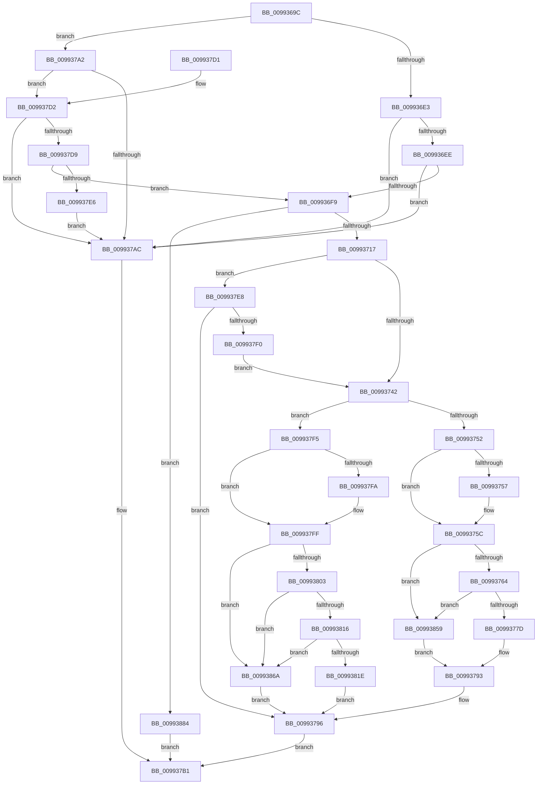

# RegRtlEnumValue

- RVA: `0x0099369C`–`0x0099388E` (길이 `498` bytes)
- VA: `0x000000014099369C`
- 실행 섹션: `PAGE`
- PDB 이름 있음: `예`; PDB Function 태그: `아니요`
- unwind 정보 RVA: `0x00098F38`
- 디코드: `147`개 명령, `498/498` bytes 표시
- 미해석 바이트: `0` (있으면 어셈블리에 `.byte`로 보존)

> 이 문서는 커널 이미지의 기계어와 PDB 기호를 분석해 생성했습니다. 4번과 5번은 함수 원형과 자료형을 바이너리 사용 방식에서 추정한 C 해석이며 원본 소스 복구 결과는 아닙니다.

## 1. Dependencies

- 직접 호출 지점: **6**; 고유 호출 대상: **4**
- 직접 호출자로 확인된 함수: **6**
- RIP 상대 이미지 참조: **0**

### Outgoing calls
- `0x00993706` → [ExAllocatePool2](../../poolcode/B8/ExAllocatePool2_function_00B820F0.md) (function, `0x00B820F0`)
- `0x00993730` → [ZwEnumerateValueKey](../../text/6A/ZwEnumerateValueKey_function_006AD330.md) (function, `0x006AD330`)
- `0x00993789` → [memcpy](../../text/6C/memcpy_function_006C6840.md) (function, `0x006C6840`)
- `0x0099379B` → [ExFreePoolWithTag](../../poolcode/B8/ExFreePoolWithTag_function_00B82870.md) (function, `0x00B82870`)
- `0x00993833` → [memcpy](../../text/6C/memcpy_function_006C6840.md) (function, `0x006C6840`)
- `0x0099384F` → [memcpy](../../text/6C/memcpy_function_006C6840.md) (function, `0x006C6840`)

### Direct callers
- [RegRtlCopyTreeInternal](../83/RegRtlCopyTreeInternal_function_008324C0.md) at `0x00832873`
- [PnpGetGenericStorePropertyKeys](PnpGetGenericStorePropertyKeys_function_00992378.md) at `0x0099260C`
- [PnpCtxRegEnumValue](PnpCtxRegEnumValue_function_0099364C.md) at `0x0099368A`
- [DrvDbGetDeviceIdDriverInfMatches](DrvDbGetDeviceIdDriverInfMatches_function_00994250.md) at `0x00994349`
- [DrvDbGetDeviceIdDriverInfMatches](DrvDbGetDeviceIdDriverInfMatches_function_00994250.md) at `0x00994468`
- [PnpGetGenericStorePropertyLocales](PnpGetGenericStorePropertyLocales_function_00994DBC.md) at `0x00994F1F`
- [DrvDbSetDeviceIdDriverInfMatches](../A6/DrvDbSetDeviceIdDriverInfMatches_function_00A6251C.md) at `0x00A62639`

### Static image references
- 디코드된 RIP-relative 메모리 참조가 없습니다.

## 2. Other-region calls and transfers

- 다른 실행 섹션으로 향하는 call: **6**
  - `0x00993706` → [ExAllocatePool2](../../poolcode/B8/ExAllocatePool2_function_00B820F0.md) (`PAGE` → `POOLCODE`)
  - `0x00993730` → [ZwEnumerateValueKey](../../text/6A/ZwEnumerateValueKey_function_006AD330.md) (`PAGE` → `.text`)
  - `0x00993789` → [memcpy](../../text/6C/memcpy_function_006C6840.md) (`PAGE` → `.text`)
  - `0x0099379B` → [ExFreePoolWithTag](../../poolcode/B8/ExFreePoolWithTag_function_00B82870.md) (`PAGE` → `POOLCODE`)
  - `0x00993833` → [memcpy](../../text/6C/memcpy_function_006C6840.md) (`PAGE` → `.text`)
  - `0x0099384F` → [memcpy](../../text/6C/memcpy_function_006C6840.md) (`PAGE` → `.text`)
- 별도 외부 분기/꼬리 이동을 확인하지 못했습니다.

## 3. Assembly (complete function range)

```asm
0099369C  48 8B C4                        mov rax, rsp
0099369F  48 89 58 08                     mov qword ptr [rax + 8], rbx
009936A3  48 89 68 10                     mov qword ptr [rax + 0x10], rbp
009936A7  48 89 70 18                     mov qword ptr [rax + 0x18], rsi
009936AB  57                              push rdi
009936AC  41 54                           push r12
009936AE  41 55                           push r13
009936B0  41 56                           push r14
009936B2  41 57                           push r15
009936B4  48 83 EC 40                     sub rsp, 0x40
009936B8  83 60 C8 00                     and dword ptr [rax - 0x38], 0
009936BC  4C 8B E9                        mov r13, rcx
009936BF  41 8B 01                        mov eax, dword ptr [r9]
009936C2  4D 8B F1                        mov r14, r9
009936C5  4C 8B BC 24 A0 00 00 00         mov r15, qword ptr [rsp + 0xa0]
009936CD  48 03 C0                        add rax, rax
009936D0  4D 8B E0                        mov r12, r8
009936D3  8B FA                           mov edi, edx
009936D5  B9 FF FF FF FF                  mov ecx, 0xffffffff
009936DA  4D 85 FF                        test r15, r15
009936DD  0F 85 BF 00 00 00               jne 0x1409937a2
009936E3  33 ED                           xor ebp, ebp
009936E5  48 3B C1                        cmp rax, rcx
009936E8  0F 87 BE 00 00 00               ja 0x1409937ac
009936EE  8D 58 10                        lea ebx, [rax + 0x10]
009936F1  3B D8                           cmp ebx, eax
009936F3  0F 82 B3 00 00 00               jb 0x1409937ac
009936F9  8B D3                           mov edx, ebx
009936FB  B9 00 01 00 00                  mov ecx, 0x100
00993700  41 B8 52 45 47 4C               mov r8d, 0x4c474552
00993706  E8 E5 E9 1E 00                  call 0x140b820f0
0099370B  48 8B F0                        mov rsi, rax
0099370E  48 85 C0                        test rax, rax
00993711  0F 84 6D 01 00 00               je 0x140993884
00993717  48 8D 44 24 30                  lea rax, [rsp + 0x30]
0099371C  4C 8B CE                        mov r9, rsi
0099371F  48 89 44 24 28                  mov qword ptr [rsp + 0x28], rax
00993724  44 8B C5                        mov r8d, ebp
00993727  8B D7                           mov edx, edi
00993729  89 5C 24 20                     mov dword ptr [rsp + 0x20], ebx
0099372D  49 8B CD                        mov rcx, r13
00993730  E8 FB 9B D1 FF                  call 0x1406ad330
00993735  45 33 ED                        xor r13d, r13d
00993738  8B F8                           mov edi, eax
0099373A  85 C0                           test eax, eax
0099373C  0F 85 A6 00 00 00               jne 0x1409937e8
00993742  48 8B 8C 24 90 00 00 00         mov rcx, qword ptr [rsp + 0x90]
0099374A  85 ED                           test ebp, ebp
0099374C  0F 85 A3 00 00 00               jne 0x1409937f5
00993752  48 85 C9                        test rcx, rcx
00993755  74 05                           je 0x14099375c
00993757  8B 46 04                        mov eax, dword ptr [rsi + 4]
0099375A  89 01                           mov dword ptr [rcx], eax
0099375C  85 FF                           test edi, edi
0099375E  0F 85 F5 00 00 00               jne 0x140993859
00993764  44 8B 46 08                     mov r8d, dword ptr [rsi + 8]
00993768  41 8B 06                        mov eax, dword ptr [r14]
0099376B  41 8B C8                        mov ecx, r8d
0099376E  48 D1 E9                        shr rcx, 1
00993771  48 FF C1                        inc rcx
00993774  48 3B C1                        cmp rax, rcx
00993777  0F 82 DC 00 00 00               jb 0x140993859
0099377D  41 8B D8                        mov ebx, r8d
00993780  48 8D 56 0C                     lea rdx, [rsi + 0xc]
00993784  D1 EB                           shr ebx, 1
00993786  49 8B CC                        mov rcx, r12
00993789  E8 B2 30 D3 FF                  call 0x1406c6840
0099378E  66 45 89 2C 5C                  mov word ptr [r12 + rbx*2], r13w
00993793  41 89 1E                        mov dword ptr [r14], ebx
00993796  33 D2                           xor edx, edx
00993798  48 8B CE                        mov rcx, rsi
0099379B  E8 D0 F0 1E 00                  call 0x140b82870
009937A0  EB 0F                           jmp 0x1409937b1
009937A2  BD 01 00 00 00                  mov ebp, 1
009937A7  48 3B C1                        cmp rax, rcx
009937AA  76 26                           jbe 0x1409937d2
009937AC  BF 95 00 00 C0                  mov edi, 0xc0000095
009937B1  4C 8D 5C 24 40                  lea r11, [rsp + 0x40]
009937B6  8B C7                           mov eax, edi
009937B8  49 8B 5B 30                     mov rbx, qword ptr [r11 + 0x30]
009937BC  49 8B 6B 38                     mov rbp, qword ptr [r11 + 0x38]
009937C0  49 8B 73 40                     mov rsi, qword ptr [r11 + 0x40]
009937C4  49 8B E3                        mov rsp, r11
009937C7  41 5F                           pop r15
009937C9  41 5E                           pop r14
009937CB  41 5D                           pop r13
009937CD  41 5C                           pop r12
009937CF  5F                              pop rdi
009937D0  C3                              ret
009937D1  CC                              int3
009937D2  8D 48 18                        lea ecx, [rax + 0x18]
009937D5  3B C8                           cmp ecx, eax
009937D7  72 D3                           jb 0x1409937ac
009937D9  41 8B 1F                        mov ebx, dword ptr [r15]
009937DC  03 D9                           add ebx, ecx
009937DE  3B D9                           cmp ebx, ecx
009937E0  0F 83 13 FF FF FF               jae 0x1409936f9
009937E6  EB C4                           jmp 0x1409937ac
009937E8  81 FF 05 00 00 80               cmp edi, 0x80000005
009937EE  75 A6                           jne 0x140993796
009937F0  E9 4D FF FF FF                  jmp 0x140993742
009937F5  48 85 C9                        test rcx, rcx
009937F8  74 05                           je 0x1409937ff
009937FA  8B 46 04                        mov eax, dword ptr [rsi + 4]
009937FD  89 01                           mov dword ptr [rcx], eax
009937FF  85 FF                           test edi, edi
00993801  75 67                           jne 0x14099386a
00993803  8B 56 10                        mov edx, dword ptr [rsi + 0x10]
00993806  41 8B 06                        mov eax, dword ptr [r14]
00993809  8B CA                           mov ecx, edx
0099380B  48 D1 E9                        shr rcx, 1
0099380E  48 FF C1                        inc rcx
00993811  48 3B C1                        cmp rax, rcx
00993814  72 54                           jb 0x14099386a
00993816  8B 46 0C                        mov eax, dword ptr [rsi + 0xc]
00993819  41 39 07                        cmp dword ptr [r15], eax
0099381C  72 4C                           jb 0x14099386a
0099381E  D1 EA                           shr edx, 1
00993820  49 8B CC                        mov rcx, r12
00993823  8B DA                           mov ebx, edx
00993825  48 8D 56 14                     lea rdx, [rsi + 0x14]
00993829  41 89 07                        mov dword ptr [r15], eax
0099382C  44 8B 46 10                     mov r8d, dword ptr [rsi + 0x10]
00993830  41 89 1E                        mov dword ptr [r14], ebx
00993833  E8 08 30 D3 FF                  call 0x1406c6840
00993838  48 8B 8C 24 98 00 00 00         mov rcx, qword ptr [rsp + 0x98]
00993840  66 45 89 2C 5C                  mov word ptr [r12 + rbx*2], r13w
00993845  8B 56 08                        mov edx, dword ptr [rsi + 8]
00993848  44 8B 46 0C                     mov r8d, dword ptr [rsi + 0xc]
0099384C  48 03 D6                        add rdx, rsi
0099384F  E8 EC 2F D3 FF                  call 0x1406c6840
00993854  E9 3D FF FF FF                  jmp 0x140993796
00993859  8B 5E 08                        mov ebx, dword ptr [rsi + 8]
0099385C  BF 23 00 00 C0                  mov edi, 0xc0000023
00993861  D1 EB                           shr ebx, 1
00993863  FF C3                           inc ebx
00993865  E9 29 FF FF FF                  jmp 0x140993793
0099386A  8B 46 10                        mov eax, dword ptr [rsi + 0x10]
0099386D  BF 23 00 00 C0                  mov edi, 0xc0000023
00993872  D1 E8                           shr eax, 1
00993874  FF C0                           inc eax
00993876  41 89 06                        mov dword ptr [r14], eax
00993879  8B 46 0C                        mov eax, dword ptr [rsi + 0xc]
0099387C  41 89 07                        mov dword ptr [r15], eax
0099387F  E9 12 FF FF FF                  jmp 0x140993796
00993884  BF 17 00 00 C0                  mov edi, 0xc0000017
00993889  E9 23 FF FF FF                  jmp 0x1409937b1
```

## 4. C-style interpretation (structured pseudocode)

```c
__int64 __fastcall RegRtlEnumValue(__int64 a1, int a2, __int64 a3, __int64 a4, __int64 a5, __int64 a6, __int64 a7)
{
    __int64 result;
    __int64 v_r13;
    __int64 v_rbp;
    __int64 v_rbx;
    __int64 v_rsp;
    unsigned __int64 v_stack_m28;
    unsigned __int64 v_stack_m38;
    unsigned __int64 v_stack_m40;
    unsigned int v_stack_m48;

    *(unsigned __int64 *)(v_rsp + 8) = v_rbx;
    *(unsigned __int64 *)(v_rsp + 16) = v_rbp;
    *(unsigned __int64 *)(v_rsp + 24) = v_rsi;
    v_rsp = (v_rsp) - (64);
    result = ((unsigned int)(*(unsigned int *)(a4))) + ((unsigned int)(*(unsigned int *)(a4)));
    if (a7 != 0) goto loc_009937A2;
    v_rbp = 0;
    if (result > ((unsigned int)(0xFFFFFFFFULL))) goto loc_009937AC;
    if (((unsigned int)(result + 16)) < ((unsigned int)(result))) goto loc_009937AC;
loc_009936F9:
    result = ExAllocatePool2(256, (unsigned int)((unsigned int)(result + 16)), (unsigned int)(0x4C474552ULL), a4);
    if (result == 0) goto loc_00993884;
    v_stack_m40 = v_stack_m38;
    v_stack_m48 = (unsigned int)(result + 16);
    result = ZwEnumerateValueKey(a1, (unsigned int)((unsigned int)((unsigned int)(a2))), 0, result);
    v_r13 = 0;
    if ((unsigned int)(result) != 0) goto loc_009937E8;
loc_00993742:
    if (0 != 0) goto loc_009937F5;
    if (a5 != 0) {
        result = *(unsigned int *)(result + 4);
        *(unsigned int *)(a5) = (unsigned int)(result);
    }
    if ((unsigned int)((unsigned int)((unsigned int)(result))) != 0) goto loc_00993859;
    a1 = ((unsigned int)((unsigned int)((unsigned int)(*(unsigned int *)(result + 8))))) >> (1);
    a1 = (a1) + 1;
    if (((unsigned int)(*(unsigned int *)(a4))) < a1) goto loc_00993859;
    v_rbx = (unsigned int)(((unsigned int)((unsigned int)((unsigned int)(*(unsigned int *)(result + 8))))) >> (1));
    result = memcpy(a3, result + 12, (unsigned int)(*(unsigned int *)(result + 8)), result);
    *(unsigned __int16 *)(a3 + v_rbx * 2) = 0;
loc_00993793:
    *(unsigned int *)(a4) = (unsigned int)(v_rbx);
loc_00993796:
    a2 = 0;
    result = ExFreePoolWithTag(result, a2, (unsigned int)(*(unsigned int *)(result + 8)), result);
    goto loc_009937B1;
loc_009937A2:
    if (result <= result) goto loc_009937D2;
loc_009937AC:
loc_009937B1:
    return (unsigned int)((unsigned int)((unsigned int)(0xC0000095ULL)));
loc_009937D2:
    if (((unsigned int)((unsigned int)((unsigned int)((unsigned int)(0xC0000095ULL))) + 24)) < ((unsigned int)((unsigned int)((unsigned int)((unsigned int)(0xC0000095ULL)))))) goto loc_009937AC;
    v_rbx = (unsigned int)(((unsigned int)(*(unsigned int *)(a7))) + ((unsigned int)((unsigned int)((unsigned int)((unsigned int)(0xC0000095ULL))) + 24)));
    if (((unsigned int)(v_rbx)) >= ((unsigned int)((unsigned int)((unsigned int)((unsigned int)(0xC0000095ULL))) + 24))) goto loc_009936F9;
    goto loc_009937AC;
loc_009937E8:
    if (((unsigned int)((unsigned int)(0xC0000095ULL))) != 0x80000005ULL) goto loc_00993796;
    goto loc_00993742;
loc_009937F5:
    result = (unsigned int)((unsigned int)((unsigned int)(0xC0000095ULL)));
    if ((unsigned int)((unsigned int)((unsigned int)(0xC0000095ULL))) + 24 != 0) {
        result = *(unsigned int *)(*(unsigned __int64 *)(v_stack_m28 + 64) + 4);
        *(unsigned int *)((unsigned int)((unsigned int)((unsigned int)(0xC0000095ULL))) + 24) = (unsigned int)(result);
    }
    if ((unsigned int)((unsigned int)(0xC0000095ULL)) != 0) goto loc_0099386A;
    a1 = ((unsigned int)((unsigned int)((unsigned int)(*(unsigned int *)(*(unsigned __int64 *)(v_stack_m28 + 64) + 16))))) >> (1);
    a1 = (a1) + 1;
    if (((unsigned int)(*(unsigned int *)(a4))) < a1) goto loc_0099386A;
    if ((*(unsigned int *)(a7)) < ((unsigned int)((unsigned int)(*(unsigned int *)(*(unsigned __int64 *)(v_stack_m28 + 64) + 12))))) goto loc_0099386A;
    a2 = (unsigned int)(((unsigned int)(*(unsigned int *)(*(unsigned __int64 *)(v_stack_m28 + 64) + 16))) >> (1));
    *(unsigned int *)(a7) = (unsigned int)((unsigned int)(*(unsigned int *)(*(unsigned __int64 *)(v_stack_m28 + 64) + 12)));
    *(unsigned int *)(a4) = (unsigned int)((unsigned int)(a2));
    result = memcpy(a3, *(unsigned __int64 *)(v_stack_m28 + 64) + 20, (unsigned int)(*(unsigned int *)(*(unsigned __int64 *)(v_stack_m28 + 64) + 16)), result);
    *(unsigned __int16 *)(a3 + (unsigned int)(a2) * 2) = 0;
    a2 = ((unsigned int)(*(unsigned int *)(*(unsigned __int64 *)(v_stack_m28 + 64) + 8))) + (*(unsigned __int64 *)(v_stack_m28 + 64));
    result = memcpy(a6, a2, (unsigned int)(*(unsigned int *)(*(unsigned __int64 *)(v_stack_m28 + 64) + 12)), result);
    goto loc_00993796;
loc_00993859:
    v_rbx = (unsigned int)(((unsigned int)(*(unsigned int *)(*(unsigned __int64 *)(v_stack_m28 + 64) + 8))) >> (1));
    v_rbx = (unsigned int)((v_rbx) + 1);
    goto loc_00993793;
loc_0099386A:
    result = (unsigned int)(((unsigned int)(*(unsigned int *)(*(unsigned __int64 *)(v_stack_m28 + 64) + 16))) >> (1));
    result = (unsigned int)((result) + 1);
    *(unsigned int *)(a4) = (unsigned int)(result);
    *(unsigned int *)(a7) = (unsigned int)((unsigned int)(*(unsigned int *)(*(unsigned __int64 *)(v_stack_m28 + 64) + 12)));
    goto loc_00993796;
loc_00993884:
    goto loc_009937B1;
}
```

## 5. (Beta) C Style

```c
int64_t RegRtlEnumValue(int64_t Arg1, int32_t Arg2, void *Arg3, void *Arg4, int64_t Arg5, int64_t Arg6, int64_t Arg7)
{
    uint8_t *arg3 = (uint8_t *)Arg3;
    uint8_t *arg4 = (uint8_t *)Arg4;

    int64_t result;
    int64_t local_r13;
    int64_t local_rbp;
    int64_t local_rbx;
    int64_t local_rsp;
    uint64_t v_stack_m28;
    uint64_t v_stack_m38;
    uint64_t v_stack_m40;
    uint32_t v_stack_m48;

    *(uint64_t *)(local_rsp + 0x8) = local_rbx;
    *(uint64_t *)(local_rsp + 0x10) = local_rbp;
    *(uint64_t *)(local_rsp + 0x18) = local_rsi;
    local_rsp = (local_rsp) - (64);
    result = ((uint32_t)(*(uint32_t *)(arg4))) + ((uint32_t)(*(uint32_t *)(arg4)));
    if (Arg7 != 0) goto loc_009937A2;
    local_rbp = 0;
    if (result > ((uint32_t)(0xFFFFFFFFULL))) goto loc_009937AC;
    if (((uint32_t)(result + 16)) < ((uint32_t)(result))) goto loc_009937AC;
loc_009936F9:
    result = ExAllocatePool2(256, (uint32_t)((uint32_t)(result + 16)), (uint32_t)(0x4C474552ULL), Arg4);
    if (result == 0) goto loc_00993884;
    v_stack_m40 = v_stack_m38;
    v_stack_m48 = (uint32_t)(result + 16);
    result = ZwEnumerateValueKey(Arg1, (uint32_t)((uint32_t)((uint32_t)(Arg2))), 0, result);
    local_r13 = 0;
    if ((uint32_t)(result) != 0) goto loc_009937E8;
loc_00993742:
    if (0 != 0) goto loc_009937F5;
    if (Arg5 != 0) {
        result = *(uint32_t *)(result + 0x4);
        *(uint32_t *)(Arg5) = (uint32_t)(result);
    }
    if ((uint32_t)((uint32_t)((uint32_t)(result))) != 0) goto loc_00993859;
    Arg1 = ((uint32_t)((uint32_t)((uint32_t)(*(uint32_t *)(result + 0x8))))) >> (1);
    Arg1 = (Arg1) + 1;
    if (((uint32_t)(*(uint32_t *)(arg4))) < Arg1) goto loc_00993859;
    local_rbx = (uint32_t)(((uint32_t)((uint32_t)((uint32_t)(*(uint32_t *)(result + 0x8))))) >> (1));
    result = memcpy(Arg3, result + 12, (uint32_t)(*(uint32_t *)(result + 0x8)), result);
    *(uint16_t *)(arg3 + local_rbx * 2) = 0;
loc_00993793:
    *(uint32_t *)(arg4) = (uint32_t)(local_rbx);
loc_00993796:
    Arg2 = 0;
    result = ExFreePoolWithTag(result, Arg2, (uint32_t)(*(uint32_t *)(result + 0x8)), result);
    goto loc_009937B1;
loc_009937A2:
    if (result <= result) goto loc_009937D2;
loc_009937AC:
loc_009937B1:
    return (uint32_t)((uint32_t)((uint32_t)(0xC0000095ULL)));
loc_009937D2:
    if (((uint32_t)((uint32_t)((uint32_t)((uint32_t)(0xC0000095ULL))) + 24)) < ((uint32_t)((uint32_t)((uint32_t)((uint32_t)(0xC0000095ULL)))))) goto loc_009937AC;
    local_rbx = (uint32_t)(((uint32_t)(*(uint32_t *)(Arg7))) + ((uint32_t)((uint32_t)((uint32_t)((uint32_t)(0xC0000095ULL))) + 24)));
    if (((uint32_t)(local_rbx)) >= ((uint32_t)((uint32_t)((uint32_t)((uint32_t)(0xC0000095ULL))) + 24))) goto loc_009936F9;
    goto loc_009937AC;
loc_009937E8:
    if (((uint32_t)((uint32_t)(0xC0000095ULL))) != 0x80000005ULL) goto loc_00993796;
    goto loc_00993742;
loc_009937F5:
    result = (uint32_t)((uint32_t)((uint32_t)(0xC0000095ULL)));
    if ((uint32_t)((uint32_t)((uint32_t)(0xC0000095ULL))) + 24 != 0) {
        result = *(uint32_t *)(*(uint64_t *)(v_stack_m28 + 0x40) + 0x4);
        *(uint32_t *)((uint32_t)((uint32_t)((uint32_t)(0xC0000095ULL))) + 0x18) = (uint32_t)(result);
    }
    if ((uint32_t)((uint32_t)(0xC0000095ULL)) != 0) goto loc_0099386A;
    Arg1 = ((uint32_t)((uint32_t)((uint32_t)(*(uint32_t *)(*(uint64_t *)(v_stack_m28 + 0x40) + 0x10))))) >> (1);
    Arg1 = (Arg1) + 1;
    if (((uint32_t)(*(uint32_t *)(arg4))) < Arg1) goto loc_0099386A;
    if ((*(uint32_t *)(Arg7)) < ((uint32_t)((uint32_t)(*(uint32_t *)(*(uint64_t *)(v_stack_m28 + 0x40) + 0xC))))) goto loc_0099386A;
    Arg2 = (uint32_t)(((uint32_t)(*(uint32_t *)(*(uint64_t *)(v_stack_m28 + 0x40) + 0x10))) >> (1));
    *(uint32_t *)(Arg7) = (uint32_t)((uint32_t)(*(uint32_t *)(*(uint64_t *)(v_stack_m28 + 0x40) + 0xC)));
    *(uint32_t *)(arg4) = (uint32_t)((uint32_t)(Arg2));
    result = memcpy(Arg3, *(uint64_t *)(v_stack_m28 + 0x40) + 20, (uint32_t)(*(uint32_t *)(*(uint64_t *)(v_stack_m28 + 0x40) + 0x10)), result);
    *(uint16_t *)(arg3 + (uint32_t)(Arg2) * 2) = 0;
    Arg2 = ((uint32_t)(*(uint32_t *)(*(uint64_t *)(v_stack_m28 + 0x40) + 0x8))) + (*(uint64_t *)(v_stack_m28 + 0x40));
    result = memcpy(Arg6, Arg2, (uint32_t)(*(uint32_t *)(*(uint64_t *)(v_stack_m28 + 0x40) + 0xC)), result);
    goto loc_00993796;
loc_00993859:
    local_rbx = (uint32_t)(((uint32_t)(*(uint32_t *)(*(uint64_t *)(v_stack_m28 + 0x40) + 0x8))) >> (1));
    local_rbx = (uint32_t)((local_rbx) + 1);
    goto loc_00993793;
loc_0099386A:
    result = (uint32_t)(((uint32_t)(*(uint32_t *)(*(uint64_t *)(v_stack_m28 + 0x40) + 0x10))) >> (1));
    result = (uint32_t)((result) + 1);
    *(uint32_t *)(arg4) = (uint32_t)(result);
    *(uint32_t *)(Arg7) = (uint32_t)((uint32_t)(*(uint32_t *)(*(uint64_t *)(v_stack_m28 + 0x40) + 0xC)));
    goto loc_00993796;
loc_00993884:
    goto loc_009937B1;
}
```

### 관측된 메모리 오프셋

구조체 형식이 확인되지 않은 접근은 인자 기준의 오프셋으로만 기록했습니다.

| 기준 인자 | 오프셋 표현 | 폭 (bit) | 접근 |
|---|---:|---:|---|
| `Arg3` | `+ 0x0 + rbx*2` | `16` | `W` |
| `Arg4` | `+ 0x0` | `32` | `R` |
| `Arg4` | `+ 0x0` | `32` | `W` |

## 6. Execution-region graph

[열기: 2D/3D 그래프와 함수 탐색 컨트롤 패널](../../../control-panel.html?section=page&rva=0x0099369C&view=graph)

- 2D 그래프는 위에서 아래로 흐르고, 3D 그래프는 빈 공간을 드래그해 회전합니다. Shift+드래그는 이동, 휠은 확대·축소, 함수 노드 선택은 대상 보고서 이동입니다.

### Static fallback


