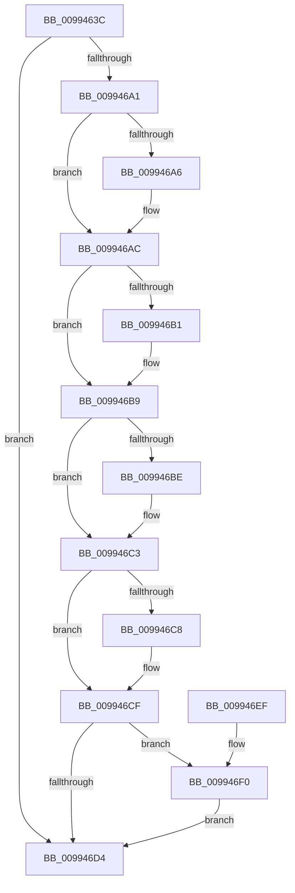

# RegRtlQueryInfoKey

- RVA: `0x0099463C`–`0x009946F7` (길이 `187` bytes)
- VA: `0x000000014099463C`
- 실행 섹션: `PAGE`
- PDB 이름 있음: `예`; PDB Function 태그: `아니요`
- unwind 정보 RVA: `0x00099034`
- 디코드: `67`개 명령, `187/187` bytes 표시
- 미해석 바이트: `0` (있으면 어셈블리에 `.byte`로 보존)

> 이 문서는 커널 이미지의 기계어와 PDB 기호를 분석해 생성했습니다. 4번과 5번은 함수 원형과 자료형을 바이너리 사용 방식에서 추정한 C 해석이며 원본 소스 복구 결과는 아닙니다.

## 1. Dependencies

- 직접 호출 지점: **2**; 고유 호출 대상: **2**
- 직접 호출자로 확인된 함수: **7**
- RIP 상대 이미지 참조: **1**

### Outgoing calls
- `0x00994696` → [ZwQueryKey](../../text/6A/ZwQueryKey_function_006AD390.md) (function, `0x006AD390`)
- `0x009946DD` → [_security_check_cookie](../../text/6A/_security_check_cookie_function_006AC640.md) (function, `0x006AC640`)

### Direct callers
- [RegRtlCopyTreeInternal](../83/RegRtlCopyTreeInternal_function_008324C0.md) at `0x008326BB`
- [_RegRtlDeletePathInternal](../96/_RegRtlDeletePathInternal_function_00965F04.md) at `0x0096607D`
- [_RegRtlEnumKeyWithCallback](_RegRtlEnumKeyWithCallback_function_009929EC.md) at `0x00992A70`
- [DrvDbGetDeviceIdDriverInfMatches](DrvDbGetDeviceIdDriverInfMatches_function_00994250.md) at `0x009942AC`
- [PnpCtxRegQueryInfoKey](PnpCtxRegQueryInfoKey_function_009945FC.md) at `0x0099462A`
- [RegRtlDeleteTreeInternal](RegRtlDeleteTreeInternal_function_00994700.md) at `0x009947AF`
- [DrvDbSetDeviceIdDriverInfMatches](../A6/DrvDbSetDeviceIdDriverInfMatches_function_00A6251C.md) at `0x00A62574`

### Static image references
- `0x0099464C` → RVA `0x00E0A740` (`.data`; read)

## 2. Other-region calls and transfers

- 다른 실행 섹션으로 향하는 call: **2**
  - `0x00994696` → [ZwQueryKey](../../text/6A/ZwQueryKey_function_006AD390.md) (`PAGE` → `.text`)
  - `0x009946DD` → [_security_check_cookie](../../text/6A/_security_check_cookie_function_006AC640.md) (`PAGE` → `.text`)
- 별도 외부 분기/꼬리 이동을 확인하지 못했습니다.

## 3. Assembly (complete function range)

```asm
0099463C  40 55                           push rbp
0099463E  53                              push rbx
0099463F  56                              push rsi
00994640  57                              push rdi
00994641  41 56                           push r14
00994643  41 57                           push r15
00994645  48 8B EC                        mov rbp, rsp
00994648  48 83 EC 78                     sub rsp, 0x78
0099464C  48 8B 05 ED 60 47 00            mov rax, qword ptr [rip + 0x4760ed]
00994653  48 33 C4                        xor rax, rsp
00994656  48 89 45 E8                     mov qword ptr [rbp - 0x18], rax
0099465A  48 8B 7D 58                     mov rdi, qword ptr [rbp + 0x58]
0099465E  33 C0                           xor eax, eax
00994660  21 45 B8                        and dword ptr [rbp - 0x48], eax
00994663  0F 57 C0                        xorps xmm0, xmm0
00994666  48 8B 5D 60                     mov rbx, qword ptr [rbp + 0x60]
0099466A  49 8B F1                        mov rsi, r9
0099466D  41 B9 28 00 00 00               mov r9d, 0x28
00994673  48 89 45 E0                     mov qword ptr [rbp - 0x20], rax
00994677  4D 8B F0                        mov r14, r8
0099467A  48 8D 45 B8                     lea rax, [rbp - 0x48]
0099467E  4C 8B FA                        mov r15, rdx
00994681  48 89 44 24 20                  mov qword ptr [rsp + 0x20], rax
00994686  4C 8D 45 C0                     lea r8, [rbp - 0x40]
0099468A  41 8D 51 DC                     lea edx, [r9 - 0x24]
0099468E  0F 11 45 C0                     movups xmmword ptr [rbp - 0x40], xmm0
00994692  0F 11 45 D0                     movups xmmword ptr [rbp - 0x30], xmm0
00994696  E8 F5 8C D1 FF                  call 0x1406ad390
0099469B  8B D0                           mov edx, eax
0099469D  85 C0                           test eax, eax
0099469F  78 33                           js 0x1409946d4
009946A1  4D 85 FF                        test r15, r15
009946A4  74 06                           je 0x1409946ac
009946A6  8B 4D CC                        mov ecx, dword ptr [rbp - 0x34]
009946A9  41 89 0F                        mov dword ptr [r15], ecx
009946AC  4D 85 F6                        test r14, r14
009946AF  74 08                           je 0x1409946b9
009946B1  8B 4D D0                        mov ecx, dword ptr [rbp - 0x30]
009946B4  D1 E9                           shr ecx, 1
009946B6  41 89 0E                        mov dword ptr [r14], ecx
009946B9  48 85 F6                        test rsi, rsi
009946BC  74 05                           je 0x1409946c3
009946BE  8B 45 D4                        mov eax, dword ptr [rbp - 0x2c]
009946C1  89 06                           mov dword ptr [rsi], eax
009946C3  48 85 FF                        test rdi, rdi
009946C6  74 07                           je 0x1409946cf
009946C8  8B 45 D8                        mov eax, dword ptr [rbp - 0x28]
009946CB  D1 E8                           shr eax, 1
009946CD  89 07                           mov dword ptr [rdi], eax
009946CF  48 85 DB                        test rbx, rbx
009946D2  75 1C                           jne 0x1409946f0
009946D4  8B C2                           mov eax, edx
009946D6  48 8B 4D E8                     mov rcx, qword ptr [rbp - 0x18]
009946DA  48 33 CC                        xor rcx, rsp
009946DD  E8 5E 7F D1 FF                  call 0x1406ac640
009946E2  48 83 C4 78                     add rsp, 0x78
009946E6  41 5F                           pop r15
009946E8  41 5E                           pop r14
009946EA  5F                              pop rdi
009946EB  5E                              pop rsi
009946EC  5B                              pop rbx
009946ED  5D                              pop rbp
009946EE  C3                              ret
009946EF  CC                              int3
009946F0  8B 45 DC                        mov eax, dword ptr [rbp - 0x24]
009946F3  89 03                           mov dword ptr [rbx], eax
009946F5  EB DD                           jmp 0x1409946d4
```

## 4. C-style interpretation (structured pseudocode)

```c
__int64 __fastcall RegRtlQueryInfoKey(__int64 a1, __int64 a2, __int64 a3, __int64 a4, __int64 a5, __int64 a6)
{
    __int64 result;
    __int64 v_rsp;
    unsigned __int64 v_stack_m48;
    unsigned __int64 v_stack_m50;
    unsigned int v_stack_m54;
    unsigned int v_stack_m58;
    unsigned int v_stack_m5C;
    unsigned __int64 v_stack_m60;
    unsigned int v_stack_m64;
    unsigned __int64 v_stack_m70;
    unsigned int v_stack_m78;
    unsigned __int64 v_stack_m88;

    v_rsp = (v_rsp) - (120);
    result = (*(unsigned __int64 *)(v_rip + 4677869)) ^ (v_rsp);
    v_stack_m48 = result;
    result = 0;
    v_stack_m50 = 0;
    v_stack_m88 = v_stack_m78;
    v_stack_m70 = v_xmm0;
    v_stack_m60 = v_xmm0;
    result = ZwQueryKey(a1, 40 - 36, v_stack_m70, 40);
    if (sign_flag) goto loc_009946D4;
    if (a2 != 0) {
        a1 = v_stack_m64;
        *(unsigned int *)(a2) = (unsigned int)(a1);
    }
    if (a3 != 0) {
        a1 = v_stack_m60;
        a1 = (unsigned int)((a1) >> (1));
        *(unsigned int *)(a3) = (unsigned int)(a1);
    }
    if (a4 != 0) {
        result = v_stack_m5C;
        *(unsigned int *)(a4) = (unsigned int)(result);
    }
    if (a5 != 0) {
        result = v_stack_m58;
        result = (unsigned int)((result) >> (1));
        *(unsigned int *)(a5) = (unsigned int)(result);
    }
    if (a6 != 0) goto loc_009946F0;
loc_009946D4:
    a1 = (v_stack_m48) ^ (v_rsp);
    result = _security_check_cookie(a1, (unsigned int)((unsigned int)(result)), v_stack_m70, 40);
    v_rsp = (v_rsp) + (120);
    return result;
loc_009946F0:
    *(unsigned int *)(a6) = (unsigned int)((unsigned int)(v_stack_m54));
    goto loc_009946D4;
}
```

## 5. (Beta) C Style

```c
int64_t RegRtlQueryInfoKey(int64_t Arg1, int64_t Arg2, int64_t Arg3, int64_t Arg4, int64_t Arg5, int64_t Arg6)
{
    int64_t result;
    int64_t local_rsp;
    uint64_t v_stack_m48;
    uint64_t v_stack_m50;
    uint32_t v_stack_m54;
    uint32_t v_stack_m58;
    uint32_t v_stack_m5C;
    uint64_t v_stack_m60;
    uint32_t v_stack_m64;
    uint64_t v_stack_m70;
    uint32_t v_stack_m78;
    uint64_t v_stack_m88;

    local_rsp = (local_rsp) - (120);
    result = (*(uint64_t *)(v_rip + 0x4760ED)) ^ (local_rsp);
    v_stack_m48 = result;
    result = 0;
    v_stack_m50 = 0;
    v_stack_m88 = v_stack_m78;
    v_stack_m70 = v_xmm0;
    v_stack_m60 = v_xmm0;
    result = ZwQueryKey(Arg1, 40 - 36, v_stack_m70, 40);
    if (sign_flag) goto loc_009946D4;
    if (Arg2 != 0) {
        Arg1 = v_stack_m64;
        *(uint32_t *)(Arg2) = (uint32_t)(Arg1);
    }
    if (Arg3 != 0) {
        Arg1 = v_stack_m60;
        Arg1 = (uint32_t)((Arg1) >> (1));
        *(uint32_t *)(Arg3) = (uint32_t)(Arg1);
    }
    if (Arg4 != 0) {
        result = v_stack_m5C;
        *(uint32_t *)(Arg4) = (uint32_t)(result);
    }
    if (Arg5 != 0) {
        result = v_stack_m58;
        result = (uint32_t)((result) >> (1));
        *(uint32_t *)(Arg5) = (uint32_t)(result);
    }
    if (Arg6 != 0) goto loc_009946F0;
loc_009946D4:
    Arg1 = (v_stack_m48) ^ (local_rsp);
    result = _security_check_cookie(Arg1, (uint32_t)((uint32_t)(result)), v_stack_m70, 40);
    local_rsp = (local_rsp) + (120);
    return result;
loc_009946F0:
    *(uint32_t *)(Arg6) = (uint32_t)((uint32_t)(v_stack_m54));
    goto loc_009946D4;
}
```

## 6. Execution-region graph

[열기: 2D/3D 그래프와 함수 탐색 컨트롤 패널](../../../control-panel.html?section=page&rva=0x0099463C&view=graph)

- 2D 그래프는 위에서 아래로 흐르고, 3D 그래프는 빈 공간을 드래그해 회전합니다. Shift+드래그는 이동, 휠은 확대·축소, 함수 노드 선택은 대상 보고서 이동입니다.

### Static fallback


