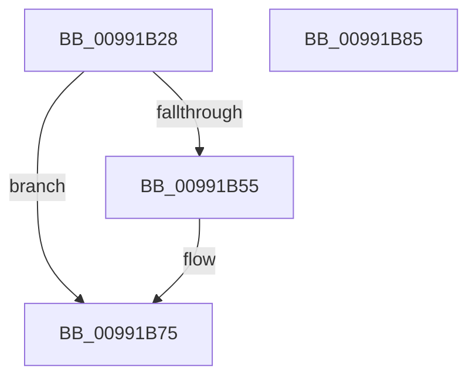

# RegRtlSetValue

- RVA: `0x00991B28`–`0x00991B86` (길이 `94` bytes)
- VA: `0x0000000140991B28`
- 실행 섹션: `PAGE`
- PDB 이름 있음: `예`; PDB Function 태그: `아니요`
- unwind 정보 RVA: `0x000718AC`
- 디코드: `28`개 명령, `94/94` bytes 표시
- 미해석 바이트: `0` (있으면 어셈블리에 `.byte`로 보존)

> 이 문서는 커널 이미지의 기계어와 PDB 기호를 분석해 생성했습니다. 4번과 5번은 함수 원형과 자료형을 바이너리 사용 방식에서 추정한 C 해석이며 원본 소스 복구 결과는 아닙니다.

## 1. Dependencies

- 직접 호출 지점: **2**; 고유 호출 대상: **2**
- 직접 호출자로 확인된 함수: **5**
- RIP 상대 이미지 참조: **0**

### Outgoing calls
- `0x00991B4C` → [RtlInitUnicodeStringEx](../../text/46/RtlInitUnicodeStringEx_function_00463960.md) (function, `0x00463960`)
- `0x00991B70` → [ZwSetValueKey](../../text/6A/ZwSetValueKey_function_006ADCD0.md) (function, `0x006ADCD0`)

### Direct callers
- [SysCtxOpenControlSet](../83/SysCtxOpenControlSet_function_00831B00.md) at `0x00831C36`
- [RegRtlCopyTreeInternal](../83/RegRtlCopyTreeInternal_function_008324C0.md) at `0x00832954`
- [_CmAddDeviceToContainerWorker](../8F/_CmAddDeviceToContainerWorker_function_008FF2EC.md) at `0x008FF4A7`
- [PnpCtxRegSetValue](PnpCtxRegSetValue_function_00991B8C.md) at `0x00991BAE`
- [_CmSetDeviceInterfaceMappedPropertyFromRegValue](../A7/_CmSetDeviceInterfaceMappedPropertyFromRegValue_function_00A729E4.md) at `0x00A72B26`
- [_CmSetDeviceInterfaceMappedPropertyFromRegValue](../A7/_CmSetDeviceInterfaceMappedPropertyFromRegValue_function_00A729E4.md) at `0x00A72C3F`

### Static image references
- 디코드된 RIP-relative 메모리 참조가 없습니다.

## 2. Other-region calls and transfers

- 다른 실행 섹션으로 향하는 call: **2**
  - `0x00991B4C` → [RtlInitUnicodeStringEx](../../text/46/RtlInitUnicodeStringEx_function_00463960.md) (`PAGE` → `.text`)
  - `0x00991B70` → [ZwSetValueKey](../../text/6A/ZwSetValueKey_function_006ADCD0.md) (`PAGE` → `.text`)
- 별도 외부 분기/꼬리 이동을 확인하지 못했습니다.

## 3. Assembly (complete function range)

```asm
00991B28  48 8B C4                        mov rax, rsp
00991B2B  48 89 58 08                     mov qword ptr [rax + 8], rbx
00991B2F  48 89 70 10                     mov qword ptr [rax + 0x10], rsi
00991B33  57                              push rdi
00991B34  48 83 EC 40                     sub rsp, 0x40
00991B38  48 8B F1                        mov rsi, rcx
00991B3B  0F 57 C0                        xorps xmm0, xmm0
00991B3E  48 8D 48 E8                     lea rcx, [rax - 0x18]
00991B42  49 8B D9                        mov rbx, r9
00991B45  0F 11 40 E8                     movups xmmword ptr [rax - 0x18], xmm0
00991B49  41 8B F8                        mov edi, r8d
00991B4C  E8 0F 1E AD FF                  call 0x140463960
00991B51  85 C0                           test eax, eax
00991B53  78 20                           js 0x140991b75
00991B55  8B 44 24 70                     mov eax, dword ptr [rsp + 0x70]
00991B59  48 8D 54 24 30                  lea rdx, [rsp + 0x30]
00991B5E  89 44 24 28                     mov dword ptr [rsp + 0x28], eax
00991B62  44 8B CF                        mov r9d, edi
00991B65  45 33 C0                        xor r8d, r8d
00991B68  48 89 5C 24 20                  mov qword ptr [rsp + 0x20], rbx
00991B6D  48 8B CE                        mov rcx, rsi
00991B70  E8 5B C1 D1 FF                  call 0x1406adcd0
00991B75  48 8B 5C 24 50                  mov rbx, qword ptr [rsp + 0x50]
00991B7A  48 8B 74 24 58                  mov rsi, qword ptr [rsp + 0x58]
00991B7F  48 83 C4 40                     add rsp, 0x40
00991B83  5F                              pop rdi
00991B84  C3                              ret
00991B85  CC                              int3
```

## 4. C-style interpretation (structured pseudocode)

```c
__int64 __fastcall RegRtlSetValue(__int64 a1, __int64 a2, int a3, __int64 a4, unsigned int a5)
{
    __int64 result;
    __int64 v_rsp;
    unsigned __int64 v_stack_m18;
    unsigned int v_stack_m20;
    unsigned __int64 v_stack_m28;
    unsigned __int64 v_stack_p10;
    unsigned __int64 v_stack_p8;

    *(unsigned __int64 *)(v_rsp + 8) = v_rbx;
    *(unsigned __int64 *)(v_rsp + 16) = v_rsi;
    v_rsp = (v_rsp) - (64);
    *(unsigned __int64 *)(v_rsp - 24) = v_xmm0;
    result = RtlInitUnicodeStringEx(v_rsp - 24, a2, a3, a4);
    if (!(sign_flag)) {
        result = a5;
        a2 = v_stack_m18;
        v_stack_m20 = (unsigned int)(result);
        a4 = (unsigned int)((unsigned int)(a3));
        a3 = 0;
        v_stack_m28 = a4;
        a1 = a1;
        result = ZwSetValueKey(a1, a2, a3, a4);
    }
    v_rsp = (v_rsp) + (64);
    return result;
}
```

## 5. (Beta) C Style

```c
int64_t RegRtlSetValue(int64_t Arg1, int64_t Arg2, int32_t Arg3, int64_t Arg4, uint32_t Arg5)
{
    int64_t result;
    int64_t local_rsp;
    uint64_t v_stack_m18;
    uint32_t v_stack_m20;
    uint64_t v_stack_m28;
    uint64_t v_stack_p10;
    uint64_t v_stack_p8;

    *(uint64_t *)(local_rsp + 0x8) = local_rbx;
    *(uint64_t *)(local_rsp + 0x10) = local_rsi;
    local_rsp = (local_rsp) - (64);
    *(uint64_t *)(local_rsp - 0x18) = v_xmm0;
    result = RtlInitUnicodeStringEx(local_rsp - 24, Arg2, Arg3, Arg4);
    if (!(sign_flag)) {
        result = Arg5;
        Arg2 = v_stack_m18;
        v_stack_m20 = (uint32_t)(result);
        Arg4 = (uint32_t)((uint32_t)(Arg3));
        Arg3 = 0;
        v_stack_m28 = Arg4;
        Arg1 = Arg1;
        result = ZwSetValueKey(Arg1, Arg2, Arg3, Arg4);
    }
    local_rsp = (local_rsp) + (64);
    return result;
}
```

## 6. Execution-region graph

[열기: 2D/3D 그래프와 함수 탐색 컨트롤 패널](../../../control-panel.html?section=page&rva=0x00991B28&view=graph)

- 2D 그래프는 위에서 아래로 흐르고, 3D 그래프는 빈 공간을 드래그해 회전합니다. Shift+드래그는 이동, 휠은 확대·축소, 함수 노드 선택은 대상 보고서 이동입니다.

### Static fallback


