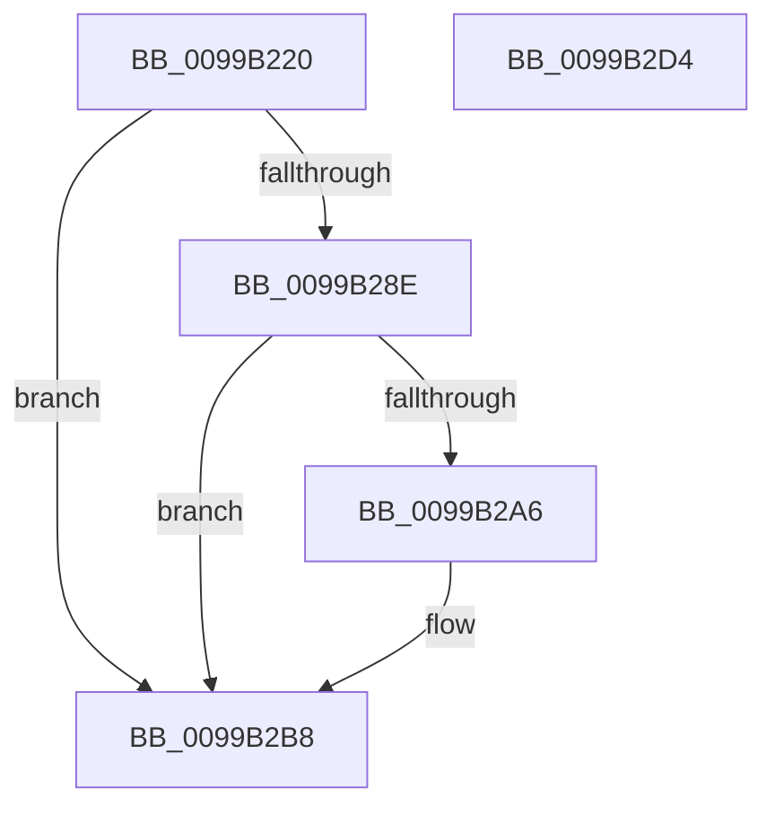

# RtlFindMessage

- RVA: `0x0099B220`–`0x0099B2D5` (길이 `181` bytes)
- VA: `0x000000014099B220`
- 실행 섹션: `PAGE`
- PDB 이름 있음: `예`; PDB Function 태그: `아니요`
- unwind 정보 RVA: `0x000996A0`
- 디코드: `51`개 명령, `181/181` bytes 표시
- 미해석 바이트: `0` (있으면 어셈블리에 `.byte`로 보존)

> 이 문서는 커널 이미지의 기계어와 PDB 기호를 분석해 생성했습니다. 4번과 5번은 함수 원형과 자료형을 바이너리 사용 방식에서 추정한 C 해석이며 원본 소스 복구 결과는 아닙니다.

## 1. Dependencies

- 직접 호출 지점: **4**; 고유 호출 대상: **4**
- 직접 호출자로 확인된 함수: **6**
- RIP 상대 이미지 참조: **1**

### Outgoing calls
- `0x0099B285` → [LdrpSearchResourceSection_U](LdrpSearchResourceSection_U_function_0099B2DC.md) (function, `0x0099B2DC`)
- `0x0099B29D` → [LdrpAccessResourceData](LdrpAccessResourceData_function_0099BE1C.md) (function, `0x0099BE1C`)
- `0x0099B2B3` → [RtlpFindMessageInTable](../../text/47/RtlpFindMessageInTable_function_00479528.md) (function, `0x00479528`)
- `0x0099B2BF` → [_security_check_cookie](../../text/6A/_security_check_cookie_function_006AC640.md) (function, `0x006AC640`)

### Direct callers
- [IopInitializeBootLogging](../71/IopInitializeBootLogging_function_0071B748.md) at `0x0071B7D7`
- [IopInitializeBootLogging](../71/IopInitializeBootLogging_function_0071B748.md) at `0x0071B85C`
- [PiGetDefaultMessageString](PiGetDefaultMessageString_function_0099A87C.md) at `0x0099A90A`
- [ExpSystemErrorHandler2](../../pagelk/B7/ExpSystemErrorHandler2_function_00B72C30.md) at `0x00B72E4D`
- [ResFwFindMessage](../../pagebgfx/BC/ResFwFindMessage_function_00BC197C.md) at `0x00BC19AE`
- [InitBootProcessor](../../init/C1/InitBootProcessor_function_00C1B1C8.md) at `0x00C1BA41`
- [Phase1InitializationDiscard](../../init/C1/Phase1InitializationDiscard_function_00C1C728.md) at `0x00C1CB9E`
- [Phase1InitializationDiscard](../../init/C1/Phase1InitializationDiscard_function_00C1C728.md) at `0x00C1D0A0`
- [Phase1InitializationDiscard](../../init/C1/Phase1InitializationDiscard_function_00C1C728.md) at `0x00C1D118`
- [Phase1InitializationDiscard](../../init/C1/Phase1InitializationDiscard_function_00C1C728.md) at `0x00C1D925`
- [Phase1InitializationDiscard](../../init/C1/Phase1InitializationDiscard_function_00C1C728.md) at `0x00C1D972`

### Static image references
- `0x0099B22F` → RVA `0x00E0A740` (`.data`; read)

## 2. Other-region calls and transfers

- 다른 실행 섹션으로 향하는 call: **2**
  - `0x0099B2B3` → [RtlpFindMessageInTable](../../text/47/RtlpFindMessageInTable_function_00479528.md) (`PAGE` → `.text`)
  - `0x0099B2BF` → [_security_check_cookie](../../text/6A/_security_check_cookie_function_006AC640.md) (`PAGE` → `.text`)
- 별도 외부 분기/꼬리 이동을 확인하지 못했습니다.

## 3. Assembly (complete function range)

```asm
0099B220  48 89 5C 24 10                  mov qword ptr [rsp + 0x10], rbx
0099B225  55                              push rbp
0099B226  56                              push rsi
0099B227  57                              push rdi
0099B228  48 8B EC                        mov rbp, rsp
0099B22B  48 83 EC 70                     sub rsp, 0x70
0099B22F  48 8B 05 0A F5 46 00            mov rax, qword ptr [rip + 0x46f50a]
0099B236  48 33 C4                        xor rax, rsp
0099B239  48 89 45 F8                     mov qword ptr [rbp - 8], rax
0099B23D  48 8B 75 40                     mov rsi, qword ptr [rbp + 0x40]
0099B241  48 8B F9                        mov rdi, rcx
0099B244  48 83 65 C8 00                  and qword ptr [rbp - 0x38], 0
0099B249  48 83 65 D0 00                  and qword ptr [rbp - 0x30], 0
0099B24E  83 65 C0 00                     and dword ptr [rbp - 0x40], 0
0099B252  8B C2                           mov eax, edx
0099B254  48 8D 55 D8                     lea rdx, [rbp - 0x28]
0099B258  41 8B D9                        mov ebx, r9d
0099B25B  41 B9 40 00 00 00               mov r9d, 0x40
0099B261  48 89 45 D8                     mov qword ptr [rbp - 0x28], rax
0099B265  41 8B C0                        mov eax, r8d
0099B268  48 89 45 E8                     mov qword ptr [rbp - 0x18], rax
0099B26C  48 8D 45 C8                     lea rax, [rbp - 0x38]
0099B270  45 8D 41 C4                     lea r8d, [r9 - 0x3c]
0099B274  48 89 44 24 20                  mov qword ptr [rsp + 0x20], rax
0099B279  48 C7 45 E0 01 00 00 00         mov qword ptr [rbp - 0x20], 1
0099B281  48 89 5D F0                     mov qword ptr [rbp - 0x10], rbx
0099B285  E8 52 00 00 00                  call 0x14099b2dc
0099B28A  85 C0                           test eax, eax
0099B28C  78 2A                           js 0x14099b2b8
0099B28E  48 8B 55 C8                     mov rdx, qword ptr [rbp - 0x38]
0099B292  4C 8D 4D C0                     lea r9, [rbp - 0x40]
0099B296  4C 8D 45 D0                     lea r8, [rbp - 0x30]
0099B29A  48 8B CF                        mov rcx, rdi
0099B29D  E8 7A 0B 00 00                  call 0x14099be1c
0099B2A2  85 C0                           test eax, eax
0099B2A4  78 12                           js 0x14099b2b8
0099B2A6  8B 55 C0                        mov edx, dword ptr [rbp - 0x40]
0099B2A9  4C 8B CE                        mov r9, rsi
0099B2AC  48 8B 4D D0                     mov rcx, qword ptr [rbp - 0x30]
0099B2B0  44 8B C3                        mov r8d, ebx
0099B2B3  E8 70 E2 AD FF                  call 0x140479528
0099B2B8  48 8B 4D F8                     mov rcx, qword ptr [rbp - 8]
0099B2BC  48 33 CC                        xor rcx, rsp
0099B2BF  E8 7C 13 D1 FF                  call 0x1406ac640
0099B2C4  48 8B 9C 24 98 00 00 00         mov rbx, qword ptr [rsp + 0x98]
0099B2CC  48 83 C4 70                     add rsp, 0x70
0099B2D0  5F                              pop rdi
0099B2D1  5E                              pop rsi
0099B2D2  5D                              pop rbp
0099B2D3  C3                              ret
0099B2D4  CC                              int3
```

## 4. C-style interpretation (structured pseudocode)

```c
__int64 __fastcall RtlFindMessage(__int64 a1, int a2, int a3, int a4, __int64 a5)
{
    __int64 result;
    __int64 v_rsp;
    unsigned __int64 v_stack_m20;
    unsigned __int64 v_stack_m28;
    unsigned __int64 v_stack_m30;
    unsigned __int64 v_stack_m38;
    unsigned __int64 v_stack_m40;
    unsigned __int64 v_stack_m48;
    unsigned __int64 v_stack_m50;
    unsigned int v_stack_m58;
    unsigned __int64 v_stack_m68;
    unsigned __int64 v_stack_p10;

    v_stack_p10 = v_rbx;
    v_rsp = (v_rsp) - (112);
    result = (*(unsigned __int64 *)(v_rip + 4650250)) ^ (v_rsp);
    v_stack_m20 = result;
    v_stack_m40 = (unsigned int)(a2);
    v_stack_m30 = (unsigned int)(a3);
    v_stack_m68 = v_stack_m50;
    v_stack_m38 = 1;
    v_stack_m28 = (unsigned int)(a4);
    result = LdrpSearchResourceSection_U(a1, v_stack_m40, 64 - 60, 64);
    if (sign_flag) goto loc_0099B2B8;
    result = LdrpAccessResourceData(a1, v_stack_m50, v_stack_m48, v_stack_m58);
    if (!(sign_flag)) {
        a2 = v_stack_m58;
        a4 = a5;
        a1 = v_stack_m48;
        a3 = (unsigned int)((unsigned int)(a4));
        result = RtlpFindMessageInTable(a1, a2, a3, a4);
    }
    a1 = (v_stack_m20) ^ (v_rsp);
    result = _security_check_cookie(a1, a2, a3, a4);
    v_rsp = (v_rsp) + (112);
    return result;
}
```

## 5. (Beta) C Style

```c
int64_t RtlFindMessage(int64_t Arg1, int32_t Arg2, int32_t Arg3, int32_t Arg4, int64_t Arg5)
{
    int64_t result;
    int64_t local_rsp;
    uint64_t v_stack_m20;
    uint64_t v_stack_m28;
    uint64_t v_stack_m30;
    uint64_t v_stack_m38;
    uint64_t v_stack_m40;
    uint64_t v_stack_m48;
    uint64_t v_stack_m50;
    uint32_t v_stack_m58;
    uint64_t v_stack_m68;
    uint64_t v_stack_p10;

    v_stack_p10 = local_rbx;
    local_rsp = (local_rsp) - (112);
    result = (*(uint64_t *)(v_rip + 0x46F50A)) ^ (local_rsp);
    v_stack_m20 = result;
    v_stack_m40 = (uint32_t)(Arg2);
    v_stack_m30 = (uint32_t)(Arg3);
    v_stack_m68 = v_stack_m50;
    v_stack_m38 = 1;
    v_stack_m28 = (uint32_t)(Arg4);
    result = LdrpSearchResourceSection_U(Arg1, v_stack_m40, 64 - 60, 64);
    if (sign_flag) goto loc_0099B2B8;
    result = LdrpAccessResourceData(Arg1, v_stack_m50, v_stack_m48, v_stack_m58);
    if (!(sign_flag)) {
        Arg2 = v_stack_m58;
        Arg4 = Arg5;
        Arg1 = v_stack_m48;
        Arg3 = (uint32_t)((uint32_t)(Arg4));
        result = RtlpFindMessageInTable(Arg1, Arg2, Arg3, Arg4);
    }
    Arg1 = (v_stack_m20) ^ (local_rsp);
    result = _security_check_cookie(Arg1, Arg2, Arg3, Arg4);
    local_rsp = (local_rsp) + (112);
    return result;
}
```

## 6. Execution-region graph

[열기: 2D/3D 그래프와 함수 탐색 컨트롤 패널](../../../control-panel.html?section=page&rva=0x0099B220&view=graph)

- 2D 그래프는 위에서 아래로 흐르고, 3D 그래프는 빈 공간을 드래그해 회전합니다. Shift+드래그는 이동, 휠은 확대·축소, 함수 노드 선택은 대상 보고서 이동입니다.

### Static fallback


