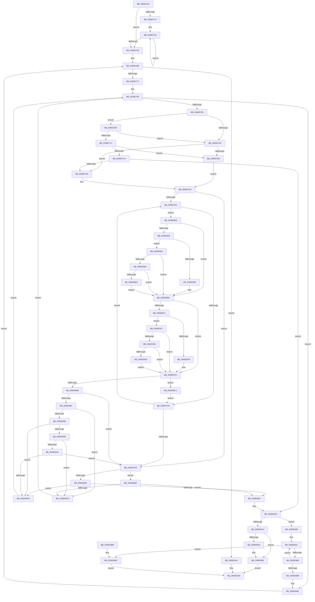

# RtlFindUnicodePrefix

- RVA: `0x0099D710`–`0x0099D9D1` (길이 `705` bytes)
- VA: `0x000000014099D710`
- 실행 섹션: `PAGE`
- PDB 이름 있음: `예`; PDB Function 태그: `아니요`
- unwind 정보 RVA: `0x00099C08`
- 디코드: `191`개 명령, `705/705` bytes 표시
- 미해석 바이트: `0` (있으면 어셈블리에 `.byte`로 보존)

> 이 문서는 커널 이미지의 기계어와 PDB 기호를 분석해 생성했습니다. 4번과 5번은 함수 원형과 자료형을 바이너리 사용 방식에서 추정한 C 해석이며 원본 소스 복구 결과는 아닙니다.

## 1. Dependencies

- 직접 호출 지점: **4**; 고유 호출 대상: **4**
- 직접 호출자로 확인된 함수: **0**
- RIP 상대 이미지 참조: **0**

### Outgoing calls
- `0x0099D738` → [ComputeUnicodeNameLength](ComputeUnicodeNameLength_function_0099D9E0.md) (function, `0x0099D9E0`)
- `0x0099D791` → [PsGetCurrentServerSiloGlobals](../../text/2F/PsGetCurrentServerSiloGlobals_function_002FE1F0.md) (function, `0x002FE1F0`)
- `0x0099D839` → [RtlSplay](../../text/38/RtlSplay_function_0038F1E0.md) (function, `0x0038F1E0`)
- `0x0099D976` → [CompareUnicodeStrings](CompareUnicodeStrings_function_0099DA20.md) (function, `0x0099DA20`)

### Direct callers
- 이 함수 시작 RVA로 연결되는 직접 call은 확인되지 않았습니다. 간접 호출은 완전히 역산할 수 없습니다.

### Static image references
- 디코드된 RIP-relative 메모리 참조가 없습니다.

## 2. Other-region calls and transfers

- 다른 실행 섹션으로 향하는 call: **2**
  - `0x0099D791` → [PsGetCurrentServerSiloGlobals](../../text/2F/PsGetCurrentServerSiloGlobals_function_002FE1F0.md) (`PAGE` → `.text`)
  - `0x0099D839` → [RtlSplay](../../text/38/RtlSplay_function_0038F1E0.md) (`PAGE` → `.text`)
- 별도 외부 분기/꼬리 이동을 확인하지 못했습니다.

## 3. Assembly (complete function range)

```asm
0099D710  48 89 5C 24 10                  mov qword ptr [rsp + 0x10], rbx
0099D715  44 89 44 24 18                  mov dword ptr [rsp + 0x18], r8d
0099D71A  48 89 4C 24 08                  mov qword ptr [rsp + 8], rcx
0099D71F  55                              push rbp
0099D720  56                              push rsi
0099D721  57                              push rdi
0099D722  41 54                           push r12
0099D724  41 55                           push r13
0099D726  41 56                           push r14
0099D728  41 57                           push r15
0099D72A  48 83 EC 20                     sub rsp, 0x20
0099D72E  4C 8B 71 08                     mov r14, qword ptr [rcx + 8]
0099D732  4C 8B EA                        mov r13, rdx
0099D735  48 8B CA                        mov rcx, rdx
0099D738  E8 A3 02 00 00                  call 0x14099d9e0
0099D73D  66 41 39 46 02                  cmp word ptr [r14 + 2], ax
0099D742  7E 1C                           jle 0x14099d760
0099D744  0F 1F 40 00                     nop dword ptr [rax]
0099D748  0F 1F 84 00 00 00 00 00         nop dword ptr [rax + rax]
0099D750  4C 89 74 24 60                  mov qword ptr [rsp + 0x60], r14
0099D755  4D 8B 76 08                     mov r14, qword ptr [r14 + 8]
0099D759  66 41 39 46 02                  cmp word ptr [r14 + 2], ax
0099D75E  7F F0                           jg 0x14099d750
0099D760  BA E0 FF 00 00                  mov edx, 0xffe0
0099D765  41 B8 C0 00 00 00               mov r8d, 0xc0
0099D76B  66 41 83 7E 02 00               cmp word ptr [r14 + 2], 0
0099D771  0F 8E 2D 02 00 00               jle 0x14099d9a4
0099D777  4D 8D 7E 18                     lea r15, [r14 + 0x18]
0099D77B  0F 1F 44 00 00                  nop dword ptr [rax + rax]
0099D780  4D 85 FF                        test r15, r15
0099D783  0F 84 0D 02 00 00               je 0x14099d996
0099D789  4D 8B 5F 18                     mov r11, qword ptr [r15 + 0x18]
0099D78D  49 8D 7F E8                     lea rdi, [r15 - 0x18]
0099D791  E8 5A 0A 96 FF                  call 0x1402fe1f0
0099D796  41 0F B7 33                     movzx esi, word ptr [r11]
0099D79A  41 0F B7 6D 00                  movzx ebp, word ptr [r13]
0099D79F  D1 EE                           shr esi, 1
0099D7A1  4C 8B A0 B0 04 00 00            mov r12, qword ptr [rax + 0x4b0]
0099D7A8  D1 ED                           shr ebp, 1
0099D7AA  83 FE 01                        cmp esi, 1
0099D7AD  74 08                           je 0x14099d7b7
0099D7AF  3B F5                           cmp esi, ebp
0099D7B1  72 1D                           jb 0x14099d7d0
0099D7B3  8B FD                           mov edi, ebp
0099D7B5  EB 1B                           jmp 0x14099d7d2
0099D7B7  49 8B 43 08                     mov rax, qword ptr [r11 + 8]
0099D7BB  66 83 38 5C                     cmp word ptr [rax], 0x5c
0099D7BF  75 EE                           jne 0x14099d7af
0099D7C1  83 FD 01                        cmp ebp, 1
0099D7C4  76 ED                           jbe 0x14099d7b3
0099D7C6  49 8B 45 08                     mov rax, qword ptr [r13 + 8]
0099D7CA  66 83 38 5C                     cmp word ptr [rax], 0x5c
0099D7CE  74 40                           je 0x14099d810
0099D7D0  8B FE                           mov edi, esi
0099D7D2  4D 8B 5B 08                     mov r11, qword ptr [r11 + 8]
0099D7D6  45 33 D2                        xor r10d, r10d
0099D7D9  49 8B 5D 08                     mov rbx, qword ptr [r13 + 8]
0099D7DD  85 FF                           test edi, edi
0099D7DF  74 1D                           je 0x14099d7fe
0099D7E1  45 0F B7 0B                     movzx r9d, word ptr [r11]
0099D7E5  4D 8D 5B 02                     lea r11, [r11 + 2]
0099D7E9  0F B7 03                        movzx eax, word ptr [rbx]
0099D7EC  48 8D 5B 02                     lea rbx, [rbx + 2]
0099D7F0  66 44 3B C8                     cmp r9w, ax
0099D7F4  75 67                           jne 0x14099d85d
0099D7F6  41 FF C2                        inc r10d
0099D7F9  44 3B D7                        cmp r10d, edi
0099D7FC  72 E3                           jb 0x14099d7e1
0099D7FE  3B F5                           cmp esi, ebp
0099D800  0F 82 B8 00 00 00               jb 0x14099d8be
0099D806  0F 87 9E 00 00 00               ja 0x14099d8aa
0099D80C  49 8D 7F E8                     lea rdi, [r15 - 0x18]
0099D810  8B 74 24 70                     mov esi, dword ptr [rsp + 0x70]
0099D814  85 F6                           test esi, esi
0099D816  0F 85 4D 01 00 00               jne 0x14099d969
0099D81C  B8 02 08 00 00                  mov eax, 0x802
0099D821  66 39 07                        cmp word ptr [rdi], ax
0099D824  75 2F                           jne 0x14099d855
0099D826  49 8B 5E 08                     mov rbx, qword ptr [r14 + 8]
0099D82A  49 8B CF                        mov rcx, r15
0099D82D  49 C7 46 08 00 00 00 00         mov qword ptr [r14 + 8], 0
0099D835  66 41 89 06                     mov word ptr [r14], ax
0099D839  E8 A2 19 9F FF                  call 0x14038f1e0
0099D83E  66 C7 40 E8 01 08               mov word ptr [rax - 0x18], 0x801
0099D844  48 8D 78 E8                     lea rdi, [rax - 0x18]
0099D848  48 8B 44 24 60                  mov rax, qword ptr [rsp + 0x60]
0099D84D  48 89 78 08                     mov qword ptr [rax + 8], rdi
0099D851  48 89 5F 08                     mov qword ptr [rdi + 8], rbx
0099D855  48 8B C7                        mov rax, rdi
0099D858  E9 49 01 00 00                  jmp 0x14099d9a6
0099D85D  41 83 F9 61                     cmp r9d, 0x61
0099D861  72 0A                           jb 0x14099d86d
0099D863  41 83 F9 7A                     cmp r9d, 0x7a
0099D867  77 78                           ja 0x14099d8e1
0099D869  66 44 03 CA                     add r9w, dx
0099D86D  83 F8 61                        cmp eax, 0x61
0099D870  72 0C                           jb 0x14099d87e
0099D872  83 F8 7A                        cmp eax, 0x7a
0099D875  0F 87 AC 00 00 00               ja 0x14099d927
0099D87B  66 03 C2                        add ax, dx
0099D87E  66 44 3B C8                     cmp r9w, ax
0099D882  0F 84 39 01 00 00               je 0x14099d9c1
0099D888  44 3B D7                        cmp r10d, edi
0099D88B  0F 83 6D FF FF FF               jae 0x14099d7fe
0099D891  66 41 83 F9 5C                  cmp r9w, 0x5c
0099D896  74 35                           je 0x14099d8cd
0099D898  66 83 F8 5C                     cmp ax, 0x5c
0099D89C  74 0C                           je 0x14099d8aa
0099D89E  66 44 3B C8                     cmp r9w, ax
0099D8A2  72 29                           jb 0x14099d8cd
0099D8A4  0F 86 54 FF FF FF               jbe 0x14099d7fe
0099D8AA  4D 8B 7F 08                     mov r15, qword ptr [r15 + 8]
0099D8AE  BA E0 FF 00 00                  mov edx, 0xffe0
0099D8B3  41 B8 C0 00 00 00               mov r8d, 0xc0
0099D8B9  E9 C2 FE FF FF                  jmp 0x14099d780
0099D8BE  49 8B 45 08                     mov rax, qword ptr [r13 + 8]
0099D8C2  66 83 3C 70 5C                  cmp word ptr [rax + rsi*2], 0x5c
0099D8C7  0F 84 3F FF FF FF               je 0x14099d80c
0099D8CD  4D 8B 7F 10                     mov r15, qword ptr [r15 + 0x10]
0099D8D1  BA E0 FF 00 00                  mov edx, 0xffe0
0099D8D6  41 B8 C0 00 00 00               mov r8d, 0xc0
0099D8DC  E9 9F FE FF FF                  jmp 0x14099d780
0099D8E1  4D 85 E4                        test r12, r12
0099D8E4  74 87                           je 0x14099d86d
0099D8E6  66 45 3B C8                     cmp r9w, r8w
0099D8EA  72 81                           jb 0x14099d86d
0099D8EC  49 8B C9                        mov rcx, r9
0099D8EF  45 8B C1                        mov r8d, r9d
0099D8F2  48 C1 E9 08                     shr rcx, 8
0099D8F6  41 83 E0 0F                     and r8d, 0xf
0099D8FA  41 0F B7 14 4C                  movzx edx, word ptr [r12 + rcx*2]
0099D8FF  41 8B C9                        mov ecx, r9d
0099D902  C1 E9 04                        shr ecx, 4
0099D905  83 E1 0F                        and ecx, 0xf
0099D908  03 D1                           add edx, ecx
0099D90A  41 0F B7 14 54                  movzx edx, word ptr [r12 + rdx*2]
0099D90F  41 03 D0                        add edx, r8d
0099D912  41 B8 C0 00 00 00               mov r8d, 0xc0
0099D918  66 45 03 0C 54                  add r9w, word ptr [r12 + rdx*2]
0099D91D  BA E0 FF 00 00                  mov edx, 0xffe0
0099D922  E9 46 FF FF FF                  jmp 0x14099d86d
0099D927  4D 85 E4                        test r12, r12
0099D92A  0F 84 4E FF FF FF               je 0x14099d87e
0099D930  66 41 3B C0                     cmp ax, r8w
0099D934  0F 82 44 FF FF FF               jb 0x14099d87e
0099D93A  48 8B C8                        mov rcx, rax
0099D93D  44 8B C0                        mov r8d, eax
0099D940  48 C1 E9 08                     shr rcx, 8
0099D944  41 83 E0 0F                     and r8d, 0xf
0099D948  41 0F B7 14 4C                  movzx edx, word ptr [r12 + rcx*2]
0099D94D  8B C8                           mov ecx, eax
0099D94F  C1 E9 04                        shr ecx, 4
0099D952  83 E1 0F                        and ecx, 0xf
0099D955  03 D1                           add edx, ecx
0099D957  41 0F B7 14 54                  movzx edx, word ptr [r12 + rdx*2]
0099D95C  41 03 D0                        add edx, r8d
0099D95F  66 41 03 04 54                  add ax, word ptr [r12 + rdx*2]
0099D964  E9 15 FF FF FF                  jmp 0x14099d87e
0099D969  48 8B DF                        mov rbx, rdi
0099D96C  48 8B 4B 30                     mov rcx, qword ptr [rbx + 0x30]
0099D970  44 8B C6                        mov r8d, esi
0099D973  49 8B D5                        mov rdx, r13
0099D976  E8 A5 00 00 00                  call 0x14099da20
0099D97B  FF C8                           dec eax
0099D97D  83 F8 01                        cmp eax, 1
0099D980  76 3A                           jbe 0x14099d9bc
0099D982  48 8B 5B 10                     mov rbx, qword ptr [rbx + 0x10]
0099D986  48 3B DF                        cmp rbx, rdi
0099D989  75 E1                           jne 0x14099d96c
0099D98B  BA E0 FF 00 00                  mov edx, 0xffe0
0099D990  41 B8 C0 00 00 00               mov r8d, 0xc0
0099D996  4C 89 74 24 60                  mov qword ptr [rsp + 0x60], r14
0099D99B  4D 8B 76 08                     mov r14, qword ptr [r14 + 8]
0099D99F  E9 C7 FD FF FF                  jmp 0x14099d76b
0099D9A4  33 C0                           xor eax, eax
0099D9A6  48 8B 5C 24 68                  mov rbx, qword ptr [rsp + 0x68]
0099D9AB  48 83 C4 20                     add rsp, 0x20
0099D9AF  41 5F                           pop r15
0099D9B1  41 5E                           pop r14
0099D9B3  41 5D                           pop r13
0099D9B5  41 5C                           pop r12
0099D9B7  5F                              pop rdi
0099D9B8  5E                              pop rsi
0099D9B9  5D                              pop rbp
0099D9BA  C3                              ret
0099D9BB  CC                              int3
0099D9BC  48 8B C3                        mov rax, rbx
0099D9BF  EB E5                           jmp 0x14099d9a6
0099D9C1  BA E0 FF 00 00                  mov edx, 0xffe0
0099D9C6  41 B8 C0 00 00 00               mov r8d, 0xc0
0099D9CC  E9 25 FE FF FF                  jmp 0x14099d7f6
```

## 4. C-style interpretation (structured pseudocode)

```c
__int64 __fastcall RtlFindUnicodePrefix(__int64 a1, __int64 a2, int a3)
{
    __int64 result;
    __int64 v_r10;
    __int64 v_rbp;
    __int64 v_rbx;
    __int64 v_rdi;
    __int64 v_rsi;
    __int64 v_rsp;
    unsigned __int64 v_stack_p10;
    unsigned int v_stack_p18;
    unsigned __int64 v_stack_p8;

    v_stack_p10 = v_rbx;
    v_stack_p18 = a3;
    v_stack_p8 = a1;
    v_rsp = (v_rsp) - (32);
    result = ComputeUnicodeNameLength(a2, a2, a3, a4);
    if ((*(unsigned __int16 *)(*(unsigned __int64 *)(a1 + 8) + 2)) <= ((unsigned __int16)(result))) goto loc_0099D760;
loc_0099D750:
    v_stack_p8 = *(unsigned __int64 *)(a1 + 8);
    if ((*(unsigned __int16 *)(*(unsigned __int64 *)(*(unsigned __int64 *)(a1 + 8) + 8) + 2)) > ((unsigned __int16)(result))) goto loc_0099D750;
loc_0099D760:
loc_0099D76B:
    if ((*(unsigned __int16 *)(*(unsigned __int64 *)(*(unsigned __int64 *)(a1 + 8) + 8) + 2)) <= 0) goto loc_0099D9A4;
loc_0099D780:
    if (*(unsigned __int64 *)(*(unsigned __int64 *)(a1 + 8) + 8) + 24 == 0) goto loc_0099D996;
    result = PsGetCurrentServerSiloGlobals(a2, (unsigned int)(0xFFE0ULL), 192, a4);
    v_rsi = (unsigned int)((*(unsigned __int16 *)(*(unsigned __int64 *)(*(unsigned __int64 *)(*(unsigned __int64 *)(a1 + 8) + 8) + 24 + 24))) >> (1));
    v_rbp = (unsigned int)((*(unsigned __int16 *)(a2)) >> (1));
    if (((unsigned int)(v_rsi)) == 1) goto loc_0099D7B7;
loc_0099D7AF:
    if (((unsigned int)(v_rsi)) < ((unsigned int)(v_rbp))) goto loc_0099D7D0;
loc_0099D7B3:
    goto loc_0099D7D2;
loc_0099D7B7:
    if ((*(unsigned __int16 *)(*(unsigned __int64 *)(*(unsigned __int64 *)(*(unsigned __int64 *)(*(unsigned __int64 *)(a1 + 8) + 8) + 24 + 24) + 8))) != 92) goto loc_0099D7AF;
    if (((unsigned int)(v_rbp)) <= 1) goto loc_0099D7B3;
    if ((*(unsigned __int16 *)(*(unsigned __int64 *)(a2 + 8))) == 92) goto loc_0099D810;
loc_0099D7D0:
loc_0099D7D2:
    v_r10 = 0;
    if ((unsigned int)((unsigned int)((unsigned int)(v_rsi))) == 0) goto loc_0099D7FE;
loc_0099D7E1:
    if (((unsigned __int16)(*(unsigned __int16 *)(*(unsigned __int64 *)(*(unsigned __int64 *)(*(unsigned __int64 *)(*(unsigned __int64 *)(a1 + 8) + 8) + 24 + 24) + 8)))) != ((unsigned __int16)(*(unsigned __int16 *)(*(unsigned __int64 *)(a2 + 8))))) goto loc_0099D85D;
loc_0099D7F6:
    v_r10 = (unsigned int)((v_r10) + 1);
    if (((unsigned int)(v_r10)) < ((unsigned int)((unsigned int)((unsigned int)(v_rsi))))) goto loc_0099D7E1;
loc_0099D7FE:
    if (((unsigned int)(v_rsi)) < ((unsigned int)(v_rbp))) goto loc_0099D8BE;
    if (((unsigned int)(v_rsi)) > ((unsigned int)(v_rbp))) goto loc_0099D8AA;
loc_0099D80C:
loc_0099D810:
    if ((unsigned int)((unsigned int)(v_stack_p18)) != 0) goto loc_0099D969;
    result = (unsigned int)(0x802ULL);
    v_rbx = *(unsigned __int64 *)(a2 + 8) + 2;
    v_rdi = *(unsigned __int64 *)(*(unsigned __int64 *)(a1 + 8) + 8) + 24 - 24;
    if ((*(unsigned __int16 *)(*(unsigned __int64 *)(*(unsigned __int64 *)(a1 + 8) + 8) + 24 - 24)) == ((unsigned __int16)((unsigned int)(0x802ULL)))) {
        v_rbx = *(unsigned __int64 *)(*(unsigned __int64 *)(*(unsigned __int64 *)(a1 + 8) + 8) + 8);
        a1 = *(unsigned __int64 *)(*(unsigned __int64 *)(a1 + 8) + 8) + 24;
        *(unsigned __int64 *)(*(unsigned __int64 *)(*(unsigned __int64 *)(a1 + 8) + 8) + 8) = 0;
        *(unsigned __int16 *)(*(unsigned __int64 *)(*(unsigned __int64 *)(a1 + 8) + 8)) = (unsigned __int16)((unsigned int)(0x802ULL));
        result = RtlSplay(a1, (unsigned int)(0xFFE0ULL), 192, *(unsigned __int16 *)(*(unsigned __int64 *)(*(unsigned __int64 *)(*(unsigned __int64 *)(*(unsigned __int64 *)(a1 + 8) + 8) + 24 + 24) + 8)));
        *(unsigned __int16 *)(result - 24) = 0x801ULL;
        v_rdi = result - 24;
        result = v_stack_p8;
        *(unsigned __int64 *)(result + 8) = v_rdi;
        *(unsigned __int64 *)(v_rdi + 8) = v_rbx;
    }
    goto loc_0099D9A6;
loc_0099D85D:
    if (((unsigned int)(*(unsigned __int16 *)(*(unsigned __int64 *)(*(unsigned __int64 *)(*(unsigned __int64 *)(*(unsigned __int64 *)(a1 + 8) + 8) + 24 + 24) + 8)))) < 97) goto loc_0099D86D;
    if (((unsigned int)(*(unsigned __int16 *)(*(unsigned __int64 *)(*(unsigned __int64 *)(*(unsigned __int64 *)(*(unsigned __int64 *)(a1 + 8) + 8) + 24 + 24) + 8)))) > 122) goto loc_0099D8E1;
    a4 = (unsigned __int16)((*(unsigned __int16 *)(*(unsigned __int64 *)(*(unsigned __int64 *)(*(unsigned __int64 *)(*(unsigned __int64 *)(a1 + 8) + 8) + 24 + 24) + 8))) + ((unsigned __int16)((unsigned int)(0xFFE0ULL))));
loc_0099D86D:
    if (((unsigned int)(v_rdi)) < 97) goto loc_0099D87E;
    if (((unsigned int)(v_rdi)) > 122) goto loc_0099D927;
    result = (unsigned __int16)((v_rdi) + ((unsigned __int16)((unsigned int)(0xFFE0ULL))));
loc_0099D87E:
    if (((unsigned __int16)(a4)) == ((unsigned __int16)(result))) goto loc_0099D9C1;
    if (((unsigned int)(v_r10)) >= ((unsigned int)(v_rdi))) goto loc_0099D7FE;
    if (((unsigned __int16)(a4)) == 92) goto loc_0099D8CD;
    if (((unsigned __int16)(result)) == 92) goto loc_0099D8AA;
    if (((unsigned __int16)(a4)) < ((unsigned __int16)(result))) goto loc_0099D8CD;
    if (((unsigned __int16)(a4)) <= ((unsigned __int16)(result))) goto loc_0099D7FE;
loc_0099D8AA:
    goto loc_0099D780;
loc_0099D8BE:
    if ((*(unsigned __int16 *)(*(unsigned __int64 *)(a2 + 8) + (unsigned int)(v_stack_p18) * 2)) == 92) goto loc_0099D80C;
loc_0099D8CD:
    goto loc_0099D780;
loc_0099D8E1:
    if (*(unsigned __int64 *)(result + 1200) == 0) goto loc_0099D86D;
    if (((unsigned __int16)(a4)) < 192) goto loc_0099D86D;
    a1 = (a4) >> (8);
    a3 = (unsigned int)(((unsigned int)((unsigned int)(a4))) & (15));
    a1 = (unsigned int)(((unsigned int)((unsigned int)(a4))) >> (4));
    a1 = (unsigned int)((a1) & (15));
    a2 = (unsigned int)((*(unsigned __int16 *)(*(unsigned __int64 *)(result + 1200) + a1 * 2)) + ((unsigned int)(a1)));
    a2 = (unsigned int)((*(unsigned __int16 *)(*(unsigned __int64 *)(result + 1200) + a2 * 2)) + (a3));
    a4 = (unsigned __int16)((a4) + (*(unsigned __int16 *)(*(unsigned __int64 *)(result + 1200) + a2 * 2)));
    goto loc_0099D86D;
loc_0099D927:
    if (*(unsigned __int64 *)(result + 1200) == 0) goto loc_0099D87E;
    if (((unsigned __int16)(*(unsigned __int64 *)(a2 + 8))) < 192) goto loc_0099D87E;
    a1 = (*(unsigned __int64 *)(a2 + 8)) >> (8);
    a3 = (unsigned int)(((unsigned int)((unsigned int)(*(unsigned __int64 *)(a2 + 8)))) & (15));
    a1 = (unsigned int)(((unsigned int)((unsigned int)(*(unsigned __int64 *)(a2 + 8)))) >> (4));
    a1 = (unsigned int)((a1) & (15));
    a2 = (unsigned int)((*(unsigned __int16 *)(*(unsigned __int64 *)(result + 1200) + a1 * 2)) + ((unsigned int)(a1)));
    a2 = (unsigned int)((*(unsigned __int16 *)(*(unsigned __int64 *)(result + 1200) + a2 * 2)) + (a3));
    result = (unsigned __int16)((*(unsigned __int64 *)(a2 + 8)) + (*(unsigned __int16 *)(*(unsigned __int64 *)(result + 1200) + a2 * 2)));
    goto loc_0099D87E;
loc_0099D969:
loc_0099D96C:
    result = CompareUnicodeStrings(*(unsigned __int64 *)(v_rdi + 48), a2, (unsigned int)((unsigned int)((unsigned int)(v_stack_p18))), a4);
    result = (unsigned int)((result) - 1);
    if (((unsigned int)(result)) <= 1) goto loc_0099D9BC;
    if ((*(unsigned __int64 *)(v_rdi + 16)) != v_rdi) goto loc_0099D96C;
loc_0099D996:
    v_stack_p8 = *(unsigned __int64 *)(*(unsigned __int64 *)(a1 + 8) + 8);
    goto loc_0099D76B;
loc_0099D9A4:
    result = 0;
loc_0099D9A6:
    v_rsp = (v_rsp) + (32);
    return result;
loc_0099D9BC:
    goto loc_0099D9A6;
loc_0099D9C1:
    goto loc_0099D7F6;
}
```

## 5. (Beta) C Style

```c
int64_t RtlFindUnicodePrefix(void *Arg1, void *Arg2, int32_t Arg3)
{
    uint8_t *arg1 = (uint8_t *)Arg1;
    uint8_t *arg2 = (uint8_t *)Arg2;

    int64_t result;
    int64_t local_r10;
    int64_t local_rbp;
    int64_t local_rbx;
    int64_t local_rdi;
    int64_t local_rsi;
    int64_t local_rsp;
    uint64_t v_stack_p10;
    uint32_t v_stack_p18;
    uint64_t v_stack_p8;

    v_stack_p10 = local_rbx;
    v_stack_p18 = Arg3;
    v_stack_p8 = Arg1;
    local_rsp = (local_rsp) - (32);
    result = ComputeUnicodeNameLength(Arg2, Arg2, Arg3, a4);
    if ((*(uint16_t *)(*(uint64_t *)(arg1 + 0x8) + 0x2)) <= ((uint16_t)(result))) goto loc_0099D760;
loc_0099D750:
    v_stack_p8 = *(uint64_t *)(arg1 + 0x8);
    if ((*(uint16_t *)(*(uint64_t *)(*(uint64_t *)(arg1 + 0x8) + 0x8) + 0x2)) > ((uint16_t)(result))) goto loc_0099D750;
loc_0099D760:
loc_0099D76B:
    if ((*(uint16_t *)(*(uint64_t *)(*(uint64_t *)(arg1 + 0x8) + 0x8) + 0x2)) <= 0) goto loc_0099D9A4;
loc_0099D780:
    if (*(uint64_t *)(*(uint64_t *)(arg1 + 0x8) + 0x8) + 24 == 0) goto loc_0099D996;
    result = PsGetCurrentServerSiloGlobals(Arg2, (uint32_t)(0xFFE0ULL), 192, a4);
    local_rsi = (uint32_t)((*(uint16_t *)(*(uint64_t *)(*(uint64_t *)(*(uint64_t *)(arg1 + 0x8) + 0x8) + 0x18 + 0x18))) >> (1));
    local_rbp = (uint32_t)((*(uint16_t *)(arg2)) >> (1));
    if (((uint32_t)(local_rsi)) == 1) goto loc_0099D7B7;
loc_0099D7AF:
    if (((uint32_t)(local_rsi)) < ((uint32_t)(local_rbp))) goto loc_0099D7D0;
loc_0099D7B3:
    goto loc_0099D7D2;
loc_0099D7B7:
    if ((*(uint16_t *)(*(uint64_t *)(*(uint64_t *)(*(uint64_t *)(*(uint64_t *)(arg1 + 0x8) + 0x8) + 0x18 + 0x18) + 0x8))) != 92) goto loc_0099D7AF;
    if (((uint32_t)(local_rbp)) <= 1) goto loc_0099D7B3;
    if ((*(uint16_t *)(*(uint64_t *)(arg2 + 0x8))) == 92) goto loc_0099D810;
loc_0099D7D0:
loc_0099D7D2:
    local_r10 = 0;
    if ((uint32_t)((uint32_t)((uint32_t)(local_rsi))) == 0) goto loc_0099D7FE;
loc_0099D7E1:
    if (((uint16_t)(*(uint16_t *)(*(uint64_t *)(*(uint64_t *)(*(uint64_t *)(*(uint64_t *)(arg1 + 0x8) + 0x8) + 0x18 + 0x18) + 0x8)))) != ((uint16_t)(*(uint16_t *)(*(uint64_t *)(arg2 + 0x8))))) goto loc_0099D85D;
loc_0099D7F6:
    local_r10 = (uint32_t)((local_r10) + 1);
    if (((uint32_t)(local_r10)) < ((uint32_t)((uint32_t)((uint32_t)(local_rsi))))) goto loc_0099D7E1;
loc_0099D7FE:
    if (((uint32_t)(local_rsi)) < ((uint32_t)(local_rbp))) goto loc_0099D8BE;
    if (((uint32_t)(local_rsi)) > ((uint32_t)(local_rbp))) goto loc_0099D8AA;
loc_0099D80C:
loc_0099D810:
    if ((uint32_t)((uint32_t)(v_stack_p18)) != 0) goto loc_0099D969;
    result = (uint32_t)(0x802ULL);
    local_rbx = *(uint64_t *)(arg2 + 0x8) + 2;
    local_rdi = *(uint64_t *)(*(uint64_t *)(arg1 + 0x8) + 0x8) + 24 - 24;
    if ((*(uint16_t *)(*(uint64_t *)(*(uint64_t *)(arg1 + 0x8) + 0x8) + 0x18 - 0x18)) == ((uint16_t)((uint32_t)(0x802ULL)))) {
        local_rbx = *(uint64_t *)(*(uint64_t *)(*(uint64_t *)(arg1 + 0x8) + 0x8) + 0x8);
        Arg1 = *(uint64_t *)(*(uint64_t *)(arg1 + 0x8) + 0x8) + 24;
        *(uint64_t *)(*(uint64_t *)(*(uint64_t *)(arg1 + 0x8) + 0x8) + 0x8) = 0;
        *(uint16_t *)(*(uint64_t *)(*(uint64_t *)(arg1 + 0x8) + 0x8)) = (uint16_t)((uint32_t)(0x802ULL));
        result = RtlSplay(Arg1, (uint32_t)(0xFFE0ULL), 192, *(uint16_t *)(*(uint64_t *)(*(uint64_t *)(*(uint64_t *)(*(uint64_t *)(arg1 + 0x8) + 0x8) + 0x18 + 0x18) + 0x8)));
        *(uint16_t *)(result - 0x18) = 0x801ULL;
        local_rdi = result - 24;
        result = v_stack_p8;
        *(uint64_t *)(result + 0x8) = local_rdi;
        *(uint64_t *)(local_rdi + 0x8) = local_rbx;
    }
    goto loc_0099D9A6;
loc_0099D85D:
    if (((uint32_t)(*(uint16_t *)(*(uint64_t *)(*(uint64_t *)(*(uint64_t *)(*(uint64_t *)(arg1 + 0x8) + 0x8) + 0x18 + 0x18) + 0x8)))) < 97) goto loc_0099D86D;
    if (((uint32_t)(*(uint16_t *)(*(uint64_t *)(*(uint64_t *)(*(uint64_t *)(*(uint64_t *)(arg1 + 0x8) + 0x8) + 0x18 + 0x18) + 0x8)))) > 122) goto loc_0099D8E1;
    a4 = (uint16_t)((*(uint16_t *)(*(uint64_t *)(*(uint64_t *)(*(uint64_t *)(*(uint64_t *)(arg1 + 0x8) + 0x8) + 0x18 + 0x18) + 0x8))) + ((uint16_t)((uint32_t)(0xFFE0ULL))));
loc_0099D86D:
    if (((uint32_t)(local_rdi)) < 97) goto loc_0099D87E;
    if (((uint32_t)(local_rdi)) > 122) goto loc_0099D927;
    result = (uint16_t)((local_rdi) + ((uint16_t)((uint32_t)(0xFFE0ULL))));
loc_0099D87E:
    if (((uint16_t)(a4)) == ((uint16_t)(result))) goto loc_0099D9C1;
    if (((uint32_t)(local_r10)) >= ((uint32_t)(local_rdi))) goto loc_0099D7FE;
    if (((uint16_t)(a4)) == 92) goto loc_0099D8CD;
    if (((uint16_t)(result)) == 92) goto loc_0099D8AA;
    if (((uint16_t)(a4)) < ((uint16_t)(result))) goto loc_0099D8CD;
    if (((uint16_t)(a4)) <= ((uint16_t)(result))) goto loc_0099D7FE;
loc_0099D8AA:
    goto loc_0099D780;
loc_0099D8BE:
    if ((*(uint16_t *)(*(uint64_t *)(arg2 + 0x8) + (uint32_t)(v_stack_p18) * 2)) == 92) goto loc_0099D80C;
loc_0099D8CD:
    goto loc_0099D780;
loc_0099D8E1:
    if (*(uint64_t *)(result + 0x4B0) == 0) goto loc_0099D86D;
    if (((uint16_t)(a4)) < 192) goto loc_0099D86D;
    Arg1 = (a4) >> (8);
    Arg3 = (uint32_t)(((uint32_t)((uint32_t)(a4))) & (15));
    Arg1 = (uint32_t)(((uint32_t)((uint32_t)(a4))) >> (4));
    Arg1 = (uint32_t)((Arg1) & (15));
    Arg2 = (uint32_t)((*(uint16_t *)(*(uint64_t *)(result + 0x4B0) + arg1 * 2)) + ((uint32_t)(Arg1)));
    Arg2 = (uint32_t)((*(uint16_t *)(*(uint64_t *)(result + 0x4B0) + arg2 * 2)) + (Arg3));
    a4 = (uint16_t)((a4) + (*(uint16_t *)(*(uint64_t *)(result + 0x4B0) + arg2 * 2)));
    goto loc_0099D86D;
loc_0099D927:
    if (*(uint64_t *)(result + 0x4B0) == 0) goto loc_0099D87E;
    if (((uint16_t)(*(uint64_t *)(arg2 + 0x8))) < 192) goto loc_0099D87E;
    Arg1 = (*(uint64_t *)(arg2 + 0x8)) >> (8);
    Arg3 = (uint32_t)(((uint32_t)((uint32_t)(*(uint64_t *)(arg2 + 0x8)))) & (15));
    Arg1 = (uint32_t)(((uint32_t)((uint32_t)(*(uint64_t *)(arg2 + 0x8)))) >> (4));
    Arg1 = (uint32_t)((Arg1) & (15));
    Arg2 = (uint32_t)((*(uint16_t *)(*(uint64_t *)(result + 0x4B0) + arg1 * 2)) + ((uint32_t)(Arg1)));
    Arg2 = (uint32_t)((*(uint16_t *)(*(uint64_t *)(result + 0x4B0) + arg2 * 2)) + (Arg3));
    result = (uint16_t)((*(uint64_t *)(arg2 + 0x8)) + (*(uint16_t *)(*(uint64_t *)(result + 0x4B0) + arg2 * 2)));
    goto loc_0099D87E;
loc_0099D969:
loc_0099D96C:
    result = CompareUnicodeStrings(*(uint64_t *)(local_rdi + 0x30), Arg2, (uint32_t)((uint32_t)((uint32_t)(v_stack_p18))), a4);
    result = (uint32_t)((result) - 1);
    if (((uint32_t)(result)) <= 1) goto loc_0099D9BC;
    if ((*(uint64_t *)(local_rdi + 0x10)) != local_rdi) goto loc_0099D96C;
loc_0099D996:
    v_stack_p8 = *(uint64_t *)(*(uint64_t *)(arg1 + 0x8) + 0x8);
    goto loc_0099D76B;
loc_0099D9A4:
    result = 0;
loc_0099D9A6:
    local_rsp = (local_rsp) + (32);
    return result;
loc_0099D9BC:
    goto loc_0099D9A6;
loc_0099D9C1:
    goto loc_0099D7F6;
}
```

### 관측된 메모리 오프셋

구조체 형식이 확인되지 않은 접근은 인자 기준의 오프셋으로만 기록했습니다.

| 기준 인자 | 오프셋 표현 | 폭 (bit) | 접근 |
|---|---:|---:|---|
| `Arg1` | `+ 0x8` | `64` | `R` |
| `Arg2` | `+ 0x0` | `16` | `R` |
| `Arg2` | `+ 0x8` | `64` | `R` |

## 6. Execution-region graph

[열기: 2D/3D 그래프와 함수 탐색 컨트롤 패널](../../../control-panel.html?section=page&rva=0x0099D710&view=graph)

- 2D 그래프는 위에서 아래로 흐르고, 3D 그래프는 빈 공간을 드래그해 회전합니다. Shift+드래그는 이동, 휠은 확대·축소, 함수 노드 선택은 대상 보고서 이동입니다.

### Static fallback


