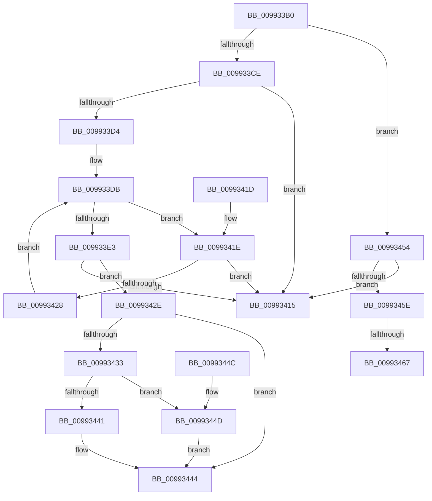

# RtlGetIntegerAtom

- RVA: `0x009933B0`–`0x0099346F` (길이 `191` bytes)
- VA: `0x00000001409933B0`
- 실행 섹션: `PAGE`
- PDB 이름 있음: `예`; PDB Function 태그: `예`
- unwind 정보 RVA: `0x00098ED8`
- 디코드: `56`개 명령, `191/191` bytes 표시
- 미해석 바이트: `0` (있으면 어셈블리에 `.byte`로 보존)

> 이 문서는 커널 이미지의 기계어와 PDB 기호를 분석해 생성했습니다. 4번과 5번은 함수 원형과 자료형을 바이너리 사용 방식에서 추정한 C 해석이며 원본 소스 복구 결과는 아닙니다.

## 1. Dependencies

- 직접 호출 지점: **1**; 고유 호출 대상: **1**
- 직접 호출자로 확인된 함수: **1**
- RIP 상대 이미지 참조: **0**

### Outgoing calls
- `0x0099340C` → [RtlUnicodeStringToInteger](RtlUnicodeStringToInteger_function_00993480.md) (function, `0x00993480`)

### Direct callers
- [RtlAddAtomToAtomTableEx](../../text/43/RtlAddAtomToAtomTableEx_function_00438550.md) at `0x004385A2`

### Static image references
- 디코드된 RIP-relative 메모리 참조가 없습니다.

## 2. Other-region calls and transfers

- 다른 실행 섹션으로 향하는 call: **0**
- call이 아닌 외부 분기/꼬리 이동: **2**
  - `0x00993461` → [sub_00B2BFAE](../B2/Unknown_function_00B2BFAE.md) (`tail-transfer`)
  - `0x0099346A` → [sub_00B2BFAE](../B2/Unknown_function_00B2BFAE.md) (`tail-transfer`)

## 3. Assembly (complete function range)

```asm
009933B0  40 53                           push rbx
009933B2  48 83 EC 30                     sub rsp, 0x30
009933B6  0F 57 C0                        xorps xmm0, xmm0
009933B9  48 8B DA                        mov rbx, rdx
009933BC  0F 11 44 24 20                  movups xmmword ptr [rsp + 0x20], xmm0
009933C1  48 F7 C1 00 00 FF FF            test rcx, -0x10000
009933C8  0F 84 86 00 00 00               je 0x140993454
009933CE  66 83 39 23                     cmp word ptr [rcx], 0x23
009933D2  75 41                           jne 0x140993415
009933D4  48 83 C1 02                     add rcx, 2
009933D8  48 8B C1                        mov rax, rcx
009933DB  0F B7 10                        movzx edx, word ptr [rax]
009933DE  66 85 D2                        test dx, dx
009933E1  75 3B                           jne 0x14099341e
009933E3  66 2B C1                        sub ax, cx
009933E6  48 89 4C 24 28                  mov qword ptr [rsp + 0x28], rcx
009933EB  48 8D 4C 24 20                  lea rcx, [rsp + 0x20]
009933F0  66 89 44 24 20                  mov word ptr [rsp + 0x20], ax
009933F5  4C 8D 44 24 40                  lea r8, [rsp + 0x40]
009933FA  66 89 44 24 22                  mov word ptr [rsp + 0x22], ax
009933FF  BA 0A 00 00 00                  mov edx, 0xa
00993404  C7 44 24 40 00 00 00 00         mov dword ptr [rsp + 0x40], 0
0099340C  E8 6F 00 00 00                  call 0x140993480
00993411  85 C0                           test eax, eax
00993413  79 19                           jns 0x14099342e
00993415  32 C0                           xor al, al
00993417  48 83 C4 30                     add rsp, 0x30
0099341B  5B                              pop rbx
0099341C  C3                              ret
0099341D  CC                              int3
0099341E  66 83 EA 30                     sub dx, 0x30
00993422  66 83 FA 09                     cmp dx, 9
00993426  77 ED                           ja 0x140993415
00993428  48 83 C0 02                     add rax, 2
0099342C  EB AD                           jmp 0x1409933db
0099342E  48 85 DB                        test rbx, rbx
00993431  74 11                           je 0x140993444
00993433  8B 4C 24 40                     mov ecx, dword ptr [rsp + 0x40]
00993437  8D 41 FF                        lea eax, [rcx - 1]
0099343A  3D FF BF 00 00                  cmp eax, 0xbfff
0099343F  77 0C                           ja 0x14099344d
00993441  66 89 0B                        mov word ptr [rbx], cx
00993444  B0 01                           mov al, 1
00993446  48 83 C4 30                     add rsp, 0x30
0099344A  5B                              pop rbx
0099344B  C3                              ret
0099344C  CC                              int3
0099344D  66 C7 03 00 C0                  mov word ptr [rbx], 0xc000
00993452  EB F0                           jmp 0x140993444
00993454  B8 00 C0 00 00                  mov eax, 0xc000
00993459  66 3B C8                        cmp cx, ax
0099345C  73 B7                           jae 0x140993415
0099345E  66 85 C9                        test cx, cx
00993461  0F 85 47 8B 19 00               jne 0x140b2bfae
00993467  0F B7 C8                        movzx ecx, ax
0099346A  E9 3F 8B 19 00                  jmp 0x140b2bfae
```

## 4. C-style interpretation (structured pseudocode)

```c
__int64 __fastcall RtlGetIntegerAtom(__int64 a1, __int64 a2)
{
    __int64 result;
    __int64 v_rsp;
    unsigned __int64 v_stack_m10;
    unsigned __int16 v_stack_m16;
    unsigned __int64 v_stack_m18;
    unsigned int v_stack_p40;
    unsigned __int64 v_stack_p8;

    v_rsp = (v_rsp) - (48);
    v_stack_m18 = v_xmm0;
    if (((a1) & (0xFFFFFFFFFFFF0000ULL)) == 0) goto loc_00993454;
    if ((*(unsigned __int16 *)(a1)) != 35) goto loc_00993415;
    a1 = (a1) + (2);
loc_009933DB:
    if ((unsigned __int16)(*(unsigned __int16 *)(a1)) != 0) goto loc_0099341E;
    result = (unsigned __int16)((a1) - ((unsigned __int16)(a1)));
    v_stack_m10 = a1;
    v_stack_m18 = (unsigned __int16)(result);
    v_stack_m16 = (unsigned __int16)(result);
    v_stack_p8 = 0;
    result = RtlUnicodeStringToInteger(v_stack_m18, 10, v_stack_p8, a4);
    if (!sign_flag) goto loc_0099342E;
loc_00993415:
    result = 0;
    v_rsp = (v_rsp) + (48);
    return result;
loc_0099341E:
    a2 = (unsigned __int16)((10) - (48));
    if (((unsigned __int16)(a2)) > 9) goto loc_00993415;
    result = (result) + (2);
    goto loc_009933DB;
loc_0099342E:
    if (a2 == 0) goto loc_00993444;
    if (((unsigned int)((unsigned int)(v_stack_p40) - 1)) > 0xBFFFULL) goto loc_0099344D;
    *(unsigned __int16 *)(a2) = (unsigned __int16)((unsigned int)(v_stack_p40));
loc_00993444:
    v_rsp = (v_rsp) + (48);
    return 1;
loc_0099344D:
    *(unsigned __int16 *)(a2) = 0xC000ULL;
    goto loc_00993444;
loc_00993454:
    if (((unsigned __int16)((unsigned int)(v_stack_p40))) >= ((unsigned __int16)((unsigned int)(0xC000ULL)))) goto loc_00993415;
}
```

## 5. (Beta) C Style

```c
int64_t RtlGetIntegerAtom(int64_t Arg1, int64_t Arg2)
{
    int64_t result;
    int64_t local_rsp;
    uint64_t v_stack_m10;
    uint16_t v_stack_m16;
    uint64_t v_stack_m18;
    uint32_t v_stack_p40;
    uint64_t v_stack_p8;

    local_rsp = (local_rsp) - (48);
    v_stack_m18 = v_xmm0;
    if (((Arg1) & (0xFFFFFFFFFFFF0000ULL)) == 0) goto loc_00993454;
    if ((*(uint16_t *)(Arg1)) != 35) goto loc_00993415;
    Arg1 = (Arg1) + (2);
loc_009933DB:
    if ((uint16_t)(*(uint16_t *)(Arg1)) != 0) goto loc_0099341E;
    result = (uint16_t)((Arg1) - ((uint16_t)(Arg1)));
    v_stack_m10 = Arg1;
    v_stack_m18 = (uint16_t)(result);
    v_stack_m16 = (uint16_t)(result);
    v_stack_p8 = 0;
    result = RtlUnicodeStringToInteger(v_stack_m18, 10, v_stack_p8, a4);
    if (!sign_flag) goto loc_0099342E;
loc_00993415:
    result = 0;
    local_rsp = (local_rsp) + (48);
    return result;
loc_0099341E:
    Arg2 = (uint16_t)((10) - (48));
    if (((uint16_t)(Arg2)) > 9) goto loc_00993415;
    result = (result) + (2);
    goto loc_009933DB;
loc_0099342E:
    if (Arg2 == 0) goto loc_00993444;
    if (((uint32_t)((uint32_t)(v_stack_p40) - 1)) > 0xBFFFULL) goto loc_0099344D;
    *(uint16_t *)(Arg2) = (uint16_t)((uint32_t)(v_stack_p40));
loc_00993444:
    local_rsp = (local_rsp) + (48);
    return 1;
loc_0099344D:
    *(uint16_t *)(Arg2) = 0xC000ULL;
    goto loc_00993444;
loc_00993454:
    if (((uint16_t)((uint32_t)(v_stack_p40))) >= ((uint16_t)((uint32_t)(0xC000ULL)))) goto loc_00993415;
}
```

## 6. Execution-region graph

[열기: 2D/3D 그래프와 함수 탐색 컨트롤 패널](../../../control-panel.html?section=page&rva=0x009933B0&view=graph)

- 2D 그래프는 위에서 아래로 흐르고, 3D 그래프는 빈 공간을 드래그해 회전합니다. Shift+드래그는 이동, 휠은 확대·축소, 함수 노드 선택은 대상 보고서 이동입니다.

### Static fallback


