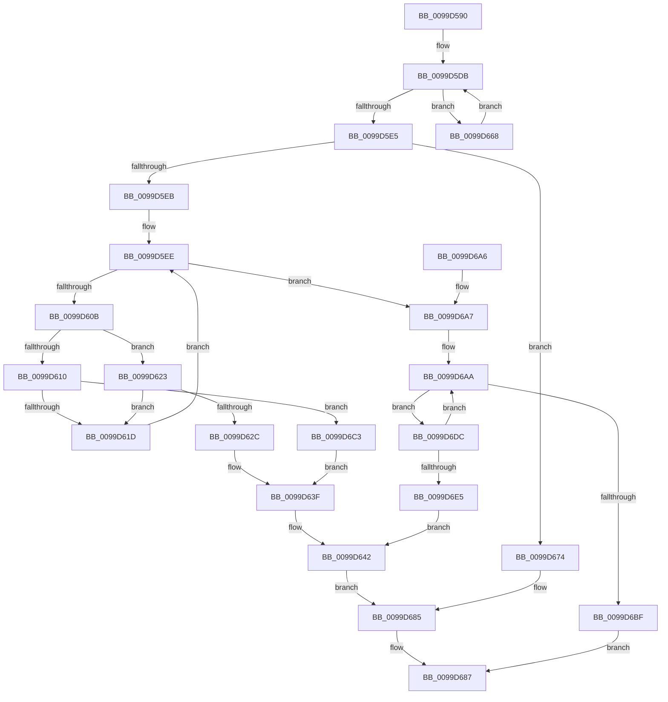

# RtlInsertUnicodePrefix

- RVA: `0x0099D590`–`0x0099D704` (길이 `372` bytes)
- VA: `0x000000014099D590`
- 실행 섹션: `PAGE`
- PDB 이름 있음: `예`; PDB Function 태그: `아니요`
- unwind 정보 RVA: `0x00099BE8`
- 디코드: `100`개 명령, `372/372` bytes 표시
- 미해석 바이트: `0` (있으면 어셈블리에 `.byte`로 보존)

> 이 문서는 커널 이미지의 기계어와 PDB 기호를 분석해 생성했습니다. 4번과 5번은 함수 원형과 자료형을 바이너리 사용 방식에서 추정한 C 해석이며 원본 소스 복구 결과는 아닙니다.

## 1. Dependencies

- 직접 호출 지점: **4**; 고유 호출 대상: **3**
- 직접 호출자로 확인된 함수: **0**
- RIP 상대 이미지 참조: **0**

### Outgoing calls
- `0x0099D5B9` → [ComputeUnicodeNameLength](ComputeUnicodeNameLength_function_0099D9E0.md) (function, `0x0099D9E0`)
- `0x0099D5F8` → [CompareUnicodeStrings](CompareUnicodeStrings_function_0099DA20.md) (function, `0x0099DA20`)
- `0x0099D650` → [RtlSplay](../../text/38/RtlSplay_function_0038F1E0.md) (function, `0x0038F1E0`)
- `0x0099D6B5` → [CompareUnicodeStrings](CompareUnicodeStrings_function_0099DA20.md) (function, `0x0099DA20`)

### Direct callers
- 이 함수 시작 RVA로 연결되는 직접 call은 확인되지 않았습니다. 간접 호출은 완전히 역산할 수 없습니다.

### Static image references
- 디코드된 RIP-relative 메모리 참조가 없습니다.

## 2. Other-region calls and transfers

- 다른 실행 섹션으로 향하는 call: **1**
  - `0x0099D650` → [RtlSplay](../../text/38/RtlSplay_function_0038F1E0.md) (`PAGE` → `.text`)
- 별도 외부 분기/꼬리 이동을 확인하지 못했습니다.

## 3. Assembly (complete function range)

```asm
0099D590  48 8B C4                        mov rax, rsp
0099D593  48 89 58 08                     mov qword ptr [rax + 8], rbx
0099D597  48 89 68 10                     mov qword ptr [rax + 0x10], rbp
0099D59B  48 89 70 18                     mov qword ptr [rax + 0x18], rsi
0099D59F  48 89 78 20                     mov qword ptr [rax + 0x20], rdi
0099D5A3  41 54                           push r12
0099D5A5  41 56                           push r14
0099D5A7  41 57                           push r15
0099D5A9  48 83 EC 20                     sub rsp, 0x20
0099D5AD  4C 8B F9                        mov r15, rcx
0099D5B0  49 8B D8                        mov rbx, r8
0099D5B3  48 8B CA                        mov rcx, rdx
0099D5B6  4C 8B E2                        mov r12, rdx
0099D5B9  E8 22 04 00 00                  call 0x14099d9e0
0099D5BE  66 89 43 02                     mov word ptr [rbx + 2], ax
0099D5C2  4C 8D 73 18                     lea r14, [rbx + 0x18]
0099D5C6  48 89 4B 30                     mov qword ptr [rbx + 0x30], rcx
0099D5CA  49 83 66 08 00                  and qword ptr [r14 + 8], 0
0099D5CF  49 83 66 10 00                  and qword ptr [r14 + 0x10], 0
0099D5D4  4D 89 36                        mov qword ptr [r14], r14
0099D5D7  49 8B 77 08                     mov rsi, qword ptr [r15 + 8]
0099D5DB  66 39 46 02                     cmp word ptr [rsi + 2], ax
0099D5DF  0F 8F 83 00 00 00               jg 0x14099d668
0099D5E5  0F 85 89 00 00 00               jne 0x14099d674
0099D5EB  48 8B FE                        mov rdi, rsi
0099D5EE  48 8B 4F 30                     mov rcx, qword ptr [rdi + 0x30]
0099D5F2  45 33 C0                        xor r8d, r8d
0099D5F5  49 8B D4                        mov rdx, r12
0099D5F8  E8 23 04 00 00                  call 0x14099da20
0099D5FD  B9 02 08 00 00                  mov ecx, 0x802
0099D602  83 F8 02                        cmp eax, 2
0099D605  0F 84 9C 00 00 00               je 0x14099d6a7
0099D60B  83 F8 03                        cmp eax, 3
0099D60E  74 13                           je 0x14099d623
0099D610  48 8B 47 28                     mov rax, qword ptr [rdi + 0x28]
0099D614  48 85 C0                        test rax, rax
0099D617  0F 84 A6 00 00 00               je 0x14099d6c3
0099D61D  48 8D 78 E8                     lea rdi, [rax - 0x18]
0099D621  EB CB                           jmp 0x14099d5ee
0099D623  48 8B 47 20                     mov rax, qword ptr [rdi + 0x20]
0099D627  48 85 C0                        test rax, rax
0099D62A  75 F1                           jne 0x14099d61d
0099D62C  48 21 43 08                     and qword ptr [rbx + 8], rax
0099D630  66 89 0B                        mov word ptr [rbx], cx
0099D633  48 8D 4F 18                     lea rcx, [rdi + 0x18]
0099D637  48 89 5B 10                     mov qword ptr [rbx + 0x10], rbx
0099D63B  4C 89 71 08                     mov qword ptr [rcx + 8], r14
0099D63F  49 89 0E                        mov qword ptr [r14], rcx
0099D642  48 8B 5E 08                     mov rbx, qword ptr [rsi + 8]
0099D646  48 83 66 08 00                  and qword ptr [rsi + 8], 0
0099D64B  66 C7 06 02 08                  mov word ptr [rsi], 0x802
0099D650  E8 8B 1B 9F FF                  call 0x14038f1e0
0099D655  48 83 E8 18                     sub rax, 0x18
0099D659  66 C7 00 01 08                  mov word ptr [rax], 0x801
0099D65E  49 89 47 08                     mov qword ptr [r15 + 8], rax
0099D662  48 89 58 08                     mov qword ptr [rax + 8], rbx
0099D666  EB 1D                           jmp 0x14099d685
0099D668  4C 8B FE                        mov r15, rsi
0099D66B  48 8B 76 08                     mov rsi, qword ptr [rsi + 8]
0099D66F  E9 67 FF FF FF                  jmp 0x14099d5db
0099D674  49 89 5F 08                     mov qword ptr [r15 + 8], rbx
0099D678  48 89 73 08                     mov qword ptr [rbx + 8], rsi
0099D67C  66 C7 03 01 08                  mov word ptr [rbx], 0x801
0099D681  48 89 5B 10                     mov qword ptr [rbx + 0x10], rbx
0099D685  B0 01                           mov al, 1
0099D687  48 8B 5C 24 40                  mov rbx, qword ptr [rsp + 0x40]
0099D68C  48 8B 6C 24 48                  mov rbp, qword ptr [rsp + 0x48]
0099D691  48 8B 74 24 50                  mov rsi, qword ptr [rsp + 0x50]
0099D696  48 8B 7C 24 58                  mov rdi, qword ptr [rsp + 0x58]
0099D69B  48 83 C4 20                     add rsp, 0x20
0099D69F  41 5F                           pop r15
0099D6A1  41 5E                           pop r14
0099D6A3  41 5C                           pop r12
0099D6A5  C3                              ret
0099D6A6  CC                              int3
0099D6A7  48 8B EF                        mov rbp, rdi
0099D6AA  48 8B 4D 30                     mov rcx, qword ptr [rbp + 0x30]
0099D6AE  41 83 C8 FF                     or r8d, 0xffffffff
0099D6B2  49 8B D4                        mov rdx, r12
0099D6B5  E8 66 03 00 00                  call 0x14099da20
0099D6BA  83 F8 02                        cmp eax, 2
0099D6BD  75 1D                           jne 0x14099d6dc
0099D6BF  32 C0                           xor al, al
0099D6C1  EB C4                           jmp 0x14099d687
0099D6C3  48 83 63 08 00                  and qword ptr [rbx + 8], 0
0099D6C8  66 89 0B                        mov word ptr [rbx], cx
0099D6CB  48 8D 4F 18                     lea rcx, [rdi + 0x18]
0099D6CF  48 89 5B 10                     mov qword ptr [rbx + 0x10], rbx
0099D6D3  4C 89 71 10                     mov qword ptr [rcx + 0x10], r14
0099D6D7  E9 63 FF FF FF                  jmp 0x14099d63f
0099D6DC  48 8B 6D 10                     mov rbp, qword ptr [rbp + 0x10]
0099D6E0  48 3B EF                        cmp rbp, rdi
0099D6E3  75 C5                           jne 0x14099d6aa
0099D6E5  48 83 63 08 00                  and qword ptr [rbx + 8], 0
0099D6EA  48 8D 4F 18                     lea rcx, [rdi + 0x18]
0099D6EE  66 C7 03 03 08                  mov word ptr [rbx], 0x803
0099D6F3  48 8B 47 10                     mov rax, qword ptr [rdi + 0x10]
0099D6F7  48 89 43 10                     mov qword ptr [rbx + 0x10], rax
0099D6FB  48 89 5F 10                     mov qword ptr [rdi + 0x10], rbx
0099D6FF  E9 3E FF FF FF                  jmp 0x14099d642
```

## 4. C-style interpretation (structured pseudocode)

```c
__int64 __fastcall RtlInsertUnicodePrefix(__int64 a1, __int64 a2, __int64 a3)
{
    __int64 result;
    __int64 v_rsp;
    unsigned __int64 v_stack_p10;
    unsigned __int64 v_stack_p18;
    unsigned __int64 v_stack_p20;
    unsigned __int64 v_stack_p8;

    *(unsigned __int64 *)(v_rsp + 8) = v_rbx;
    *(unsigned __int64 *)(v_rsp + 16) = v_rbp;
    *(unsigned __int64 *)(v_rsp + 24) = v_rsi;
    *(unsigned __int64 *)(v_rsp + 32) = v_rdi;
    v_rsp = (v_rsp) - (32);
    result = ComputeUnicodeNameLength(a2, a2, a3, a4);
    *(unsigned __int16 *)(a3 + 2) = (unsigned __int16)(result);
    *(unsigned __int64 *)(a3 + 48) = a2;
    *(unsigned __int64 *)(a3 + 24) = a3 + 24;
loc_0099D5DB:
    if ((*(unsigned __int16 *)(*(unsigned __int64 *)(a1 + 8) + 2)) > ((unsigned __int16)(result))) goto loc_0099D668;
    if ((*(unsigned __int16 *)(*(unsigned __int64 *)(a1 + 8) + 2)) != ((unsigned __int16)(result))) goto loc_0099D674;
loc_0099D5EE:
    a3 = 0;
    result = CompareUnicodeStrings(*(unsigned __int64 *)(*(unsigned __int64 *)(a1 + 8) + 48), a2, a3, a4);
    if (((unsigned int)(result)) == 2) goto loc_0099D6A7;
    if (((unsigned int)(result)) == 3) goto loc_0099D623;
    if (*(unsigned __int64 *)(*(unsigned __int64 *)(a1 + 8) + 40) == 0) goto loc_0099D6C3;
loc_0099D61D:
    goto loc_0099D5EE;
loc_0099D623:
    if (*(unsigned __int64 *)(*(unsigned __int64 *)(*(unsigned __int64 *)(a1 + 8) + 40) - 24 + 32) != 0) goto loc_0099D61D;
    *(unsigned __int16 *)(a3) = (unsigned __int16)((unsigned int)(0x802ULL));
    *(unsigned __int64 *)(a3 + 16) = 0;
    *(unsigned __int64 *)(*(unsigned __int64 *)(*(unsigned __int64 *)(a1 + 8) + 40) - 24 + 24 + 8) = a3 + 24;
loc_0099D63F:
    *(unsigned __int64 *)(a3 + 24) = *(unsigned __int64 *)(*(unsigned __int64 *)(a1 + 8) + 40) - 24 + 24;
loc_0099D642:
    *(unsigned __int16 *)(*(unsigned __int64 *)(a1 + 8)) = 0x802ULL;
    result = RtlSplay(*(unsigned __int64 *)(*(unsigned __int64 *)(a1 + 8) + 40) - 24 + 24, a2, a3, a4);
    result = (result) - (24);
    *(unsigned __int16 *)(result) = 0x801ULL;
    *(unsigned __int64 *)(a1 + 8) = result;
    *(unsigned __int64 *)(result + 8) = *(unsigned __int64 *)(*(unsigned __int64 *)(a1 + 8) + 8);
    goto loc_0099D685;
loc_0099D668:
    goto loc_0099D5DB;
loc_0099D674:
    *(unsigned __int64 *)(*(unsigned __int64 *)(a1 + 8) + 8) = *(unsigned __int64 *)(*(unsigned __int64 *)(a1 + 8) + 8);
    *(unsigned __int64 *)(*(unsigned __int64 *)(*(unsigned __int64 *)(a1 + 8) + 8) + 8) = *(unsigned __int64 *)(*(unsigned __int64 *)(a1 + 8) + 8);
    *(unsigned __int16 *)(*(unsigned __int64 *)(*(unsigned __int64 *)(a1 + 8) + 8)) = 0x801ULL;
    *(unsigned __int64 *)(*(unsigned __int64 *)(*(unsigned __int64 *)(a1 + 8) + 8) + 16) = *(unsigned __int64 *)(*(unsigned __int64 *)(a1 + 8) + 8);
loc_0099D685:
loc_0099D687:
    v_rsp = (v_rsp) + (32);
    return 1;
loc_0099D6A7:
loc_0099D6AA:
    a3 = (unsigned int)((a3) | (0xFFFFFFFFULL));
    result = CompareUnicodeStrings(*(unsigned __int64 *)(v_stack_p20 + 48), a2, a3, a4);
    if (((unsigned int)(result)) != 2) goto loc_0099D6DC;
    result = 0;
    goto loc_0099D687;
loc_0099D6C3:
    *(unsigned __int16 *)(v_stack_p8) = (unsigned __int16)(*(unsigned __int64 *)(v_stack_p20 + 48));
    *(unsigned __int64 *)(v_stack_p8 + 16) = v_stack_p8;
    *(unsigned __int64 *)(v_stack_p20 + 24 + 16) = a3 + 24;
    goto loc_0099D63F;
loc_0099D6DC:
    if ((*(unsigned __int64 *)(v_stack_p20 + 16)) != v_stack_p20) goto loc_0099D6AA;
    *(unsigned __int16 *)(v_stack_p8) = 0x803ULL;
    *(unsigned __int64 *)(v_stack_p8 + 16) = *(unsigned __int64 *)(v_stack_p20 + 16);
    *(unsigned __int64 *)(v_stack_p20 + 16) = v_stack_p8;
    goto loc_0099D642;
}
```

## 5. (Beta) C Style

```c
int64_t RtlInsertUnicodePrefix(void *Arg1, int64_t Arg2, void *Arg3)
{
    uint8_t *arg1 = (uint8_t *)Arg1;
    uint8_t *arg3 = (uint8_t *)Arg3;

    int64_t result;
    int64_t local_rsp;
    uint64_t v_stack_p10;
    uint64_t v_stack_p18;
    uint64_t v_stack_p20;
    uint64_t v_stack_p8;

    *(uint64_t *)(local_rsp + 0x8) = local_rbx;
    *(uint64_t *)(local_rsp + 0x10) = local_rbp;
    *(uint64_t *)(local_rsp + 0x18) = local_rsi;
    *(uint64_t *)(local_rsp + 0x20) = local_rdi;
    local_rsp = (local_rsp) - (32);
    result = ComputeUnicodeNameLength(Arg2, Arg2, Arg3, a4);
    *(uint16_t *)(arg3 + 0x2) = (uint16_t)(result);
    *(uint64_t *)(arg3 + 0x30) = Arg2;
    *(void **)(arg3 + 0x18) = Arg3 + 24;
loc_0099D5DB:
    if ((*(uint16_t *)(*(uint64_t *)(arg1 + 0x8) + 0x2)) > ((uint16_t)(result))) goto loc_0099D668;
    if ((*(uint16_t *)(*(uint64_t *)(arg1 + 0x8) + 0x2)) != ((uint16_t)(result))) goto loc_0099D674;
loc_0099D5EE:
    Arg3 = 0;
    result = CompareUnicodeStrings(*(uint64_t *)(*(uint64_t *)(arg1 + 0x8) + 0x30), Arg2, Arg3, a4);
    if (((uint32_t)(result)) == 2) goto loc_0099D6A7;
    if (((uint32_t)(result)) == 3) goto loc_0099D623;
    if (*(uint64_t *)(*(uint64_t *)(arg1 + 0x8) + 0x28) == 0) goto loc_0099D6C3;
loc_0099D61D:
    goto loc_0099D5EE;
loc_0099D623:
    if (*(uint64_t *)(*(uint64_t *)(*(uint64_t *)(arg1 + 0x8) + 0x28) - 0x18 + 0x20) != 0) goto loc_0099D61D;
    *(uint16_t *)(arg3) = (uint16_t)((uint32_t)(0x802ULL));
    *(uint64_t *)(arg3 + 0x10) = 0;
    *(void **)(*(uint64_t *)(*(uint64_t *)(arg1 + 0x8) + 0x28) - 0x18 + 0x18 + 0x8) = Arg3 + 24;
loc_0099D63F:
    *(uint64_t *)(arg3 + 0x18) = *(uint64_t *)(*(uint64_t *)(arg1 + 0x8) + 0x28) - 24 + 24;
loc_0099D642:
    *(uint16_t *)(*(uint64_t *)(arg1 + 0x8)) = 0x802ULL;
    result = RtlSplay(*(uint64_t *)(*(uint64_t *)(arg1 + 0x8) + 0x28) - 24 + 24, Arg2, Arg3, a4);
    result = (result) - (24);
    *(uint16_t *)(result) = 0x801ULL;
    *(uint64_t *)(arg1 + 0x8) = result;
    *(uint64_t *)(result + 0x8) = *(uint64_t *)(*(uint64_t *)(arg1 + 0x8) + 0x8);
    goto loc_0099D685;
loc_0099D668:
    goto loc_0099D5DB;
loc_0099D674:
    *(uint64_t *)(*(uint64_t *)(arg1 + 0x8) + 0x8) = *(uint64_t *)(*(uint64_t *)(arg1 + 0x8) + 0x8);
    *(uint64_t *)(*(uint64_t *)(*(uint64_t *)(arg1 + 0x8) + 0x8) + 0x8) = *(uint64_t *)(*(uint64_t *)(arg1 + 0x8) + 0x8);
    *(uint16_t *)(*(uint64_t *)(*(uint64_t *)(arg1 + 0x8) + 0x8)) = 0x801ULL;
    *(uint64_t *)(*(uint64_t *)(*(uint64_t *)(arg1 + 0x8) + 0x8) + 0x10) = *(uint64_t *)(*(uint64_t *)(arg1 + 0x8) + 0x8);
loc_0099D685:
loc_0099D687:
    local_rsp = (local_rsp) + (32);
    return 1;
loc_0099D6A7:
loc_0099D6AA:
    Arg3 = (uint32_t)((Arg3) | (0xFFFFFFFFULL));
    result = CompareUnicodeStrings(*(uint64_t *)(v_stack_p20 + 0x30), Arg2, Arg3, a4);
    if (((uint32_t)(result)) != 2) goto loc_0099D6DC;
    result = 0;
    goto loc_0099D687;
loc_0099D6C3:
    *(uint16_t *)(v_stack_p8) = (uint16_t)(*(uint64_t *)(v_stack_p20 + 0x30));
    *(uint64_t *)(v_stack_p8 + 0x10) = v_stack_p8;
    *(void **)(v_stack_p20 + 0x18 + 0x10) = Arg3 + 24;
    goto loc_0099D63F;
loc_0099D6DC:
    if ((*(uint64_t *)(v_stack_p20 + 0x10)) != v_stack_p20) goto loc_0099D6AA;
    *(uint16_t *)(v_stack_p8) = 0x803ULL;
    *(uint64_t *)(v_stack_p8 + 0x10) = *(uint64_t *)(v_stack_p20 + 0x10);
    *(uint64_t *)(v_stack_p20 + 0x10) = v_stack_p8;
    goto loc_0099D642;
}
```

### 관측된 메모리 오프셋

구조체 형식이 확인되지 않은 접근은 인자 기준의 오프셋으로만 기록했습니다.

| 기준 인자 | 오프셋 표현 | 폭 (bit) | 접근 |
|---|---:|---:|---|
| `Arg1` | `+ 0x8` | `64` | `R` |
| `Arg3` | `+ 0x0` | `16` | `W` |
| `Arg3` | `+ 0x0` | `64` | `W` |
| `Arg3` | `+ 0x2` | `16` | `W` |
| `Arg3` | `+ 0x8` | `64` | `R/W` |
| `Arg3` | `+ 0x8` | `64` | `W` |
| `Arg3` | `+ 0x10` | `64` | `R/W` |
| `Arg3` | `+ 0x10` | `64` | `W` |
| `Arg3` | `+ 0x18` | `64` | `R` |
| `Arg3` | `+ 0x30` | `64` | `W` |

## 6. Execution-region graph

[열기: 2D/3D 그래프와 함수 탐색 컨트롤 패널](../../../control-panel.html?section=page&rva=0x0099D590&view=graph)

- 2D 그래프는 위에서 아래로 흐르고, 3D 그래프는 빈 공간을 드래그해 회전합니다. Shift+드래그는 이동, 휠은 확대·축소, 함수 노드 선택은 대상 보고서 이동입니다.

### Static fallback


