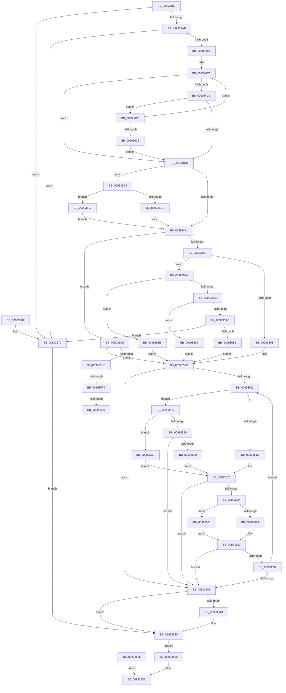

# RtlUnicodeStringToInteger

- RVA: `0x00993480`–`0x00993646` (길이 `454` bytes)
- VA: `0x0000000140993480`
- 실행 섹션: `PAGE`
- PDB 이름 있음: `예`; PDB Function 태그: `예`
- unwind 정보 RVA: `0x00098EF8`
- 디코드: `127`개 명령, `454/454` bytes 표시
- 미해석 바이트: `0` (있으면 어셈블리에 `.byte`로 보존)

> 이 문서는 커널 이미지의 기계어와 PDB 기호를 분석해 생성했습니다. 4번과 5번은 함수 원형과 자료형을 바이너리 사용 방식에서 추정한 C 해석이며 원본 소스 복구 결과는 아닙니다.

## 1. Dependencies

- 직접 호출 지점: **0**; 고유 호출 대상: **0**
- 직접 호출자로 확인된 함수: **15**
- RIP 상대 이미지 참조: **0**

### Outgoing calls
- 직접 디코드된 call 명령이 없습니다.

### Direct callers
- [RtlpMuiRegAddAlternateCodePage](../../text/6A/RtlpMuiRegAddAlternateCodePage_function_006A8EE4.md) at `0x006A9020`
- [PiDcInitUpdateProperties](../73/PiDcInitUpdateProperties_function_00730B3C.md) at `0x00730CFE`
- [RtlpQueryNlsSystemCodePages](../78/RtlpQueryNlsSystemCodePages_function_0078C33C.md) at `0x0078C44D`
- [RtlpQueryNlsSystemCodePages](../78/RtlpQueryNlsSystemCodePages_function_0078C33C.md) at `0x0078C4BA`
- [WdipSemLoadNextEndEvent](../7A/WdipSemLoadNextEndEvent_function_007AFAD0.md) at `0x007AFC97`
- [WdipSemLoadNextScenario](../7A/WdipSemLoadNextScenario_function_007AFDE0.md) at `0x007B001B`
- [CmpGetAcpiProfileInformation](../7E/CmpGetAcpiProfileInformation_function_007E3D7C.md) at `0x007E3F68`
- [PnpGetGenericStorePropertyKeys](PnpGetGenericStorePropertyKeys_function_00992378.md) at `0x0099257F`
- [RtlLookupAtomInAtomTable](RtlLookupAtomInAtomTable_function_00992DF0.md) at `0x00992EFE`
- [RtlGetIntegerAtom](RtlGetIntegerAtom_function_009933B0.md) at `0x0099340C`
- [PnpParseIndirectResourceString](../9D/PnpParseIndirectResourceString_function_009D3444.md) at `0x009D354F`
- [PiCMDeleteDeviceKey](../AD/PiCMDeleteDeviceKey_function_00AD6780.md) at `0x00AD690B`
- [sub_00B393C0](../B3/Unknown_function_00B393C0.md) at `0x00B3940A`
- [PopReadSimulatedArchitecturalClasses](../../init/C4/PopReadSimulatedArchitecturalClasses_function_00C41284.md) at `0x00C413B2`
- [PopReadSimulatedHGSClasses](../../init/C4/PopReadSimulatedHGSClasses_function_00C41470.md) at `0x00C416C4`
- [PsInitializeBootCpuPartitions](../../init/C4/PsInitializeBootCpuPartitions_function_00C44D94.md) at `0x00C44FF0`

### Static image references
- 디코드된 RIP-relative 메모리 참조가 없습니다.

## 2. Other-region calls and transfers

- 다른 실행 섹션으로 향하는 call: **0**
- call이 아닌 외부 분기/꼬리 이동: **3**
  - `0x009935EE` → [sub_00B2BFC0 + 0x3D](../B2/Unknown_function_00B2BFC0.md) (`tail-transfer`)
  - `0x00993603` → [sub_00B2BFC0](../B2/Unknown_function_00B2BFC0.md) (`tail-transfer`)
  - `0x00993612` → [sub_00B2BFC0 + 0x28](../B2/Unknown_function_00B2BFC0.md) (`tail-transfer`)

## 3. Assembly (complete function range)

```asm
00993480  48 89 5C 24 08                  mov qword ptr [rsp + 8], rbx
00993485  48 89 74 24 10                  mov qword ptr [rsp + 0x10], rsi
0099348A  48 89 7C 24 18                  mov qword ptr [rsp + 0x18], rdi
0099348F  4C 89 74 24 20                  mov qword ptr [rsp + 0x20], r14
00993494  4D 8B F0                        mov r14, r8
00993497  8B DA                           mov ebx, edx
00993499  45 33 C9                        xor r9d, r9d
0099349C  41 8B F1                        mov esi, r9d
0099349F  0F B7 01                        movzx eax, word ptr [rcx]
009934A2  66 85 C0                        test ax, ax
009934A5  0F 84 C5 00 00 00               je 0x140993570
009934AB  A8 01                           test al, 1
009934AD  0F 85 BD 00 00 00               jne 0x140993570
009934B3  4C 8B 51 08                     mov r10, qword ptr [rcx + 8]
009934B7  44 8B C0                        mov r8d, eax
009934BA  41 D1 E8                        shr r8d, 1
009934BD  41 0F B7 F9                     movzx edi, r9w
009934C1  41 8B C0                        mov eax, r8d
009934C4  41 FF C8                        dec r8d
009934C7  85 C0                           test eax, eax
009934C9  74 12                           je 0x1409934dd
009934CB  41 0F B7 3A                     movzx edi, word ptr [r10]
009934CF  49 83 C2 02                     add r10, 2
009934D3  66 83 FF 20                     cmp di, 0x20
009934D7  0F 86 42 01 00 00               jbe 0x14099361f
009934DD  0F B7 C7                        movzx eax, di
009934E0  8D 4F D5                        lea ecx, [rdi - 0x2b]
009934E3  BA FD FF 00 00                  mov edx, 0xfffd
009934E8  66 85 CA                        test dx, cx
009934EB  0F 84 D3 00 00 00               je 0x1409935c4
009934F1  49 8B CA                        mov rcx, r10
009934F4  41 8B D0                        mov edx, r8d
009934F7  85 DB                           test ebx, ebx
009934F9  0F 84 DA 00 00 00               je 0x1409935d9
009934FF  83 FB 10                        cmp ebx, 0x10
00993502  0F 85 92 00 00 00               jne 0x14099359a
00993508  44 8D 5B F4                     lea r11d, [rbx - 0xc]
0099350C  66 85 C0                        test ax, ax
0099350F  74 36                           je 0x140993547
00993511  8D 48 D0                        lea ecx, [rax - 0x30]
00993514  66 83 F9 09                     cmp cx, 9
00993518  77 5D                           ja 0x140993577
0099351A  0F B7 D0                        movzx edx, ax
0099351D  83 EA 30                        sub edx, 0x30
00993520  3B D3                           cmp edx, ebx
00993522  73 23                           jae 0x140993547
00993524  45 85 DB                        test r11d, r11d
00993527  74 68                           je 0x140993591
00993529  41 8B CB                        mov ecx, r11d
0099352C  41 D3 E1                        shl r9d, cl
0099352F  44 0B CA                        or r9d, edx
00993532  45 85 C0                        test r8d, r8d
00993535  74 10                           je 0x140993547
00993537  41 FF C8                        dec r8d
0099353A  41 0F B7 02                     movzx eax, word ptr [r10]
0099353E  49 83 C2 02                     add r10, 2
00993542  66 85 C0                        test ax, ax
00993545  75 CA                           jne 0x140993511
00993547  66 83 FF 2D                     cmp di, 0x2d
0099354B  75 03                           jne 0x140993550
0099354D  41 F7 D9                        neg r9d
00993550  90                              nop
00993551  45 89 0E                        mov dword ptr [r14], r9d
00993554  EB 02                           jmp 0x140993558
00993556  EB 02                           jmp 0x14099355a
00993558  8B C6                           mov eax, esi
0099355A  48 8B 5C 24 08                  mov rbx, qword ptr [rsp + 8]
0099355F  48 8B 74 24 10                  mov rsi, qword ptr [rsp + 0x10]
00993564  48 8B 7C 24 18                  mov rdi, qword ptr [rsp + 0x18]
00993569  4C 8B 74 24 20                  mov r14, qword ptr [rsp + 0x20]
0099356E  C3                              ret
0099356F  CC                              int3
00993570  BE 0D 00 00 C0                  mov esi, 0xc000000d
00993575  EB D9                           jmp 0x140993550
00993577  8D 48 BF                        lea ecx, [rax - 0x41]
0099357A  66 83 F9 05                     cmp cx, 5
0099357E  76 39                           jbe 0x1409935b9
00993580  8D 48 9F                        lea ecx, [rax - 0x61]
00993583  66 83 F9 05                     cmp cx, 5
00993587  77 BE                           ja 0x140993547
00993589  0F B7 D0                        movzx edx, ax
0099358C  83 EA 57                        sub edx, 0x57
0099358F  EB 8F                           jmp 0x140993520
00993591  44 0F AF CB                     imul r9d, ebx
00993595  44 03 CA                        add r9d, edx
00993598  EB 98                           jmp 0x140993532
0099359A  83 FB 02                        cmp ebx, 2
0099359D  0F 84 98 00 00 00               je 0x14099363b
009935A3  83 FB 08                        cmp ebx, 8
009935A6  0F 84 84 00 00 00               je 0x140993630
009935AC  83 FB 0A                        cmp ebx, 0xa
009935AF  75 BF                           jne 0x140993570
009935B1  45 8B D9                        mov r11d, r9d
009935B4  E9 53 FF FF FF                  jmp 0x14099350c
009935B9  0F B7 D0                        movzx edx, ax
009935BC  83 EA 37                        sub edx, 0x37
009935BF  E9 5C FF FF FF                  jmp 0x140993520
009935C4  45 85 C0                        test r8d, r8d
009935C7  74 4E                           je 0x140993617
009935C9  41 FF C8                        dec r8d
009935CC  41 0F B7 02                     movzx eax, word ptr [r10]
009935D0  49 83 C2 02                     add r10, 2
009935D4  E9 18 FF FF FF                  jmp 0x1409934f1
009935D9  BB 0A 00 00 00                  mov ebx, 0xa
009935DE  45 8B D9                        mov r11d, r9d
009935E1  66 83 F8 30                     cmp ax, 0x30
009935E5  0F 85 21 FF FF FF               jne 0x14099350c
009935EB  45 85 C0                        test r8d, r8d
009935EE  0F 84 09 8A 19 00               je 0x140b2bffd
009935F4  41 FF C8                        dec r8d
009935F7  41 0F B7 02                     movzx eax, word ptr [r10]
009935FB  49 83 C2 02                     add r10, 2
009935FF  66 83 F8 78                     cmp ax, 0x78
00993603  0F 85 B7 89 19 00               jne 0x140b2bfc0
00993609  BB 10 00 00 00                  mov ebx, 0x10
0099360E  44 8D 5B F4                     lea r11d, [rbx - 0xc]
00993612  E9 D1 89 19 00                  jmp 0x140b2bfe8
00993617  41 8B C1                        mov eax, r9d
0099361A  E9 D2 FE FF FF                  jmp 0x1409934f1
0099361F  45 85 C0                        test r8d, r8d
00993622  0F 85 99 FE FF FF               jne 0x1409934c1
00993628  41 8B F9                        mov edi, r9d
0099362B  E9 AD FE FF FF                  jmp 0x1409934dd
00993630  41 BB 03 00 00 00               mov r11d, 3
00993636  E9 D1 FE FF FF                  jmp 0x14099350c
0099363B  41 BB 01 00 00 00               mov r11d, 1
00993641  E9 C6 FE FF FF                  jmp 0x14099350c
```

## 4. C-style interpretation (structured pseudocode)

```c
__int64 __fastcall RtlUnicodeStringToInteger(__int64 a1, int a2, __int64 a3, int a4)
{
    __int64 v_r10;
    unsigned __int64 v_stack_p10;
    unsigned __int64 v_stack_p18;
    unsigned __int64 v_stack_p20;
    unsigned __int64 v_stack_p8;

    v_stack_p8 = v_rbx;
    v_stack_p10 = v_rsi;
    v_stack_p18 = v_rdi;
    v_stack_p20 = v_r14;
    a4 = 0;
    if ((unsigned __int16)(*(unsigned __int16 *)(a1)) == 0) goto loc_00993570;
    if ((((unsigned __int8)(*(unsigned __int16 *)(a1))) & (1)) != 0) goto loc_00993570;
    a3 = (unsigned int)(((unsigned int)((unsigned int)(*(unsigned __int16 *)(a1)))) >> (1));
loc_009934C1:
    a3 = (unsigned int)((a3) - 1);
    if ((unsigned int)((unsigned int)((unsigned int)(a3))) == 0) goto loc_009934DD;
    v_r10 = (*(unsigned __int64 *)(a1 + 8)) + (2);
    if (((unsigned __int16)(*(unsigned __int16 *)(*(unsigned __int64 *)(a1 + 8)))) <= 32) goto loc_0099361F;
loc_009934DD:
    if ((((unsigned __int16)((unsigned int)(0xFFFDULL))) & ((unsigned __int16)(*(unsigned __int16 *)(*(unsigned __int64 *)(a1 + 8)) - 43))) == 0) goto loc_009935C4;
loc_009934F1:
    if ((unsigned int)((unsigned int)(a2)) == 0) goto loc_009935D9;
    if (((unsigned int)((unsigned int)(a2))) != 16) goto loc_0099359A;
loc_0099350C:
    if ((unsigned __int16)((unsigned __int16)(*(unsigned __int16 *)(*(unsigned __int64 *)(a1 + 8)))) == 0) goto loc_00993547;
loc_00993511:
    if (((unsigned __int16)((unsigned __int16)(*(unsigned __int16 *)(*(unsigned __int64 *)(a1 + 8))) - 48)) > 9) goto loc_00993577;
    a2 = (unsigned int)(((unsigned __int16)((unsigned __int16)(*(unsigned __int16 *)(*(unsigned __int64 *)(a1 + 8))))) - (48));
loc_00993520:
    if (a2 >= ((unsigned int)((unsigned int)(a2)))) goto loc_00993547;
    if ((unsigned int)((unsigned int)(a2) - 12) == 0) goto loc_00993591;
    a4 = (unsigned int)((a4) << ((unsigned __int8)((unsigned int)((unsigned int)((unsigned int)(a2) - 12)))));
    a4 = (unsigned int)((a4) | (a2));
loc_00993532:
    if ((unsigned int)(a3) == 0) goto loc_00993547;
    a3 = (unsigned int)((a3) - 1);
    v_r10 = (v_r10) + (2);
    if ((unsigned __int16)(*(unsigned __int16 *)(v_r10)) != 0) goto loc_00993511;
loc_00993547:
    if (((unsigned __int16)(*(unsigned __int16 *)(*(unsigned __int64 *)(a1 + 8)))) == 45) {
        a4 = (unsigned int)(-(a4));
    }
    *(unsigned int *)(a3) = a4;
    goto loc_00993558;
loc_00993558:
loc_0099355A:
    return 0;
loc_00993570:
    goto loc_00993550;
loc_00993577:
    if (((unsigned __int16)(0 - 65)) <= 5) goto loc_009935B9;
    if (((unsigned __int16)(0 - 97)) > 5) goto loc_00993547;
    a2 = (unsigned int)((0) - (87));
    goto loc_00993520;
loc_00993591:
    a4 = (unsigned int)((a4) * ((unsigned int)(v_stack_p8)));
    a4 = (unsigned int)((a4) + (a2));
    goto loc_00993532;
loc_0099359A:
    if (((unsigned int)(v_stack_p8)) == 2) goto loc_0099363B;
    if (((unsigned int)(v_stack_p8)) == 8) goto loc_00993630;
    if (((unsigned int)(v_stack_p8)) != 10) goto loc_00993570;
    goto loc_0099350C;
loc_009935B9:
    a2 = (unsigned int)((0) - (55));
    goto loc_00993520;
loc_009935C4:
    if ((unsigned int)(a3) == 0) goto loc_00993617;
    a3 = (unsigned int)((a3) - 1);
    v_r10 = (v_r10) + (2);
    goto loc_009934F1;
loc_009935D9:
    if (((unsigned __int16)(*(unsigned __int16 *)(v_r10))) != 48) goto loc_0099350C;
    a3 = (unsigned int)((a3) - 1);
    v_r10 = (v_r10) + (2);
loc_00993617:
    goto loc_009934F1;
loc_0099361F:
    if ((unsigned int)(a3) != 0) goto loc_009934C1;
    goto loc_009934DD;
loc_00993630:
    goto loc_0099350C;
loc_0099363B:
    goto loc_0099350C;
}
```

## 5. (Beta) C Style

```c
int64_t RtlUnicodeStringToInteger(void *Arg1, int32_t Arg2, void *Arg3, int32_t Arg4)
{
    uint8_t *arg1 = (uint8_t *)Arg1;
    uint8_t *arg3 = (uint8_t *)Arg3;

    int64_t local_r10;
    uint64_t v_stack_p10;
    uint64_t v_stack_p18;
    uint64_t v_stack_p20;
    uint64_t v_stack_p8;

    v_stack_p8 = local_rbx;
    v_stack_p10 = local_rsi;
    v_stack_p18 = local_rdi;
    v_stack_p20 = local_r14;
    Arg4 = 0;
    if ((uint16_t)(*(uint16_t *)(arg1)) == 0) goto loc_00993570;
    if ((((uint8_t)(*(uint16_t *)(arg1))) & (1)) != 0) goto loc_00993570;
    Arg3 = (uint32_t)(((uint32_t)((uint32_t)(*(uint16_t *)(arg1)))) >> (1));
loc_009934C1:
    Arg3 = (uint32_t)((Arg3) - 1);
    if ((uint32_t)((uint32_t)((uint32_t)(Arg3))) == 0) goto loc_009934DD;
    local_r10 = (*(uint64_t *)(arg1 + 0x8)) + (2);
    if (((uint16_t)(*(uint16_t *)(*(uint64_t *)(arg1 + 0x8)))) <= 32) goto loc_0099361F;
loc_009934DD:
    if ((((uint16_t)((uint32_t)(0xFFFDULL))) & ((uint16_t)(*(uint16_t *)(*(uint64_t *)(arg1 + 0x8)) - 43))) == 0) goto loc_009935C4;
loc_009934F1:
    if ((uint32_t)((uint32_t)(Arg2)) == 0) goto loc_009935D9;
    if (((uint32_t)((uint32_t)(Arg2))) != 16) goto loc_0099359A;
loc_0099350C:
    if ((uint16_t)((uint16_t)(*(uint16_t *)(*(uint64_t *)(arg1 + 0x8)))) == 0) goto loc_00993547;
loc_00993511:
    if (((uint16_t)((uint16_t)(*(uint16_t *)(*(uint64_t *)(arg1 + 0x8))) - 48)) > 9) goto loc_00993577;
    Arg2 = (uint32_t)(((uint16_t)((uint16_t)(*(uint16_t *)(*(uint64_t *)(arg1 + 0x8))))) - (48));
loc_00993520:
    if (Arg2 >= ((uint32_t)((uint32_t)(Arg2)))) goto loc_00993547;
    if ((uint32_t)((uint32_t)(Arg2) - 12) == 0) goto loc_00993591;
    Arg4 = (uint32_t)((Arg4) << ((uint8_t)((uint32_t)((uint32_t)((uint32_t)(Arg2) - 12)))));
    Arg4 = (uint32_t)((Arg4) | (Arg2));
loc_00993532:
    if ((uint32_t)(Arg3) == 0) goto loc_00993547;
    Arg3 = (uint32_t)((Arg3) - 1);
    local_r10 = (local_r10) + (2);
    if ((uint16_t)(*(uint16_t *)(local_r10)) != 0) goto loc_00993511;
loc_00993547:
    if (((uint16_t)(*(uint16_t *)(*(uint64_t *)(arg1 + 0x8)))) == 45) {
        Arg4 = (uint32_t)(-(Arg4));
    }
    *(uint32_t *)(arg3) = Arg4;
    goto loc_00993558;
loc_00993558:
loc_0099355A:
    return 0;
loc_00993570:
    goto loc_00993550;
loc_00993577:
    if (((uint16_t)(0 - 65)) <= 5) goto loc_009935B9;
    if (((uint16_t)(0 - 97)) > 5) goto loc_00993547;
    Arg2 = (uint32_t)((0) - (87));
    goto loc_00993520;
loc_00993591:
    Arg4 = (uint32_t)((Arg4) * ((uint32_t)(v_stack_p8)));
    Arg4 = (uint32_t)((Arg4) + (Arg2));
    goto loc_00993532;
loc_0099359A:
    if (((uint32_t)(v_stack_p8)) == 2) goto loc_0099363B;
    if (((uint32_t)(v_stack_p8)) == 8) goto loc_00993630;
    if (((uint32_t)(v_stack_p8)) != 10) goto loc_00993570;
    goto loc_0099350C;
loc_009935B9:
    Arg2 = (uint32_t)((0) - (55));
    goto loc_00993520;
loc_009935C4:
    if ((uint32_t)(Arg3) == 0) goto loc_00993617;
    Arg3 = (uint32_t)((Arg3) - 1);
    local_r10 = (local_r10) + (2);
    goto loc_009934F1;
loc_009935D9:
    if (((uint16_t)(*(uint16_t *)(local_r10))) != 48) goto loc_0099350C;
    Arg3 = (uint32_t)((Arg3) - 1);
    local_r10 = (local_r10) + (2);
loc_00993617:
    goto loc_009934F1;
loc_0099361F:
    if ((uint32_t)(Arg3) != 0) goto loc_009934C1;
    goto loc_009934DD;
loc_00993630:
    goto loc_0099350C;
loc_0099363B:
    goto loc_0099350C;
}
```

### 관측된 메모리 오프셋

구조체 형식이 확인되지 않은 접근은 인자 기준의 오프셋으로만 기록했습니다.

| 기준 인자 | 오프셋 표현 | 폭 (bit) | 접근 |
|---|---:|---:|---|
| `Arg1` | `+ 0x0` | `16` | `R` |
| `Arg1` | `+ 0x8` | `64` | `R` |
| `Arg3` | `+ 0x0` | `32` | `W` |

## 6. Execution-region graph

[열기: 2D/3D 그래프와 함수 탐색 컨트롤 패널](../../../control-panel.html?section=page&rva=0x00993480&view=graph)

- 2D 그래프는 위에서 아래로 흐르고, 3D 그래프는 빈 공간을 드래그해 회전합니다. Shift+드래그는 이동, 휠은 확대·축소, 함수 노드 선택은 대상 보고서 이동입니다.

### Static fallback


