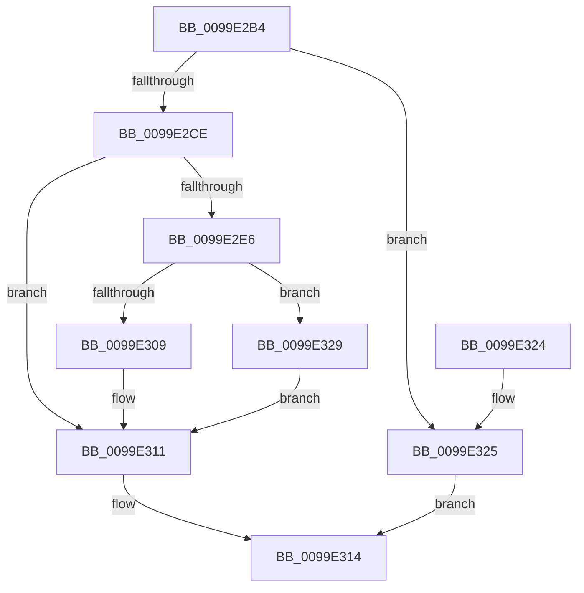

# RtlpAllocateAtom

- RVA: `0x0099E2B4`–`0x0099E337` (길이 `131` bytes)
- VA: `0x000000014099E2B4`
- 실행 섹션: `PAGE`
- PDB 이름 있음: `예`; PDB Function 태그: `아니요`
- unwind 정보 RVA: `0x0009A3D0`
- 디코드: `39`개 명령, `131/131` bytes 표시
- 미해석 바이트: `0` (있으면 어셈블리에 `.byte`로 보존)

> 이 문서는 커널 이미지의 기계어와 PDB 기호를 분석해 생성했습니다. 4번과 5번은 함수 원형과 자료형을 바이너리 사용 방식에서 추정한 C 해석이며 원본 소스 복구 결과는 아닙니다.

## 1. Dependencies

- 직접 호출 지점: **3**; 고유 호출 대상: **3**
- 직접 호출자로 확인된 함수: **3**
- RIP 상대 이미지 참조: **0**

### Outgoing calls
- `0x0099E2D9` → [ExAllocatePool2](../../poolcode/B8/ExAllocatePool2_function_00B820F0.md) (function, `0x00B820F0`)
- `0x0099E2FC` → [PsChargeSharedPoolQuota](PsChargeSharedPoolQuota_function_0099E340.md) (function, `0x0099E340`)
- `0x0099E32E` → [ExFreePoolWithTag](../../poolcode/B8/ExFreePoolWithTag_function_00B82870.md) (function, `0x00B82870`)

### Direct callers
- [RtlpAllocateAtomTableEntry](../../text/43/RtlpAllocateAtomTableEntry_function_004387CC.md) at `0x004387FB`
- [RtlpAllocateAtomTableEntry](../../text/43/RtlpAllocateAtomTableEntry_function_004387CC.md) at `0x00438872`
- [RtlpLookupOrCreateLowBox](../../text/43/RtlpLookupOrCreateLowBox_function_00438940.md) at `0x004389DB`
- [RtlCreateAtomTableEx](../../text/4A/RtlCreateAtomTableEx_function_004A0670.md) at `0x004A06BD`

### Static image references
- 디코드된 RIP-relative 메모리 참조가 없습니다.

## 2. Other-region calls and transfers

- 다른 실행 섹션으로 향하는 call: **2**
  - `0x0099E2D9` → [ExAllocatePool2](../../poolcode/B8/ExAllocatePool2_function_00B820F0.md) (`PAGE` → `POOLCODE`)
  - `0x0099E32E` → [ExFreePoolWithTag](../../poolcode/B8/ExFreePoolWithTag_function_00B82870.md) (`PAGE` → `POOLCODE`)
- 별도 외부 분기/꼬리 이동을 확인하지 못했습니다.

## 3. Assembly (complete function range)

```asm
0099E2B4  48 89 5C 24 08                  mov qword ptr [rsp + 8], rbx
0099E2B9  48 89 74 24 10                  mov qword ptr [rsp + 0x10], rsi
0099E2BE  57                              push rdi
0099E2BF  48 83 EC 20                     sub rsp, 0x20
0099E2C3  48 8D 79 10                     lea rdi, [rcx + 0x10]
0099E2C7  8B F2                           mov esi, edx
0099E2C9  48 3B F9                        cmp rdi, rcx
0099E2CC  72 57                           jb 0x14099e325
0099E2CE  44 8B C2                        mov r8d, edx
0099E2D1  B9 00 01 00 00                  mov ecx, 0x100
0099E2D6  48 8B D7                        mov rdx, rdi
0099E2D9  E8 12 3E 1E 00                  call 0x140b820f0
0099E2DE  48 8B D8                        mov rbx, rax
0099E2E1  48 85 C0                        test rax, rax
0099E2E4  74 2B                           je 0x14099e311
0099E2E6  65 48 8B 0C 25 88 01 00 00      mov rcx, qword ptr gs:[0x188]
0099E2EF  45 33 C0                        xor r8d, r8d
0099E2F2  48 8B D7                        mov rdx, rdi
0099E2F5  48 8B 89 B8 00 00 00            mov rcx, qword ptr [rcx + 0xb8]
0099E2FC  E8 3F 00 00 00                  call 0x14099e340
0099E301  48 89 03                        mov qword ptr [rbx], rax
0099E304  48 85 C0                        test rax, rax
0099E307  74 20                           je 0x14099e329
0099E309  48 89 7B 08                     mov qword ptr [rbx + 8], rdi
0099E30D  48 83 C3 10                     add rbx, 0x10
0099E311  48 8B C3                        mov rax, rbx
0099E314  48 8B 5C 24 30                  mov rbx, qword ptr [rsp + 0x30]
0099E319  48 8B 74 24 38                  mov rsi, qword ptr [rsp + 0x38]
0099E31E  48 83 C4 20                     add rsp, 0x20
0099E322  5F                              pop rdi
0099E323  C3                              ret
0099E324  CC                              int3
0099E325  33 C0                           xor eax, eax
0099E327  EB EB                           jmp 0x14099e314
0099E329  8B D6                           mov edx, esi
0099E32B  48 8B CB                        mov rcx, rbx
0099E32E  E8 3D 45 1E 00                  call 0x140b82870
0099E333  33 DB                           xor ebx, ebx
0099E335  EB DA                           jmp 0x14099e311
```

## 4. C-style interpretation (structured pseudocode)

```c
__int64 __fastcall RtlpAllocateAtom(__int64 a1, int a2)
{
    __int64 result;
    __int64 v_rbx;
    __int64 v_rsp;
    unsigned __int64 v_stack_p10;
    unsigned __int64 v_stack_p8;

    v_stack_p8 = v_rbx;
    v_stack_p10 = v_rsi;
    v_rsp = (v_rsp) - (32);
    if ((a1 + 16) < a1) goto loc_0099E325;
    result = ExAllocatePool2(256, a1 + 16, (unsigned int)(a2), a4);
    if (result == 0) goto loc_0099E311;
    a3 = 0;
    result = PsChargeSharedPoolQuota(*(unsigned __int64 *)(*(unsigned __int64 *)(gs_base + (0 + 392)) + 184), a1 + 16, a3, a4);
    *(unsigned __int64 *)(result) = result;
    if (result == 0) goto loc_0099E329;
    *(unsigned __int64 *)(result + 8) = a1 + 16;
    v_rbx = (result) + (16);
loc_0099E311:
loc_0099E314:
    v_rsp = (v_rsp) + (32);
    return v_rbx;
loc_0099E325:
    result = 0;
    goto loc_0099E314;
loc_0099E329:
    result = ExFreePoolWithTag(v_stack_p8, (unsigned int)((unsigned int)(v_stack_p10)), a3, a4);
    v_rbx = 0;
    goto loc_0099E311;
}
```

## 5. (Beta) C Style

```c
int64_t RtlpAllocateAtom(void *Arg1, int32_t Arg2)
{
    uint8_t *arg1 = (uint8_t *)Arg1;

    int64_t result;
    int64_t local_rbx;
    int64_t local_rsp;
    uint64_t v_stack_p10;
    uint64_t v_stack_p8;

    v_stack_p8 = local_rbx;
    v_stack_p10 = local_rsi;
    local_rsp = (local_rsp) - (32);
    if ((Arg1 + 16) < Arg1) goto loc_0099E325;
    result = ExAllocatePool2(256, Arg1 + 16, (uint32_t)(Arg2), a4);
    if (result == 0) goto loc_0099E311;
    a3 = 0;
    result = PsChargeSharedPoolQuota(*(uint64_t *)(*(uint64_t *)(gs_base + (0 + 0x188)) + 0xB8), Arg1 + 16, a3, a4);
    *(uint64_t *)(result) = result;
    if (result == 0) goto loc_0099E329;
    *(void **)(result + 0x8) = Arg1 + 16;
    local_rbx = (result) + (16);
loc_0099E311:
loc_0099E314:
    local_rsp = (local_rsp) + (32);
    return local_rbx;
loc_0099E325:
    result = 0;
    goto loc_0099E314;
loc_0099E329:
    result = ExFreePoolWithTag(v_stack_p8, (uint32_t)((uint32_t)(v_stack_p10)), a3, a4);
    local_rbx = 0;
    goto loc_0099E311;
}
```

### 관측된 메모리 오프셋

구조체 형식이 확인되지 않은 접근은 인자 기준의 오프셋으로만 기록했습니다.

| 기준 인자 | 오프셋 표현 | 폭 (bit) | 접근 |
|---|---:|---:|---|
| `Arg1` | `+ 0x10` | `64` | `R` |

## 6. Execution-region graph

[열기: 2D/3D 그래프와 함수 탐색 컨트롤 패널](../../../control-panel.html?section=page&rva=0x0099E2B4&view=graph)

- 2D 그래프는 위에서 아래로 흐르고, 3D 그래프는 빈 공간을 드래그해 회전합니다. Shift+드래그는 이동, 휠은 확대·축소, 함수 노드 선택은 대상 보고서 이동입니다.

### Static fallback


