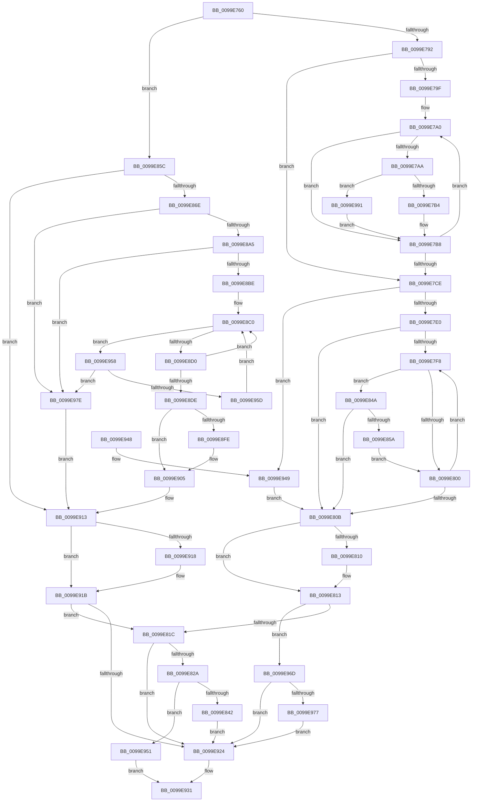

# RtlpHashStringToAtom

- RVA: `0x0099E760`–`0x0099E99E` (길이 `574` bytes)
- VA: `0x000000014099E760`
- 실행 섹션: `PAGE`
- PDB 이름 있음: `예`; PDB Function 태그: `아니요`
- unwind 정보 RVA: `0x0009AF1C`
- 디코드: `160`개 명령, `574/574` bytes 표시
- 미해석 바이트: `0` (있으면 어셈블리에 `.byte`로 보존)

> 이 문서는 커널 이미지의 기계어와 PDB 기호를 분석해 생성했습니다. 4번과 5번은 함수 원형과 자료형을 바이너리 사용 방식에서 추정한 C 해석이며 원본 소스 복구 결과는 아닙니다.

## 1. Dependencies

- 직접 호출 지점: **9**; 고유 호출 대상: **8**
- 직접 호출자로 확인된 함수: **2**
- RIP 상대 이미지 참조: **0**

### Outgoing calls
- `0x0099E834` → [RtlpLookupOrCreateLowBox](../../text/43/RtlpLookupOrCreateLowBox_function_00438940.md) (function, `0x00438940`)
- `0x0099E851` → [wcsicmp](../../text/50/wcsicmp_function_00500080.md) (function, `0x00500080`)
- `0x0099E8AD` → [ExpLookupHandleTableEntry](../86/ExpLookupHandleTableEntry_function_00869DB0.md) (function, `0x00869DB0`)
- `0x0099E8E1` → [ExGetHandlePointer](../../text/43/ExGetHandlePointer_function_00430C90.md) (function, `0x00430C90`)
- `0x0099E900` → [ExfUnblockPushLock](../../text/2A/ExfUnblockPushLock_function_002A3FE0.md) (function, `0x002A3FE0`)
- `0x0099E90E` → [KeLeaveCriticalRegionThread](../../text/25/KeLeaveCriticalRegionThread_function_0025EFF0.md) (function, `0x0025EFF0`)
- `0x0099E963` → [ExpBlockOnLockedHandleEntry](../86/ExpBlockOnLockedHandleEntry_function_00868838.md) (function, `0x00868838`)
- `0x0099E987` → [KeLeaveCriticalRegionThread](../../text/25/KeLeaveCriticalRegionThread_function_0025EFF0.md) (function, `0x0025EFF0`)
- `0x0099E994` → [RtlUpcaseUnicodeChar](../85/RtlUpcaseUnicodeChar_function_0085F0F0.md) (function, `0x0085F0F0`)

### Direct callers
- [RtlAddAtomToAtomTableEx](../../text/43/RtlAddAtomToAtomTableEx_function_00438550.md) at `0x004385E6`
- [RtlpFreeAllAtom](../../text/47/RtlpFreeAllAtom_function_00479244.md) at `0x0047927D`

### Static image references
- 디코드된 RIP-relative 메모리 참조가 없습니다.

## 2. Other-region calls and transfers

- 다른 실행 섹션으로 향하는 call: **6**
  - `0x0099E834` → [RtlpLookupOrCreateLowBox](../../text/43/RtlpLookupOrCreateLowBox_function_00438940.md) (`PAGE` → `.text`)
  - `0x0099E851` → [wcsicmp](../../text/50/wcsicmp_function_00500080.md) (`PAGE` → `.text`)
  - `0x0099E8E1` → [ExGetHandlePointer](../../text/43/ExGetHandlePointer_function_00430C90.md) (`PAGE` → `.text`)
  - `0x0099E900` → [ExfUnblockPushLock](../../text/2A/ExfUnblockPushLock_function_002A3FE0.md) (`PAGE` → `.text`)
  - `0x0099E90E` → [KeLeaveCriticalRegionThread](../../text/25/KeLeaveCriticalRegionThread_function_0025EFF0.md) (`PAGE` → `.text`)
  - `0x0099E987` → [KeLeaveCriticalRegionThread](../../text/25/KeLeaveCriticalRegionThread_function_0025EFF0.md) (`PAGE` → `.text`)
- 별도 외부 분기/꼬리 이동을 확인하지 못했습니다.

## 3. Assembly (complete function range)

```asm
0099E760  48 89 5C 24 08                  mov qword ptr [rsp + 8], rbx
0099E765  48 89 6C 24 18                  mov qword ptr [rsp + 0x18], rbp
0099E76A  56                              push rsi
0099E76B  57                              push rdi
0099E76C  41 54                           push r12
0099E76E  41 56                           push r14
0099E770  41 57                           push r15
0099E772  48 83 EC 20                     sub rsp, 0x20
0099E776  33 F6                           xor esi, esi
0099E778  4D 8B F9                        mov r15, r9
0099E77B  45 0F B6 E0                     movzx r12d, r8b
0099E77F  4C 8B F2                        mov r14, rdx
0099E782  48 8B E9                        mov rbp, rcx
0099E785  48 F7 C2 00 00 FF FF            test rdx, -0x10000
0099E78C  0F 84 CA 00 00 00               je 0x14099e85c
0099E792  0F B7 02                        movzx eax, word ptr [rdx]
0099E795  48 8B DA                        mov rbx, rdx
0099E798  8B FE                           mov edi, esi
0099E79A  66 85 C0                        test ax, ax
0099E79D  74 2F                           je 0x14099e7ce
0099E79F  90                              nop
0099E7A0  48 83 C3 02                     add rbx, 2
0099E7A4  66 83 F8 61                     cmp ax, 0x61
0099E7A8  72 0E                           jb 0x14099e7b8
0099E7AA  66 83 F8 7A                     cmp ax, 0x7a
0099E7AE  0F 87 DD 01 00 00               ja 0x14099e991
0099E7B4  66 83 E8 20                     sub ax, 0x20
0099E7B8  0F B7 C8                        movzx ecx, ax
0099E7BB  8B C1                           mov eax, ecx
0099E7BD  D1 E8                           shr eax, 1
0099E7BF  03 C1                           add eax, ecx
0099E7C1  8D 0C 48                        lea ecx, [rax + rcx*2]
0099E7C4  0F B7 03                        movzx eax, word ptr [rbx]
0099E7C7  03 F9                           add edi, ecx
0099E7C9  66 85 C0                        test ax, ax
0099E7CC  75 D2                           jne 0x14099e7a0
0099E7CE  49 2B DE                        sub rbx, r14
0099E7D1  48 D1 FB                        sar rbx, 1
0099E7D4  81 FB FF 00 00 00               cmp ebx, 0xff
0099E7DA  0F 87 69 01 00 00               ja 0x14099e949
0099E7E0  33 D2                           xor edx, edx
0099E7E2  48 8D 75 20                     lea rsi, [rbp + 0x20]
0099E7E6  8B C7                           mov eax, edi
0099E7E8  F7 75 1C                        div dword ptr [rbp + 0x1c]
0099E7EB  48 8B 3C D6                     mov rdi, qword ptr [rsi + rdx*8]
0099E7EF  48 8D 34 D6                     lea rsi, [rsi + rdx*8]
0099E7F3  48 85 FF                        test rdi, rdi
0099E7F6  74 13                           je 0x14099e80b
0099E7F8  0F B6 47 28                     movzx eax, byte ptr [rdi + 0x28]
0099E7FC  3B C3                           cmp eax, ebx
0099E7FE  74 4A                           je 0x14099e84a
0099E800  48 8B F7                        mov rsi, rdi
0099E803  48 8B 3F                        mov rdi, qword ptr [rdi]
0099E806  48 85 FF                        test rdi, rdi
0099E809  75 ED                           jne 0x14099e7f8
0099E80B  4D 85 FF                        test r15, r15
0099E80E  74 03                           je 0x14099e813
0099E810  49 89 37                        mov qword ptr [r15], rsi
0099E813  48 85 FF                        test rdi, rdi
0099E816  0F 84 51 01 00 00               je 0x14099e96d
0099E81C  48 8B 5C 24 78                  mov rbx, qword ptr [rsp + 0x78]
0099E821  48 85 DB                        test rbx, rbx
0099E824  0F 84 FA 00 00 00               je 0x14099e924
0099E82A  45 0F B6 C4                     movzx r8d, r12b
0099E82E  48 8B D7                        mov rdx, rdi
0099E831  48 8B CD                        mov rcx, rbp
0099E834  E8 07 A1 A9 FF                  call 0x140438940
0099E839  48 85 C0                        test rax, rax
0099E83C  0F 84 0F 01 00 00               je 0x14099e951
0099E842  48 89 03                        mov qword ptr [rbx], rax
0099E845  E9 DA 00 00 00                  jmp 0x14099e924
0099E84A  48 8D 4F 2A                     lea rcx, [rdi + 0x2a]
0099E84E  49 8B D6                        mov rdx, r14
0099E851  E8 2A 18 B6 FF                  call 0x140500080
0099E856  85 C0                           test eax, eax
0099E858  74 B1                           je 0x14099e80b
0099E85A  EB A4                           jmp 0x14099e800
0099E85C  B8 00 C0 00 00                  mov eax, 0xc000
0099E861  48 8B FE                        mov rdi, rsi
0099E864  66 44 3B F0                     cmp r14w, ax
0099E868  0F 82 A5 00 00 00               jb 0x14099e913
0099E86E  65 48 8B 04 25 88 01 00 00      mov rax, qword ptr gs:[0x188]
0099E877  41 81 E6 FF 3F 00 00            and r14d, 0x3fff
0099E87E  41 C1 E6 02                     shl r14d, 2
0099E882  48 89 74 24 58                  mov qword ptr [rsp + 0x58], rsi
0099E887  44 89 74 24 58                  mov dword ptr [rsp + 0x58], r14d
0099E88C  66 FF 88 E4 01 00 00            dec word ptr [rax + 0x1e4]
0099E893  90                              nop
0099E894  48 8B 79 10                     mov rdi, qword ptr [rcx + 0x10]
0099E898  41 F7 C6 FC 03 00 00            test r14d, 0x3fc
0099E89F  0F 84 D9 00 00 00               je 0x14099e97e
0099E8A5  48 8B 54 24 58                  mov rdx, qword ptr [rsp + 0x58]
0099E8AA  48 8B CF                        mov rcx, rdi
0099E8AD  E8 FE B4 EC FF                  call 0x140869db0
0099E8B2  48 8B D8                        mov rbx, rax
0099E8B5  48 85 C0                        test rax, rax
0099E8B8  0F 84 C0 00 00 00               je 0x14099e97e
0099E8BE  66 90                           nop
0099E8C0  0F 0D 0B                        prefetchw byte ptr [rbx]
0099E8C3  4C 8B 03                        mov r8, qword ptr [rbx]
0099E8C6  41 F6 C0 01                     test r8b, 1
0099E8CA  0F 84 88 00 00 00               je 0x14099e958
0099E8D0  49 8D 48 FF                     lea rcx, [r8 - 1]
0099E8D4  49 8B C0                        mov rax, r8
0099E8D7  F0 48 0F B1 0B                  lock cmpxchg qword ptr [rbx], rcx
0099E8DC  75 E2                           jne 0x14099e8c0
0099E8DE  48 8B CB                        mov rcx, rbx
0099E8E1  E8 AA 23 A9 FF                  call 0x140430c90
0099E8E6  48 8B 4D 10                     mov rcx, qword ptr [rbp + 0x10]
0099E8EA  48 8B F8                        mov rdi, rax
0099E8ED  F0 48 FF 03                     lock inc qword ptr [rbx]
0099E8F1  48 83 C1 30                     add rcx, 0x30
0099E8F5  F0 09 34 24                     lock or dword ptr [rsp], esi
0099E8F9  48 39 31                        cmp qword ptr [rcx], rsi
0099E8FC  74 07                           je 0x14099e905
0099E8FE  33 D2                           xor edx, edx
0099E900  E8 DB 56 90 FF                  call 0x1402a3fe0
0099E905  65 48 8B 0C 25 88 01 00 00      mov rcx, qword ptr gs:[0x188]
0099E90E  E8 DD 06 8C FF                  call 0x14025eff0
0099E913  4D 85 FF                        test r15, r15
0099E916  74 03                           je 0x14099e91b
0099E918  49 89 37                        mov qword ptr [r15], rsi
0099E91B  48 85 FF                        test rdi, rdi
0099E91E  0F 85 F8 FE FF FF               jne 0x14099e81c
0099E924  48 8B 84 24 80 00 00 00         mov rax, qword ptr [rsp + 0x80]
0099E92C  48 89 38                        mov qword ptr [rax], rdi
0099E92F  33 C0                           xor eax, eax
0099E931  48 8B 5C 24 50                  mov rbx, qword ptr [rsp + 0x50]
0099E936  48 8B 6C 24 60                  mov rbp, qword ptr [rsp + 0x60]
0099E93B  48 83 C4 20                     add rsp, 0x20
0099E93F  41 5F                           pop r15
0099E941  41 5E                           pop r14
0099E943  41 5C                           pop r12
0099E945  5F                              pop rdi
0099E946  5E                              pop rsi
0099E947  C3                              ret
0099E948  CC                              int3
0099E949  48 8B FE                        mov rdi, rsi
0099E94C  E9 BA FE FF FF                  jmp 0x14099e80b
0099E951  B8 17 00 00 C0                  mov eax, 0xc0000017
0099E956  EB D9                           jmp 0x14099e931
0099E958  4D 85 C0                        test r8, r8
0099E95B  74 21                           je 0x14099e97e
0099E95D  48 8B D3                        mov rdx, rbx
0099E960  48 8B CF                        mov rcx, rdi
0099E963  E8 D0 9E EC FF                  call 0x140868838
0099E968  E9 53 FF FF FF                  jmp 0x14099e8c0
0099E96D  48 8B 4C 24 70                  mov rcx, qword ptr [rsp + 0x70]
0099E972  48 85 C9                        test rcx, rcx
0099E975  74 AD                           je 0x14099e924
0099E977  8D 04 1B                        lea eax, [rbx + rbx]
0099E97A  89 01                           mov dword ptr [rcx], eax
0099E97C  EB A6                           jmp 0x14099e924
0099E97E  65 48 8B 0C 25 88 01 00 00      mov rcx, qword ptr gs:[0x188]
0099E987  E8 64 06 8C FF                  call 0x14025eff0
0099E98C  48 8B FE                        mov rdi, rsi
0099E98F  EB 82                           jmp 0x14099e913
0099E991  0F B7 C8                        movzx ecx, ax
0099E994  E8 57 07 EC FF                  call 0x14085f0f0
0099E999  E9 1A FE FF FF                  jmp 0x14099e7b8
```

## 4. C-style interpretation (structured pseudocode)

```c
__int64 __fastcall RtlpHashStringToAtom(__int64 a1, __int64 a2, unsigned __int8 a3, __int64 a4, __int64 a5, __int64 a6, __int64 a7)
{
    __int64 result;
    __int64 v_r14;
    __int64 v_rbx;
    __int64 v_rdi;
    __int64 v_rsi;
    __int64 v_rsp;
    unsigned int v_stack_m48;
    unsigned __int64 v_stack_p10;
    unsigned __int64 v_stack_p18;
    unsigned __int64 v_stack_p8;

    v_stack_p8 = v_rbx;
    v_stack_p18 = v_rbp;
    v_rsp = (v_rsp) - (32);
    v_rsi = 0;
    if (((a2) & (0xFFFFFFFFFFFF0000ULL)) == 0) goto loc_0099E85C;
    if ((unsigned __int16)(*(unsigned __int16 *)(a2)) == 0) goto loc_0099E7CE;
loc_0099E7A0:
    v_rbx = (a2) + (2);
    if (((unsigned __int16)(*(unsigned __int16 *)(a2))) < 97) goto loc_0099E7B8;
    if (((unsigned __int16)(*(unsigned __int16 *)(a2))) > 122) goto loc_0099E991;
    result = (unsigned __int16)((*(unsigned __int16 *)(a2)) - (32));
loc_0099E7B8:
    result = (unsigned int)(((unsigned int)((unsigned int)((unsigned __int16)(result)))) >> (1));
    result = (unsigned int)((result) + ((unsigned int)((unsigned __int16)(result))));
    v_rdi = (unsigned int)((0) + ((unsigned int)(result + (unsigned __int16)(result) * 2)));
    if ((unsigned __int16)(*(unsigned __int16 *)(v_rbx)) != 0) goto loc_0099E7A0;
loc_0099E7CE:
    v_rbx = (v_rbx) - (a2);
    v_rbx = (v_rbx) >> (1);
    if (((unsigned int)(v_rbx)) > 255) goto loc_0099E949;
    a2 = 0;
    if (*(unsigned __int64 *)(a1 + 32 + a2 * 8) == 0) goto loc_0099E80B;
loc_0099E7F8:
    if (((unsigned int)(*(unsigned __int8 *)(*(unsigned __int64 *)(a1 + 32 + a2 * 8) + 40))) == ((unsigned int)(v_rbx))) goto loc_0099E84A;
loc_0099E800:
    if (*(unsigned __int64 *)(*(unsigned __int64 *)(a1 + 32 + a2 * 8)) != 0) goto loc_0099E7F8;
loc_0099E80B:
    if (a4 != 0) {
        *(unsigned __int64 *)(a4) = *(unsigned __int64 *)(a1 + 32 + a2 * 8);
    }
    if (*(unsigned __int64 *)(*(unsigned __int64 *)(a1 + 32 + a2 * 8)) == 0) goto loc_0099E96D;
loc_0099E81C:
    if (a6 == 0) goto loc_0099E924;
    result = RtlpLookupOrCreateLowBox(a1, *(unsigned __int64 *)(*(unsigned __int64 *)(a1 + 32 + a2 * 8)), a3, a4);
    if (result == 0) goto loc_0099E951;
    *(unsigned __int64 *)(a6) = result;
    goto loc_0099E924;
loc_0099E84A:
    result = wcsicmp(*(unsigned __int64 *)(*(unsigned __int64 *)(a1 + 32 + a2 * 8)) + 42, 0, a3, a4);
    if ((unsigned int)(result) == 0) goto loc_0099E80B;
    goto loc_0099E800;
loc_0099E85C:
    if (0 < ((unsigned __int16)((unsigned int)(0xC000ULL)))) goto loc_0099E913;
    v_r14 = (unsigned int)((a2) & (0x3FFFULL));
    v_r14 = (unsigned int)((v_r14) << (2));
    v_stack_p10 = *(unsigned __int64 *)(a1 + 32 + a2 * 8);
    v_stack_p10 = (unsigned int)(v_r14);
    if ((((unsigned int)(v_r14)) & (0x3FCULL)) == 0) goto loc_0099E97E;
    result = ExpLookupHandleTableEntry(*(unsigned __int64 *)(*(unsigned __int64 *)(*(unsigned __int64 *)(a1 + 32 + a2 * 8)) + 42 + 16), v_stack_p10, a3, a4);
    if (result == 0) goto loc_0099E97E;
loc_0099E8C0:
    if ((((unsigned __int8)(*(unsigned __int64 *)(result))) & (1)) == 0) goto loc_0099E958;
    if ((((unsigned __int8)(*(unsigned __int64 *)(result))) & (1)) != 0) goto loc_0099E8C0;
    result = ExGetHandlePointer(result, v_stack_p10, *(unsigned __int64 *)(result), a4);
    a1 = (*(unsigned __int64 *)(a1 + 16)) + (48);
    if ((*(unsigned __int64 *)(a1)) != (*(unsigned __int64 *)(a1 + 32 + a2 * 8))) {
        a2 = 0;
        result = ExfUnblockPushLock(a1, a2, *(unsigned __int64 *)(result), a4);
    }
    result = KeLeaveCriticalRegionThread(*(unsigned __int64 *)(gs_base + (0 + 392)), a2, *(unsigned __int64 *)(result), a4);
loc_0099E913:
    if (a4 != 0) {
        *(unsigned __int64 *)(a4) = *(unsigned __int64 *)(a1 + 32 + a2 * 8);
    }
    if (result != 0) goto loc_0099E81C;
loc_0099E924:
    *(unsigned __int64 *)(a7) = result;
    result = 0;
loc_0099E931:
    v_rsp = (v_rsp) + (32);
    return result;
loc_0099E949:
    goto loc_0099E80B;
loc_0099E951:
    goto loc_0099E931;
loc_0099E958:
    if (*(unsigned __int64 *)(result) == 0) goto loc_0099E97E;
    result = ExpBlockOnLockedHandleEntry(*(unsigned __int64 *)(a1 + 32 + a2 * 8), v_stack_p8, *(unsigned __int64 *)(result), a4);
    goto loc_0099E8C0;
loc_0099E96D:
    if (a5 == 0) goto loc_0099E924;
    *(unsigned int *)(a5) = (unsigned int)(v_stack_p8 + v_stack_p8 * 1);
    goto loc_0099E924;
loc_0099E97E:
    result = KeLeaveCriticalRegionThread(*(unsigned __int64 *)(gs_base + (0 + 392)), v_stack_p8, *(unsigned __int64 *)(result), a4);
    goto loc_0099E913;
loc_0099E991:
    result = RtlUpcaseUnicodeChar((unsigned __int16)(result), v_stack_p8, *(unsigned __int64 *)(result), a4);
    goto loc_0099E7B8;
}
```

## 5. (Beta) C Style

```c
int64_t RtlpHashStringToAtom(void *Arg1, int64_t Arg2, uint8_t Arg3, int64_t Arg4, int64_t Arg5, int64_t Arg6, void *Arg7)
{
    uint8_t *arg1 = (uint8_t *)Arg1;
    uint8_t *arg7 = (uint8_t *)Arg7;

    int64_t result;
    int64_t local_r14;
    int64_t local_rbx;
    int64_t local_rdi;
    int64_t local_rsi;
    int64_t local_rsp;
    uint32_t v_stack_m48;
    uint64_t v_stack_p10;
    uint64_t v_stack_p18;
    uint64_t v_stack_p8;

    v_stack_p8 = local_rbx;
    v_stack_p18 = local_rbp;
    local_rsp = (local_rsp) - (32);
    local_rsi = 0;
    if (((Arg2) & (0xFFFFFFFFFFFF0000ULL)) == 0) goto loc_0099E85C;
    if ((uint16_t)(*(uint16_t *)(Arg2)) == 0) goto loc_0099E7CE;
loc_0099E7A0:
    local_rbx = (Arg2) + (2);
    if (((uint16_t)(*(uint16_t *)(Arg2))) < 97) goto loc_0099E7B8;
    if (((uint16_t)(*(uint16_t *)(Arg2))) > 122) goto loc_0099E991;
    result = (uint16_t)((*(uint16_t *)(Arg2)) - (32));
loc_0099E7B8:
    result = (uint32_t)(((uint32_t)((uint32_t)((uint16_t)(result)))) >> (1));
    result = (uint32_t)((result) + ((uint32_t)((uint16_t)(result))));
    local_rdi = (uint32_t)((0) + ((uint32_t)(result + (uint16_t)(result) * 2)));
    if ((uint16_t)(*(uint16_t *)(local_rbx)) != 0) goto loc_0099E7A0;
loc_0099E7CE:
    local_rbx = (local_rbx) - (Arg2);
    local_rbx = (local_rbx) >> (1);
    if (((uint32_t)(local_rbx)) > 255) goto loc_0099E949;
    Arg2 = 0;
    if (*(uint64_t *)(arg1 + 0x20 + Arg2 * 8) == 0) goto loc_0099E80B;
loc_0099E7F8:
    if (((uint32_t)(*(uint8_t *)(*(uint64_t *)(arg1 + 0x20 + Arg2 * 8) + 0x28))) == ((uint32_t)(local_rbx))) goto loc_0099E84A;
loc_0099E800:
    if (*(uint64_t *)(*(uint64_t *)(arg1 + 0x20 + Arg2 * 8)) != 0) goto loc_0099E7F8;
loc_0099E80B:
    if (Arg4 != 0) {
        *(uint64_t *)(Arg4) = *(uint64_t *)(arg1 + 0x20 + Arg2 * 8);
    }
    if (*(uint64_t *)(*(uint64_t *)(arg1 + 0x20 + Arg2 * 8)) == 0) goto loc_0099E96D;
loc_0099E81C:
    if (Arg6 == 0) goto loc_0099E924;
    result = RtlpLookupOrCreateLowBox(Arg1, *(uint64_t *)(*(uint64_t *)(arg1 + 0x20 + Arg2 * 8)), Arg3, Arg4);
    if (result == 0) goto loc_0099E951;
    *(uint64_t *)(Arg6) = result;
    goto loc_0099E924;
loc_0099E84A:
    result = wcsicmp(*(uint64_t *)(*(uint64_t *)(arg1 + 0x20 + Arg2 * 8)) + 42, 0, Arg3, Arg4);
    if ((uint32_t)(result) == 0) goto loc_0099E80B;
    goto loc_0099E800;
loc_0099E85C:
    if (0 < ((uint16_t)((uint32_t)(0xC000ULL)))) goto loc_0099E913;
    local_r14 = (uint32_t)((Arg2) & (0x3FFFULL));
    local_r14 = (uint32_t)((local_r14) << (2));
    v_stack_p10 = *(uint64_t *)(arg1 + 0x20 + Arg2 * 8);
    v_stack_p10 = (uint32_t)(local_r14);
    if ((((uint32_t)(local_r14)) & (0x3FCULL)) == 0) goto loc_0099E97E;
    result = ExpLookupHandleTableEntry(*(uint64_t *)(*(uint64_t *)(*(uint64_t *)(arg1 + 0x20 + Arg2 * 8)) + 0x2A + 0x10), v_stack_p10, Arg3, Arg4);
    if (result == 0) goto loc_0099E97E;
loc_0099E8C0:
    if ((((uint8_t)(*(uint64_t *)(result))) & (1)) == 0) goto loc_0099E958;
    if ((((uint8_t)(*(uint64_t *)(result))) & (1)) != 0) goto loc_0099E8C0;
    result = ExGetHandlePointer(result, v_stack_p10, *(uint64_t *)(result), Arg4);
    Arg1 = (*(uint64_t *)(arg1 + 0x10)) + (48);
    if ((*(uint64_t *)(arg1)) != (*(uint64_t *)(arg1 + 0x20 + Arg2 * 8))) {
        Arg2 = 0;
        result = ExfUnblockPushLock(Arg1, Arg2, *(uint64_t *)(result), Arg4);
    }
    result = KeLeaveCriticalRegionThread(*(uint64_t *)(gs_base + (0 + 0x188)), Arg2, *(uint64_t *)(result), Arg4);
loc_0099E913:
    if (Arg4 != 0) {
        *(uint64_t *)(Arg4) = *(uint64_t *)(arg1 + 0x20 + Arg2 * 8);
    }
    if (result != 0) goto loc_0099E81C;
loc_0099E924:
    *(uint64_t *)(arg7) = result;
    result = 0;
loc_0099E931:
    local_rsp = (local_rsp) + (32);
    return result;
loc_0099E949:
    goto loc_0099E80B;
loc_0099E951:
    goto loc_0099E931;
loc_0099E958:
    if (*(uint64_t *)(result) == 0) goto loc_0099E97E;
    result = ExpBlockOnLockedHandleEntry(*(uint64_t *)(arg1 + 0x20 + Arg2 * 8), v_stack_p8, *(uint64_t *)(result), Arg4);
    goto loc_0099E8C0;
loc_0099E96D:
    if (Arg5 == 0) goto loc_0099E924;
    *(uint32_t *)(Arg5) = (uint32_t)(v_stack_p8 + v_stack_p8 * 1);
    goto loc_0099E924;
loc_0099E97E:
    result = KeLeaveCriticalRegionThread(*(uint64_t *)(gs_base + (0 + 0x188)), v_stack_p8, *(uint64_t *)(result), Arg4);
    goto loc_0099E913;
loc_0099E991:
    result = RtlUpcaseUnicodeChar((uint16_t)(result), v_stack_p8, *(uint64_t *)(result), Arg4);
    goto loc_0099E7B8;
}
```

### 관측된 메모리 오프셋

구조체 형식이 확인되지 않은 접근은 인자 기준의 오프셋으로만 기록했습니다.

| 기준 인자 | 오프셋 표현 | 폭 (bit) | 접근 |
|---|---:|---:|---|
| `Arg1` | `+ 0x0 + rdx*8` | `64` | `R` |
| `Arg1` | `+ 0x10` | `64` | `R` |
| `Arg1` | `+ 0x1C` | `32` | `R` |
| `Arg1` | `+ 0x20` | `64` | `R` |
| `Arg7` | `+ 0x0` | `64` | `W` |

## 6. Execution-region graph

[열기: 2D/3D 그래프와 함수 탐색 컨트롤 패널](../../../control-panel.html?section=page&rva=0x0099E760&view=graph)

- 2D 그래프는 위에서 아래로 흐르고, 3D 그래프는 빈 공간을 드래그해 회전합니다. Shift+드래그는 이동, 휠은 확대·축소, 함수 노드 선택은 대상 보고서 이동입니다.

### Static fallback


