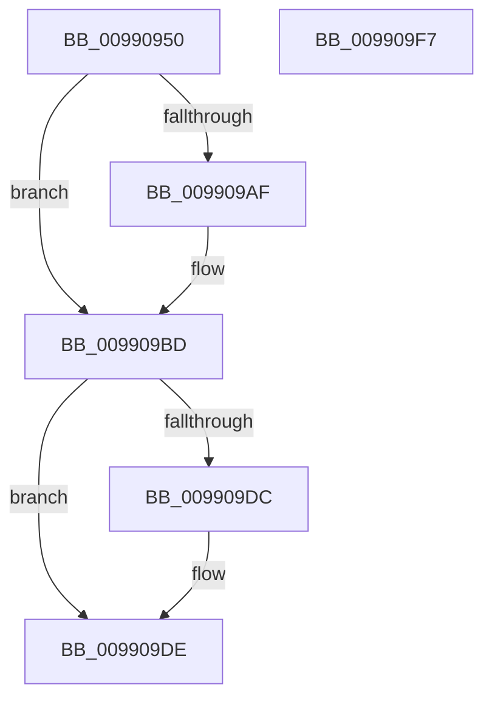

# SeQueryUserSidToken

- RVA: `0x00990950`–`0x009909F8` (길이 `168` bytes)
- VA: `0x0000000140990950`
- 실행 섹션: `PAGE`
- PDB 이름 있음: `예`; PDB Function 태그: `아니요`
- unwind 정보 RVA: `0x00060300`
- 디코드: `45`개 명령, `168/168` bytes 표시
- 미해석 바이트: `0` (있으면 어셈블리에 `.byte`로 보존)

> 이 문서는 커널 이미지의 기계어와 PDB 기호를 분석해 생성했습니다. 4번과 5번은 함수 원형과 자료형을 바이너리 사용 방식에서 추정한 C 해석이며 원본 소스 복구 결과는 아닙니다.

## 1. Dependencies

- 직접 호출 지점: **4**; 고유 호출 대상: **4**
- 직접 호출자로 확인된 함수: **9**
- RIP 상대 이미지 참조: **0**

### Outgoing calls
- `0x00990991` → [ExAcquireResourceSharedLite](../../text/21/ExAcquireResourceSharedLite_function_00211BC0.md) (function, `0x00211BC0`)
- `0x009909B5` → [memcpy](../../text/6C/memcpy_function_006C6840.md) (function, `0x006C6840`)
- `0x009909C1` → [ExReleaseResourceLite](../../text/25/ExReleaseResourceLite_function_0025FA10.md) (function, `0x0025FA10`)
- `0x009909CF` → [KeLeaveCriticalRegionThread](../../text/25/KeLeaveCriticalRegionThread_function_0025EFF0.md) (function, `0x0025EFF0`)

### Direct callers
- [PiDqSameUserHive](../70/PiDqSameUserHive_function_007055B0.md) at `0x00705614`
- [PiDqSameUserHive](../70/PiDqSameUserHive_function_007055B0.md) at `0x00705630`
- [CmpLogHiveFileInaccessible](../87/CmpLogHiveFileInaccessible_function_0087AEAC.md) at `0x0087B13B`
- [PopEtGetProcessSidAndPackageIdentity](../98/PopEtGetProcessSidAndPackageIdentity_function_0098FD2C.md) at `0x0098FD95`
- [ExpWnfQueryCurrentUserSID](../98/ExpWnfQueryCurrentUserSID_function_0098FFB0.md) at `0x00990005`
- [CmpGetVirtualizationID](CmpGetVirtualizationID_function_00990338.md) at `0x00990391`
- [PiDqOpenUserObjectRegKey](PiDqOpenUserObjectRegKey_function_00990444.md) at `0x0099053E`
- [AlpcpPortQueryConnectedSidInfo](../9C/AlpcpPortQueryConnectedSidInfo_function_009CAC3C.md) at `0x009CAD6E`
- [PspAssignProcessQuotaBlock](../AE/PspAssignProcessQuotaBlock_function_00AE3124.md) at `0x00AE318A`
- [sub_00B3ABCE](../B3/Unknown_function_00B3ABCE.md) at `0x00B3ABF0`

### Static image references
- 디코드된 RIP-relative 메모리 참조가 없습니다.

## 2. Other-region calls and transfers

- 다른 실행 섹션으로 향하는 call: **4**
  - `0x00990991` → [ExAcquireResourceSharedLite](../../text/21/ExAcquireResourceSharedLite_function_00211BC0.md) (`PAGE` → `.text`)
  - `0x009909B5` → [memcpy](../../text/6C/memcpy_function_006C6840.md) (`PAGE` → `.text`)
  - `0x009909C1` → [ExReleaseResourceLite](../../text/25/ExReleaseResourceLite_function_0025FA10.md) (`PAGE` → `.text`)
  - `0x009909CF` → [KeLeaveCriticalRegionThread](../../text/25/KeLeaveCriticalRegionThread_function_0025EFF0.md) (`PAGE` → `.text`)
- 별도 외부 분기/꼬리 이동을 확인하지 못했습니다.

## 3. Assembly (complete function range)

```asm
00990950  48 89 5C 24 08                  mov qword ptr [rsp + 8], rbx
00990955  48 89 6C 24 10                  mov qword ptr [rsp + 0x10], rbp
0099095A  48 89 74 24 18                  mov qword ptr [rsp + 0x18], rsi
0099095F  57                              push rdi
00990960  41 56                           push r14
00990962  41 57                           push r15
00990964  48 83 EC 20                     sub rsp, 0x20
00990968  65 48 8B 04 25 88 01 00 00      mov rax, qword ptr gs:[0x188]
00990971  4C 8B FA                        mov r15, rdx
00990974  48 8B E9                        mov rbp, rcx
00990977  B2 01                           mov dl, 1
00990979  49 8B D9                        mov rbx, r9
0099097C  41 8B F8                        mov edi, r8d
0099097F  41 BE 23 00 00 C0               mov r14d, 0xc0000023
00990985  66 FF 88 E4 01 00 00            dec word ptr [rax + 0x1e4]
0099098C  90                              nop
0099098D  48 8B 49 30                     mov rcx, qword ptr [rcx + 0x30]
00990991  E8 2A 12 88 FF                  call 0x140211bc0
00990996  48 8B 85 98 00 00 00            mov rax, qword ptr [rbp + 0x98]
0099099D  48 8B 10                        mov rdx, qword ptr [rax]
009909A0  0F B6 42 01                     movzx eax, byte ptr [rdx + 1]
009909A4  8D 34 85 08 00 00 00            lea esi, [rax*4 + 8]
009909AB  3B FE                           cmp edi, esi
009909AD  72 0E                           jb 0x1409909bd
009909AF  44 8B C6                        mov r8d, esi
009909B2  49 8B CF                        mov rcx, r15
009909B5  E8 86 5E D3 FF                  call 0x1406c6840
009909BA  45 33 F6                        xor r14d, r14d
009909BD  48 8B 4D 30                     mov rcx, qword ptr [rbp + 0x30]
009909C1  E8 4A F0 8C FF                  call 0x14025fa10
009909C6  65 48 8B 0C 25 88 01 00 00      mov rcx, qword ptr gs:[0x188]
009909CF  E8 1C E6 8C FF                  call 0x14025eff0
009909D4  41 8B C6                        mov eax, r14d
009909D7  48 85 DB                        test rbx, rbx
009909DA  74 02                           je 0x1409909de
009909DC  89 33                           mov dword ptr [rbx], esi
009909DE  48 8B 5C 24 40                  mov rbx, qword ptr [rsp + 0x40]
009909E3  48 8B 6C 24 48                  mov rbp, qword ptr [rsp + 0x48]
009909E8  48 8B 74 24 50                  mov rsi, qword ptr [rsp + 0x50]
009909ED  48 83 C4 20                     add rsp, 0x20
009909F1  41 5F                           pop r15
009909F3  41 5E                           pop r14
009909F5  5F                              pop rdi
009909F6  C3                              ret
009909F7  CC                              int3
```

## 4. C-style interpretation (structured pseudocode)

```c
__int64 __fastcall SeQueryUserSidToken(__int64 a1, __int64 a2, int a3, __int64 a4)
{
    __int64 result;
    __int64 v_r14;
    __int64 v_rsp;
    unsigned __int64 v_stack_p10;
    unsigned __int64 v_stack_p18;
    unsigned __int64 v_stack_p8;

    v_stack_p8 = v_rbx;
    v_stack_p10 = v_rbp;
    v_stack_p18 = v_rsi;
    v_rsp = (v_rsp) - (32);
    result = ExAcquireResourceSharedLite(*(unsigned __int64 *)(a1 + 48), 1, a3, a4);
    result = *(unsigned __int8 *)(*(unsigned __int64 *)(*(unsigned __int64 *)(a1 + 152)) + 1);
    v_r14 = (unsigned int)(0xC0000023ULL);
    if (((unsigned int)((unsigned int)(a3))) >= ((unsigned int)(*(unsigned __int8 *)(*(unsigned __int64 *)(*(unsigned __int64 *)(a1 + 152)) + 1) * 4 + 8))) {
        a3 = (unsigned int)(*(unsigned __int8 *)(*(unsigned __int64 *)(*(unsigned __int64 *)(a1 + 152)) + 1) * 4 + 8);
        a1 = a2;
        result = memcpy(a1, *(unsigned __int64 *)(*(unsigned __int64 *)(a1 + 152)), a3, a4);
        v_r14 = 0;
    }
    result = ExReleaseResourceLite(*(unsigned __int64 *)(a1 + 48), *(unsigned __int64 *)(*(unsigned __int64 *)(a1 + 152)), a3, a4);
    result = KeLeaveCriticalRegionThread(*(unsigned __int64 *)(gs_base + (0 + 392)), *(unsigned __int64 *)(*(unsigned __int64 *)(a1 + 152)), a3, a4);
    if (a4 != 0) {
        *(unsigned int *)(a4) = (unsigned int)(*(unsigned __int8 *)(*(unsigned __int64 *)(*(unsigned __int64 *)(a1 + 152)) + 1) * 4 + 8);
    }
    v_rsp = (v_rsp) + (32);
    return 0;
}
```

## 5. (Beta) C Style

```c
int64_t SeQueryUserSidToken(void *Arg1, int64_t Arg2, int32_t Arg3, int64_t Arg4)
{
    uint8_t *arg1 = (uint8_t *)Arg1;

    int64_t result;
    int64_t local_r14;
    int64_t local_rsp;
    uint64_t v_stack_p10;
    uint64_t v_stack_p18;
    uint64_t v_stack_p8;

    v_stack_p8 = local_rbx;
    v_stack_p10 = local_rbp;
    v_stack_p18 = local_rsi;
    local_rsp = (local_rsp) - (32);
    result = ExAcquireResourceSharedLite(*(uint64_t *)(arg1 + 0x30), 1, Arg3, Arg4);
    result = *(uint8_t *)(*(uint64_t *)(*(uint64_t *)(arg1 + 0x98)) + 0x1);
    local_r14 = (uint32_t)(0xC0000023ULL);
    if (((uint32_t)((uint32_t)(Arg3))) >= ((uint32_t)(*(uint8_t *)(*(uint64_t *)(*(uint64_t *)(arg1 + 0x98)) + 0x1) * 4 + 8))) {
        Arg3 = (uint32_t)(*(uint8_t *)(*(uint64_t *)(*(uint64_t *)(arg1 + 0x98)) + 0x1) * 4 + 8);
        Arg1 = Arg2;
        result = memcpy(Arg1, *(uint64_t *)(*(uint64_t *)(arg1 + 0x98)), Arg3, Arg4);
        local_r14 = 0;
    }
    result = ExReleaseResourceLite(*(uint64_t *)(arg1 + 0x30), *(uint64_t *)(*(uint64_t *)(arg1 + 0x98)), Arg3, Arg4);
    result = KeLeaveCriticalRegionThread(*(uint64_t *)(gs_base + (0 + 0x188)), *(uint64_t *)(*(uint64_t *)(arg1 + 0x98)), Arg3, Arg4);
    if (Arg4 != 0) {
        *(uint32_t *)(Arg4) = (uint32_t)(*(uint8_t *)(*(uint64_t *)(*(uint64_t *)(arg1 + 0x98)) + 0x1) * 4 + 8);
    }
    local_rsp = (local_rsp) + (32);
    return 0;
}
```

### 관측된 메모리 오프셋

구조체 형식이 확인되지 않은 접근은 인자 기준의 오프셋으로만 기록했습니다.

| 기준 인자 | 오프셋 표현 | 폭 (bit) | 접근 |
|---|---:|---:|---|
| `Arg1` | `+ 0x30` | `64` | `R` |
| `Arg1` | `+ 0x98` | `64` | `R` |

## 6. Execution-region graph

[열기: 2D/3D 그래프와 함수 탐색 컨트롤 패널](../../../control-panel.html?section=page&rva=0x00990950&view=graph)

- 2D 그래프는 위에서 아래로 흐르고, 3D 그래프는 빈 공간을 드래그해 회전합니다. Shift+드래그는 이동, 휠은 확대·축소, 함수 노드 선택은 대상 보고서 이동입니다.

### Static fallback


