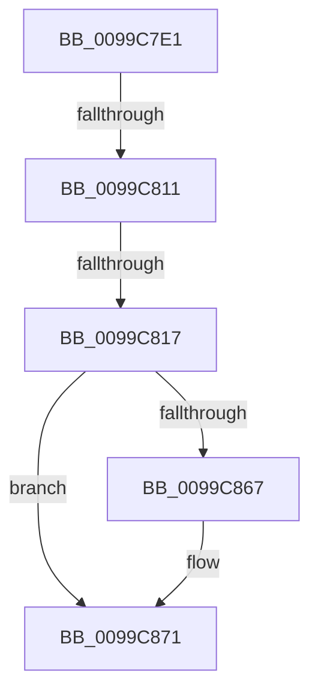

# sub_0099C7E1

- RVA: `0x0099C7E1`–`0x0099C88E` (길이 `173` bytes)
- VA: `0x000000014099C7E1`
- 실행 섹션: `PAGE`
- PDB 이름 있음: `아니요`; PDB Function 태그: `아니요`
- unwind 정보 RVA: `0x0009995C`
- 디코드: `41`개 명령, `173/173` bytes 표시
- 미해석 바이트: `0` (있으면 어셈블리에 `.byte`로 보존)

> 이 문서는 커널 이미지의 기계어와 PDB 기호를 분석해 생성했습니다. 4번과 5번은 함수 원형과 자료형을 바이너리 사용 방식에서 추정한 C 해석이며 원본 소스 복구 결과는 아닙니다.

## 1. Dependencies

- 직접 호출 지점: **3**; 고유 호출 대상: **3**
- 직접 호출자로 확인된 함수: **0**
- RIP 상대 이미지 참조: **0**

### Outgoing calls
- `0x0099C7FE` → [PspLockThreadSecurityShared](../../text/3C/PspLockThreadSecurityShared_function_003C4720.md) (function, `0x003C4720`)
- `0x0099C834` → [ObfReferenceObjectWithTag](../../text/21/ObfReferenceObjectWithTag_function_00210710.md) (function, `0x00210710`)
- `0x0099C877` → [PspUnlockThreadSecurityShared](../../text/3C/PspUnlockThreadSecurityShared_function_003C2E40.md) (function, `0x003C2E40`)

### Direct callers
- 이 함수 시작 RVA로 연결되는 직접 call은 확인되지 않았습니다. 간접 호출은 완전히 역산할 수 없습니다.

### Static image references
- 디코드된 RIP-relative 메모리 참조가 없습니다.

## 2. Other-region calls and transfers

- 다른 실행 섹션으로 향하는 call: **3**
  - `0x0099C7FE` → [PspLockThreadSecurityShared](../../text/3C/PspLockThreadSecurityShared_function_003C4720.md) (`PAGE` → `.text`)
  - `0x0099C834` → [ObfReferenceObjectWithTag](../../text/21/ObfReferenceObjectWithTag_function_00210710.md) (`PAGE` → `.text`)
  - `0x0099C877` → [PspUnlockThreadSecurityShared](../../text/3C/PspUnlockThreadSecurityShared_function_003C2E40.md) (`PAGE` → `.text`)
- call이 아닌 외부 분기/꼬리 이동: **3**
  - `0x0099C80B` → [sub_0099C88E + 0x14](Unknown_function_0099C88E.md) (`tail-transfer`)
  - `0x0099C815` → [sub_0099C88E](Unknown_function_0099C88E.md) (`tail-transfer`)
  - `0x0099C889` → [PsReferenceImpersonationTokenEx + 0x23](PsReferenceImpersonationTokenEx_function_0099C7B0.md) (`tail-transfer`)

## 3. Assembly (complete function range)

```asm
0099C7E1  4C 89 74 24 40                  mov qword ptr [rsp + 0x40], r14
0099C7E6  65 4C 8B 34 25 88 01 00 00      mov r14, qword ptr gs:[0x188]
0099C7EF  49 8B D6                        mov rdx, r14
0099C7F2  4C 89 7C 24 48                  mov qword ptr [rsp + 0x48], r15
0099C7F7  4C 8B B9 20 02 00 00            mov r15, qword ptr [rcx + 0x220]
0099C7FE  E8 1D 7F A2 FF                  call 0x1403c4720
0099C803  8B 83 A0 05 00 00               mov eax, dword ptr [rbx + 0x5a0]
0099C809  A8 08                           test al, 8
0099C80B  0F 84 91 00 00 00               je 0x14099c8a2
0099C811  40 F6 C7 01                     test dil, 1
0099C815  75 77                           jne 0x14099c88e
0099C817  48 8B BB 38 05 00 00            mov rdi, qword ptr [rbx + 0x538]
0099C81E  8B 83 A0 05 00 00               mov eax, dword ptr [rbx + 0x5a0]
0099C824  48 83 E7 F8                     and rdi, 0xfffffffffffffff8
0099C828  C1 E8 08                        shr eax, 8
0099C82B  24 01                           and al, 1
0099C82D  8B D5                           mov edx, ebp
0099C82F  88 06                           mov byte ptr [rsi], al
0099C831  48 8B CF                        mov rcx, rdi
0099C834  E8 D7 3E 87 FF                  call 0x140210710
0099C839  8B 8B 38 05 00 00               mov ecx, dword ptr [rbx + 0x538]
0099C83F  48 8B 44 24 68                  mov rax, qword ptr [rsp + 0x68]
0099C844  83 E1 03                        and ecx, 3
0099C847  89 08                           mov dword ptr [rax], ecx
0099C849  0F B6 8B 38 05 00 00            movzx ecx, byte ptr [rbx + 0x538]
0099C850  48 8B 44 24 60                  mov rax, qword ptr [rsp + 0x60]
0099C855  C0 E9 02                        shr cl, 2
0099C858  80 E1 01                        and cl, 1
0099C85B  88 08                           mov byte ptr [rax], cl
0099C85D  48 8B 4C 24 70                  mov rcx, qword ptr [rsp + 0x70]
0099C862  48 85 C9                        test rcx, rcx
0099C865  74 0A                           je 0x14099c871
0099C867  41 0F B6 87 FA 05 00 00         movzx eax, byte ptr [r15 + 0x5fa]
0099C86F  88 01                           mov byte ptr [rcx], al
0099C871  49 8B D6                        mov rdx, r14
0099C874  48 8B CB                        mov rcx, rbx
0099C877  E8 C4 65 A2 FF                  call 0x1403c2e40
0099C87C  4C 8B 7C 24 48                  mov r15, qword ptr [rsp + 0x48]
0099C881  48 8B C7                        mov rax, rdi
0099C884  4C 8B 74 24 40                  mov r14, qword ptr [rsp + 0x40]
0099C889  E9 45 FF FF FF                  jmp 0x14099c7d3
```

## 4. C-style interpretation (structured pseudocode)

```c
__int64 __fastcall sub_0099C7E1(__int64 a1, __int64 a2, __int64 a3, __int64 a4, __int64 a5, __int64 a6, __int64 a7, __int64 a8, __int64 a9, __int64 a10, __int64 a11, __int64 a12, __int64 a13, __int64 a14)
{
    __int64 result;
    __int64 v_rdi;
    unsigned __int64 v_stack_p40;
    unsigned __int64 v_stack_p48;

    v_stack_p40 = v_r14;
    v_stack_p48 = v_r15;
    result = PspLockThreadSecurityShared(a1, *(unsigned __int64 *)(gs_base + (0 + 392)), a3, a4);
    v_rdi = (*(unsigned __int64 *)(v_rbx + 1336)) & (-8);
    result = (unsigned int)(((unsigned int)(*(unsigned int *)(v_rbx + 1440))) >> (8));
    result = (unsigned __int8)((result) & (1));
    *(unsigned __int8 *)(v_rsi) = (unsigned __int8)(result);
    result = ObfReferenceObjectWithTag(v_rdi, (unsigned int)((unsigned int)(v_rbp)), a3, a4);
    a1 = (unsigned int)(((unsigned int)(*(unsigned int *)(v_rbx + 1336))) & (3));
    *(unsigned int *)(a13) = (unsigned int)(a1);
    a1 = (unsigned __int8)((*(unsigned __int8 *)(v_rbx + 1336)) >> (2));
    a1 = (unsigned __int8)((a1) & (1));
    *(unsigned __int8 *)(a12) = (unsigned __int8)(a1);
    result = a12;
    if (a14 != 0) {
        result = *(unsigned __int8 *)(*(unsigned __int64 *)(a1 + 544) + 1530);
        *(unsigned __int8 *)(a14) = (unsigned __int8)(result);
    }
    result = PspUnlockThreadSecurityShared(v_rbx, *(unsigned __int64 *)(gs_base + (0 + 392)), a3, a4);
}
```

## 5. (Beta) C Style

```c
int64_t sub_0099C7E1(void *Arg1, int64_t Arg2, int64_t Arg3, int64_t Arg4, uint64_t Arg5, uint64_t Arg6, uint64_t Arg7, int64_t Arg8, int64_t Arg9, uint64_t Arg10, uint64_t Arg11, void *Arg12, void *Arg13, int64_t Arg14)
{
    uint8_t *arg1 = (uint8_t *)Arg1;
    uint8_t *arg12 = (uint8_t *)Arg12;
    uint8_t *arg13 = (uint8_t *)Arg13;

    int64_t result;
    int64_t local_rdi;
    uint64_t v_stack_p40;
    uint64_t v_stack_p48;

    v_stack_p40 = local_r14;
    v_stack_p48 = local_r15;
    result = PspLockThreadSecurityShared(Arg1, *(uint64_t *)(gs_base + (0 + 0x188)), Arg3, Arg4);
    local_rdi = (*(uint64_t *)(local_rbx + 0x538)) & (-8);
    result = (uint32_t)(((uint32_t)(*(uint32_t *)(local_rbx + 0x5A0))) >> (8));
    result = (uint8_t)((result) & (1));
    *(uint8_t *)(local_rsi) = (uint8_t)(result);
    result = ObfReferenceObjectWithTag(local_rdi, (uint32_t)((uint32_t)(local_rbp)), Arg3, Arg4);
    Arg1 = (uint32_t)(((uint32_t)(*(uint32_t *)(local_rbx + 0x538))) & (3));
    *(uint32_t *)(arg13) = (uint32_t)(Arg1);
    Arg1 = (uint8_t)((*(uint8_t *)(local_rbx + 0x538)) >> (2));
    Arg1 = (uint8_t)((Arg1) & (1));
    *(uint8_t *)(arg12) = (uint8_t)(Arg1);
    result = Arg12;
    if (Arg14 != 0) {
        result = *(uint8_t *)(*(uint64_t *)(arg1 + 0x220) + 0x5FA);
        *(uint8_t *)(Arg14) = (uint8_t)(result);
    }
    result = PspUnlockThreadSecurityShared(local_rbx, *(uint64_t *)(gs_base + (0 + 0x188)), Arg3, Arg4);
}
```

### 관측된 메모리 오프셋

구조체 형식이 확인되지 않은 접근은 인자 기준의 오프셋으로만 기록했습니다.

| 기준 인자 | 오프셋 표현 | 폭 (bit) | 접근 |
|---|---:|---:|---|
| `Arg1` | `+ 0x220` | `64` | `R` |
| `Arg12` | `+ 0x0` | `8` | `W` |
| `Arg13` | `+ 0x0` | `32` | `W` |

## 6. Execution-region graph

[열기: 2D/3D 그래프와 함수 탐색 컨트롤 패널](../../../control-panel.html?section=page&rva=0x0099C7E1&view=graph)

- 2D 그래프는 위에서 아래로 흐르고, 3D 그래프는 빈 공간을 드래그해 회전합니다. Shift+드래그는 이동, 휠은 확대·축소, 함수 노드 선택은 대상 보고서 이동입니다.

### Static fallback


