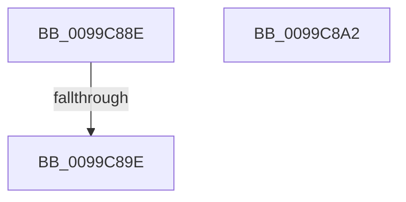

# sub_0099C88E

- RVA: `0x0099C88E`–`0x0099C8A6` (길이 `24` bytes)
- VA: `0x000000014099C88E`
- 실행 섹션: `PAGE`
- PDB 이름 있음: `아니요`; PDB Function 태그: `아니요`
- unwind 정보 RVA: `0x00099974`
- 디코드: `7`개 명령, `24/24` bytes 표시
- 미해석 바이트: `0` (있으면 어셈블리에 `.byte`로 보존)

> 이 문서는 커널 이미지의 기계어와 PDB 기호를 분석해 생성했습니다. 4번과 5번은 함수 원형과 자료형을 바이너리 사용 방식에서 추정한 C 해석이며 원본 소스 복구 결과는 아닙니다.

## 1. Dependencies

- 직접 호출 지점: **0**; 고유 호출 대상: **0**
- 직접 호출자로 확인된 함수: **0**
- RIP 상대 이미지 참조: **0**

### Outgoing calls
- 직접 디코드된 call 명령이 없습니다.

### Direct callers
- 이 함수 시작 RVA로 연결되는 직접 call은 확인되지 않았습니다. 간접 호출은 완전히 역산할 수 없습니다.

### Static image references
- 디코드된 RIP-relative 메모리 참조가 없습니다.

## 2. Other-region calls and transfers

- 다른 실행 섹션으로 향하는 call: **0**
- call이 아닌 외부 분기/꼬리 이동: **3**
  - `0x0099C898` → [sub_0099C7E1 + 0x36](Unknown_function_0099C7E1.md) (`tail-transfer`)
  - `0x0099C8A0` → [sub_0099C7E1 + 0x4C](Unknown_function_0099C7E1.md) (`tail-transfer`)
  - `0x0099C8A4` → [sub_0099C7E1 + 0x90](Unknown_function_0099C7E1.md) (`tail-transfer`)

## 3. Assembly (complete function range)

```asm
0099C88E  48 8B BB 48 06 00 00            mov rdi, qword ptr [rbx + 0x648]
0099C895  48 85 FF                        test rdi, rdi
0099C898  0F 84 79 FF FF FF               je 0x14099c817
0099C89E  32 C0                           xor al, al
0099C8A0  EB 8B                           jmp 0x14099c82d
0099C8A2  33 FF                           xor edi, edi
0099C8A4  EB CB                           jmp 0x14099c871
```

## 4. C-style interpretation (structured pseudocode)

```c
__int64 __fastcall sub_0099C88E(void)
{
    __int64 result;

    result = 0;
}
```

## 5. (Beta) C Style

```c
void sub_0099C88E(void)
{
    int64_t result;

    result = 0;
}
```

## 6. Execution-region graph

[열기: 2D/3D 그래프와 함수 탐색 컨트롤 패널](../../../control-panel.html?section=page&rva=0x0099C88E&view=graph)

- 2D 그래프는 위에서 아래로 흐르고, 3D 그래프는 빈 공간을 드래그해 회전합니다. Shift+드래그는 이동, 휠은 확대·축소, 함수 노드 선택은 대상 보고서 이동입니다.

### Static fallback


