# sub_0099CB19

- RVA: `0x0099CB19`–`0x0099CD37` (길이 `542` bytes)
- VA: `0x000000014099CB19`
- 실행 섹션: `PAGE`
- PDB 이름 있음: `아니요`; PDB Function 태그: `아니요`
- unwind 정보 RVA: `0x00099B6C`
- 디코드: `120`개 명령, `542/542` bytes 표시
- 미해석 바이트: `0` (있으면 어셈블리에 `.byte`로 보존)

> 이 문서는 커널 이미지의 기계어와 PDB 기호를 분석해 생성했습니다. 4번과 5번은 함수 원형과 자료형을 바이너리 사용 방식에서 추정한 C 해석이며 원본 소스 복구 결과는 아닙니다.

## 1. Dependencies

- 직접 호출 지점: **1**; 고유 호출 대상: **1**
- 직접 호출자로 확인된 함수: **0**
- RIP 상대 이미지 참조: **5**

### Outgoing calls
- `0x0099CCF6` → [EtwWrite](../../text/41/EtwWrite_function_0041C720.md) (function, `0x0041C720`)

### Direct callers
- 이 함수 시작 RVA로 연결되는 직접 call은 확인되지 않았습니다. 간접 호출은 완전히 역산할 수 없습니다.

### Static image references
- `0x0099CB34` → RVA `0x00000000` (`image boundary/outside`; read)
- `0x0099CB62` → RVA `0x000133E0` (`.rdata`; read)
- `0x0099CBAA` → RVA `0x00FD80C0` (`PAGEDATA`; read)
- `0x0099CBE8` → RVA `0x000105E0` (`.rdata`; read)
- `0x0099CCDF` → RVA `0x00FD8018` (`PAGEDATA`; read)

## 2. Other-region calls and transfers

- 다른 실행 섹션으로 향하는 call: **1**
  - `0x0099CCF6` → [EtwWrite](../../text/41/EtwWrite_function_0041C720.md) (`PAGE` → `.text`)
- call이 아닌 외부 분기/꼬리 이동: **11**
  - `0x0099CBBF` → [sub_0099CD37 + 0x5C7](Unknown_function_0099CD37.md) (`tail-transfer`)
  - `0x0099CBD8` → [sub_0099CD37](Unknown_function_0099CD37.md) (`tail-transfer`)
  - `0x0099CC8A` → [sub_0099CD37 + 0x500](Unknown_function_0099CD37.md) (`tail-transfer`)
  - `0x0099CCB1` → [sub_0099CD37 + 0x25](Unknown_function_0099CD37.md) (`tail-transfer`)
  - `0x0099CCBA` → [sub_0099CD37 + 0x73](Unknown_function_0099CD37.md) (`tail-transfer`)
  - `0x0099CCC5` → [sub_0099CD37 + 0x384](Unknown_function_0099CD37.md) (`tail-transfer`)
  - `0x0099CCCF` → [sub_0099CD37 + 0x1F](Unknown_function_0099CD37.md) (`tail-transfer`)
  - `0x0099CCD9` → [sub_0099CD37 + 0x1F](Unknown_function_0099CD37.md) (`tail-transfer`)
  - `0x0099CD03` → [sub_0099CD37 + 0x4B0](Unknown_function_0099CD37.md) (`tail-transfer`)
  - `0x0099CD0C` → [sub_0099CD37 + 0xC1](Unknown_function_0099CD37.md) (`tail-transfer`)
  - `0x0099CD32` → [EtwpRegTraceCallback + 0x8A](EtwpRegTraceCallback_function_0099CA70.md) (`tail-transfer`)

## 3. Assembly (complete function range)

```asm
0099CB19  48 89 9C 24 E0 01 00 00         mov qword ptr [rsp + 0x1e0], rbx
0099CB21  4C 89 A4 24 E8 01 00 00         mov qword ptr [rsp + 0x1e8], r12
0099CB29  4C 89 AC 24 F8 01 00 00         mov qword ptr [rsp + 0x1f8], r13
0099CB31  48 63 C2                        movsxd rax, edx
0099CB34  48 8D 15 C5 34 66 FF            lea rdx, [rip - 0x99cb3b]
0099CB3B  4C 89 B4 24 B0 01 00 00         mov qword ptr [rsp + 0x1b0], r14
0099CB43  0F B6 84 02 BC D3 99 00         movzx eax, byte ptr [rdx + rax + 0x99d3bc]
0099CB4B  8B 8C 82 78 D3 99 00            mov ecx, dword ptr [rdx + rax*4 + 0x99d378]
0099CB52  48 03 CA                        add rcx, rdx
0099CB55  FF E1                           jmp rcx
0099CB57  CC                              int3
0099CB58  CC                              int3
0099CB59  CC                              int3
0099CB5A  CC                              int3
0099CB5B  48 8B DF                        mov rbx, rdi
0099CB5E  49 8B 40 10                     mov rax, qword ptr [r8 + 0x10]
0099CB62  0F 10 05 77 68 67 FF            movups xmm0, xmmword ptr [rip - 0x989789]
0099CB69  0F 11 45 A0                     movups xmmword ptr [rbp - 0x60], xmm0
0099CB6D  48 8B 48 08                     mov rcx, qword ptr [rax + 8]
0099CB71  48 89 4C 24 50                  mov qword ptr [rsp + 0x50], rcx
0099CB76  45 39 78 08                     cmp dword ptr [r8 + 8], r15d
0099CB7A  7C 07                           jl 0x14099cb83
0099CB7C  49 8B 08                        mov rcx, qword ptr [r8]
0099CB7F  48 89 4D 88                     mov qword ptr [rbp - 0x78], rcx
0099CB83  4C 8B 18                        mov r11, qword ptr [rax]
0099CB86  41 BD 01 00 00 00               mov r13d, 1
0099CB8C  4C 89 5C 24 60                  mov qword ptr [rsp + 0x60], r11
0099CB91  45 8D 45 01                     lea r8d, [r13 + 1]
0099CB95  41 8D 7D 03                     lea edi, [r13 + 3]
0099CB99  45 8B D7                        mov r10d, r15d
0099CB9C  45 8B F7                        mov r14d, r15d
0099CB9F  45 8B E7                        mov r12d, r15d
0099CBA2  44 89 7C 24 44                  mov dword ptr [rsp + 0x44], r15d
0099CBA7  41 8B D7                        mov edx, r15d
0099CBAA  F6 05 0F B5 63 00 01            test byte ptr [rip + 0x63b50f], 1
0099CBB1  44 89 54 24 38                  mov dword ptr [rsp + 0x38], r10d
0099CBB6  44 89 44 24 40                  mov dword ptr [rsp + 0x40], r8d
0099CBBB  89 54 24 3C                     mov dword ptr [rsp + 0x3c], edx
0099CBBF  0F 85 39 07 00 00               jne 0x14099d2fe
0099CBC5  48 C7 45 B8 08 00 00 00         mov qword ptr [rbp - 0x48], 8
0099CBCD  48 8D 44 24 50                  lea rax, [rsp + 0x50]
0099CBD2  48 89 45 B0                     mov qword ptr [rbp - 0x50], rax
0099CBD6  85 FF                           test edi, edi
0099CBD8  0F 85 59 01 00 00               jne 0x14099cd37
0099CBDE  44 8D 4F 02                     lea r9d, [rdi + 2]
0099CBE2  48 8D 45 C0                     lea rax, [rbp - 0x40]
0099CBE6  33 FF                           xor edi, edi
0099CBE8  48 8D 0D F1 39 67 FF            lea rcx, [rip - 0x98c60f]
0099CBEF  48 83 FB 01                     cmp rbx, 1
0099CBF3  74 04                           je 0x14099cbf9
0099CBF5  48 8D 4B 08                     lea rcx, [rbx + 8]
0099CBF9  48 89 08                        mov qword ptr [rax], rcx
0099CBFC  48 C7 40 08 04 00 00 00         mov qword ptr [rax + 8], 4
0099CC04  85 D2                           test edx, edx
0099CC06  74 1C                           je 0x14099cc24
0099CC08  41 8B C1                        mov eax, r9d
0099CC0B  48 8D 4C 24 68                  lea rcx, [rsp + 0x68]
0099CC10  48 03 C0                        add rax, rax
0099CC13  41 FF C1                        inc r9d
0099CC16  48 89 4C C5 B0                  mov qword ptr [rbp + rax*8 - 0x50], rcx
0099CC1B  48 C7 44 C5 B8 04 00 00 00      mov qword ptr [rbp + rax*8 - 0x48], 4
0099CC24  45 85 F6                        test r14d, r14d
0099CC27  74 1C                           je 0x14099cc45
0099CC29  41 8B C1                        mov eax, r9d
0099CC2C  48 8D 4C 24 58                  lea rcx, [rsp + 0x58]
0099CC31  48 03 C0                        add rax, rax
0099CC34  41 FF C1                        inc r9d
0099CC37  48 89 4C C5 B0                  mov qword ptr [rbp + rax*8 - 0x50], rcx
0099CC3C  48 C7 44 C5 B8 04 00 00 00      mov qword ptr [rbp + rax*8 - 0x48], 4
0099CC45  45 85 C0                        test r8d, r8d
0099CC48  74 1C                           je 0x14099cc66
0099CC4A  41 8B C1                        mov eax, r9d
0099CC4D  48 8D 4C 24 78                  lea rcx, [rsp + 0x78]
0099CC52  48 03 C0                        add rax, rax
0099CC55  41 FF C1                        inc r9d
0099CC58  48 89 4C C5 B0                  mov qword ptr [rbp + rax*8 - 0x50], rcx
0099CC5D  48 C7 44 C5 B8 04 00 00 00      mov qword ptr [rbp + rax*8 - 0x48], 4
0099CC66  45 85 E4                        test r12d, r12d
0099CC69  74 1C                           je 0x14099cc87
0099CC6B  41 8B C1                        mov eax, r9d
0099CC6E  48 8D 4C 24 4C                  lea rcx, [rsp + 0x4c]
0099CC73  48 03 C0                        add rax, rax
0099CC76  41 FF C1                        inc r9d
0099CC79  48 89 4C C5 B0                  mov qword ptr [rbp + rax*8 - 0x50], rcx
0099CC7E  48 C7 44 C5 B8 04 00 00 00      mov qword ptr [rbp + rax*8 - 0x48], 4
0099CC87  45 84 FF                        test r15b, r15b
0099CC8A  0F 85 A7 05 00 00               jne 0x14099d237
0099CC90  41 8B C1                        mov eax, r9d
0099CC93  4C 8D 35 46 39 67 FF            lea r14, [rip - 0x98c6ba]
0099CC9A  48 03 C0                        add rax, rax
0099CC9D  41 FF C1                        inc r9d
0099CCA0  4C 89 74 C5 B0                  mov qword ptr [rbp + rax*8 - 0x50], r14
0099CCA5  48 C7 44 C5 B8 02 00 00 00      mov qword ptr [rbp + rax*8 - 0x48], 2
0099CCAE  45 85 ED                        test r13d, r13d
0099CCB1  0F 85 A5 00 00 00               jne 0x14099cd5c
0099CCB7  45 85 D2                        test r10d, r10d
0099CCBA  0F 85 EA 00 00 00               jne 0x14099cdaa
0099CCC0  83 7C 24 44 00                  cmp dword ptr [rsp + 0x44], 0
0099CCC5  0F 85 F0 03 00 00               jne 0x14099d0bb
0099CCCB  48 83 FB 01                     cmp rbx, 1
0099CCCF  0F 84 81 00 00 00               je 0x14099cd56
0099CCD5  83 7B 08 00                     cmp dword ptr [rbx + 8], 0
0099CCD9  7D 7B                           jge 0x14099cd56
0099CCDB  C6 45 A4 01                     mov byte ptr [rbp - 0x5c], 1
0099CCDF  48 8B 0D 32 B3 63 00            mov rcx, qword ptr [rip + 0x63b332]
0099CCE6  48 8D 45 B0                     lea rax, [rbp - 0x50]
0099CCEA  45 33 C0                        xor r8d, r8d
0099CCED  48 89 44 24 20                  mov qword ptr [rsp + 0x20], rax
0099CCF2  48 8D 55 A0                     lea rdx, [rbp - 0x60]
0099CCF6  E8 25 FA A7 FF                  call 0x14041c720
0099CCFB  48 8B 4C 24 70                  mov rcx, qword ptr [rsp + 0x70]
0099CD00  48 85 C9                        test rcx, rcx
0099CD03  0F 85 DE 04 00 00               jne 0x14099d1e7
0099CD09  48 85 F6                        test rsi, rsi
0099CD0C  0F 85 E6 00 00 00               jne 0x14099cdf8
0099CD12  4C 8B AC 24 F8 01 00 00         mov r13, qword ptr [rsp + 0x1f8]
0099CD1A  4C 8B A4 24 E8 01 00 00         mov r12, qword ptr [rsp + 0x1e8]
0099CD22  48 8B 9C 24 E0 01 00 00         mov rbx, qword ptr [rsp + 0x1e0]
0099CD2A  4C 8B B4 24 B0 01 00 00         mov r14, qword ptr [rsp + 0x1b0]
0099CD32  E9 C3 FD FF FF                  jmp 0x14099cafa
```

## 4. C-style interpretation (structured pseudocode)

```c
__int64 __fastcall sub_0099CB19(__int64 a1, int a2, __int64 a3)
{
    unsigned __int64 v_stack_p1B0;
    unsigned __int64 v_stack_p1E0;
    unsigned __int64 v_stack_p1E8;
    unsigned __int64 v_stack_p1F8;
    unsigned __int64 v_stack_p20;
    unsigned int v_stack_p38;
    unsigned int v_stack_p3C;
    unsigned int v_stack_p40;
    unsigned int v_stack_p44;
    unsigned __int64 v_stack_p4C;
    unsigned __int64 v_stack_p50;
    unsigned __int64 v_stack_p58;
    unsigned __int64 v_stack_p60;
    unsigned __int64 v_stack_p68;
    unsigned __int64 v_stack_p70;
    unsigned __int64 v_stack_p78;

    v_stack_p1E0 = v_rbx;
    v_stack_p1E8 = v_r12;
    v_stack_p1F8 = v_r13;
    v_stack_p1B0 = v_r14;
    a1 = ((unsigned int)(*(unsigned int *)(v_rip - 10079035 + *(unsigned __int8 *)(v_rip - 10079035 + (int)(a2) * 1 + 10081212) * 4 + 10081144))) + (v_rip - 10079035);
}
```

## 5. (Beta) C Style

```c
int64_t sub_0099CB19(int64_t Arg1, int32_t Arg2, int64_t Arg3)
{
    uint64_t v_stack_p1B0;
    uint64_t v_stack_p1E0;
    uint64_t v_stack_p1E8;
    uint64_t v_stack_p1F8;
    uint64_t v_stack_p20;
    uint32_t v_stack_p38;
    uint32_t v_stack_p3C;
    uint32_t v_stack_p40;
    uint32_t v_stack_p44;
    uint64_t v_stack_p4C;
    uint64_t v_stack_p50;
    uint64_t v_stack_p58;
    uint64_t v_stack_p60;
    uint64_t v_stack_p68;
    uint64_t v_stack_p70;
    uint64_t v_stack_p78;

    v_stack_p1E0 = local_rbx;
    v_stack_p1E8 = local_r12;
    v_stack_p1F8 = local_r13;
    v_stack_p1B0 = local_r14;
    Arg1 = ((uint32_t)(*(uint32_t *)(v_rip - 0x99CB3B + *(uint8_t *)(v_rip - 0x99CB3B + (int32_t)(Arg2) * 1 + 0x99D3BC) * 4 + 0x99D378))) + (v_rip - 10079035);
}
```

## 6. Execution-region graph

[열기: 2D/3D 그래프와 함수 탐색 컨트롤 패널](../../../control-panel.html?section=page&rva=0x0099CB19&view=graph)

- 2D 그래프는 위에서 아래로 흐르고, 3D 그래프는 빈 공간을 드래그해 회전합니다. Shift+드래그는 이동, 휠은 확대·축소, 함수 노드 선택은 대상 보고서 이동입니다.

### Static fallback

```mermaid
flowchart TD
  bb_0099CB19[BB_0099CB19]
  bb_0099CB57[BB_0099CB57]
  bb_0099CB7C[BB_0099CB7C]
  bb_0099CB83[BB_0099CB83]
  bb_0099CBC5[BB_0099CBC5]
  bb_0099CBDE[BB_0099CBDE]
  bb_0099CBF5[BB_0099CBF5]
  bb_0099CBF9[BB_0099CBF9]
  bb_0099CC08[BB_0099CC08]
  bb_0099CC24[BB_0099CC24]
  bb_0099CC29[BB_0099CC29]
  bb_0099CC45[BB_0099CC45]
  bb_0099CC4A[BB_0099CC4A]
  bb_0099CC66[BB_0099CC66]
  bb_0099CC6B[BB_0099CC6B]
  bb_0099CC87[BB_0099CC87]
  bb_0099CC90[BB_0099CC90]
  bb_0099CCB7[BB_0099CCB7]
  bb_0099CCC0[BB_0099CCC0]
  bb_0099CCCB[BB_0099CCCB]
  bb_0099CCD5[BB_0099CCD5]
  bb_0099CCDB[BB_0099CCDB]
  bb_0099CD09[BB_0099CD09]
  bb_0099CD12[BB_0099CD12]
  bb_0099CB57 -->|branch| bb_0099CB83
  bb_0099CB57 -->|fallthrough| bb_0099CB7C
  bb_0099CB7C -->|flow| bb_0099CB83
  bb_0099CB83 -->|fallthrough| bb_0099CBC5
  bb_0099CBC5 -->|fallthrough| bb_0099CBDE
  bb_0099CBDE -->|branch| bb_0099CBF9
  bb_0099CBDE -->|fallthrough| bb_0099CBF5
  bb_0099CBF5 -->|flow| bb_0099CBF9
  bb_0099CBF9 -->|branch| bb_0099CC24
  bb_0099CBF9 -->|fallthrough| bb_0099CC08
  bb_0099CC08 -->|flow| bb_0099CC24
  bb_0099CC24 -->|branch| bb_0099CC45
  bb_0099CC24 -->|fallthrough| bb_0099CC29
  bb_0099CC29 -->|flow| bb_0099CC45
  bb_0099CC45 -->|branch| bb_0099CC66
  bb_0099CC45 -->|fallthrough| bb_0099CC4A
  bb_0099CC4A -->|flow| bb_0099CC66
  bb_0099CC66 -->|branch| bb_0099CC87
  bb_0099CC66 -->|fallthrough| bb_0099CC6B
  bb_0099CC6B -->|flow| bb_0099CC87
  bb_0099CC87 -->|fallthrough| bb_0099CC90
  bb_0099CC90 -->|fallthrough| bb_0099CCB7
  bb_0099CCB7 -->|fallthrough| bb_0099CCC0
  bb_0099CCC0 -->|fallthrough| bb_0099CCCB
  bb_0099CCCB -->|fallthrough| bb_0099CCD5
  bb_0099CCD5 -->|fallthrough| bb_0099CCDB
  bb_0099CCDB -->|fallthrough| bb_0099CD09
  bb_0099CD09 -->|fallthrough| bb_0099CD12
```


