# sub_0099CD37

- RVA: `0x0099CD37`–`0x0099D3E3` (길이 `1,708` bytes)
- VA: `0x000000014099CD37`
- 실행 섹션: `PAGE`
- PDB 이름 있음: `아니요`; PDB Function 태그: `아니요`
- unwind 정보 RVA: `0x00099B8C`
- 디코드: `411`개 명령, `1,708/1,708` bytes 표시
- 미해석 바이트: `3` (있으면 어셈블리에 `.byte`로 보존)

> 이 문서는 커널 이미지의 기계어와 PDB 기호를 분석해 생성했습니다. 4번과 5번은 함수 원형과 자료형을 바이너리 사용 방식에서 추정한 C 해석이며 원본 소스 복구 결과는 아닙니다.

## 1. Dependencies

- 직접 호출 지점: **9**; 고유 호출 대상: **4**
- 직접 호출자로 확인된 함수: **0**
- RIP 상대 이미지 참조: **16**

### Outgoing calls
- `0x0099CDFD` → [ExFreePoolWithTag](../../poolcode/B8/ExFreePoolWithTag_function_00B82870.md) (function, `0x00B82870`)
- `0x0099CFE3` → [EtwpCaptureRegistryData](EtwpCaptureRegistryData_function_0099D4FC.md) (function, `0x0099D4FC`)
- `0x0099D02A` → [EtwpCapturePreviousRegistryData](EtwpCapturePreviousRegistryData_function_0099D3EC.md) (function, `0x0099D3EC`)
- `0x0099D1E9` → [ExFreePoolWithTag](../../poolcode/B8/ExFreePoolWithTag_function_00B82870.md) (function, `0x00B82870`)
- `0x0099D212` → [EtwpCaptureRegistryData](EtwpCaptureRegistryData_function_0099D4FC.md) (function, `0x0099D4FC`)
- `0x0099D291` → [EtwpCaptureRegistryData](EtwpCaptureRegistryData_function_0099D4FC.md) (function, `0x0099D4FC`)
- `0x0099D2BD` → [EtwpCaptureRegistryData](EtwpCaptureRegistryData_function_0099D4FC.md) (function, `0x0099D4FC`)
- `0x0099D2E7` → [EtwpCaptureRegistryData](EtwpCaptureRegistryData_function_0099D4FC.md) (function, `0x0099D4FC`)
- `0x0099D320` → [CmCallbackGetKeyObjectID](../9D/CmCallbackGetKeyObjectID_function_009DC2E0.md) (function, `0x009DC2E0`)

### Direct callers
- 이 함수 시작 RVA로 연결되는 직접 call은 확인되지 않았습니다. 간접 호출은 완전히 역산할 수 없습니다.

### Static image references
- `0x0099CE07` → RVA `0x00FD80C0` (`PAGEDATA`; read)
- `0x0099CE18` → RVA `0x000133F0` (`.rdata`; read)
- `0x0099CE70` → RVA `0x00013400` (`.rdata`; read)
- `0x0099CEA8` → RVA `0x00013410` (`.rdata`; read)
- `0x0099CEDF` → RVA `0x00013420` (`.rdata`; read)
- `0x0099CF3B` → RVA `0x00013430` (`.rdata`; read)
- `0x0099CF6F` → RVA `0x00013440` (`.rdata`; read)
- `0x0099CFA0` → RVA `0x00013450` (`.rdata`; read)
- `0x0099D042` → RVA `0x00013460` (`.rdata`; read)
- `0x0099D09D` → RVA `0x00013470` (`.rdata`; read)
- `0x0099D152` → RVA `0x00013480` (`.rdata`; read)
- `0x0099D176` → RVA `0x00013490` (`.rdata`; read)
- `0x0099D1A8` → RVA `0x000134A0` (`.rdata`; read)
- `0x0099D1F3` → RVA `0x000134B0` (`.rdata`; read)
- `0x0099D22B` → RVA `0x000134C0` (`.rdata`; read)
- `0x0099D319` → RVA `0x00FD8230` (`PAGEDATA`; read)

## 2. Other-region calls and transfers

- 다른 실행 섹션으로 향하는 call: **2**
  - `0x0099CDFD` → [ExFreePoolWithTag](../../poolcode/B8/ExFreePoolWithTag_function_00B82870.md) (`PAGE` → `POOLCODE`)
  - `0x0099D1E9` → [ExFreePoolWithTag](../../poolcode/B8/ExFreePoolWithTag_function_00B82870.md) (`PAGE` → `POOLCODE`)
- call이 아닌 외부 분기/꼬리 이동: **25**
  - `0x0099CD51` → [sub_0099CB19 + 0xCD](Unknown_function_0099CB19.md) (`tail-transfer`)
  - `0x0099CD5A` → [sub_0099CB19 + 0x1C6](Unknown_function_0099CB19.md) (`tail-transfer`)
  - `0x0099CDA5` → [sub_0099CB19 + 0x19E](Unknown_function_0099CB19.md) (`tail-transfer`)
  - `0x0099CDCE` → [sub_0099CB19 + 0x1A7](Unknown_function_0099CB19.md) (`tail-transfer`)
  - `0x0099CDF3` → [sub_0099CB19 + 0x1A7](Unknown_function_0099CB19.md) (`tail-transfer`)
  - `0x0099CE02` → [sub_0099CB19 + 0x1F9](Unknown_function_0099CB19.md) (`tail-transfer`)
  - `0x0099CE64` → [sub_0099CB19 + 0x89](Unknown_function_0099CB19.md) (`tail-transfer`)
  - `0x0099CEC9` → [sub_0099CB19 + 0x80](Unknown_function_0099CB19.md) (`tail-transfer`)
  - `0x0099CF2F` → [sub_0099CB19 + 0x91](Unknown_function_0099CB19.md) (`tail-transfer`)
  - `0x0099CF53` → [sub_0099CB19 + 0x6A](Unknown_function_0099CB19.md) (`tail-transfer`)
  - `0x0099CF63` → [sub_0099CB19 + 0x63](Unknown_function_0099CB19.md) (`tail-transfer`)
  - `0x0099D015` → [sub_0099CB19 + 0x91](Unknown_function_0099CB19.md) (`tail-transfer`)
  - `0x0099D021` → [sub_0099CB19 + 0x1F9](Unknown_function_0099CB19.md) (`tail-transfer`)
  - `0x0099D02F` → [sub_0099CB19 + 0x1F9](Unknown_function_0099CB19.md) (`tail-transfer`)
  - `0x0099D098` → [sub_0099CB19 + 0x8E](Unknown_function_0099CB19.md) (`tail-transfer`)
  - `0x0099D11F` → [sub_0099CB19 + 0x1B2](Unknown_function_0099CB19.md) (`tail-transfer`)
  - `0x0099D143` → [sub_0099CB19 + 0x1B2](Unknown_function_0099CB19.md) (`tail-transfer`)
  - `0x0099D1E2` → [sub_0099CB19 + 0x91](Unknown_function_0099CB19.md) (`tail-transfer`)
  - `0x0099D1EE` → [sub_0099CB19 + 0x1F0](Unknown_function_0099CB19.md) (`tail-transfer`)
  - `0x0099D23E` → [sub_0099CB19 + 0x177](Unknown_function_0099CB19.md) (`tail-transfer`)
  - `0x0099D24B` → [sub_0099CB19 + 0x177](Unknown_function_0099CB19.md) (`tail-transfer`)
  - `0x0099D259` → [sub_0099CB19 + 0x177](Unknown_function_0099CB19.md) (`tail-transfer`)
  - `0x0099D279` → [sub_0099CB19 + 0x177](Unknown_function_0099CB19.md) (`tail-transfer`)
  - `0x0099D309` → [sub_0099CB19 + 0xAC](Unknown_function_0099CB19.md) (`tail-transfer`)
  - `0x0099D34A` → [sub_0099CB19 + 0xAC](Unknown_function_0099CB19.md) (`tail-transfer`)

## 3. Assembly (complete function range)

```asm
0099CD37  48 8D 45 88                     lea rax, [rbp - 0x78]
0099CD3B  48 C7 45 C8 08 00 00 00         mov qword ptr [rbp - 0x38], 8
0099CD43  48 89 45 C0                     mov qword ptr [rbp - 0x40], rax
0099CD47  41 B9 03 00 00 00               mov r9d, 3
0099CD4D  48 8D 45 D0                     lea rax, [rbp - 0x30]
0099CD51  E9 90 FE FF FF                  jmp 0x14099cbe6
0099CD56  C6 45 A4 02                     mov byte ptr [rbp - 0x5c], 2
0099CD5A  EB 83                           jmp 0x14099ccdf
0099CD5C  4D 85 DB                        test r11, r11
0099CD5F  74 2D                           je 0x14099cd8e
0099CD61  49 8B 53 08                     mov rdx, qword ptr [r11 + 8]
0099CD65  48 85 D2                        test rdx, rdx
0099CD68  74 24                           je 0x14099cd8e
0099CD6A  45 0F B7 03                     movzx r8d, word ptr [r11]
0099CD6E  66 45 85 C0                     test r8w, r8w
0099CD72  74 1A                           je 0x14099cd8e
0099CD74  48 8D 4D B0                     lea rcx, [rbp - 0x50]
0099CD78  41 8B C1                        mov eax, r9d
0099CD7B  48 03 C0                        add rax, rax
0099CD7E  41 FF C1                        inc r9d
0099CD81  48 89 14 C1                     mov qword ptr [rcx + rax*8], rdx
0099CD85  44 89 44 C1 08                  mov dword ptr [rcx + rax*8 + 8], r8d
0099CD8A  89 7C C1 0C                     mov dword ptr [rcx + rax*8 + 0xc], edi
0099CD8E  41 8B C1                        mov eax, r9d
0099CD91  48 03 C0                        add rax, rax
0099CD94  41 FF C1                        inc r9d
0099CD97  4C 89 74 C5 B0                  mov qword ptr [rbp + rax*8 - 0x50], r14
0099CD9C  48 C7 44 C5 B8 02 00 00 00      mov qword ptr [rbp + rax*8 - 0x48], 2
0099CDA5  E9 0D FF FF FF                  jmp 0x14099ccb7
0099CDAA  0F B7 54 24 34                  movzx edx, word ptr [rsp + 0x34]
0099CDAF  48 8D 4C 24 30                  lea rcx, [rsp + 0x30]
0099CDB4  41 8B C1                        mov eax, r9d
0099CDB7  41 FF C1                        inc r9d
0099CDBA  48 03 C0                        add rax, rax
0099CDBD  48 89 4C C5 B0                  mov qword ptr [rbp + rax*8 - 0x50], rcx
0099CDC2  48 C7 44 C5 B8 02 00 00 00      mov qword ptr [rbp + rax*8 - 0x48], 2
0099CDCB  66 85 D2                        test dx, dx
0099CDCE  0F 84 EC FE FF FF               je 0x14099ccc0
0099CDD4  41 8B C1                        mov eax, r9d
0099CDD7  48 8D 4D B0                     lea rcx, [rbp - 0x50]
0099CDDB  48 C1 E0 04                     shl rax, 4
0099CDDF  48 03 C8                        add rcx, rax
0099CDE2  48 8B 44 24 70                  mov rax, qword ptr [rsp + 0x70]
0099CDE7  41 FF C1                        inc r9d
0099CDEA  48 89 01                        mov qword ptr [rcx], rax
0099CDED  89 51 08                        mov dword ptr [rcx + 8], edx
0099CDF0  89 79 0C                        mov dword ptr [rcx + 0xc], edi
0099CDF3  E9 C8 FE FF FF                  jmp 0x14099ccc0
0099CDF8  33 D2                           xor edx, edx
0099CDFA  48 8B CE                        mov rcx, rsi
0099CDFD  E8 6E 5A 1E 00                  call 0x140b82870
0099CE02  E9 0B FF FF FF                  jmp 0x14099cd12
0099CE07  F6 05 B2 B2 63 00 02            test byte ptr [rip + 0x63b2b2], 2
0099CE0E  48 8B DF                        mov rbx, rdi
0099CE11  49 8B 50 10                     mov rdx, qword ptr [r8 + 0x10]
0099CE15  49 8B 00                        mov rax, qword ptr [r8]
0099CE18  0F 10 05 D1 65 67 FF            movups xmm0, xmmword ptr [rip - 0x989a2f]
0099CE1F  0F 11 45 A0                     movups xmmword ptr [rbp - 0x60], xmm0
0099CE23  4C 8B 5A 08                     mov r11, qword ptr [rdx + 8]
0099CE27  48 89 44 24 50                  mov qword ptr [rsp + 0x50], rax
0099CE2C  8B 42 10                        mov eax, dword ptr [rdx + 0x10]
0099CE2F  89 44 24 58                     mov dword ptr [rsp + 0x58], eax
0099CE33  48 8B 42 28                     mov rax, qword ptr [rdx + 0x28]
0099CE37  4C 89 5C 24 60                  mov qword ptr [rsp + 0x60], r11
0099CE3C  44 8B 00                        mov r8d, dword ptr [rax]
0099CE3F  44 89 44 24 4C                  mov dword ptr [rsp + 0x4c], r8d
0099CE44  0F 85 34 04 00 00               jne 0x14099d27e
0099CE4A  41 BD 01 00 00 00               mov r13d, 1
0099CE50  41 BA 40 00 00 00               mov r10d, 0x40
0099CE56  45 8B C7                        mov r8d, r15d
0099CE59  41 8B FF                        mov edi, r15d
0099CE5C  45 8D 62 E0                     lea r12d, [r10 - 0x20]
0099CE60  45 8D 72 D0                     lea r14d, [r10 - 0x30]
0099CE64  E9 39 FD FF FF                  jmp 0x14099cba2
0099CE69  49 8B 00                        mov rax, qword ptr [r8]
0099CE6C  49 8B 50 10                     mov rdx, qword ptr [r8 + 0x10]
0099CE70  0F 10 05 89 65 67 FF            movups xmm0, xmmword ptr [rip - 0x989a77]
0099CE77  48 89 44 24 50                  mov qword ptr [rsp + 0x50], rax
0099CE7C  0F 11 45 A0                     movups xmmword ptr [rbp - 0x60], xmm0
0099CE80  8B 42 08                        mov eax, dword ptr [rdx + 8]
0099CE83  89 44 24 58                     mov dword ptr [rsp + 0x58], eax
0099CE87  48 8B 42 20                     mov rax, qword ptr [rdx + 0x20]
0099CE8B  44 8B 00                        mov r8d, dword ptr [rax]
0099CE8E  F6 05 2B B2 63 00 02            test byte ptr [rip + 0x63b22b], 2
0099CE95  48 8B DF                        mov rbx, rdi
0099CE98  44 89 44 24 4C                  mov dword ptr [rsp + 0x4c], r8d
0099CE9D  0F 85 31 04 00 00               jne 0x14099d2d4
0099CEA3  45 8B EF                        mov r13d, r15d
0099CEA6  EB A8                           jmp 0x14099ce50
0099CEA8  0F 10 05 61 65 67 FF            movups xmm0, xmmword ptr [rip - 0x989a9f]
0099CEAF  49 8B 00                        mov rax, qword ptr [r8]
0099CEB2  BB 01 00 00 00                  mov ebx, 1
0099CEB7  48 89 44 24 50                  mov qword ptr [rsp + 0x50], rax
0099CEBC  45 8B EF                        mov r13d, r15d
0099CEBF  0F 11 45 A0                     movups xmmword ptr [rbp - 0x60], xmm0
0099CEC3  41 8B FF                        mov edi, r15d
0099CEC6  45 8B C7                        mov r8d, r15d
0099CEC9  E9 CB FC FF FF                  jmp 0x14099cb99
0099CECE  F6 05 EB B1 63 00 02            test byte ptr [rip + 0x63b1eb], 2
0099CED5  48 8B DF                        mov rbx, rdi
0099CED8  49 8B 50 10                     mov rdx, qword ptr [r8 + 0x10]
0099CEDC  49 8B 00                        mov rax, qword ptr [r8]
0099CEDF  0F 10 05 3A 65 67 FF            movups xmm0, xmmword ptr [rip - 0x989ac6]
0099CEE6  48 89 44 24 50                  mov qword ptr [rsp + 0x50], rax
0099CEEB  0F 11 45 A0                     movups xmmword ptr [rbp - 0x60], xmm0
0099CEEF  8B 42 08                        mov eax, dword ptr [rdx + 8]
0099CEF2  89 44 24 68                     mov dword ptr [rsp + 0x68], eax
0099CEF6  8B 42 0C                        mov eax, dword ptr [rdx + 0xc]
0099CEF9  89 44 24 58                     mov dword ptr [rsp + 0x58], eax
0099CEFD  48 8B 42 20                     mov rax, qword ptr [rdx + 0x20]
0099CF01  44 8B 00                        mov r8d, dword ptr [rax]
0099CF04  44 89 44 24 4C                  mov dword ptr [rsp + 0x4c], r8d
0099CF09  0F 85 9B 03 00 00               jne 0x14099d2aa
0099CF0F  41 BA 40 00 00 00               mov r10d, 0x40
0099CF15  44 89 7C 24 44                  mov dword ptr [rsp + 0x44], r15d
0099CF1A  45 8B EF                        mov r13d, r15d
0099CF1D  45 8B C7                        mov r8d, r15d
0099CF20  41 8B FF                        mov edi, r15d
0099CF23  45 8D 62 E0                     lea r12d, [r10 - 0x20]
0099CF27  41 8D 52 C8                     lea edx, [r10 - 0x38]
0099CF2B  45 8D 72 D0                     lea r14d, [r10 - 0x30]
0099CF2F  E9 76 FC FF FF                  jmp 0x14099cbaa
0099CF34  48 8B DF                        mov rbx, rdi
0099CF37  49 8B 40 10                     mov rax, qword ptr [r8 + 0x10]
0099CF3B  0F 10 05 EE 64 67 FF            movups xmm0, xmmword ptr [rip - 0x989b12]
0099CF42  0F 11 45 A0                     movups xmmword ptr [rbp - 0x60], xmm0
0099CF46  48 8B 48 08                     mov rcx, qword ptr [rax + 8]
0099CF4A  48 89 4C 24 50                  mov qword ptr [rsp + 0x50], rcx
0099CF4F  45 39 78 08                     cmp dword ptr [r8 + 8], r15d
0099CF53  0F 8C 2A FC FF FF               jl 0x14099cb83
0099CF59  48 8B 48 40                     mov rcx, qword ptr [rax + 0x40]
0099CF5D  8B 11                           mov edx, dword ptr [rcx]
0099CF5F  89 54 24 78                     mov dword ptr [rsp + 0x78], edx
0099CF63  E9 14 FC FF FF                  jmp 0x14099cb7c
0099CF68  49 8B 00                        mov rax, qword ptr [r8]
0099CF6B  49 8B 50 10                     mov rdx, qword ptr [r8 + 0x10]
0099CF6F  0F 10 05 CA 64 67 FF            movups xmm0, xmmword ptr [rip - 0x989b36]
0099CF76  48 89 44 24 50                  mov qword ptr [rsp + 0x50], rax
0099CF7B  0F 11 45 A0                     movups xmmword ptr [rbp - 0x60], xmm0
0099CF7F  8B 42 08                        mov eax, dword ptr [rdx + 8]
0099CF82  89 44 24 58                     mov dword ptr [rsp + 0x58], eax
0099CF86  44 8B 42 18                     mov r8d, dword ptr [rdx + 0x18]
0099CF8A  E9 FF FE FF FF                  jmp 0x14099ce8e
0099CF8F  F6 05 2A B1 63 00 02            test byte ptr [rip + 0x63b12a], 2
0099CF96  48 8B DF                        mov rbx, rdi
0099CF99  49 8B 50 10                     mov rdx, qword ptr [r8 + 0x10]
0099CF9D  49 8B 00                        mov rax, qword ptr [r8]
0099CFA0  0F 10 05 A9 64 67 FF            movups xmm0, xmmword ptr [rip - 0x989b57]
0099CFA7  48 89 44 24 50                  mov qword ptr [rsp + 0x50], rax
0099CFAC  0F 11 45 A0                     movups xmmword ptr [rbp - 0x60], xmm0
0099CFB0  8B 42 08                        mov eax, dword ptr [rdx + 8]
0099CFB3  89 44 24 68                     mov dword ptr [rsp + 0x68], eax
0099CFB7  8B 42 0C                        mov eax, dword ptr [rdx + 0xc]
0099CFBA  89 44 24 58                     mov dword ptr [rsp + 0x58], eax
0099CFBE  48 8B 42 20                     mov rax, qword ptr [rdx + 0x20]
0099CFC2  44 8B 00                        mov r8d, dword ptr [rax]
0099CFC5  44 89 44 24 4C                  mov dword ptr [rsp + 0x4c], r8d
0099CFCA  0F 84 3F FF FF FF               je 0x14099cf0f
0099CFD0  44 39 7F 08                     cmp dword ptr [rdi + 8], r15d
0099CFD4  0F 8C 35 FF FF FF               jl 0x14099cf0f
0099CFDA  48 8B 52 10                     mov rdx, qword ptr [rdx + 0x10]
0099CFDE  48 8D 4C 24 70                  lea rcx, [rsp + 0x70]
0099CFE3  E8 14 05 00 00                  call 0x14099d4fc
0099CFE8  41 BA 40 00 00 00               mov r10d, 0x40
0099CFEE  66 89 44 24 34                  mov word ptr [rsp + 0x34], ax
0099CFF3  66 89 44 24 30                  mov word ptr [rsp + 0x30], ax
0099CFF8  4D 8B DF                        mov r11, r15
0099CFFB  44 89 7C 24 44                  mov dword ptr [rsp + 0x44], r15d
0099D000  45 8B EF                        mov r13d, r15d
0099D003  45 8B C7                        mov r8d, r15d
0099D006  41 8B FF                        mov edi, r15d
0099D009  45 8D 62 E0                     lea r12d, [r10 - 0x20]
0099D00D  41 8D 52 C8                     lea edx, [r10 - 0x38]
0099D011  45 8D 72 D0                     lea r14d, [r10 - 0x30]
0099D015  E9 90 FB FF FF                  jmp 0x14099cbaa
0099D01A  F6 05 9F B0 63 00 04            test byte ptr [rip + 0x63b09f], 4
0099D021  0F 84 EB FC FF FF               je 0x14099cd12
0099D027  48 8B CF                        mov rcx, rdi
0099D02A  E8 BD 03 00 00                  call 0x14099d3ec
0099D02F  E9 DE FC FF FF                  jmp 0x14099cd12
0099D034  F6 05 85 B0 63 00 02            test byte ptr [rip + 0x63b085], 2
0099D03B  48 8B DF                        mov rbx, rdi
0099D03E  49 8B 50 10                     mov rdx, qword ptr [r8 + 0x10]
0099D042  0F 10 05 17 64 67 FF            movups xmm0, xmmword ptr [rip - 0x989be9]
0099D049  0F 11 45 A0                     movups xmmword ptr [rbp - 0x60], xmm0
0099D04D  4C 8B 5A 08                     mov r11, qword ptr [rdx + 8]
0099D051  8B 42 14                        mov eax, dword ptr [rdx + 0x14]
0099D054  89 44 24 58                     mov dword ptr [rsp + 0x58], eax
0099D058  49 8B 00                        mov rax, qword ptr [r8]
0099D05B  48 89 44 24 50                  mov qword ptr [rsp + 0x50], rax
0099D060  44 8B 42 20                     mov r8d, dword ptr [rdx + 0x20]
0099D064  44 89 44 24 4C                  mov dword ptr [rsp + 0x4c], r8d
0099D069  4C 89 5C 24 60                  mov qword ptr [rsp + 0x60], r11
0099D06E  0F 85 8B 01 00 00               jne 0x14099d1ff
0099D074  48 8B 77 20                     mov rsi, qword ptr [rdi + 0x20]
0099D078  41 BA 40 00 00 00               mov r10d, 0x40
0099D07E  C7 44 24 44 80 00 00 00         mov dword ptr [rsp + 0x44], 0x80
0099D086  45 8B C7                        mov r8d, r15d
0099D089  41 8B FF                        mov edi, r15d
0099D08C  45 8D 6A C1                     lea r13d, [r10 - 0x3f]
0099D090  45 8D 62 E0                     lea r12d, [r10 - 0x20]
0099D094  45 8D 72 D0                     lea r14d, [r10 - 0x30]
0099D098  E9 0A FB FF FF                  jmp 0x14099cba7
0099D09D  0F 10 05 CC 63 67 FF            movups xmm0, xmmword ptr [rip - 0x989c34]
0099D0A4  49 8B 00                        mov rax, qword ptr [r8]
0099D0A7  45 8B EF                        mov r13d, r15d
0099D0AA  48 89 44 24 50                  mov qword ptr [rsp + 0x50], rax
0099D0AF  48 8B DF                        mov rbx, rdi
0099D0B2  0F 11 45 A0                     movups xmmword ptr [rbp - 0x60], xmm0
0099D0B6  E9 08 FE FF FF                  jmp 0x14099cec3
0099D0BB  48 85 F6                        test rsi, rsi
0099D0BE  0F 85 8B 02 00 00               jne 0x14099d34f
0099D0C4  0F B7 54 24 48                  movzx edx, word ptr [rsp + 0x48]
0099D0C9  48 8D 4C 24 7C                  lea rcx, [rsp + 0x7c]
0099D0CE  41 8B C1                        mov eax, r9d
0099D0D1  41 FF C1                        inc r9d
0099D0D4  48 03 C0                        add rax, rax
0099D0D7  48 89 4C C5 B0                  mov qword ptr [rbp + rax*8 - 0x50], rcx
0099D0DC  48 8D 4D 80                     lea rcx, [rbp - 0x80]
0099D0E0  48 C7 44 C5 B8 04 00 00 00      mov qword ptr [rbp + rax*8 - 0x48], 4
0099D0E9  41 8B C1                        mov eax, r9d
0099D0EC  41 FF C1                        inc r9d
0099D0EF  48 03 C0                        add rax, rax
0099D0F2  48 89 4C C5 B0                  mov qword ptr [rbp + rax*8 - 0x50], rcx
0099D0F7  48 8D 4C 24 48                  lea rcx, [rsp + 0x48]
0099D0FC  48 C7 44 C5 B8 04 00 00 00      mov qword ptr [rbp + rax*8 - 0x48], 4
0099D105  41 8B C1                        mov eax, r9d
0099D108  41 FF C1                        inc r9d
0099D10B  48 03 C0                        add rax, rax
0099D10E  48 89 4C C5 B0                  mov qword ptr [rbp + rax*8 - 0x50], rcx
0099D113  48 C7 44 C5 B8 02 00 00 00      mov qword ptr [rbp + rax*8 - 0x48], 2
0099D11C  66 85 D2                        test dx, dx
0099D11F  0F 84 A6 FB FF FF               je 0x14099cccb
0099D125  41 8B C1                        mov eax, r9d
0099D128  48 8D 4D B0                     lea rcx, [rbp - 0x50]
0099D12C  48 C1 E0 04                     shl rax, 4
0099D130  48 03 C8                        add rcx, rax
0099D133  48 8D 46 0C                     lea rax, [rsi + 0xc]
0099D137  41 FF C1                        inc r9d
0099D13A  48 89 01                        mov qword ptr [rcx], rax
0099D13D  89 51 08                        mov dword ptr [rcx + 8], edx
0099D140  89 79 0C                        mov dword ptr [rcx + 0xc], edi
0099D143  E9 83 FB FF FF                  jmp 0x14099cccb
0099D148  49 8B 40 10                     mov rax, qword ptr [r8 + 0x10]
0099D14C  41 BD 01 00 00 00               mov r13d, 1
0099D152  0F 10 05 27 63 67 FF            movups xmm0, xmmword ptr [rip - 0x989cd9]
0099D159  48 8B DF                        mov rbx, rdi
0099D15C  0F 11 45 A0                     movups xmmword ptr [rbp - 0x60], xmm0
0099D160  4C 8B 58 08                     mov r11, qword ptr [rax + 8]
0099D164  49 8B 00                        mov rax, qword ptr [r8]
0099D167  48 89 44 24 50                  mov qword ptr [rsp + 0x50], rax
0099D16C  4C 89 5C 24 60                  mov qword ptr [rsp + 0x60], r11
0099D171  E9 4D FD FF FF                  jmp 0x14099cec3
0099D176  0F 10 05 13 63 67 FF            movups xmm0, xmmword ptr [rip - 0x989ced]
0099D17D  49 8B 40 10                     mov rax, qword ptr [r8 + 0x10]
0099D181  45 8B EF                        mov r13d, r15d
0099D184  48 8B DF                        mov rbx, rdi
0099D187  0F 11 45 A0                     movups xmmword ptr [rbp - 0x60], xmm0
0099D18B  48 8B 08                        mov rcx, qword ptr [rax]
0099D18E  48 89 4C 24 50                  mov qword ptr [rsp + 0x50], rcx
0099D193  E9 2B FD FF FF                  jmp 0x14099cec3
0099D198  49 8B 40 10                     mov rax, qword ptr [r8 + 0x10]
0099D19C  41 BC 20 00 00 00               mov r12d, 0x20
0099D1A2  49 8B 08                        mov rcx, qword ptr [r8]
0099D1A5  48 8B DF                        mov rbx, rdi
0099D1A8  0F 10 05 F1 62 67 FF            movups xmm0, xmmword ptr [rip - 0x989d0f]
0099D1AF  48 89 4C 24 50                  mov qword ptr [rsp + 0x50], rcx
0099D1B4  45 8B D7                        mov r10d, r15d
0099D1B7  44 89 7C 24 44                  mov dword ptr [rsp + 0x44], r15d
0099D1BC  41 8D 54 24 E8                  lea edx, [r12 - 0x18]
0099D1C1  0F 11 45 A0                     movups xmmword ptr [rbp - 0x60], xmm0
0099D1C5  8B 48 10                        mov ecx, dword ptr [rax + 0x10]
0099D1C8  45 8B EF                        mov r13d, r15d
0099D1CB  89 4C 24 68                     mov dword ptr [rsp + 0x68], ecx
0099D1CF  45 8B C7                        mov r8d, r15d
0099D1D2  48 8B 48 20                     mov rcx, qword ptr [rax + 0x20]
0099D1D6  45 8B F7                        mov r14d, r15d
0099D1D9  41 8B FF                        mov edi, r15d
0099D1DC  8B 01                           mov eax, dword ptr [rcx]
0099D1DE  89 44 24 4C                     mov dword ptr [rsp + 0x4c], eax
0099D1E2  E9 C3 F9 FF FF                  jmp 0x14099cbaa
0099D1E7  33 D2                           xor edx, edx
0099D1E9  E8 82 56 1E 00                  call 0x140b82870
0099D1EE  E9 16 FB FF FF                  jmp 0x14099cd09
0099D1F3  0F 10 05 B6 62 67 FF            movups xmm0, xmmword ptr [rip - 0x989d4a]
0099D1FA  E9 A5 FE FF FF                  jmp 0x14099d0a4
0099D1FF  44 39 7F 08                     cmp dword ptr [rdi + 8], r15d
0099D203  0F 8C 6B FE FF FF               jl 0x14099d074
0099D209  48 8B 52 18                     mov rdx, qword ptr [rdx + 0x18]
0099D20D  48 8D 4C 24 70                  lea rcx, [rsp + 0x70]
0099D212  E8 E5 02 00 00                  call 0x14099d4fc
0099D217  4C 8B 5C 24 60                  mov r11, qword ptr [rsp + 0x60]
0099D21C  66 89 44 24 34                  mov word ptr [rsp + 0x34], ax
0099D221  66 89 44 24 30                  mov word ptr [rsp + 0x30], ax
0099D226  E9 49 FE FF FF                  jmp 0x14099d074
0099D22B  0F 10 05 8E 62 67 FF            movups xmm0, xmmword ptr [rip - 0x989d72]
0099D232  E9 6D FE FF FF                  jmp 0x14099d0a4
0099D237  48 8B 45 98                     mov rax, qword ptr [rbp - 0x68]
0099D23B  48 85 C0                        test rax, rax
0099D23E  0F 84 4C FA FF FF               je 0x14099cc90
0099D244  48 8B 50 08                     mov rdx, qword ptr [rax + 8]
0099D248  48 85 D2                        test rdx, rdx
0099D24B  0F 84 3F FA FF FF               je 0x14099cc90
0099D251  44 0F B7 00                     movzx r8d, word ptr [rax]
0099D255  66 45 85 C0                     test r8w, r8w
0099D259  0F 84 31 FA FF FF               je 0x14099cc90
0099D25F  48 8D 4D B0                     lea rcx, [rbp - 0x50]
0099D263  41 8B C1                        mov eax, r9d
0099D266  48 03 C0                        add rax, rax
0099D269  41 FF C1                        inc r9d
0099D26C  48 89 14 C1                     mov qword ptr [rcx + rax*8], rdx
0099D270  44 89 44 C1 08                  mov dword ptr [rcx + rax*8 + 8], r8d
0099D275  89 7C C1 0C                     mov dword ptr [rcx + rax*8 + 0xc], edi
0099D279  E9 12 FA FF FF                  jmp 0x14099cc90
0099D27E  44 39 7F 08                     cmp dword ptr [rdi + 8], r15d
0099D282  0F 8C C2 FB FF FF               jl 0x14099ce4a
0099D288  48 8B 52 18                     mov rdx, qword ptr [rdx + 0x18]
0099D28C  48 8D 4C 24 70                  lea rcx, [rsp + 0x70]
0099D291  E8 66 02 00 00                  call 0x14099d4fc
0099D296  4C 8B 5C 24 60                  mov r11, qword ptr [rsp + 0x60]
0099D29B  66 89 44 24 34                  mov word ptr [rsp + 0x34], ax
0099D2A0  66 89 44 24 30                  mov word ptr [rsp + 0x30], ax
0099D2A5  E9 A0 FB FF FF                  jmp 0x14099ce4a
0099D2AA  44 39 7F 08                     cmp dword ptr [rdi + 8], r15d
0099D2AE  0F 8C 5B FC FF FF               jl 0x14099cf0f
0099D2B4  48 8B 52 10                     mov rdx, qword ptr [rdx + 0x10]
0099D2B8  48 8D 4C 24 70                  lea rcx, [rsp + 0x70]
0099D2BD  E8 3A 02 00 00                  call 0x14099d4fc
0099D2C2  66 89 44 24 34                  mov word ptr [rsp + 0x34], ax
0099D2C7  4D 8B DF                        mov r11, r15
0099D2CA  66 89 44 24 30                  mov word ptr [rsp + 0x30], ax
0099D2CF  E9 3B FC FF FF                  jmp 0x14099cf0f
0099D2D4  44 39 7F 08                     cmp dword ptr [rdi + 8], r15d
0099D2D8  0F 8C C5 FB FF FF               jl 0x14099cea3
0099D2DE  48 8B 52 10                     mov rdx, qword ptr [rdx + 0x10]
0099D2E2  48 8D 4C 24 70                  lea rcx, [rsp + 0x70]
0099D2E7  E8 10 02 00 00                  call 0x14099d4fc
0099D2EC  66 89 44 24 34                  mov word ptr [rsp + 0x34], ax
0099D2F1  4D 8B DF                        mov r11, r15
0099D2F4  66 89 44 24 30                  mov word ptr [rsp + 0x30], ax
0099D2F9  E9 A5 FB FF FF                  jmp 0x14099cea3
0099D2FE  48 8B 44 24 50                  mov rax, qword ptr [rsp + 0x50]
0099D303  41 B7 01                        mov r15b, 1
0099D306  48 85 C0                        test rax, rax
0099D309  0F 84 B6 F8 FF FF               je 0x14099cbc5
0099D30F  4C 8D 4D 90                     lea r9, [rbp - 0x70]
0099D313  45 33 C0                        xor r8d, r8d
0099D316  48 8B D0                        mov rdx, rax
0099D319  48 8D 0D 10 AF 63 00            lea rcx, [rip + 0x63af10]
0099D320  E8 BB EF 03 00                  call 0x1409dc2e0
0099D325  48 8B 45 90                     mov rax, qword ptr [rbp - 0x70]
0099D329  44 8B 54 24 38                  mov r10d, dword ptr [rsp + 0x38]
0099D32E  8B 54 24 3C                     mov edx, dword ptr [rsp + 0x3c]
0099D332  4C 8B 5C 24 60                  mov r11, qword ptr [rsp + 0x60]
0099D337  44 8B 44 24 40                  mov r8d, dword ptr [rsp + 0x40]
0099D33C  48 89 45 98                     mov qword ptr [rbp - 0x68], rax
0099D340  0F B7 44 24 30                  movzx eax, word ptr [rsp + 0x30]
0099D345  66 89 44 24 34                  mov word ptr [rsp + 0x34], ax
0099D34A  E9 76 F8 FF FF                  jmp 0x14099cbc5
0099D34F  8B 4E 08                        mov ecx, dword ptr [rsi + 8]
0099D352  89 4D 80                        mov dword ptr [rbp - 0x80], ecx
0099D355  8B 46 04                        mov eax, dword ptr [rsi + 4]
0099D358  89 44 24 7C                     mov dword ptr [rsp + 0x7c], eax
0099D35C  B8 00 08 00 00                  mov eax, 0x800
0099D361  66 89 44 24 48                  mov word ptr [rsp + 0x48], ax
0099D366  3B C8                           cmp ecx, eax
0099D368  0F 87 56 FD FF FF               ja 0x14099d0c4
0099D36E  66 89 4C 24 48                  mov word ptr [rsp + 0x48], cx
0099D373  E9 4C FD FF FF                  jmp 0x14099d0c4
0099D378  1A D0                           sbb dl, al
0099D37A  99                              cdq
0099D37B  00 A8 CE 99 00 76               add byte ptr [rax + 0x760099ce], ch
0099D381  D1 99 00 34 D0 99               rcr dword ptr [rcx - 0x662fcc00], 1
0099D387  00 48 D1                        add byte ptr [rax - 0x2f], cl
0099D38A  99                              cdq
0099D38B  00 68 CF                        add byte ptr [rax - 0x31], ch
0099D38E  99                              cdq
0099D38F  00 CE                           add dh, cl
0099D391  CE                              .byte 0xce
0099D392  99                              cdq
0099D393  00 8F CF 99 00 69               add byte ptr [rdi + 0x690099cf], cl
0099D399  CE                              .byte 0xce
0099D39A  99                              cdq
0099D39B  00 07                           add byte ptr [rdi], al
0099D39D  CE                              .byte 0xce
0099D39E  99                              cdq
0099D39F  00 98 D1 99 00 34               add byte ptr [rax + 0x340099d1], bl
0099D3A5  CF                              iretd
0099D3A6  99                              cdq
0099D3A7  00 5B CB                        add byte ptr [rbx - 0x35], bl
0099D3AA  99                              cdq
0099D3AB  00 2B                           add byte ptr [rbx], ch
0099D3AD  D2 99 00 9D D0 99               rcr byte ptr [rcx - 0x662f6300], cl
0099D3B3  00 F3                           add bl, dh
0099D3B5  D1 99 00 12 CD 99               rcr dword ptr [rcx - 0x6632ee00], 1
0099D3BB  00 00                           add byte ptr [rax], al
0099D3BD  10 10                           adc byte ptr [rax], dl
0099D3BF  10 10                           adc byte ptr [rax], dl
0099D3C1  10 10                           adc byte ptr [rax], dl
0099D3C3  10 10                           adc byte ptr [rax], dl
0099D3C5  10 10                           adc byte ptr [rax], dl
0099D3C7  10 10                           adc byte ptr [rax], dl
0099D3C9  01 02                           add dword ptr [rdx], eax
0099D3CB  03 04 05 10 06 07 08            add eax, dword ptr [rax + 0x8070610]
0099D3D2  09 0A                           or dword ptr [rdx], ecx
0099D3D4  10 10                           adc byte ptr [rax], dl
0099D3D6  0B 10                           or edx, dword ptr [rax]
0099D3D8  0C 10                           or al, 0x10
0099D3DA  0D 10 10 10 10                  or eax, 0x10101010
0099D3DF  10 0E                           adc byte ptr [rsi], cl
0099D3E1  10 0F                           adc byte ptr [rdi], cl
```

## 4. C-style interpretation (structured pseudocode)

```c
__int64 __fastcall sub_0099CD37(void)
{
    unsigned __int64 v_stack_p30;
    unsigned __int16 v_stack_p34;
    unsigned int v_stack_p38;
    unsigned int v_stack_p3C;
    unsigned int v_stack_p40;
    unsigned int v_stack_p44;
    unsigned __int16 v_stack_p48;
    unsigned int v_stack_p4C;
    unsigned __int64 v_stack_p50;
    unsigned int v_stack_p58;
    unsigned __int64 v_stack_p60;
    unsigned int v_stack_p68;
    unsigned __int64 v_stack_p70;
    unsigned int v_stack_p78;
    unsigned __int64 v_stack_p7C;

    *(unsigned __int64 *)(v_rbp - 56) = 8;
    *(unsigned __int64 *)(v_rbp - 64) = v_rbp - 120;
}
```

## 5. (Beta) C Style

```c
void sub_0099CD37(void)
{
    uint64_t v_stack_p30;
    uint16_t v_stack_p34;
    uint32_t v_stack_p38;
    uint32_t v_stack_p3C;
    uint32_t v_stack_p40;
    uint32_t v_stack_p44;
    uint16_t v_stack_p48;
    uint32_t v_stack_p4C;
    uint64_t v_stack_p50;
    uint32_t v_stack_p58;
    uint64_t v_stack_p60;
    uint32_t v_stack_p68;
    uint64_t v_stack_p70;
    uint32_t v_stack_p78;
    uint64_t v_stack_p7C;

    *(uint64_t *)(local_rbp - 0x38) = 8;
    *(uint64_t *)(local_rbp - 0x40) = local_rbp - 120;
}
```

## 6. Execution-region graph

[열기: 2D/3D 그래프와 함수 탐색 컨트롤 패널](../../../control-panel.html?section=page&rva=0x0099CD37&view=graph)

- 2D 그래프는 위에서 아래로 흐르고, 3D 그래프는 빈 공간을 드래그해 회전합니다. Shift+드래그는 이동, 휠은 확대·축소, 함수 노드 선택은 대상 보고서 이동입니다.

### Static fallback

```mermaid
flowchart TD
  bb_0099CD37[BB_0099CD37]
  bb_0099CD56[BB_0099CD56]
  bb_0099CD5C[BB_0099CD5C]
  bb_0099CD61[BB_0099CD61]
  bb_0099CD6A[BB_0099CD6A]
  bb_0099CD74[BB_0099CD74]
  bb_0099CD8E[BB_0099CD8E]
  bb_0099CDAA[BB_0099CDAA]
  bb_0099CDD4[BB_0099CDD4]
  bb_0099CDF8[BB_0099CDF8]
  bb_0099CE07[BB_0099CE07]
  bb_0099CE4A[BB_0099CE4A]
  bb_0099CE50[BB_0099CE50]
  bb_0099CE69[BB_0099CE69]
  bb_0099CE8E[BB_0099CE8E]
  bb_0099CEA3[BB_0099CEA3]
  bb_0099CEA8[BB_0099CEA8]
  bb_0099CEC3[BB_0099CEC3]
  bb_0099CECE[BB_0099CECE]
  bb_0099CF0F[BB_0099CF0F]
  bb_0099CF34[BB_0099CF34]
  bb_0099CF59[BB_0099CF59]
  bb_0099CF68[BB_0099CF68]
  bb_0099CF8F[BB_0099CF8F]
  bb_0099CFD0[BB_0099CFD0]
  bb_0099CFDA[BB_0099CFDA]
  bb_0099D01A[BB_0099D01A]
  bb_0099D027[BB_0099D027]
  bb_0099D034[BB_0099D034]
  bb_0099D074[BB_0099D074]
  bb_0099D09D[BB_0099D09D]
  bb_0099D0A4[BB_0099D0A4]
  bb_0099D0BB[BB_0099D0BB]
  bb_0099D0C4[BB_0099D0C4]
  bb_0099D125[BB_0099D125]
  bb_0099D148[BB_0099D148]
  bb_0099D176[BB_0099D176]
  bb_0099D198[BB_0099D198]
  bb_0099D1E7[BB_0099D1E7]
  bb_0099D1F3[BB_0099D1F3]
  bb_0099D1FF[BB_0099D1FF]
  bb_0099D209[BB_0099D209]
  bb_0099D22B[BB_0099D22B]
  bb_0099D237[BB_0099D237]
  bb_0099D244[BB_0099D244]
  bb_0099D251[BB_0099D251]
  bb_0099D25F[BB_0099D25F]
  bb_0099D27E[BB_0099D27E]
  bb_0099D288[BB_0099D288]
  bb_0099D2AA[BB_0099D2AA]
  bb_0099D2B4[BB_0099D2B4]
  bb_0099D2D4[BB_0099D2D4]
  bb_0099D2DE[BB_0099D2DE]
  bb_0099D2FE[BB_0099D2FE]
  bb_0099D30F[BB_0099D30F]
  bb_0099D34F[BB_0099D34F]
  bb_0099D36E[BB_0099D36E]
  bb_0099D378[BB_0099D378]
  bb_0099CD5C -->|branch| bb_0099CD8E
  bb_0099CD5C -->|fallthrough| bb_0099CD61
  bb_0099CD61 -->|branch| bb_0099CD8E
  bb_0099CD61 -->|fallthrough| bb_0099CD6A
  bb_0099CD6A -->|branch| bb_0099CD8E
  bb_0099CD6A -->|fallthrough| bb_0099CD74
  bb_0099CD74 -->|flow| bb_0099CD8E
  bb_0099CDAA -->|fallthrough| bb_0099CDD4
  bb_0099CE07 -->|branch| bb_0099D27E
  bb_0099CE07 -->|fallthrough| bb_0099CE4A
  bb_0099CE4A -->|flow| bb_0099CE50
  bb_0099CE69 -->|flow| bb_0099CE8E
  bb_0099CE8E -->|branch| bb_0099D2D4
  bb_0099CE8E -->|fallthrough| bb_0099CEA3
  bb_0099CEA3 -->|branch| bb_0099CE50
  bb_0099CEA8 -->|flow| bb_0099CEC3
  bb_0099CECE -->|branch| bb_0099D2AA
  bb_0099CECE -->|fallthrough| bb_0099CF0F
  bb_0099CF34 -->|fallthrough| bb_0099CF59
  bb_0099CF68 -->|branch| bb_0099CE8E
  bb_0099CF8F -->|branch| bb_0099CF0F
  bb_0099CF8F -->|fallthrough| bb_0099CFD0
  bb_0099CFD0 -->|branch| bb_0099CF0F
  bb_0099CFD0 -->|fallthrough| bb_0099CFDA
  bb_0099D01A -->|fallthrough| bb_0099D027
  bb_0099D034 -->|branch| bb_0099D1FF
  bb_0099D034 -->|fallthrough| bb_0099D074
  bb_0099D09D -->|flow| bb_0099D0A4
  bb_0099D0A4 -->|branch| bb_0099CEC3
  bb_0099D0BB -->|branch| bb_0099D34F
  bb_0099D0BB -->|fallthrough| bb_0099D0C4
  bb_0099D0C4 -->|fallthrough| bb_0099D125
  bb_0099D148 -->|branch| bb_0099CEC3
  bb_0099D176 -->|branch| bb_0099CEC3
  bb_0099D1F3 -->|branch| bb_0099D0A4
  bb_0099D1FF -->|branch| bb_0099D074
  bb_0099D1FF -->|fallthrough| bb_0099D209
  bb_0099D209 -->|branch| bb_0099D074
  bb_0099D22B -->|branch| bb_0099D0A4
  bb_0099D237 -->|fallthrough| bb_0099D244
  bb_0099D244 -->|fallthrough| bb_0099D251
  bb_0099D251 -->|fallthrough| bb_0099D25F
  bb_0099D27E -->|branch| bb_0099CE4A
  bb_0099D27E -->|fallthrough| bb_0099D288
  bb_0099D288 -->|branch| bb_0099CE4A
  bb_0099D2AA -->|branch| bb_0099CF0F
  bb_0099D2AA -->|fallthrough| bb_0099D2B4
  bb_0099D2B4 -->|branch| bb_0099CF0F
  bb_0099D2D4 -->|branch| bb_0099CEA3
  bb_0099D2D4 -->|fallthrough| bb_0099D2DE
  bb_0099D2DE -->|branch| bb_0099CEA3
  bb_0099D2FE -->|fallthrough| bb_0099D30F
  bb_0099D34F -->|branch| bb_0099D0C4
  bb_0099D34F -->|fallthrough| bb_0099D36E
  bb_0099D36E -->|branch| bb_0099D0C4
```


