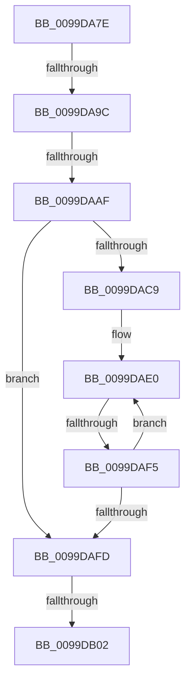

# sub_0099DA7E

- RVA: `0x0099DA7E`–`0x0099DB18` (길이 `154` bytes)
- VA: `0x000000014099DA7E`
- 실행 섹션: `PAGE`
- PDB 이름 있음: `아니요`; PDB Function 태그: `아니요`
- unwind 정보 RVA: `0x00099C34`
- 디코드: `40`개 명령, `154/154` bytes 표시
- 미해석 바이트: `0` (있으면 어셈블리에 `.byte`로 보존)

> 이 문서는 커널 이미지의 기계어와 PDB 기호를 분석해 생성했습니다. 4번과 5번은 함수 원형과 자료형을 바이너리 사용 방식에서 추정한 C 해석이며 원본 소스 복구 결과는 아닙니다.

## 1. Dependencies

- 직접 호출 지점: **0**; 고유 호출 대상: **0**
- 직접 호출자로 확인된 함수: **0**
- RIP 상대 이미지 참조: **0**

### Outgoing calls
- 직접 디코드된 call 명령이 없습니다.

### Direct callers
- 이 함수 시작 RVA로 연결되는 직접 call은 확인되지 않았습니다. 간접 호출은 완전히 역산할 수 없습니다.

### Static image references
- 디코드된 RIP-relative 메모리 참조가 없습니다.

## 2. Other-region calls and transfers

- 다른 실행 섹션으로 향하는 call: **0**
- call이 아닌 외부 분기/꼬리 이동: **4**
  - `0x0099DA96` → [sub_0099DC17](Unknown_function_0099DC17.md) (`tail-transfer`)
  - `0x0099DAA9` → [sub_0099DB26 + 0x2C](Unknown_function_0099DB26.md) (`tail-transfer`)
  - `0x0099DAF3` → [sub_0099DB26](Unknown_function_0099DB26.md) (`tail-transfer`)
  - `0x0099DB00` → [sub_0099DB26 + 0x55](Unknown_function_0099DB26.md) (`tail-transfer`)

## 3. Assembly (complete function range)

```asm
0099DA7E  48 89 74 24 58                  mov qword ptr [rsp + 0x58], rsi
0099DA83  44 0F 47 C7                     cmova r8d, edi
0099DA87  33 F6                           xor esi, esi
0099DA89  44 0F B7 CE                     movzx r9d, si
0099DA8D  0F B7 C6                        movzx eax, si
0099DA90  44 8B D6                        mov r10d, esi
0099DA93  45 85 C0                        test r8d, r8d
0099DA96  0F 85 7B 01 00 00               jne 0x14099dc17
0099DA9C  48 89 5C 24 50                  mov qword ptr [rsp + 0x50], rbx
0099DAA1  4C 89 64 24 60                  mov qword ptr [rsp + 0x60], r12
0099DAA6  45 3B D0                        cmp r10d, r8d
0099DAA9  0F 85 A3 00 00 00               jne 0x14099db52
0099DAAF  4D 8B 5B 08                     mov r11, qword ptr [r11 + 8]
0099DAB3  49 8B 5D 08                     mov rbx, qword ptr [r13 + 8]
0099DAB7  41 8B C2                        mov eax, r10d
0099DABA  48 8D 0C 00                     lea rcx, [rax + rax]
0099DABE  4C 03 D9                        add r11, rcx
0099DAC1  48 03 D9                        add rbx, rcx
0099DAC4  44 3B D7                        cmp r10d, edi
0099DAC7  73 34                           jae 0x14099dafd
0099DAC9  B9 C0 00 00 00                  mov ecx, 0xc0
0099DACE  41 BC E0 FF 00 00               mov r12d, 0xffe0
0099DAD4  0F 1F 40 00                     nop dword ptr [rax]
0099DAD8  0F 1F 84 00 00 00 00 00         nop dword ptr [rax + rax]
0099DAE0  45 0F B7 0B                     movzx r9d, word ptr [r11]
0099DAE4  4D 8D 5B 02                     lea r11, [r11 + 2]
0099DAE8  0F B7 03                        movzx eax, word ptr [rbx]
0099DAEB  48 8D 5B 02                     lea rbx, [rbx + 2]
0099DAEF  66 44 3B C8                     cmp r9w, ax
0099DAF3  75 31                           jne 0x14099db26
0099DAF5  41 FF C2                        inc r10d
0099DAF8  44 3B D7                        cmp r10d, edi
0099DAFB  72 E3                           jb 0x14099dae0
0099DAFD  41 3B EE                        cmp ebp, r14d
0099DB00  72 79                           jb 0x14099db7b
0099DB02  40 0F 97 C6                     seta sil
0099DB06  8D 46 02                        lea eax, [rsi + 2]
0099DB09  48 8B 5C 24 50                  mov rbx, qword ptr [rsp + 0x50]
0099DB0E  4C 8B 64 24 60                  mov r12, qword ptr [rsp + 0x60]
0099DB13  48 8B 74 24 58                  mov rsi, qword ptr [rsp + 0x58]
```

## 4. C-style interpretation (structured pseudocode)

```c
__int64 __fastcall sub_0099DA7E(__int64 a1, __int64 a2, __int64 a3, __int64 a4, __int64 a5, __int64 a6, __int64 a7, __int64 a8, __int64 a9, __int64 a10, __int64 a11, __int64 a12)
{
    __int64 v_r10;
    __int64 v_r11;
    __int64 v_rbx;
    __int64 v_rsi;
    unsigned __int64 v_stack_p50;
    unsigned __int64 v_stack_p58;
    unsigned __int64 v_stack_p60;

    v_stack_p58 = v_rsi;
    if (condition_is_above) { a3 = (unsigned int)(v_rdi); }
    v_rsi = 0;
    v_stack_p50 = v_rbx;
    v_stack_p60 = v_r12;
    v_r11 = (*(unsigned __int64 *)(v_r11 + 8)) + (0 + 0 * 1);
    v_rbx = (*(unsigned __int64 *)(v_r13 + 8)) + (0 + 0 * 1);
    if (0 >= ((unsigned int)(v_rdi))) goto loc_0099DAFD;
loc_0099DAE0:
    v_r10 = (unsigned int)((0) + 1);
    if (((unsigned int)(v_r10)) < ((unsigned int)(v_rdi))) goto loc_0099DAE0;
loc_0099DAFD:
    v_rsi = (((unsigned int)(v_rbp)) > ((unsigned int)(v_r14))) ? 1 : 0;
    return v_rsi + 2;
}
```

## 5. (Beta) C Style

```c
int64_t sub_0099DA7E(int64_t Arg1, int64_t Arg2, int64_t Arg3, int64_t Arg4, uint64_t Arg5, uint64_t Arg6, uint64_t Arg7, uint64_t Arg8, uint64_t Arg9, int64_t Arg10, int64_t Arg11, int64_t Arg12)
{
    int64_t local_r10;
    int64_t local_r11;
    int64_t local_rbx;
    int64_t local_rsi;
    uint64_t v_stack_p50;
    uint64_t v_stack_p58;
    uint64_t v_stack_p60;

    v_stack_p58 = local_rsi;
    if (condition_is_above) { Arg3 = (uint32_t)(local_rdi); }
    local_rsi = 0;
    v_stack_p50 = local_rbx;
    v_stack_p60 = local_r12;
    local_r11 = (*(uint64_t *)(local_r11 + 0x8)) + (0 + 0 * 1);
    local_rbx = (*(uint64_t *)(local_r13 + 0x8)) + (0 + 0 * 1);
    if (0 >= ((uint32_t)(local_rdi))) goto loc_0099DAFD;
loc_0099DAE0:
    local_r10 = (uint32_t)((0) + 1);
    if (((uint32_t)(local_r10)) < ((uint32_t)(local_rdi))) goto loc_0099DAE0;
loc_0099DAFD:
    local_rsi = (((uint32_t)(local_rbp)) > ((uint32_t)(local_r14))) ? 1 : 0;
    return local_rsi + 2;
}
```

## 6. Execution-region graph

[열기: 2D/3D 그래프와 함수 탐색 컨트롤 패널](../../../control-panel.html?section=page&rva=0x0099DA7E&view=graph)

- 2D 그래프는 위에서 아래로 흐르고, 3D 그래프는 빈 공간을 드래그해 회전합니다. Shift+드래그는 이동, 휠은 확대·축소, 함수 노드 선택은 대상 보고서 이동입니다.

### Static fallback


