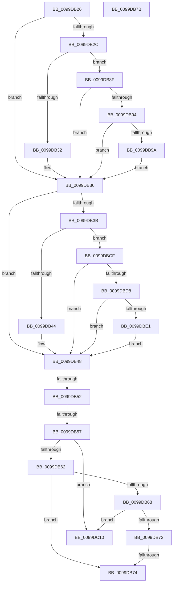

# sub_0099DB26

- RVA: `0x0099DB26`–`0x0099DC17` (길이 `241` bytes)
- VA: `0x000000014099DB26`
- 실행 섹션: `PAGE`
- PDB 이름 있음: `아니요`; PDB Function 태그: `아니요`
- unwind 정보 RVA: `0x00099C64`
- 디코드: `65`개 명령, `241/241` bytes 표시
- 미해석 바이트: `0` (있으면 어셈블리에 `.byte`로 보존)

> 이 문서는 커널 이미지의 기계어와 PDB 기호를 분석해 생성했습니다. 4번과 5번은 함수 원형과 자료형을 바이너리 사용 방식에서 추정한 C 해석이며 원본 소스 복구 결과는 아닙니다.

## 1. Dependencies

- 직접 호출 지점: **0**; 고유 호출 대상: **0**
- 직접 호출자로 확인된 함수: **0**
- RIP 상대 이미지 참조: **0**

### Outgoing calls
- 직접 디코드된 call 명령이 없습니다.

### Direct callers
- 이 함수 시작 RVA로 연결되는 직접 call은 확인되지 않았습니다. 간접 호출은 완전히 역산할 수 없습니다.

### Static image references
- 디코드된 RIP-relative 메모리 참조가 없습니다.

## 2. Other-region calls and transfers

- 다른 실행 섹션으로 향하는 call: **0**
- call이 아닌 외부 분기/꼬리 이동: **6**
  - `0x0099DB4C` → [sub_0099DC4F](Unknown_function_0099DC4F.md) (`tail-transfer`)
  - `0x0099DB55` → [sub_0099DA7E + 0x7F](Unknown_function_0099DA7E.md) (`tail-transfer`)
  - `0x0099DB72` → [sub_0099DA7E + 0x7F](Unknown_function_0099DA7E.md) (`tail-transfer`)
  - `0x0099DB79` → [sub_0099DA7E + 0x8B](Unknown_function_0099DA7E.md) (`tail-transfer`)
  - `0x0099DB8A` → [sub_0099DA7E + 0x8B](Unknown_function_0099DA7E.md) (`tail-transfer`)
  - `0x0099DC12` → [sub_0099DA7E + 0x8B](Unknown_function_0099DA7E.md) (`tail-transfer`)

## 3. Assembly (complete function range)

```asm
0099DB26  41 83 F9 61                     cmp r9d, 0x61
0099DB2A  72 0A                           jb 0x14099db36
0099DB2C  41 83 F9 7A                     cmp r9d, 0x7a
0099DB30  77 5D                           ja 0x14099db8f
0099DB32  66 45 03 CC                     add r9w, r12w
0099DB36  83 F8 61                        cmp eax, 0x61
0099DB39  72 0D                           jb 0x14099db48
0099DB3B  83 F8 7A                        cmp eax, 0x7a
0099DB3E  0F 87 8B 00 00 00               ja 0x14099dbcf
0099DB44  66 41 03 C4                     add ax, r12w
0099DB48  66 44 3B C8                     cmp r9w, ax
0099DB4C  0F 84 FD 00 00 00               je 0x14099dc4f
0099DB52  44 3B D7                        cmp r10d, edi
0099DB55  73 A6                           jae 0x14099dafd
0099DB57  66 41 83 F9 5C                  cmp r9w, 0x5c
0099DB5C  0F 84 AE 00 00 00               je 0x14099dc10
0099DB62  66 83 F8 5C                     cmp ax, 0x5c
0099DB66  74 0C                           je 0x14099db74
0099DB68  66 44 3B C8                     cmp r9w, ax
0099DB6C  0F 82 9E 00 00 00               jb 0x14099dc10
0099DB72  76 89                           jbe 0x14099dafd
0099DB74  B8 03 00 00 00                  mov eax, 3
0099DB79  EB 8E                           jmp 0x14099db09
0099DB7B  49 8B 45 08                     mov rax, qword ptr [r13 + 8]
0099DB7F  66 83 3C 68 5C                  cmp word ptr [rax + rbp*2], 0x5c
0099DB84  40 0F 94 C6                     sete sil
0099DB88  8B C6                           mov eax, esi
0099DB8A  E9 7A FF FF FF                  jmp 0x14099db09
0099DB8F  4D 85 FF                        test r15, r15
0099DB92  74 A2                           je 0x14099db36
0099DB94  66 44 3B C9                     cmp r9w, cx
0099DB98  72 9C                           jb 0x14099db36
0099DB9A  49 8B C9                        mov rcx, r9
0099DB9D  45 8B C1                        mov r8d, r9d
0099DBA0  48 C1 E9 08                     shr rcx, 8
0099DBA4  41 83 E0 0F                     and r8d, 0xf
0099DBA8  41 0F B7 14 4F                  movzx edx, word ptr [r15 + rcx*2]
0099DBAD  41 8B C9                        mov ecx, r9d
0099DBB0  C1 E9 04                        shr ecx, 4
0099DBB3  83 E1 0F                        and ecx, 0xf
0099DBB6  03 D1                           add edx, ecx
0099DBB8  B9 C0 00 00 00                  mov ecx, 0xc0
0099DBBD  41 0F B7 14 57                  movzx edx, word ptr [r15 + rdx*2]
0099DBC2  41 03 D0                        add edx, r8d
0099DBC5  66 45 03 0C 57                  add r9w, word ptr [r15 + rdx*2]
0099DBCA  E9 67 FF FF FF                  jmp 0x14099db36
0099DBCF  4D 85 FF                        test r15, r15
0099DBD2  0F 84 70 FF FF FF               je 0x14099db48
0099DBD8  66 3B C1                        cmp ax, cx
0099DBDB  0F 82 67 FF FF FF               jb 0x14099db48
0099DBE1  48 8B C8                        mov rcx, rax
0099DBE4  44 8B C0                        mov r8d, eax
0099DBE7  48 C1 E9 08                     shr rcx, 8
0099DBEB  41 83 E0 0F                     and r8d, 0xf
0099DBEF  41 0F B7 14 4F                  movzx edx, word ptr [r15 + rcx*2]
0099DBF4  8B C8                           mov ecx, eax
0099DBF6  C1 E9 04                        shr ecx, 4
0099DBF9  83 E1 0F                        and ecx, 0xf
0099DBFC  03 D1                           add edx, ecx
0099DBFE  41 0F B7 14 57                  movzx edx, word ptr [r15 + rdx*2]
0099DC03  41 03 D0                        add edx, r8d
0099DC06  66 41 03 04 57                  add ax, word ptr [r15 + rdx*2]
0099DC0B  E9 38 FF FF FF                  jmp 0x14099db48
0099DC10  33 C0                           xor eax, eax
0099DC12  E9 F2 FE FF FF                  jmp 0x14099db09
```

## 4. C-style interpretation (structured pseudocode)

```c
__int64 __fastcall sub_0099DB26(unsigned __int16 a1, __int64 a2, __int64 a3, int a4)
{
    __int64 result;

    if (a4 < 97) goto loc_0099DB36;
    if (a4 > 122) goto loc_0099DB8F;
    a4 = (unsigned __int16)((a4) + ((unsigned __int16)(v_r12)));
loc_0099DB36:
    if (((unsigned int)(result)) < 97) goto loc_0099DB48;
    if (((unsigned int)(result)) > 122) goto loc_0099DBCF;
    result = (unsigned __int16)((result) + ((unsigned __int16)(v_r12)));
loc_0099DB48:
    if (((unsigned __int16)(a4)) == 92) goto loc_0099DC10;
    if (((unsigned __int16)(result)) == 92) goto loc_0099DB74;
    if (((unsigned __int16)(a4)) < ((unsigned __int16)(result))) goto loc_0099DC10;
loc_0099DB74:
loc_0099DB8F:
    if (v_r15 == 0) goto loc_0099DB36;
    if (((unsigned __int16)(a4)) < a1) goto loc_0099DB36;
    a1 = (a4) >> (8);
    a3 = (unsigned int)(((unsigned int)(a4)) & (15));
    a1 = (unsigned int)(((unsigned int)(a4)) >> (4));
    a1 = (unsigned int)((a1) & (15));
    a2 = (unsigned int)((*(unsigned __int16 *)(v_r15 + a1 * 2)) + (a1));
    a2 = (unsigned int)((*(unsigned __int16 *)(v_r15 + a2 * 2)) + ((unsigned int)(a3)));
    a4 = (unsigned __int16)((a4) + (*(unsigned __int16 *)(v_r15 + a2 * 2)));
    goto loc_0099DB36;
loc_0099DBCF:
    if (v_r15 == 0) goto loc_0099DB48;
    if (3 < 192) goto loc_0099DB48;
    a1 = (3) >> (8);
    a3 = (unsigned int)((3) & (15));
    a1 = (unsigned int)((3) >> (4));
    a1 = (unsigned int)((a1) & (15));
    a2 = (unsigned int)((*(unsigned __int16 *)(v_r15 + a1 * 2)) + (a1));
    a2 = (unsigned int)((*(unsigned __int16 *)(v_r15 + a2 * 2)) + ((unsigned int)(a3)));
    result = (unsigned __int16)((3) + (*(unsigned __int16 *)(v_r15 + a2 * 2)));
    goto loc_0099DB48;
loc_0099DC10:
    result = 0;
}
```

## 5. (Beta) C Style

```c
int64_t sub_0099DB26(uint16_t Arg1, int64_t Arg2, int64_t Arg3, int32_t Arg4)
{
    int64_t result;

    if (Arg4 < 97) goto loc_0099DB36;
    if (Arg4 > 122) goto loc_0099DB8F;
    Arg4 = (uint16_t)((Arg4) + ((uint16_t)(local_r12)));
loc_0099DB36:
    if (((uint32_t)(result)) < 97) goto loc_0099DB48;
    if (((uint32_t)(result)) > 122) goto loc_0099DBCF;
    result = (uint16_t)((result) + ((uint16_t)(local_r12)));
loc_0099DB48:
    if (((uint16_t)(Arg4)) == 92) goto loc_0099DC10;
    if (((uint16_t)(result)) == 92) goto loc_0099DB74;
    if (((uint16_t)(Arg4)) < ((uint16_t)(result))) goto loc_0099DC10;
loc_0099DB74:
loc_0099DB8F:
    if (local_r15 == 0) goto loc_0099DB36;
    if (((uint16_t)(Arg4)) < Arg1) goto loc_0099DB36;
    Arg1 = (Arg4) >> (8);
    Arg3 = (uint32_t)(((uint32_t)(Arg4)) & (15));
    Arg1 = (uint32_t)(((uint32_t)(Arg4)) >> (4));
    Arg1 = (uint32_t)((Arg1) & (15));
    Arg2 = (uint32_t)((*(uint16_t *)(local_r15 + Arg1 * 2)) + (Arg1));
    Arg2 = (uint32_t)((*(uint16_t *)(local_r15 + Arg2 * 2)) + ((uint32_t)(Arg3)));
    Arg4 = (uint16_t)((Arg4) + (*(uint16_t *)(local_r15 + Arg2 * 2)));
    goto loc_0099DB36;
loc_0099DBCF:
    if (local_r15 == 0) goto loc_0099DB48;
    if (3 < 192) goto loc_0099DB48;
    Arg1 = (3) >> (8);
    Arg3 = (uint32_t)((3) & (15));
    Arg1 = (uint32_t)((3) >> (4));
    Arg1 = (uint32_t)((Arg1) & (15));
    Arg2 = (uint32_t)((*(uint16_t *)(local_r15 + Arg1 * 2)) + (Arg1));
    Arg2 = (uint32_t)((*(uint16_t *)(local_r15 + Arg2 * 2)) + ((uint32_t)(Arg3)));
    result = (uint16_t)((3) + (*(uint16_t *)(local_r15 + Arg2 * 2)));
    goto loc_0099DB48;
loc_0099DC10:
    result = 0;
}
```

## 6. Execution-region graph

[열기: 2D/3D 그래프와 함수 탐색 컨트롤 패널](../../../control-panel.html?section=page&rva=0x0099DB26&view=graph)

- 2D 그래프는 위에서 아래로 흐르고, 3D 그래프는 빈 공간을 드래그해 회전합니다. Shift+드래그는 이동, 휠은 확대·축소, 함수 노드 선택은 대상 보고서 이동입니다.

### Static fallback


