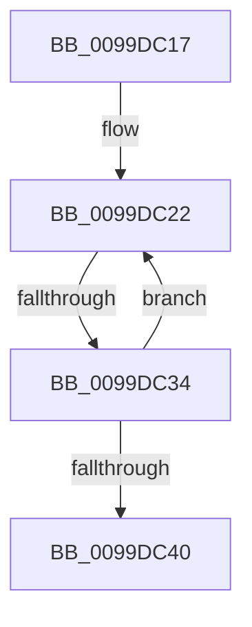

# sub_0099DC17

- RVA: `0x0099DC17`–`0x0099DC45` (길이 `46` bytes)
- VA: `0x000000014099DC17`
- 실행 섹션: `PAGE`
- PDB 이름 있음: `아니요`; PDB Function 태그: `아니요`
- unwind 정보 RVA: `0x00099C80`
- 디코드: `12`개 명령, `46/46` bytes 표시
- 미해석 바이트: `0` (있으면 어셈블리에 `.byte`로 보존)

> 이 문서는 커널 이미지의 기계어와 PDB 기호를 분석해 생성했습니다. 4번과 5번은 함수 원형과 자료형을 바이너리 사용 방식에서 추정한 C 해석이며 원본 소스 복구 결과는 아닙니다.

## 1. Dependencies

- 직접 호출 지점: **0**; 고유 호출 대상: **0**
- 직접 호출자로 확인된 함수: **0**
- RIP 상대 이미지 참조: **0**

### Outgoing calls
- 직접 디코드된 call 명령이 없습니다.

### Direct callers
- 이 함수 시작 RVA로 연결되는 직접 call은 확인되지 않았습니다. 간접 호출은 완전히 역산할 수 없습니다.

### Static image references
- 디코드된 RIP-relative 메모리 참조가 없습니다.

## 2. Other-region calls and transfers

- 다른 실행 섹션으로 향하는 call: **0**
- call이 아닌 외부 분기/꼬리 이동: **2**
  - `0x0099DC2E` → [sub_0099DA7E + 0x1E](Unknown_function_0099DA7E.md) (`tail-transfer`)
  - `0x0099DC40` → [sub_0099DA7E + 0x1E](Unknown_function_0099DA7E.md) (`tail-transfer`)

## 3. Assembly (complete function range)

```asm
0099DC17  48 8B 4A 08                     mov rcx, qword ptr [rdx + 8]
0099DC1B  49 8B 53 08                     mov rdx, qword ptr [r11 + 8]
0099DC1F  48 2B D1                        sub rdx, rcx
0099DC22  44 0F B7 0C 0A                  movzx r9d, word ptr [rdx + rcx]
0099DC27  0F B7 01                        movzx eax, word ptr [rcx]
0099DC2A  66 44 3B C8                     cmp r9w, ax
0099DC2E  0F 85 68 FE FF FF               jne 0x14099da9c
0099DC34  41 FF C2                        inc r10d
0099DC37  48 83 C1 02                     add rcx, 2
0099DC3B  45 3B D0                        cmp r10d, r8d
0099DC3E  72 E2                           jb 0x14099dc22
0099DC40  E9 57 FE FF FF                  jmp 0x14099da9c
```

## 4. C-style interpretation (structured pseudocode)

```c
__int64 __fastcall sub_0099DC17(__int64 a1, __int64 a2, int a3)
{
    __int64 v_r10;

    a2 = (*(unsigned __int64 *)(v_r11 + 8)) - (*(unsigned __int64 *)(a2 + 8));
loc_0099DC22:
    v_r10 = (unsigned int)((v_r10) + 1);
    a1 = (*(unsigned __int64 *)(a2 + 8)) + (2);
    if (((unsigned int)(v_r10)) < a3) goto loc_0099DC22;
}
```

## 5. (Beta) C Style

```c
int64_t sub_0099DC17(int64_t Arg1, void *Arg2, int32_t Arg3)
{
    uint8_t *arg2 = (uint8_t *)Arg2;

    int64_t local_r10;

    Arg2 = (*(uint64_t *)(local_r11 + 0x8)) - (*(uint64_t *)(arg2 + 0x8));
loc_0099DC22:
    local_r10 = (uint32_t)((local_r10) + 1);
    Arg1 = (*(uint64_t *)(arg2 + 0x8)) + (2);
    if (((uint32_t)(local_r10)) < Arg3) goto loc_0099DC22;
}
```

### 관측된 메모리 오프셋

구조체 형식이 확인되지 않은 접근은 인자 기준의 오프셋으로만 기록했습니다.

| 기준 인자 | 오프셋 표현 | 폭 (bit) | 접근 |
|---|---:|---:|---|
| `Arg2` | `+ 0x8` | `64` | `R` |

## 6. Execution-region graph

[열기: 2D/3D 그래프와 함수 탐색 컨트롤 패널](../../../control-panel.html?section=page&rva=0x0099DC17&view=graph)

- 2D 그래프는 위에서 아래로 흐르고, 3D 그래프는 빈 공간을 드래그해 회전합니다. Shift+드래그는 이동, 휠은 확대·축소, 함수 노드 선택은 대상 보고서 이동입니다.

### Static fallback


