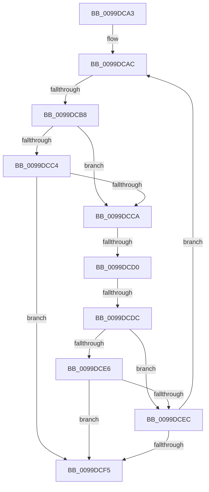

# sub_0099DCA3

- RVA: `0x0099DCA3`–`0x0099DCFA` (길이 `87` bytes)
- VA: `0x000000014099DCA3`
- 실행 섹션: `PAGE`
- PDB 이름 있음: `아니요`; PDB Function 태그: `아니요`
- unwind 정보 RVA: `0x0009A130`
- 디코드: `24`개 명령, `87/87` bytes 표시
- 미해석 바이트: `0` (있으면 어셈블리에 `.byte`로 보존)

> 이 문서는 커널 이미지의 기계어와 PDB 기호를 분석해 생성했습니다. 4번과 5번은 함수 원형과 자료형을 바이너리 사용 방식에서 추정한 C 해석이며 원본 소스 복구 결과는 아닙니다.

## 1. Dependencies

- 직접 호출 지점: **0**; 고유 호출 대상: **0**
- 직접 호출자로 확인된 함수: **0**
- RIP 상대 이미지 참조: **0**

### Outgoing calls
- 직접 디코드된 call 명령이 없습니다.

### Direct callers
- 이 함수 시작 RVA로 연결되는 직접 call은 확인되지 않았습니다. 간접 호출은 완전히 역산할 수 없습니다.

### Static image references
- 디코드된 RIP-relative 메모리 참조가 없습니다.

## 2. Other-region calls and transfers

- 다른 실행 섹션으로 향하는 call: **0**
- call이 아닌 외부 분기/꼬리 이동: **3**
  - `0x0099DCB2` → [sub_0099DD1B + 0x2D](Unknown_function_0099DD1B.md) (`tail-transfer`)
  - `0x0099DCCE` → [sub_0099DD1B + 0x28](Unknown_function_0099DD1B.md) (`tail-transfer`)
  - `0x0099DCDA` → [sub_0099DD1B](Unknown_function_0099DD1B.md) (`tail-transfer`)

## 3. Assembly (complete function range)

```asm
0099DCA3  4C 89 7C 24 40                  mov qword ptr [rsp + 0x40], r15
0099DCA8  44 8D 7D FF                     lea r15d, [rbp - 1]
0099DCAC  0F B7 FF                        movzx edi, di
0099DCAF  83 FF 02                        cmp edi, 2
0099DCB2  0F 83 90 00 00 00               jae 0x14099dd48
0099DCB8  48 8B 5C FE 08                  mov rbx, qword ptr [rsi + rdi*8 + 8]
0099DCBD  66 83 7B 42 00                  cmp word ptr [rbx + 0x42], 0
0099DCC2  74 06                           je 0x14099dcca
0099DCC4  80 7B 41 01                     cmp byte ptr [rbx + 0x41], 1
0099DCC8  74 2B                           je 0x14099dcf5
0099DCCA  83 7B 28 FF                     cmp dword ptr [rbx + 0x28], -1
0099DCCE  74 73                           je 0x14099dd43
0099DCD0  48 8B 93 F0 00 00 00            mov rdx, qword ptr [rbx + 0xf0]
0099DCD7  48 85 D2                        test rdx, rdx
0099DCDA  75 3F                           jne 0x14099dd1b
0099DCDC  66 83 7B 42 00                  cmp word ptr [rbx + 0x42], 0
0099DCE1  48 8B EB                        mov rbp, rbx
0099DCE4  74 06                           je 0x14099dcec
0099DCE6  80 7B 41 00                     cmp byte ptr [rbx + 0x41], 0
0099DCEA  75 09                           jne 0x14099dcf5
0099DCEC  41 0F B7 C7                     movzx eax, r15w
0099DCF0  66 03 F8                        add di, ax
0099DCF3  79 B7                           jns 0x14099dcac
0099DCF5  4C 8B 7C 24 40                  mov r15, qword ptr [rsp + 0x40]
```

## 4. C-style interpretation (structured pseudocode)

```c
__int64 __fastcall sub_0099DCA3(__int64 a1, __int64 a2, __int64 a3, __int64 a4, __int64 a5, __int64 a6, __int64 a7, __int64 a8)
{
    __int64 v_rdi;
    unsigned __int64 v_stack_p40;

    v_stack_p40 = v_r15;
loc_0099DCAC:
    if ((*(unsigned __int16 *)(*(unsigned __int64 *)(v_rsi + (unsigned __int16)(v_rdi) * 8 + 8) + 66)) == 0) goto loc_0099DCCA;
    if ((*(unsigned __int8 *)(*(unsigned __int64 *)(v_rsi + (unsigned __int16)(v_rdi) * 8 + 8) + 65)) == 1) goto loc_0099DCF5;
loc_0099DCCA:
    if ((*(unsigned __int16 *)(*(unsigned __int64 *)(v_rsi + (unsigned __int16)(v_rdi) * 8 + 8) + 66)) == 0) goto loc_0099DCEC;
    if ((*(unsigned __int8 *)(*(unsigned __int64 *)(v_rsi + (unsigned __int16)(v_rdi) * 8 + 8) + 65)) != 0) goto loc_0099DCF5;
loc_0099DCEC:
    v_rdi = (unsigned __int16)(((unsigned __int16)(v_rdi)) + ((unsigned __int16)((unsigned __int16)(v_rbp - 1))));
    if (!sign_flag) goto loc_0099DCAC;
loc_0099DCF5:
    return (unsigned __int16)(v_rbp - 1);
}
```

## 5. (Beta) C Style

```c
int64_t sub_0099DCA3(int64_t Arg1, int64_t Arg2, int64_t Arg3, int64_t Arg4, uint64_t Arg5, uint64_t Arg6, uint64_t Arg7, int64_t Arg8)
{
    int64_t local_rdi;
    uint64_t v_stack_p40;

    v_stack_p40 = local_r15;
loc_0099DCAC:
    if ((*(uint16_t *)(*(uint64_t *)(local_rsi + (uint16_t)(local_rdi) * 8 + 0x8) + 0x42)) == 0) goto loc_0099DCCA;
    if ((*(uint8_t *)(*(uint64_t *)(local_rsi + (uint16_t)(local_rdi) * 8 + 0x8) + 0x41)) == 1) goto loc_0099DCF5;
loc_0099DCCA:
    if ((*(uint16_t *)(*(uint64_t *)(local_rsi + (uint16_t)(local_rdi) * 8 + 0x8) + 0x42)) == 0) goto loc_0099DCEC;
    if ((*(uint8_t *)(*(uint64_t *)(local_rsi + (uint16_t)(local_rdi) * 8 + 0x8) + 0x41)) != 0) goto loc_0099DCF5;
loc_0099DCEC:
    local_rdi = (uint16_t)(((uint16_t)(local_rdi)) + ((uint16_t)((uint16_t)(local_rbp - 1))));
    if (!sign_flag) goto loc_0099DCAC;
loc_0099DCF5:
    return (uint16_t)(local_rbp - 1);
}
```

## 6. Execution-region graph

[열기: 2D/3D 그래프와 함수 탐색 컨트롤 패널](../../../control-panel.html?section=page&rva=0x0099DCA3&view=graph)

- 2D 그래프는 위에서 아래로 흐르고, 3D 그래프는 빈 공간을 드래그해 회전합니다. Shift+드래그는 이동, 휠은 확대·축소, 함수 노드 선택은 대상 보고서 이동입니다.

### Static fallback


