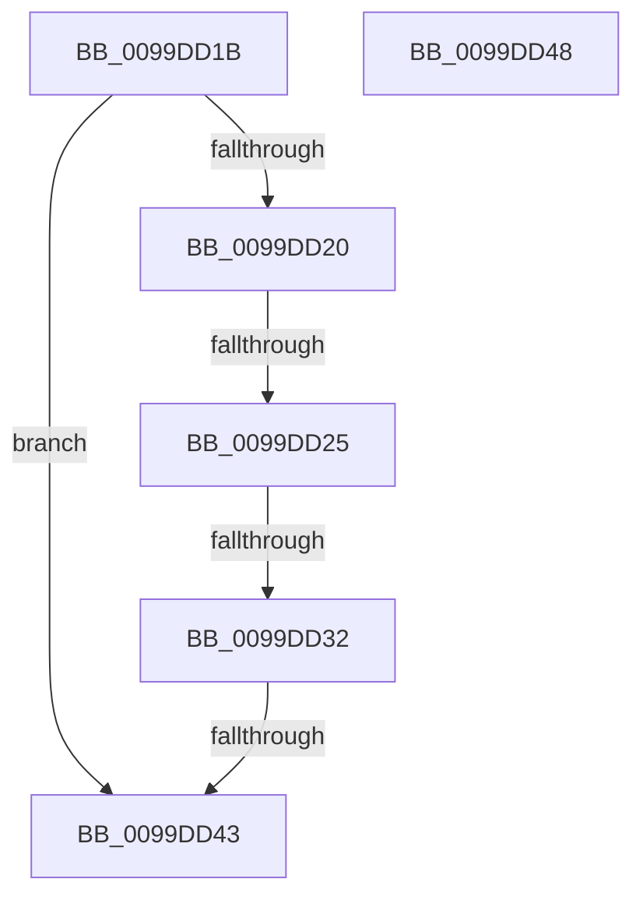

# sub_0099DD1B

- RVA: `0x0099DD1B`–`0x0099DD56` (길이 `59` bytes)
- VA: `0x000000014099DD1B`
- 실행 섹션: `PAGE`
- PDB 이름 있음: `아니요`; PDB Function 태그: `아니요`
- unwind 정보 RVA: `0x0009A158`
- 디코드: `17`개 명령, `59/59` bytes 표시
- 미해석 바이트: `0` (있으면 어셈블리에 `.byte`로 보존)

> 이 문서는 커널 이미지의 기계어와 PDB 기호를 분석해 생성했습니다. 4번과 5번은 함수 원형과 자료형을 바이너리 사용 방식에서 추정한 C 해석이며 원본 소스 복구 결과는 아닙니다.

## 1. Dependencies

- 직접 호출 지점: **1**; 고유 호출 대상: **1**
- 직접 호출자로 확인된 함수: **0**
- RIP 상대 이미지 참조: **0**

### Outgoing calls
- `0x0099DD3A` → [CmpTransUowIsEqual](../70/CmpTransUowIsEqual_function_007049CC.md) (function, `0x007049CC`)

### Direct callers
- 이 함수 시작 RVA로 연결되는 직접 call은 확인되지 않았습니다. 간접 호출은 완전히 역산할 수 없습니다.

### Static image references
- 디코드된 RIP-relative 메모리 참조가 없습니다.

## 2. Other-region calls and transfers

- 다른 실행 섹션으로 향하는 call: **0**
- call이 아닌 외부 분기/꼬리 이동: **5**
  - `0x0099DD23` → [sub_0099DCA3 + 0x39](Unknown_function_0099DCA3.md) (`tail-transfer`)
  - `0x0099DD2C` → [sub_0099DDC2](Unknown_function_0099DDC2.md) (`tail-transfer`)
  - `0x0099DD41` → [sub_0099DCA3 + 0x39](Unknown_function_0099DCA3.md) (`tail-transfer`)
  - `0x0099DD46` → [sub_0099DCA3 + 0x4D](Unknown_function_0099DCA3.md) (`tail-transfer`)
  - `0x0099DD51` → [sub_0099DCA3 + 0x1A](Unknown_function_0099DCA3.md) (`tail-transfer`)

## 3. Assembly (complete function range)

```asm
0099DD1B  4D 85 F6                        test r14, r14
0099DD1E  74 23                           je 0x14099dd43
0099DD20  4C 3B F2                        cmp r14, rdx
0099DD23  74 B7                           je 0x14099dcdc
0099DD25  49 8B 46 38                     mov rax, qword ptr [r14 + 0x38]
0099DD29  48 85 C0                        test rax, rax
0099DD2C  0F 85 90 00 00 00               jne 0x14099ddc2
0099DD32  48 83 C2 58                     add rdx, 0x58
0099DD36  49 8D 4E 58                     lea rcx, [r14 + 0x58]
0099DD3A  E8 8D 6C D6 FF                  call 0x1407049cc
0099DD3F  84 C0                           test al, al
0099DD41  75 99                           jne 0x14099dcdc
0099DD43  41 8B C7                        mov eax, r15d
0099DD46  EB A8                           jmp 0x14099dcf0
0099DD48  48 8B 5E 18                     mov rbx, qword ptr [rsi + 0x18]
0099DD4C  48 8B 5C FB F0                  mov rbx, qword ptr [rbx + rdi*8 - 0x10]
0099DD51  E9 67 FF FF FF                  jmp 0x14099dcbd
```

## 4. C-style interpretation (structured pseudocode)

```c
__int64 __fastcall sub_0099DD1B(__int64 a1, __int64 a2)
{
    __int64 result;

    if (v_r14 == 0) goto loc_0099DD43;
    a2 = (a2) + (88);
    result = CmpTransUowIsEqual(v_r14 + 88, a2, a3, a4);
loc_0099DD43:
}
```

## 5. (Beta) C Style

```c
int64_t sub_0099DD1B(int64_t Arg1, int64_t Arg2)
{
    int64_t result;

    if (local_r14 == 0) goto loc_0099DD43;
    Arg2 = (Arg2) + (88);
    result = CmpTransUowIsEqual(local_r14 + 88, Arg2, a3, a4);
loc_0099DD43:
}
```

## 6. Execution-region graph

[열기: 2D/3D 그래프와 함수 탐색 컨트롤 패널](../../../control-panel.html?section=page&rva=0x0099DD1B&view=graph)

- 2D 그래프는 위에서 아래로 흐르고, 3D 그래프는 빈 공간을 드래그해 회전합니다. Shift+드래그는 이동, 휠은 확대·축소, 함수 노드 선택은 대상 보고서 이동입니다.

### Static fallback


