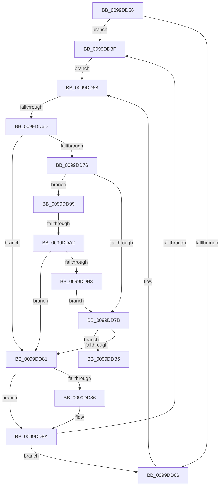

# sub_0099DD56

- RVA: `0x0099DD56`–`0x0099DDC2` (길이 `108` bytes)
- VA: `0x000000014099DD56`
- 실행 섹션: `PAGE`
- PDB 이름 있음: `아니요`; PDB Function 태그: `아니요`
- unwind 정보 RVA: `0x0009A16C`
- 디코드: `34`개 명령, `108/108` bytes 표시
- 미해석 바이트: `0` (있으면 어셈블리에 `.byte`로 보존)

> 이 문서는 커널 이미지의 기계어와 PDB 기호를 분석해 생성했습니다. 4번과 5번은 함수 원형과 자료형을 바이너리 사용 방식에서 추정한 C 해석이며 원본 소스 복구 결과는 아닙니다.

## 1. Dependencies

- 직접 호출 지점: **1**; 고유 호출 대상: **1**
- 직접 호출자로 확인된 함수: **0**
- RIP 상대 이미지 참조: **0**

### Outgoing calls
- `0x0099DDAA` → [CmpTransUowIsEqual](../70/CmpTransUowIsEqual_function_007049CC.md) (function, `0x007049CC`)

### Direct callers
- 이 함수 시작 RVA로 연결되는 직접 call은 확인되지 않았습니다. 간접 호출은 완전히 역산할 수 없습니다.

### Static image references
- 디코드된 RIP-relative 메모리 참조가 없습니다.

## 2. Other-region calls and transfers

- 다른 실행 섹션으로 향하는 call: **0**
- call이 아닌 외부 분기/꼬리 이동: **3**
  - `0x0099DD6B` → [sub_0099DCFA + 0x9](Unknown_function_0099DCFA.md) (`tail-transfer`)
  - `0x0099DDA0` → [sub_0099DDDA](Unknown_function_0099DDDA.md) (`tail-transfer`)
  - `0x0099DDBD` → [sub_0099DCFA + 0xD](Unknown_function_0099DCFA.md) (`tail-transfer`)

## 3. Assembly (complete function range)

```asm
0099DD56  48 81 C5 D0 00 00 00            add rbp, 0xd0
0099DD5D  48 8B 7D 08                     mov rdi, qword ptr [rbp + 8]
0099DD61  48 3B EF                        cmp rbp, rdi
0099DD64  75 29                           jne 0x14099dd8f
0099DD66  33 F6                           xor esi, esi
0099DD68  48 85 F6                        test rsi, rsi
0099DD6B  74 96                           je 0x14099dd03
0099DD6D  48 8B 4E 38                     mov rcx, qword ptr [rsi + 0x38]
0099DD71  48 85 C9                        test rcx, rcx
0099DD74  74 0B                           je 0x14099dd81
0099DD76  49 3B CE                        cmp rcx, r14
0099DD79  75 1E                           jne 0x14099dd99
0099DD7B  83 7E 44 09                     cmp dword ptr [rsi + 0x44], 9
0099DD7F  74 34                           je 0x14099ddb5
0099DD81  48 85 FF                        test rdi, rdi
0099DD84  75 04                           jne 0x14099dd8a
0099DD86  48 8B 7D 08                     mov rdi, qword ptr [rbp + 8]
0099DD8A  48 3B EF                        cmp rbp, rdi
0099DD8D  74 D7                           je 0x14099dd66
0099DD8F  48 8D 77 E0                     lea rsi, [rdi - 0x20]
0099DD93  48 8B 7F 08                     mov rdi, qword ptr [rdi + 8]
0099DD97  EB CF                           jmp 0x14099dd68
0099DD99  48 8B 41 38                     mov rax, qword ptr [rcx + 0x38]
0099DD9D  48 85 C0                        test rax, rax
0099DDA0  75 38                           jne 0x14099ddda
0099DDA2  49 8D 56 58                     lea rdx, [r14 + 0x58]
0099DDA6  48 83 C1 58                     add rcx, 0x58
0099DDAA  E8 1D 6C D6 FF                  call 0x1407049cc
0099DDAF  84 C0                           test al, al
0099DDB1  74 CE                           je 0x14099dd81
0099DDB3  EB C6                           jmp 0x14099dd7b
0099DDB5  48 8B 46 58                     mov rax, qword ptr [rsi + 0x58]
0099DDB9  48 83 C0 20                     add rax, 0x20
0099DDBD  E9 45 FF FF FF                  jmp 0x14099dd07
```

## 4. C-style interpretation (structured pseudocode)

```c
__int64 __fastcall sub_0099DD56(void)
{
    __int64 result;
    __int64 v_rbp;
    __int64 v_rdi;
    __int64 v_rsi;

    v_rbp = (v_rbp) + (208);
    if (v_rbp != (*(unsigned __int64 *)(v_rbp + 8))) goto loc_0099DD8F;
loc_0099DD66:
    v_rsi = 0;
loc_0099DD68:
    if (*(unsigned __int64 *)(v_rsi + 56) == 0) goto loc_0099DD81;
    if ((*(unsigned __int64 *)(v_rsi + 56)) != v_r14) goto loc_0099DD99;
loc_0099DD7B:
    if ((*(unsigned int *)(v_rsi + 68)) == 9) goto loc_0099DDB5;
loc_0099DD81:
    v_rdi = *(unsigned __int64 *)(v_rbp + 8);
    if (*(unsigned __int64 *)(v_rbp + 8) == 0) {
        v_rdi = *(unsigned __int64 *)(v_rbp + 8);
    }
    if (v_rbp == v_rdi) goto loc_0099DD66;
loc_0099DD8F:
    goto loc_0099DD68;
loc_0099DD99:
    a1 = (*(unsigned __int64 *)(v_rsi + 56)) + (88);
    result = CmpTransUowIsEqual(a1, v_r14 + 88, a3, a4);
    if ((unsigned __int8)(result) == 0) goto loc_0099DD81;
    goto loc_0099DD7B;
loc_0099DDB5:
    result = (*(unsigned __int64 *)(v_rdi - 32 + 88)) + (32);
}
```

## 5. (Beta) C Style

```c
void sub_0099DD56(void)
{
    int64_t result;
    int64_t local_rbp;
    int64_t local_rdi;
    int64_t local_rsi;

    local_rbp = (local_rbp) + (208);
    if (local_rbp != (*(uint64_t *)(local_rbp + 0x8))) goto loc_0099DD8F;
loc_0099DD66:
    local_rsi = 0;
loc_0099DD68:
    if (*(uint64_t *)(local_rsi + 0x38) == 0) goto loc_0099DD81;
    if ((*(uint64_t *)(local_rsi + 0x38)) != local_r14) goto loc_0099DD99;
loc_0099DD7B:
    if ((*(uint32_t *)(local_rsi + 0x44)) == 9) goto loc_0099DDB5;
loc_0099DD81:
    local_rdi = *(uint64_t *)(local_rbp + 0x8);
    if (*(uint64_t *)(local_rbp + 0x8) == 0) {
        local_rdi = *(uint64_t *)(local_rbp + 0x8);
    }
    if (local_rbp == local_rdi) goto loc_0099DD66;
loc_0099DD8F:
    goto loc_0099DD68;
loc_0099DD99:
    a1 = (*(uint64_t *)(local_rsi + 0x38)) + (88);
    result = CmpTransUowIsEqual(a1, local_r14 + 88, a3, a4);
    if ((uint8_t)(result) == 0) goto loc_0099DD81;
    goto loc_0099DD7B;
loc_0099DDB5:
    result = (*(uint64_t *)(local_rdi - 0x20 + 0x58)) + (32);
}
```

## 6. Execution-region graph

[열기: 2D/3D 그래프와 함수 탐색 컨트롤 패널](../../../control-panel.html?section=page&rva=0x0099DD56&view=graph)

- 2D 그래프는 위에서 아래로 흐르고, 3D 그래프는 빈 공간을 드래그해 회전합니다. Shift+드래그는 이동, 휠은 확대·축소, 함수 노드 선택은 대상 보고서 이동입니다.

### Static fallback


