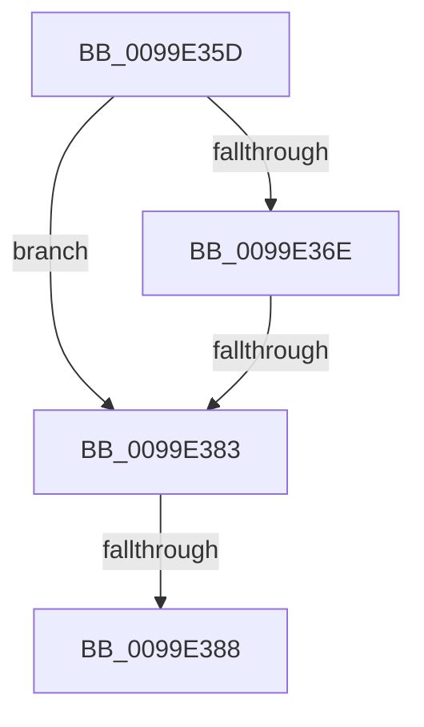

# sub_0099E35D

- RVA: `0x0099E35D`–`0x0099E3A2` (길이 `69` bytes)
- VA: `0x000000014099E35D`
- 실행 섹션: `PAGE`
- PDB 이름 있음: `아니요`; PDB Function 태그: `아니요`
- unwind 정보 RVA: `0x0009A3F0`
- 디코드: `20`개 명령, `69/69` bytes 표시
- 미해석 바이트: `0` (있으면 어셈블리에 `.byte`로 보존)

> 이 문서는 커널 이미지의 기계어와 PDB 기호를 분석해 생성했습니다. 4번과 5번은 함수 원형과 자료형을 바이너리 사용 방식에서 추정한 C 해석이며 원본 소스 복구 결과는 아닙니다.

## 1. Dependencies

- 직접 호출 지점: **1**; 고유 호출 대상: **1**
- 직접 호출자로 확인된 함수: **0**
- RIP 상대 이미지 참조: **0**

### Outgoing calls
- `0x0099E37A` → [PspChargeQuota](../../text/39/PspChargeQuota_function_00390330.md) (function, `0x00390330`)

### Direct callers
- 이 함수 시작 RVA로 연결되는 직접 call은 확인되지 않았습니다. 간접 호출은 완전히 역산할 수 없습니다.

### Static image references
- 디코드된 RIP-relative 메모리 참조가 없습니다.

## 2. Other-region calls and transfers

- 다른 실행 섹션으로 향하는 call: **1**
  - `0x0099E37A` → [PspChargeQuota](../../text/39/PspChargeQuota_function_00390330.md) (`PAGE` → `.text`)
- call이 아닌 외부 분기/꼬리 이동: **2**
  - `0x0099E381` → [sub_0099E3A3 + 0x2A](Unknown_function_0099E3A3.md) (`tail-transfer`)
  - `0x0099E386` → [sub_0099E3A3](Unknown_function_0099E3A3.md) (`tail-transfer`)

## 3. Assembly (complete function range)

```asm
0099E35D  48 89 5C 24 30                  mov qword ptr [rsp + 0x30], rbx
0099E362  48 8B 99 F8 02 00 00            mov rbx, qword ptr [rcx + 0x2f8]
0099E369  48 85 D2                        test rdx, rdx
0099E36C  74 15                           je 0x14099e383
0099E36E  4C 8B CA                        mov r9, rdx
0099E371  48 8B CB                        mov rcx, rbx
0099E374  33 D2                           xor edx, edx
0099E376  44 8D 42 01                     lea r8d, [rdx + 1]
0099E37A  E8 B1 1F 9F FF                  call 0x140390330
0099E37F  85 C0                           test eax, eax
0099E381  78 4A                           js 0x14099e3cd
0099E383  48 85 F6                        test rsi, rsi
0099E386  75 1B                           jne 0x14099e3a3
0099E388  F0 FF 83 00 02 00 00            lock inc dword ptr [rbx + 0x200]
0099E38F  48 8B C3                        mov rax, rbx
0099E392  48 8B 5C 24 30                  mov rbx, qword ptr [rsp + 0x30]
0099E397  48 8B 74 24 38                  mov rsi, qword ptr [rsp + 0x38]
0099E39C  48 83 C4 20                     add rsp, 0x20
0099E3A0  5F                              pop rdi
0099E3A1  C3                              ret
```

## 4. C-style interpretation (structured pseudocode)

```c
__int64 __fastcall sub_0099E35D(__int64 a1, __int64 a2, __int64 a3, __int64 a4, __int64 a5, __int64 a6, __int64 a7)
{
    __int64 result;
    __int64 v_rsp;
    unsigned __int64 v_stack_p30;

    v_stack_p30 = v_rbx;
    if (a2 == 0) goto loc_0099E383;
    a2 = 0;
    result = PspChargeQuota(*(unsigned __int64 *)(a1 + 760), a2, a2 + 1, a2);
loc_0099E383:
    v_rsp = (v_rsp) + (32);
    return *(unsigned __int64 *)(a1 + 760);
}
```

## 5. (Beta) C Style

```c
int64_t sub_0099E35D(void *Arg1, int64_t Arg2, int64_t Arg3, int64_t Arg4, uint64_t Arg5, int64_t Arg6, int64_t Arg7)
{
    uint8_t *arg1 = (uint8_t *)Arg1;

    int64_t result;
    int64_t local_rsp;
    uint64_t v_stack_p30;

    v_stack_p30 = local_rbx;
    if (Arg2 == 0) goto loc_0099E383;
    Arg2 = 0;
    result = PspChargeQuota(*(uint64_t *)(arg1 + 0x2F8), Arg2, Arg2 + 1, Arg2);
loc_0099E383:
    local_rsp = (local_rsp) + (32);
    return *(uint64_t *)(arg1 + 0x2F8);
}
```

### 관측된 메모리 오프셋

구조체 형식이 확인되지 않은 접근은 인자 기준의 오프셋으로만 기록했습니다.

| 기준 인자 | 오프셋 표현 | 폭 (bit) | 접근 |
|---|---:|---:|---|
| `Arg1` | `+ 0x2F8` | `64` | `R` |

## 6. Execution-region graph

[열기: 2D/3D 그래프와 함수 탐색 컨트롤 패널](../../../control-panel.html?section=page&rva=0x0099E35D&view=graph)

- 2D 그래프는 위에서 아래로 흐르고, 3D 그래프는 빈 공간을 드래그해 회전합니다. Shift+드래그는 이동, 휠은 확대·축소, 함수 노드 선택은 대상 보고서 이동입니다.

### Static fallback


