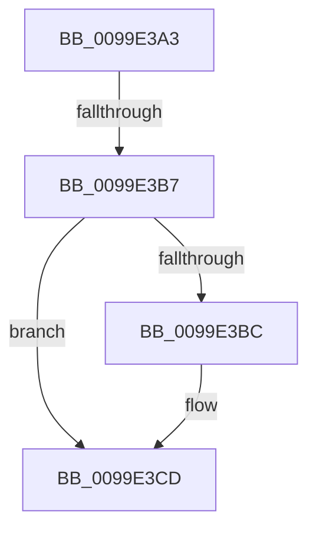

# sub_0099E3A3

- RVA: `0x0099E3A3`–`0x0099E3DF` (길이 `60` bytes)
- VA: `0x000000014099E3A3`
- 실행 섹션: `PAGE`
- PDB 이름 있음: `아니요`; PDB Function 태그: `아니요`
- unwind 정보 RVA: `0x0009A418`
- 디코드: `20`개 명령, `60/60` bytes 표시
- 미해석 바이트: `0` (있으면 어셈블리에 `.byte`로 보존)

> 이 문서는 커널 이미지의 기계어와 PDB 기호를 분석해 생성했습니다. 4번과 5번은 함수 원형과 자료형을 바이너리 사용 방식에서 추정한 C 해석이며 원본 소스 복구 결과는 아닙니다.

## 1. Dependencies

- 직접 호출 지점: **2**; 고유 호출 대상: **2**
- 직접 호출자로 확인된 함수: **0**
- RIP 상대 이미지 참조: **0**

### Outgoing calls
- `0x0099E3AE` → [PspChargeQuota](../../text/39/PspChargeQuota_function_00390330.md) (function, `0x00390330`)
- `0x0099E3C8` → [PspReturnQuota](../../text/39/PspReturnQuota_function_00390C40.md) (function, `0x00390C40`)

### Direct callers
- 이 함수 시작 RVA로 연결되는 직접 call은 확인되지 않았습니다. 간접 호출은 완전히 역산할 수 없습니다.

### Static image references
- 디코드된 RIP-relative 메모리 참조가 없습니다.

## 2. Other-region calls and transfers

- 다른 실행 섹션으로 향하는 call: **2**
  - `0x0099E3AE` → [PspChargeQuota](../../text/39/PspChargeQuota_function_00390330.md) (`PAGE` → `.text`)
  - `0x0099E3C8` → [PspReturnQuota](../../text/39/PspReturnQuota_function_00390C40.md) (`PAGE` → `.text`)
- call이 아닌 외부 분기/꼬리 이동: **1**
  - `0x0099E3B5` → [sub_0099E35D + 0x2B](Unknown_function_0099E35D.md) (`tail-transfer`)

## 3. Assembly (complete function range)

```asm
0099E3A3  4C 8B CE                        mov r9, rsi
0099E3A6  45 33 C0                        xor r8d, r8d
0099E3A9  33 D2                           xor edx, edx
0099E3AB  48 8B CB                        mov rcx, rbx
0099E3AE  E8 7D 1F 9F FF                  call 0x140390330
0099E3B3  85 C0                           test eax, eax
0099E3B5  79 D1                           jns 0x14099e388
0099E3B7  48 85 FF                        test rdi, rdi
0099E3BA  74 11                           je 0x14099e3cd
0099E3BC  33 D2                           xor edx, edx
0099E3BE  4C 8B CF                        mov r9, rdi
0099E3C1  48 8B CB                        mov rcx, rbx
0099E3C4  44 8D 42 01                     lea r8d, [rdx + 1]
0099E3C8  E8 73 28 9F FF                  call 0x140390c40
0099E3CD  48 8B 5C 24 30                  mov rbx, qword ptr [rsp + 0x30]
0099E3D2  33 C0                           xor eax, eax
0099E3D4  48 8B 74 24 38                  mov rsi, qword ptr [rsp + 0x38]
0099E3D9  48 83 C4 20                     add rsp, 0x20
0099E3DD  5F                              pop rdi
0099E3DE  C3                              ret
```

## 4. C-style interpretation (structured pseudocode)

```c
__int64 __fastcall sub_0099E3A3(__int64 a1, int a2, int a3, __int64 a4, __int64 a5, __int64 a6, __int64 a7)
{
    __int64 result;
    __int64 v_rsp;

    a3 = 0;
    a2 = 0;
    result = PspChargeQuota(v_rbx, a2, a3, v_rsi);
    if (v_rdi != 0) {
        a2 = 0;
        a4 = v_rdi;
        a1 = v_rbx;
        a3 = a2 + 1;
        result = PspReturnQuota(a1, a2, a3, a4);
    }
    result = 0;
    v_rsp = (v_rsp) + (32);
    return result;
}
```

## 5. (Beta) C Style

```c
int64_t sub_0099E3A3(int64_t Arg1, int32_t Arg2, int32_t Arg3, int64_t Arg4, uint64_t Arg5, int64_t Arg6, int64_t Arg7)
{
    int64_t result;
    int64_t local_rsp;

    Arg3 = 0;
    Arg2 = 0;
    result = PspChargeQuota(local_rbx, Arg2, Arg3, local_rsi);
    if (local_rdi != 0) {
        Arg2 = 0;
        Arg4 = local_rdi;
        Arg1 = local_rbx;
        Arg3 = Arg2 + 1;
        result = PspReturnQuota(Arg1, Arg2, Arg3, Arg4);
    }
    result = 0;
    local_rsp = (local_rsp) + (32);
    return result;
}
```

## 6. Execution-region graph

[열기: 2D/3D 그래프와 함수 탐색 컨트롤 패널](../../../control-panel.html?section=page&rva=0x0099E3A3&view=graph)

- 2D 그래프는 위에서 아래로 흐르고, 3D 그래프는 빈 공간을 드래그해 회전합니다. Shift+드래그는 이동, 휠은 확대·축소, 함수 노드 선택은 대상 보고서 이동입니다.

### Static fallback


