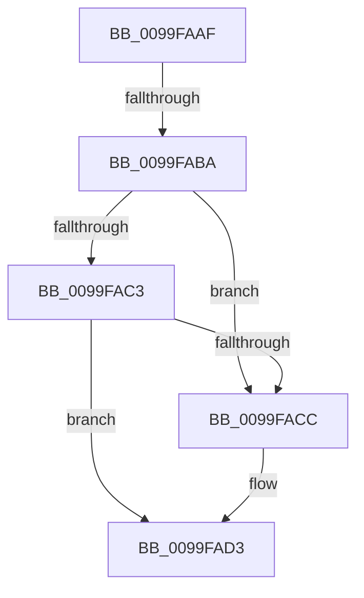

# sub_0099FAAF

- RVA: `0x0099FAAF`–`0x0099FB10` (길이 `97` bytes)
- VA: `0x000000014099FAAF`
- 실행 섹션: `PAGE`
- PDB 이름 있음: `아니요`; PDB Function 태그: `아니요`
- unwind 정보 RVA: `0x0009B238`
- 디코드: `24`개 명령, `97/97` bytes 표시
- 미해석 바이트: `0` (있으면 어셈블리에 `.byte`로 보존)

> 이 문서는 커널 이미지의 기계어와 PDB 기호를 분석해 생성했습니다. 4번과 5번은 함수 원형과 자료형을 바이너리 사용 방식에서 추정한 C 해석이며 원본 소스 복구 결과는 아닙니다.

## 1. Dependencies

- 직접 호출 지점: **2**; 고유 호출 대상: **2**
- 직접 호출자로 확인된 함수: **0**
- RIP 상대 이미지 참조: **3**

### Outgoing calls
- `0x0099FAFE` → [ExReleaseFastMutex](../../text/25/ExReleaseFastMutex_function_002519C0.md) (function, `0x002519C0`)
- `0x0099FB06` → [CmpUnlockKcb](../../pagecmrc/BC/CmpUnlockKcb_function_00BC92C0.md) (function, `0x00BC92C0`)

### Direct callers
- 이 함수 시작 RVA로 연결되는 직접 call은 확인되지 않았습니다. 간접 호출은 완전히 역산할 수 없습니다.

### Static image references
- `0x0099FAD3` → RVA `0x00EEFC30` (`.data`; read/write)
- `0x0099FAE0` → RVA `0x00FDA438` (`PAGEDATA`; read/write)
- `0x0099FAF7` → RVA `0x00EF5880` (`.data`; read)

## 2. Other-region calls and transfers

- 다른 실행 섹션으로 향하는 call: **2**
  - `0x0099FAFE` → [ExReleaseFastMutex](../../text/25/ExReleaseFastMutex_function_002519C0.md) (`PAGE` → `.text`)
  - `0x0099FB06` → [CmpUnlockKcb](../../pagecmrc/BC/CmpUnlockKcb_function_00BC92C0.md) (`PAGE` → `PAGECMRC`)
- call이 아닌 외부 분기/꼬리 이동: **2**
  - `0x0099FAB8` → [sub_0099FB22](Unknown_function_0099FB22.md) (`tail-transfer`)
  - `0x0099FB0B` → [CmpReferenceKeyControlBlockLockNotHeld + 0x26](CmpReferenceKeyControlBlockLockNotHeld_function_0099F9A0.md) (`tail-transfer`)

## 3. Assembly (complete function range)

```asm
0099FAAF  48 8D 8B E0 00 00 00            lea rcx, [rbx + 0xe0]
0099FAB6  A8 04                           test al, 4
0099FAB8  75 68                           jne 0x14099fb22
0099FABA  48 8B 11                        mov rdx, qword ptr [rcx]
0099FABD  48 39 4A 08                     cmp qword ptr [rdx + 8], rcx
0099FAC1  75 09                           jne 0x14099facc
0099FAC3  48 8B 41 08                     mov rax, qword ptr [rcx + 8]
0099FAC7  48 39 08                        cmp qword ptr [rax], rcx
0099FACA  74 07                           je 0x14099fad3
0099FACC  B9 03 00 00 00                  mov ecx, 3
0099FAD1  CD 29                           int 0x29
0099FAD3  FF 0D 57 01 55 00               dec dword ptr [rip + 0x550157]
0099FAD9  48 89 10                        mov qword ptr [rax], rdx
0099FADC  48 89 42 08                     mov qword ptr [rdx + 8], rax
0099FAE0  48 FF 0D 51 A9 63 00            dec qword ptr [rip + 0x63a951]
0099FAE7  48 89 49 08                     mov qword ptr [rcx + 8], rcx
0099FAEB  48 89 09                        mov qword ptr [rcx], rcx
0099FAEE  F0 83 0C 24 00                  lock or dword ptr [rsp], 0
0099FAF3  80 63 40 FD                     and byte ptr [rbx + 0x40], 0xfd
0099FAF7  48 8D 0D 82 5D 55 00            lea rcx, [rip + 0x555d82]
0099FAFE  E8 BD 1E 8B FF                  call 0x1402519c0
0099FB03  48 8B CB                        mov rcx, rbx
0099FB06  E8 B5 97 22 00                  call 0x140bc92c0
0099FB0B  E9 B6 FE FF FF                  jmp 0x14099f9c6
```

## 4. C-style interpretation (structured pseudocode)

```c
__int64 __fastcall sub_0099FAAF(void)
{
    __int64 result;
    unsigned int v_stack_p0;

    if ((*(unsigned __int64 *)(*(unsigned __int64 *)(v_rbx + 224) + 8)) != (v_rbx + 224)) goto loc_0099FACC;
    if ((*(unsigned __int64 *)(*(unsigned __int64 *)(v_rbx + 224 + 8))) != (v_rbx + 224)) {
        a1 = 3;
    }
    *(unsigned __int64 *)(*(unsigned __int64 *)(v_rbx + 224 + 8)) = *(unsigned __int64 *)(v_rbx + 224);
    *(unsigned __int64 *)(*(unsigned __int64 *)(v_rbx + 224) + 8) = *(unsigned __int64 *)(v_rbx + 224 + 8);
    *(unsigned __int64 *)(a1 + 8) = a1;
    *(unsigned __int64 *)(a1) = a1;
    result = ExReleaseFastMutex(v_rip + 5594498, *(unsigned __int64 *)(v_rbx + 224), a3, a4);
    result = CmpUnlockKcb(v_rbx, *(unsigned __int64 *)(v_rbx + 224), a3, a4);
}
```

## 5. (Beta) C Style

```c
void sub_0099FAAF(void)
{
    int64_t result;
    uint32_t v_stack_p0;

    if ((*(uint64_t *)(*(uint64_t *)(local_rbx + 0xE0) + 0x8)) != (local_rbx + 224)) goto loc_0099FACC;
    if ((*(uint64_t *)(*(uint64_t *)(local_rbx + 0xE0 + 0x8))) != (local_rbx + 224)) {
        a1 = 3;
    }
    *(uint64_t *)(*(uint64_t *)(local_rbx + 0xE0 + 0x8)) = *(uint64_t *)(local_rbx + 0xE0);
    *(uint64_t *)(*(uint64_t *)(local_rbx + 0xE0) + 0x8) = *(uint64_t *)(local_rbx + 0xE0 + 0x8);
    *(uint64_t *)(a1 + 0x8) = a1;
    *(uint64_t *)(a1) = a1;
    result = ExReleaseFastMutex(v_rip + 5594498, *(uint64_t *)(local_rbx + 0xE0), a3, a4);
    result = CmpUnlockKcb(local_rbx, *(uint64_t *)(local_rbx + 0xE0), a3, a4);
}
```

## 6. Execution-region graph

[열기: 2D/3D 그래프와 함수 탐색 컨트롤 패널](../../../control-panel.html?section=page&rva=0x0099FAAF&view=graph)

- 2D 그래프는 위에서 아래로 흐르고, 3D 그래프는 빈 공간을 드래그해 회전합니다. Shift+드래그는 이동, 휠은 확대·축소, 함수 노드 선택은 대상 보고서 이동입니다.

### Static fallback


