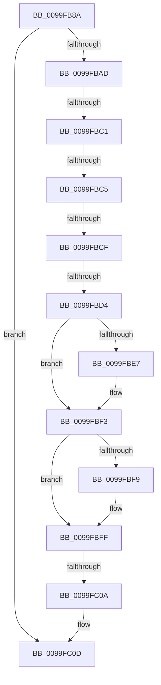

# sub_0099FB8A

- RVA: `0x0099FB8A`–`0x0099FC2F` (길이 `165` bytes)
- VA: `0x000000014099FB8A`
- 실행 섹션: `PAGE`
- PDB 이름 있음: `아니요`; PDB Function 태그: `아니요`
- unwind 정보 RVA: `0x0009B29C`
- 디코드: `49`개 명령, `165/165` bytes 표시
- 미해석 바이트: `0` (있으면 어셈블리에 `.byte`로 보존)

> 이 문서는 커널 이미지의 기계어와 PDB 기호를 분석해 생성했습니다. 4번과 5번은 함수 원형과 자료형을 바이너리 사용 방식에서 추정한 C 해석이며 원본 소스 복구 결과는 아닙니다.

## 1. Dependencies

- 직접 호출 지점: **0**; 고유 호출 대상: **0**
- 직접 호출자로 확인된 함수: **0**
- RIP 상대 이미지 참조: **0**

### Outgoing calls
- 직접 디코드된 call 명령이 없습니다.

### Direct callers
- 이 함수 시작 RVA로 연결되는 직접 call은 확인되지 않았습니다. 간접 호출은 완전히 역산할 수 없습니다.

### Static image references
- 디코드된 RIP-relative 메모리 참조가 없습니다.

## 2. Other-region calls and transfers

- 다른 실행 섹션으로 향하는 call: **0**
- call이 아닌 외부 분기/꼬리 이동: **5**
  - `0x0099FBBF` → [sub_0099FC35](Unknown_function_0099FC35.md) (`tail-transfer`)
  - `0x0099FBC3` → [sub_0099FC35](Unknown_function_0099FC35.md) (`tail-transfer`)
  - `0x0099FBCD` → [sub_0099FC35 + 0x18](Unknown_function_0099FC35.md) (`tail-transfer`)
  - `0x0099FBD2` → [sub_0099FC35 + 0xC](Unknown_function_0099FC35.md) (`tail-transfer`)
  - `0x0099FC08` → [sub_0099FC35 + 0x11](Unknown_function_0099FC35.md) (`tail-transfer`)

## 3. Assembly (complete function range)

```asm
0099FB8A  48 89 5C 24 20                  mov qword ptr [rsp + 0x20], rbx
0099FB8F  8B 59 54                        mov ebx, dword ptr [rcx + 0x54]
0099FB92  48 8B 0A                        mov rcx, qword ptr [rdx]
0099FB95  48 89 6C 24 30                  mov qword ptr [rsp + 0x30], rbp
0099FB9A  48 89 74 24 10                  mov qword ptr [rsp + 0x10], rsi
0099FB9F  48 89 7C 24 08                  mov qword ptr [rsp + 8], rdi
0099FBA4  4C 89 34 24                     mov qword ptr [rsp], r14
0099FBA8  45 85 C9                        test r9d, r9d
0099FBAB  74 60                           je 0x14099fc0d
0099FBAD  45 8B 73 24                     mov r14d, dword ptr [r11 + 0x24]
0099FBB1  40 32 ED                        xor bpl, bpl
0099FBB4  41 8B 7B 20                     mov edi, dword ptr [r11 + 0x20]
0099FBB8  45 89 10                        mov dword ptr [r8], r10d
0099FBBB  8B 31                           mov esi, dword ptr [rcx]
0099FBBD  3B F0                           cmp esi, eax
0099FBBF  76 74                           jbe 0x14099fc35
0099FBC1  3B F7                           cmp esi, edi
0099FBC3  73 70                           jae 0x14099fc35
0099FBC5  BF 01 00 00 00                  mov edi, 1
0099FBCA  45 85 F6                        test r14d, r14d
0099FBCD  75 7E                           jne 0x14099fc4d
0099FBCF  83 FB 04                        cmp ebx, 4
0099FBD2  76 6D                           jbe 0x14099fc41
0099FBD4  0F B6 69 04                     movzx ebp, byte ptr [rcx + 4]
0099FBD8  8B C5                           mov eax, ebp
0099FBDA  23 C7                           and eax, edi
0099FBDC  41 8B FA                        mov edi, r10d
0099FBDF  41 0F 95 C6                     setne r14b
0099FBE3  85 C0                           test eax, eax
0099FBE5  75 0C                           jne 0x14099fbf3
0099FBE7  41 C7 00 01 00 00 00            mov dword ptr [r8], 1
0099FBEE  BF 01 00 00 00                  mov edi, 1
0099FBF3  40 F6 C5 02                     test bpl, 2
0099FBF7  74 06                           je 0x14099fbff
0099FBF9  83 CF 04                        or edi, 4
0099FBFC  41 89 38                        mov dword ptr [r8], edi
0099FBFF  48 03 CB                        add rcx, rbx
0099FC02  41 FF C9                        dec r9d
0099FC05  45 84 F6                        test r14b, r14b
0099FC08  75 3C                           jne 0x14099fc46
0099FC0A  44 8B D6                        mov r10d, esi
0099FC0D  44 89 4A 08                     mov dword ptr [rdx + 8], r9d
0099FC11  48 89 0A                        mov qword ptr [rdx], rcx
0099FC14  4C 8B 34 24                     mov r14, qword ptr [rsp]
0099FC18  41 8B C2                        mov eax, r10d
0099FC1B  48 8B 7C 24 08                  mov rdi, qword ptr [rsp + 8]
0099FC20  48 8B 74 24 10                  mov rsi, qword ptr [rsp + 0x10]
0099FC25  48 8B 6C 24 30                  mov rbp, qword ptr [rsp + 0x30]
0099FC2A  48 8B 5C 24 20                  mov rbx, qword ptr [rsp + 0x20]
```

## 4. C-style interpretation (structured pseudocode)

```c
__int64 __fastcall sub_0099FB8A(__int64 a1, __int64 a2, __int64 a3, int a4, __int64 a5, __int64 a6)
{
    __int64 result;
    __int64 v_r14;
    __int64 v_rbp;
    __int64 v_rdi;
    unsigned __int64 v_stack_p0;
    unsigned __int64 v_stack_p10;
    unsigned __int64 v_stack_p20;
    unsigned __int64 v_stack_p30;
    unsigned __int64 v_stack_p8;

    v_stack_p20 = v_rbx;
    v_stack_p30 = v_rbp;
    v_stack_p10 = v_rsi;
    v_stack_p8 = v_rdi;
    v_stack_p0 = v_r14;
    if (a4 == 0) goto loc_0099FC0D;
    v_rbp = 0;
    *(unsigned int *)(a3) = (unsigned int)(v_r10);
    result = (unsigned int)(((unsigned int)((unsigned int)(*(unsigned __int8 *)(*(unsigned __int64 *)(a2) + 4)))) & (1));
    v_r14 = (condition_is_not_equal) ? 1 : 0;
    v_rdi = (unsigned int)((unsigned int)(v_r10));
    if ((unsigned int)(result) == 0) {
        *(unsigned int *)(a3) = 1;
        v_rdi = 1;
    }
    if ((((unsigned __int8)(*(unsigned __int8 *)(*(unsigned __int64 *)(a2) + 4))) & (2)) != 0) {
        v_rdi = (unsigned int)((v_rdi) | (4));
        *(unsigned int *)(a3) = (unsigned int)(v_rdi);
    }
    a1 = (*(unsigned __int64 *)(a2)) + ((unsigned int)(*(unsigned int *)(a1 + 84)));
    a4 = (unsigned int)((a4) - 1);
loc_0099FC0D:
    *(unsigned int *)(a2 + 8) = a4;
    *(unsigned __int64 *)(a2) = a1;
    return (unsigned int)((unsigned int)((unsigned int)((unsigned int)((unsigned int)(*(unsigned int *)(*(unsigned __int64 *)(a2)))))));
}
```

## 5. (Beta) C Style

```c
int64_t sub_0099FB8A(void *Arg1, void *Arg2, void *Arg3, int32_t Arg4, uint64_t Arg5, int64_t Arg6)
{
    uint8_t *arg1 = (uint8_t *)Arg1;
    uint8_t *arg2 = (uint8_t *)Arg2;
    uint8_t *arg3 = (uint8_t *)Arg3;

    int64_t result;
    int64_t local_r14;
    int64_t local_rbp;
    int64_t local_rdi;
    uint64_t v_stack_p0;
    uint64_t v_stack_p10;
    uint64_t v_stack_p20;
    uint64_t v_stack_p30;
    uint64_t v_stack_p8;

    v_stack_p20 = local_rbx;
    v_stack_p30 = local_rbp;
    v_stack_p10 = local_rsi;
    v_stack_p8 = local_rdi;
    v_stack_p0 = local_r14;
    if (Arg4 == 0) goto loc_0099FC0D;
    local_rbp = 0;
    *(uint32_t *)(arg3) = (uint32_t)(local_r10);
    result = (uint32_t)(((uint32_t)((uint32_t)(*(uint8_t *)(*(uint64_t *)(arg2) + 0x4)))) & (1));
    local_r14 = (condition_is_not_equal) ? 1 : 0;
    local_rdi = (uint32_t)((uint32_t)(local_r10));
    if ((uint32_t)(result) == 0) {
        *(uint32_t *)(arg3) = 1;
        local_rdi = 1;
    }
    if ((((uint8_t)(*(uint8_t *)(*(uint64_t *)(arg2) + 0x4))) & (2)) != 0) {
        local_rdi = (uint32_t)((local_rdi) | (4));
        *(uint32_t *)(arg3) = (uint32_t)(local_rdi);
    }
    Arg1 = (*(uint64_t *)(arg2)) + ((uint32_t)(*(uint32_t *)(arg1 + 0x54)));
    Arg4 = (uint32_t)((Arg4) - 1);
loc_0099FC0D:
    *(uint32_t *)(arg2 + 0x8) = Arg4;
    *(void **)(arg2) = Arg1;
    return (uint32_t)((uint32_t)((uint32_t)((uint32_t)((uint32_t)(*(uint32_t *)(*(uint64_t *)(arg2)))))));
}
```

### 관측된 메모리 오프셋

구조체 형식이 확인되지 않은 접근은 인자 기준의 오프셋으로만 기록했습니다.

| 기준 인자 | 오프셋 표현 | 폭 (bit) | 접근 |
|---|---:|---:|---|
| `Arg1` | `+ 0x54` | `32` | `R` |
| `Arg2` | `+ 0x0` | `64` | `R` |
| `Arg2` | `+ 0x0` | `64` | `W` |
| `Arg2` | `+ 0x8` | `32` | `W` |
| `Arg3` | `+ 0x0` | `32` | `W` |

## 6. Execution-region graph

[열기: 2D/3D 그래프와 함수 탐색 컨트롤 패널](../../../control-panel.html?section=page&rva=0x0099FB8A&view=graph)

- 2D 그래프는 위에서 아래로 흐르고, 3D 그래프는 빈 공간을 드래그해 회전합니다. Shift+드래그는 이동, 휠은 확대·축소, 함수 노드 선택은 대상 보고서 이동입니다.

### Static fallback


