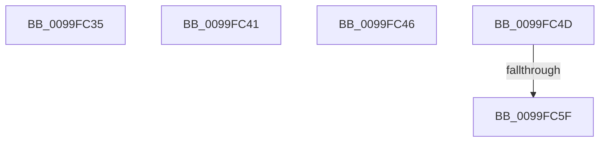

# sub_0099FC35

- RVA: `0x0099FC35`–`0x0099FC67` (길이 `50` bytes)
- VA: `0x000000014099FC35`
- 실행 섹션: `PAGE`
- PDB 이름 있음: `아니요`; PDB Function 태그: `아니요`
- unwind 정보 RVA: `0x0009B2D4`
- 디코드: `13`개 명령, `50/50` bytes 표시
- 미해석 바이트: `0` (있으면 어셈블리에 `.byte`로 보존)

> 이 문서는 커널 이미지의 기계어와 PDB 기호를 분석해 생성했습니다. 4번과 5번은 함수 원형과 자료형을 바이너리 사용 방식에서 추정한 C 해석이며 원본 소스 복구 결과는 아닙니다.

## 1. Dependencies

- 직접 호출 지점: **0**; 고유 호출 대상: **0**
- 직접 호출자로 확인된 함수: **0**
- RIP 상대 이미지 참조: **1**

### Outgoing calls
- 직접 디코드된 call 명령이 없습니다.

### Direct callers
- 이 함수 시작 RVA로 연결되는 직접 call은 확인되지 않았습니다. 간접 호출은 완전히 역산할 수 없습니다.

### Static image references
- `0x0099FC35` → RVA `0x00E2D828` (`.data`; write)

## 2. Other-region calls and transfers

- 다른 실행 섹션으로 향하는 call: **0**
- call이 아닌 외부 분기/꼬리 이동: **5**
  - `0x0099FC3F` → [sub_0099FB8A + 0x8A](Unknown_function_0099FB8A.md) (`tail-transfer`)
  - `0x0099FC44` → [sub_0099FB8A + 0x5D](Unknown_function_0099FB8A.md) (`tail-transfer`)
  - `0x0099FC48` → [sub_0099FB8A + 0x1E](Unknown_function_0099FB8A.md) (`tail-transfer`)
  - `0x0099FC59` → [sub_0099FB8A + 0x45](Unknown_function_0099FB8A.md) (`tail-transfer`)
  - `0x0099FC62` → [sub_0099FB8A + 0x45](Unknown_function_0099FB8A.md) (`tail-transfer`)

## 3. Assembly (complete function range)

```asm
0099FC35  C7 05 E9 DB 48 00 0E 00 00 00   mov dword ptr [rip + 0x48dbe9], 0xe
0099FC3F  EB D3                           jmp 0x14099fc14
0099FC41  45 32 F6                        xor r14b, r14b
0099FC44  EB A1                           jmp 0x14099fbe7
0099FC46  8B C6                           mov eax, esi
0099FC48  E9 5B FF FF FF                  jmp 0x14099fba8
0099FC4D  41 8B FE                        mov edi, r14d
0099FC50  F7 D7                           not edi
0099FC52  83 E7 01                        and edi, 1
0099FC55  41 F6 C6 02                     test r14b, 2
0099FC59  0F 84 70 FF FF FF               je 0x14099fbcf
0099FC5F  83 CF 02                        or edi, 2
0099FC62  E9 68 FF FF FF                  jmp 0x14099fbcf
```

## 4. C-style interpretation (structured pseudocode)

```c
__int64 __fastcall sub_0099FC35(void)
{
    *(unsigned int *)(v_rip + 4774889) = 14;
}
```

## 5. (Beta) C Style

```c
void sub_0099FC35(void)
{
    *(uint32_t *)(v_rip + 0x48DBE9) = 14;
}
```

## 6. Execution-region graph

[열기: 2D/3D 그래프와 함수 탐색 컨트롤 패널](../../../control-panel.html?section=page&rva=0x0099FC35&view=graph)

- 2D 그래프는 위에서 아래로 흐르고, 3D 그래프는 빈 공간을 드래그해 회전합니다. Shift+드래그는 이동, 휠은 확대·축소, 함수 노드 선택은 대상 보고서 이동입니다.

### Static fallback


