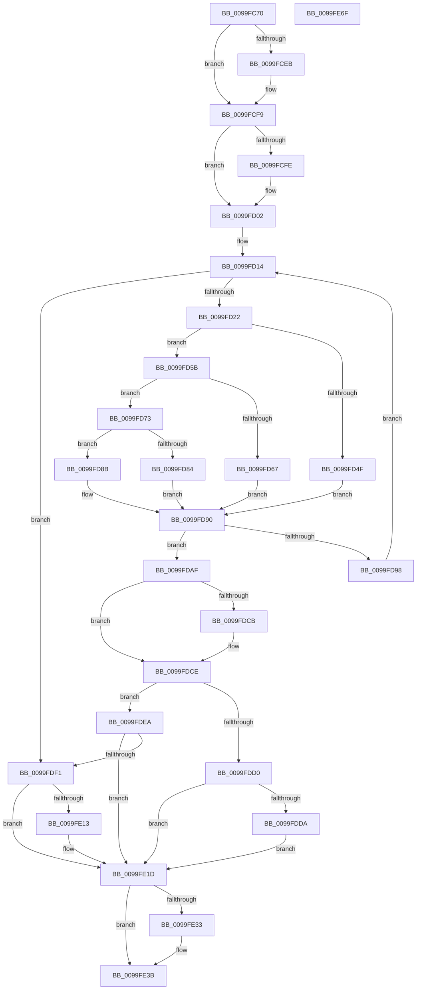

# sub_0099FC70

- RVA: `0x0099FC70`–`0x0099FE70` (길이 `512` bytes)
- VA: `0x000000014099FC70`
- 실행 섹션: `PAGE`
- PDB 이름 있음: `아니요`; PDB Function 태그: `아니요`
- unwind 정보 RVA: `0x0009B2F8`
- 디코드: `146`개 명령, `512/512` bytes 표시
- 미해석 바이트: `0` (있으면 어셈블리에 `.byte`로 보존)

> 이 문서는 커널 이미지의 기계어와 PDB 기호를 분석해 생성했습니다. 4번과 5번은 함수 원형과 자료형을 바이너리 사용 방식에서 추정한 C 해석이며 원본 소스 복구 결과는 아닙니다.

## 1. Dependencies

- 직접 호출 지점: **15**; 고유 호출 대상: **13**
- 직접 호출자로 확인된 함수: **1**
- RIP 상대 이미지 참조: **4**

### Outgoing calls
- `0x0099FCDA` → [KeAbPreAcquire](../../text/21/KeAbPreAcquire_function_00210230.md) (function, `0x00210230`)
- `0x0099FCF4` → [ExfAcquirePushLockExclusiveEx](../../text/20/ExfAcquirePushLockExclusiveEx_function_0020FC90.md) (function, `0x0020FC90`)
- `0x0099FD54` → [sub_008D3ED0](../8D/Unknown_function_008D3ED0.md) (function, `0x008D3ED0`)
- `0x0099FD6C` → [sub_008D3F00](../8D/Unknown_function_008D3F00.md) (function, `0x008D3F00`)
- `0x0099FD84` → [sub_008D3F30](../8D/Unknown_function_008D3F30.md) (function, `0x008D3F30`)
- `0x0099FD8B` → [guard_dispatch_icall](../../text/6B/guard_dispatch_icall_function_006BAAD0.md) (function, `0x006BAAD0`)
- `0x0099FDC0` → [sub_009A08EC](../9A/Unknown_function_009A08EC.md) (function, `0x009A08EC`)
- `0x0099FDDD` → [sub_009A08EC](../9A/Unknown_function_009A08EC.md) (function, `0x009A08EC`)
- `0x0099FE08` → [sub_008D0970](../8D/Unknown_function_008D0970.md) (function, `0x008D0970`)
- `0x0099FE16` → [sub_009A08EC](../9A/Unknown_function_009A08EC.md) (function, `0x009A08EC`)
- `0x0099FE20` → [sub_009A0698](../9A/Unknown_function_009A0698.md) (function, `0x009A0698`)
- `0x0099FE36` → [ExfTryToWakePushLock](../../text/26/ExfTryToWakePushLock_function_00265DD0.md) (function, `0x00265DD0`)
- `0x0099FE3E` → [KeAbPostRelease](../../text/2E/KeAbPostRelease_function_002E1600.md) (function, `0x002E1600`)
- `0x0099FE43` → [KeLeaveGuardedRegion](../../text/2E/KeLeaveGuardedRegion_function_002E2C40.md) (function, `0x002E2C40`)
- `0x0099FE52` → [_security_check_cookie](../../text/6A/_security_check_cookie_function_006AC640.md) (function, `0x006AC640`)

### Direct callers
- [sub_009A03AC](../9A/Unknown_function_009A03AC.md) at `0x009A04F4`

### Static image references
- `0x0099FC84` → RVA `0x00E0A740` (`.data`; read)
- `0x0099FD43` → RVA `0x008D3ED0` (`PAGE`; read)
- `0x0099FD5B` → RVA `0x008D3F00` (`PAGE`; read)
- `0x0099FD73` → RVA `0x008D3F30` (`PAGE`; read)

## 2. Other-region calls and transfers

- 다른 실행 섹션으로 향하는 call: **7**
  - `0x0099FCDA` → [KeAbPreAcquire](../../text/21/KeAbPreAcquire_function_00210230.md) (`PAGE` → `.text`)
  - `0x0099FCF4` → [ExfAcquirePushLockExclusiveEx](../../text/20/ExfAcquirePushLockExclusiveEx_function_0020FC90.md) (`PAGE` → `.text`)
  - `0x0099FD8B` → [guard_dispatch_icall](../../text/6B/guard_dispatch_icall_function_006BAAD0.md) (`PAGE` → `.text`)
  - `0x0099FE36` → [ExfTryToWakePushLock](../../text/26/ExfTryToWakePushLock_function_00265DD0.md) (`PAGE` → `.text`)
  - `0x0099FE3E` → [KeAbPostRelease](../../text/2E/KeAbPostRelease_function_002E1600.md) (`PAGE` → `.text`)
  - `0x0099FE43` → [KeLeaveGuardedRegion](../../text/2E/KeLeaveGuardedRegion_function_002E2C40.md) (`PAGE` → `.text`)
  - `0x0099FE52` → [_security_check_cookie](../../text/6A/_security_check_cookie_function_006AC640.md) (`PAGE` → `.text`)
- 별도 외부 분기/꼬리 이동을 확인하지 못했습니다.

## 3. Assembly (complete function range)

```asm
0099FC70  48 89 5C 24 20                  mov qword ptr [rsp + 0x20], rbx
0099FC75  55                              push rbp
0099FC76  56                              push rsi
0099FC77  57                              push rdi
0099FC78  41 54                           push r12
0099FC7A  41 55                           push r13
0099FC7C  41 56                           push r14
0099FC7E  41 57                           push r15
0099FC80  48 83 EC 60                     sub rsp, 0x60
0099FC84  48 8B 05 B5 AA 46 00            mov rax, qword ptr [rip + 0x46aab5]
0099FC8B  48 33 C4                        xor rax, rsp
0099FC8E  48 89 44 24 50                  mov qword ptr [rsp + 0x50], rax
0099FC93  8B 42 18                        mov eax, dword ptr [rdx + 0x18]
0099FC96  48 8D A9 B0 00 00 00            lea rbp, [rcx + 0xb0]
0099FC9D  89 44 24 48                     mov dword ptr [rsp + 0x48], eax
0099FCA1  4C 8B EA                        mov r13, rdx
0099FCA4  48 8B 42 20                     mov rax, qword ptr [rdx + 0x20]
0099FCA8  4C 8B F9                        mov r15, rcx
0099FCAB  48 89 44 24 40                  mov qword ptr [rsp + 0x40], rax
0099FCB0  45 33 F6                        xor r14d, r14d
0099FCB3  44 21 74 24 4C                  and dword ptr [rsp + 0x4c], r14d
0099FCB8  48 83 CB FF                     or rbx, 0xffffffffffffffff
0099FCBC  65 48 8B 04 25 88 01 00 00      mov rax, qword ptr gs:[0x188]
0099FCC5  33 D2                           xor edx, edx
0099FCC7  4C 89 44 24 30                  mov qword ptr [rsp + 0x30], r8
0099FCCC  48 8B CD                        mov rcx, rbp
0099FCCF  45 33 C0                        xor r8d, r8d
0099FCD2  66 01 98 E6 01 00 00            add word ptr [rax + 0x1e6], bx
0099FCD9  90                              nop
0099FCDA  E8 51 05 87 FF                  call 0x140210230
0099FCDF  F0 48 0F BA 6D 00 00            lock bts qword ptr [rbp], 0
0099FCE6  48 8B F8                        mov rdi, rax
0099FCE9  73 0E                           jae 0x14099fcf9
0099FCEB  4C 8B C5                        mov r8, rbp
0099FCEE  48 8B D0                        mov rdx, rax
0099FCF1  48 8B CD                        mov rcx, rbp
0099FCF4  E8 97 FF 86 FF                  call 0x14020fc90
0099FCF9  48 85 FF                        test rdi, rdi
0099FCFC  74 04                           je 0x14099fd02
0099FCFE  C6 47 0A 01                     mov byte ptr [rdi + 0xa], 1
0099FD02  49 81 C7 88 00 00 00            add r15, 0x88
0099FD09  45 33 E4                        xor r12d, r12d
0099FD0C  41 8B 7F 04                     mov edi, dword ptr [r15 + 4]
0099FD10  FF CF                           dec edi
0099FD12  33 F6                           xor esi, esi
0099FD14  B9 02 00 00 00                  mov ecx, 2
0099FD19  44 3B E7                        cmp r12d, edi
0099FD1C  0F 8F CF 00 00 00               jg 0x14099fdf1
0099FD22  42 8D 04 27                     lea eax, [rdi + r12]
0099FD26  41 B8 10 00 00 00               mov r8d, 0x10
0099FD2C  99                              cdq
0099FD2D  F7 F9                           idiv ecx
0099FD2F  49 8B 4F 10                     mov rcx, qword ptr [r15 + 0x10]
0099FD33  8B F0                           mov esi, eax
0099FD35  49 8B 47 20                     mov rax, qword ptr [r15 + 0x20]
0099FD39  8B D6                           mov edx, esi
0099FD3B  41 0F AF 17                     imul edx, dword ptr [r15]
0099FD3F  48 8B 0C 0A                     mov rcx, qword ptr [rdx + rcx]
0099FD43  48 8D 15 86 41 F3 FF            lea rdx, [rip - 0xcbe7a]
0099FD4A  48 3B C2                        cmp rax, rdx
0099FD4D  75 0C                           jne 0x14099fd5b
0099FD4F  48 8D 54 24 40                  lea rdx, [rsp + 0x40]
0099FD54  E8 77 41 F3 FF                  call 0x1408d3ed0
0099FD59  EB 35                           jmp 0x14099fd90
0099FD5B  48 8D 15 9E 41 F3 FF            lea rdx, [rip - 0xcbe62]
0099FD62  48 3B C2                        cmp rax, rdx
0099FD65  75 0C                           jne 0x14099fd73
0099FD67  48 8D 54 24 40                  lea rdx, [rsp + 0x40]
0099FD6C  E8 8F 41 F3 FF                  call 0x1408d3f00
0099FD71  EB 1D                           jmp 0x14099fd90
0099FD73  48 8D 15 B6 41 F3 FF            lea rdx, [rip - 0xcbe4a]
0099FD7A  48 3B C2                        cmp rax, rdx
0099FD7D  48 8D 54 24 40                  lea rdx, [rsp + 0x40]
0099FD82  75 07                           jne 0x14099fd8b
0099FD84  E8 A7 41 F3 FF                  call 0x1408d3f30
0099FD89  EB 05                           jmp 0x14099fd90
0099FD8B  E8 40 AD D1 FF                  call 0x1406baad0
0099FD90  48 8B D0                        mov rdx, rax
0099FD93  48 85 C0                        test rax, rax
0099FD96  74 17                           je 0x14099fdaf
0099FD98  8D 46 FF                        lea eax, [rsi - 1]
0099FD9B  8D 4E 01                        lea ecx, [rsi + 1]
0099FD9E  0F 49 C7                        cmovns eax, edi
0099FDA1  8B F8                           mov edi, eax
0099FDA3  44 0F 49 E1                     cmovns r12d, ecx
0099FDA7  0F 49 F1                        cmovns esi, ecx
0099FDAA  E9 65 FF FF FF                  jmp 0x14099fd14
0099FDAF  49 8B 47 10                     mov rax, qword ptr [r15 + 0x10]
0099FDB3  8B CE                           mov ecx, esi
0099FDB5  41 0F AF 0F                     imul ecx, dword ptr [r15]
0099FDB9  48 8B 14 01                     mov rdx, qword ptr [rcx + rax]
0099FDBD  48 8B CA                        mov rcx, rdx
0099FDC0  E8 27 0B 00 00                  call 0x1409a08ec
0099FDC5  8B F8                           mov edi, eax
0099FDC7  85 C0                           test eax, eax
0099FDC9  78 03                           js 0x14099fdce
0099FDCB  4C 8B F2                        mov r14, rdx
0099FDCE  75 1A                           jne 0x14099fdea
0099FDD0  48 8B 54 24 30                  mov rdx, qword ptr [rsp + 0x30]
0099FDD5  48 85 D2                        test rdx, rdx
0099FDD8  74 43                           je 0x14099fe1d
0099FDDA  49 8B CE                        mov rcx, r14
0099FDDD  E8 0A 0B 00 00                  call 0x1409a08ec
0099FDE2  4C 89 32                        mov qword ptr [rdx], r14
0099FDE5  45 33 F6                        xor r14d, r14d
0099FDE8  EB 33                           jmp 0x14099fe1d
0099FDEA  3D 72 02 00 C0                  cmp eax, 0xc0000272
0099FDEF  75 2C                           jne 0x14099fe1d
0099FDF1  89 74 24 28                     mov dword ptr [rsp + 0x28], esi
0099FDF5  4C 8D 4C 24 40                  lea r9, [rsp + 0x40]
0099FDFA  49 8B D5                        mov rdx, r13
0099FDFD  C7 44 24 20 10 00 00 00         mov dword ptr [rsp + 0x20], 0x10
0099FE05  49 8B CF                        mov rcx, r15
0099FE08  E8 63 0B F3 FF                  call 0x1408d0970
0099FE0D  8B F8                           mov edi, eax
0099FE0F  85 C0                           test eax, eax
0099FE11  78 0A                           js 0x14099fe1d
0099FE13  49 8B CD                        mov rcx, r13
0099FE16  E8 D1 0A 00 00                  call 0x1409a08ec
0099FE1B  8B F8                           mov edi, eax
0099FE1D  49 8B CE                        mov rcx, r14
0099FE20  E8 73 08 00 00                  call 0x1409a0698
0099FE25  F0 48 0F C1 5D 00               lock xadd qword ptr [rbp], rbx
0099FE2B  80 E3 06                        and bl, 6
0099FE2E  80 FB 02                        cmp bl, 2
0099FE31  75 08                           jne 0x14099fe3b
0099FE33  48 8B CD                        mov rcx, rbp
0099FE36  E8 95 5F 8C FF                  call 0x140265dd0
0099FE3B  48 8B CD                        mov rcx, rbp
0099FE3E  E8 BD 17 94 FF                  call 0x1402e1600
0099FE43  E8 F8 2D 94 FF                  call 0x1402e2c40
0099FE48  8B C7                           mov eax, edi
0099FE4A  48 8B 4C 24 50                  mov rcx, qword ptr [rsp + 0x50]
0099FE4F  48 33 CC                        xor rcx, rsp
0099FE52  E8 E9 C7 D0 FF                  call 0x1406ac640
0099FE57  48 8B 9C 24 B8 00 00 00         mov rbx, qword ptr [rsp + 0xb8]
0099FE5F  48 83 C4 60                     add rsp, 0x60
0099FE63  41 5F                           pop r15
0099FE65  41 5E                           pop r14
0099FE67  41 5D                           pop r13
0099FE69  41 5C                           pop r12
0099FE6B  5F                              pop rdi
0099FE6C  5E                              pop rsi
0099FE6D  5D                              pop rbp
0099FE6E  C3                              ret
0099FE6F  CC                              int3
```

## 4. C-style interpretation (structured pseudocode)

```c
__int64 __fastcall sub_0099FC70(__int64 a1, __int64 a2, __int64 a3)
{
    __int64 result;
    __int64 v_r12;
    __int64 v_r14;
    __int64 v_r15;
    __int64 v_rbx;
    __int64 v_rdi;
    __int64 v_rsi;
    __int64 v_rsp;
    unsigned __int64 v_stack_m48;
    unsigned int v_stack_m4C;
    unsigned int v_stack_m50;
    unsigned __int64 v_stack_m58;
    unsigned __int64 v_stack_m68;
    unsigned int v_stack_m70;
    unsigned int v_stack_m78;
    unsigned __int64 v_stack_p20;

    v_stack_p20 = v_rbx;
    v_rsp = (v_rsp) - (96);
    result = (*(unsigned __int64 *)(v_rip + 4631221)) ^ (v_rsp);
    v_stack_m48 = result;
    v_stack_m50 = (unsigned int)((unsigned int)(*(unsigned int *)(a2 + 24)));
    v_stack_m58 = *(unsigned __int64 *)(a2 + 32);
    v_r14 = 0;
    v_rbx = (v_rbx) | (-1);
    a2 = 0;
    v_stack_m68 = a3;
    a3 = 0;
    result = KeAbPreAcquire(a1 + 176, a2, a3, a4);
    if (!(condition_is_above_or_equal)) {
        a3 = a1 + 176;
        a2 = result;
        a1 = a1 + 176;
        result = ExfAcquirePushLockExclusiveEx(a1, a2, a3, a4);
    }
    if (result != 0) {
        *(unsigned __int8 *)(result + 10) = 1;
    }
    v_r15 = (a1) + (136);
    v_r12 = 0;
    v_rdi = (unsigned int)(((unsigned int)(*(unsigned int *)(v_r15 + 4))) - 1);
    v_rsi = 0;
loc_0099FD14:
    if (0 > ((unsigned int)(v_rdi))) goto loc_0099FDF1;
    a2 = (unsigned int)(((unsigned int)((unsigned int)((unsigned int)((unsigned int)(v_rdi + v_r12 * 1))))) * (*(unsigned int *)(v_r15)));
    if ((*(unsigned __int64 *)(v_r15 + 32)) != (v_rip - 835194)) goto loc_0099FD5B;
    result = sub_008D3ED0(*(unsigned __int64 *)(a2 + *(unsigned __int64 *)(v_r15 + 16) * 1), v_stack_m58, 16, a4);
    goto loc_0099FD90;
loc_0099FD5B:
    if (result != (v_rip - 835170)) goto loc_0099FD73;
    result = sub_008D3F00(*(unsigned __int64 *)(a2 + *(unsigned __int64 *)(v_r15 + 16) * 1), v_stack_m58, 16, a4);
    goto loc_0099FD90;
loc_0099FD73:
    if (result != (v_rip - 835146)) goto loc_0099FD8B;
    result = sub_008D3F30(*(unsigned __int64 *)(a2 + *(unsigned __int64 *)(v_r15 + 16) * 1), v_stack_m58, 16, a4);
    goto loc_0099FD90;
loc_0099FD8B:
    result = guard_dispatch_icall(*(unsigned __int64 *)(a2 + *(unsigned __int64 *)(v_r15 + 16) * 1), v_stack_m58, 16, a4);
loc_0099FD90:
    if (result == 0) goto loc_0099FDAF;
    result = (unsigned int)((unsigned int)(v_rdi + v_r12 * 1)) - 1;
    if (!sign_flag) {
        result = (unsigned int)(v_rdi);
        v_r12 = (unsigned int)((unsigned int)((unsigned int)(v_rdi + v_r12 * 1)) + 1);
    }
    v_rsi = (unsigned int)((unsigned int)(v_rdi + v_r12 * 1));
    if (!sign_flag) { v_rsi = (unsigned int)((unsigned int)((unsigned int)(v_rdi + v_r12 * 1)) + 1); }
    goto loc_0099FD14;
loc_0099FDAF:
    a1 = (unsigned int)(((unsigned int)((unsigned int)(v_rsi))) * (*(unsigned int *)(v_r15)));
    result = sub_009A08EC(*(unsigned __int64 *)(a1 + *(unsigned __int64 *)(v_r15 + 16) * 1), *(unsigned __int64 *)(a1 + *(unsigned __int64 *)(v_r15 + 16) * 1), 16, a4);
    if (!(sign_flag)) {
        v_r14 = *(unsigned __int64 *)(a1 + *(unsigned __int64 *)(v_r15 + 16) * 1);
    }
    if ((unsigned int)(result) != 0) goto loc_0099FDEA;
    if (v_stack_m68 == 0) goto loc_0099FE1D;
    result = sub_009A08EC(v_r14, v_stack_m68, 16, a4);
    *(unsigned __int64 *)(v_stack_m68) = v_r14;
    v_r14 = 0;
    goto loc_0099FE1D;
loc_0099FDEA:
    if (((unsigned int)(result)) != 0xC0000272ULL) goto loc_0099FE1D;
loc_0099FDF1:
    v_stack_m70 = (unsigned int)(v_rsi);
    v_stack_m78 = 16;
    result = sub_008D0970(v_r15, a2, 16, v_stack_m58);
    v_rdi = (unsigned int)((unsigned int)(result));
    if (!(sign_flag)) {
        a1 = a2;
        result = sub_009A08EC(a1, a2, 16, v_stack_m58);
        v_rdi = (unsigned int)(result);
    }
    result = sub_009A0698(0, a2, 16, v_stack_m58);
    v_rbx = (unsigned __int8)((v_rbx) & (6));
    if (((unsigned __int8)(v_rbx)) == 2) {
        a1 = a1 + 176;
        result = ExfTryToWakePushLock(a1, a2, 16, v_stack_m58);
    }
    result = KeAbPostRelease(a1 + 176, a2, 16, v_stack_m58);
    result = KeLeaveGuardedRegion(a1 + 176, a2, 16, v_stack_m58);
    a1 = (v_stack_m48) ^ (v_rsp);
    result = _security_check_cookie(a1, a2, 16, v_stack_m58);
    v_rsp = (v_rsp) + (96);
    return result;
}
```

## 5. (Beta) C Style

```c
int64_t sub_0099FC70(void *Arg1, void *Arg2, int64_t Arg3)
{
    uint8_t *arg1 = (uint8_t *)Arg1;
    uint8_t *arg2 = (uint8_t *)Arg2;

    int64_t result;
    int64_t local_r12;
    int64_t local_r14;
    int64_t local_r15;
    int64_t local_rbx;
    int64_t local_rdi;
    int64_t local_rsi;
    int64_t local_rsp;
    uint64_t v_stack_m48;
    uint32_t v_stack_m4C;
    uint32_t v_stack_m50;
    uint64_t v_stack_m58;
    uint64_t v_stack_m68;
    uint32_t v_stack_m70;
    uint32_t v_stack_m78;
    uint64_t v_stack_p20;

    v_stack_p20 = local_rbx;
    local_rsp = (local_rsp) - (96);
    result = (*(uint64_t *)(v_rip + 0x46AAB5)) ^ (local_rsp);
    v_stack_m48 = result;
    v_stack_m50 = (uint32_t)((uint32_t)(*(uint32_t *)(arg2 + 0x18)));
    v_stack_m58 = *(uint64_t *)(arg2 + 0x20);
    local_r14 = 0;
    local_rbx = (local_rbx) | (-1);
    Arg2 = 0;
    v_stack_m68 = Arg3;
    Arg3 = 0;
    result = KeAbPreAcquire(Arg1 + 176, Arg2, Arg3, a4);
    if (!(condition_is_above_or_equal)) {
        Arg3 = Arg1 + 176;
        Arg2 = result;
        Arg1 = Arg1 + 176;
        result = ExfAcquirePushLockExclusiveEx(Arg1, Arg2, Arg3, a4);
    }
    if (result != 0) {
        *(uint8_t *)(result + 0xA) = 1;
    }
    local_r15 = (Arg1) + (136);
    local_r12 = 0;
    local_rdi = (uint32_t)(((uint32_t)(*(uint32_t *)(local_r15 + 0x4))) - 1);
    local_rsi = 0;
loc_0099FD14:
    if (0 > ((uint32_t)(local_rdi))) goto loc_0099FDF1;
    Arg2 = (uint32_t)(((uint32_t)((uint32_t)((uint32_t)((uint32_t)(local_rdi + local_r12 * 1))))) * (*(uint32_t *)(local_r15)));
    if ((*(uint64_t *)(local_r15 + 0x20)) != (v_rip - 835194)) goto loc_0099FD5B;
    result = sub_008D3ED0(*(uint64_t *)(arg2 + *(uint64_t *)(local_r15 + 0x10) * 1), v_stack_m58, 16, a4);
    goto loc_0099FD90;
loc_0099FD5B:
    if (result != (v_rip - 835170)) goto loc_0099FD73;
    result = sub_008D3F00(*(uint64_t *)(arg2 + *(uint64_t *)(local_r15 + 0x10) * 1), v_stack_m58, 16, a4);
    goto loc_0099FD90;
loc_0099FD73:
    if (result != (v_rip - 835146)) goto loc_0099FD8B;
    result = sub_008D3F30(*(uint64_t *)(arg2 + *(uint64_t *)(local_r15 + 0x10) * 1), v_stack_m58, 16, a4);
    goto loc_0099FD90;
loc_0099FD8B:
    result = guard_dispatch_icall(*(uint64_t *)(arg2 + *(uint64_t *)(local_r15 + 0x10) * 1), v_stack_m58, 16, a4);
loc_0099FD90:
    if (result == 0) goto loc_0099FDAF;
    result = (uint32_t)((uint32_t)(local_rdi + local_r12 * 1)) - 1;
    if (!sign_flag) {
        result = (uint32_t)(local_rdi);
        local_r12 = (uint32_t)((uint32_t)((uint32_t)(local_rdi + local_r12 * 1)) + 1);
    }
    local_rsi = (uint32_t)((uint32_t)(local_rdi + local_r12 * 1));
    if (!sign_flag) { local_rsi = (uint32_t)((uint32_t)((uint32_t)(local_rdi + local_r12 * 1)) + 1); }
    goto loc_0099FD14;
loc_0099FDAF:
    Arg1 = (uint32_t)(((uint32_t)((uint32_t)(local_rsi))) * (*(uint32_t *)(local_r15)));
    result = sub_009A08EC(*(uint64_t *)(arg1 + *(uint64_t *)(local_r15 + 0x10) * 1), *(uint64_t *)(arg1 + *(uint64_t *)(local_r15 + 0x10) * 1), 16, a4);
    if (!(sign_flag)) {
        local_r14 = *(uint64_t *)(arg1 + *(uint64_t *)(local_r15 + 0x10) * 1);
    }
    if ((uint32_t)(result) != 0) goto loc_0099FDEA;
    if (v_stack_m68 == 0) goto loc_0099FE1D;
    result = sub_009A08EC(local_r14, v_stack_m68, 16, a4);
    *(uint64_t *)(v_stack_m68) = local_r14;
    local_r14 = 0;
    goto loc_0099FE1D;
loc_0099FDEA:
    if (((uint32_t)(result)) != 0xC0000272ULL) goto loc_0099FE1D;
loc_0099FDF1:
    v_stack_m70 = (uint32_t)(local_rsi);
    v_stack_m78 = 16;
    result = sub_008D0970(local_r15, Arg2, 16, v_stack_m58);
    local_rdi = (uint32_t)((uint32_t)(result));
    if (!(sign_flag)) {
        Arg1 = Arg2;
        result = sub_009A08EC(Arg1, Arg2, 16, v_stack_m58);
        local_rdi = (uint32_t)(result);
    }
    result = sub_009A0698(0, Arg2, 16, v_stack_m58);
    local_rbx = (uint8_t)((local_rbx) & (6));
    if (((uint8_t)(local_rbx)) == 2) {
        Arg1 = Arg1 + 176;
        result = ExfTryToWakePushLock(Arg1, Arg2, 16, v_stack_m58);
    }
    result = KeAbPostRelease(Arg1 + 176, Arg2, 16, v_stack_m58);
    result = KeLeaveGuardedRegion(Arg1 + 176, Arg2, 16, v_stack_m58);
    Arg1 = (v_stack_m48) ^ (local_rsp);
    result = _security_check_cookie(Arg1, Arg2, 16, v_stack_m58);
    local_rsp = (local_rsp) + (96);
    return result;
}
```

### 관측된 메모리 오프셋

구조체 형식이 확인되지 않은 접근은 인자 기준의 오프셋으로만 기록했습니다.

| 기준 인자 | 오프셋 표현 | 폭 (bit) | 접근 |
|---|---:|---:|---|
| `Arg1` | `+ 0x0` | `32` | `R` |
| `Arg1` | `+ 0x0` | `64` | `R/W` |
| `Arg1` | `+ 0x4` | `32` | `R` |
| `Arg1` | `+ 0x10` | `64` | `R` |
| `Arg1` | `+ 0x20` | `64` | `R` |
| `Arg1` | `+ 0xB0` | `64` | `R` |
| `Arg2` | `+ 0x18` | `32` | `R` |
| `Arg2` | `+ 0x20` | `64` | `R` |

## 6. Execution-region graph

[열기: 2D/3D 그래프와 함수 탐색 컨트롤 패널](../../../control-panel.html?section=page&rva=0x0099FC70&view=graph)

- 2D 그래프는 위에서 아래로 흐르고, 3D 그래프는 빈 공간을 드래그해 회전합니다. Shift+드래그는 이동, 휠은 확대·축소, 함수 노드 선택은 대상 보고서 이동입니다.

### Static fallback


